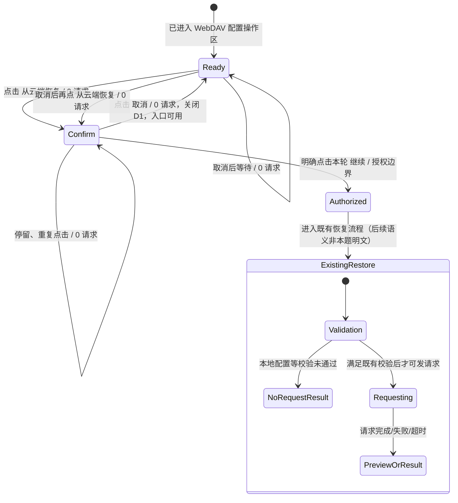

# vg-spec8 需求分析草稿（仅分析）

## 0. 范围、证据与状态

- 本轮派工：仅写本文件。未修改生产代码、测试、全局 workflow state/events；未运行构建、安装或设备操作。本文件不是运行时验收通过证据。
- 唯一需求正文：`spec/requirement.md`，SHA256 `256038a2336dce8956585ff92c18e7ec9e5cd79d736f7b7f56021dbf646af592`（已核对）。
- 元数据：`spec/metadata.json:2` 的 `base_commit` 为 `9cbcf7292c8cc46955dc3b522ddbda41c66a61d9`；文件 SHA256 `92a41fc04e0bb8ff18e0fce0e9324039fb369a4c879cffd2477c2e9b15e58c9c`（已核对）。本轮读取 HEAD 相同。
- 分析格式依据：`spec-harness/0-analyze.md:34-53`。其中基线构建、安装、实际操作要求（57、74 行）由主 Agent 另行协调；本派工禁止执行，故入口和行为结论一律是**只读代码证据，运行时未验证**。
- 原生环境实际读取：`CODEX_SESSION_ID=01a144eb-32eb-7cb3-b4d6-daea0ae599b7`；`CODEX_THREAD_ID=01a144ec-8fc2-7773-b6c4-d2cadea6ddf3`。不据此读取任何其他会话记录。
- 证据等级仅有 `SPEC_EXPLICIT`（原文明文）、`REASONABLE_DERIVATION`（为实现明文而合理推导）、`UNCONFIRMED_ASSUMPTION`（原文不能确定）。`CODE_EVIDENCE` 在下文只是证据类型，**不是第四种需求等级**，基线行为不能反向修改 Spec。
- 不推定官方 F-point 数量、权重或评分；A 编号用于本地追踪。

## 1. Spec 原文逐字证据索引

以下句子均逐字摘录，不把基线文案当作需求文案。

| 引用 | 来源 | 原文 |
| --- | --- | --- |
| Q1 | `spec/requirement.md:7`，场景一概述 | 用户点击「从云端恢复」打开第一层确认弹窗后，如果点击「取消」，弹窗必须关闭，页面回到 WebDAV 设置操作区。 |
| Q2 | `spec/requirement.md:11`，场景一步骤 1 | 1. 用户进入 WebDAV 配置页，并点击「从云端恢复」。 |
| Q3 | `spec/requirement.md:12`，场景一步骤 2 | 2. 页面显示恢复确认弹窗。 |
| Q4 | `spec/requirement.md:13`，场景一步骤 3 | 3. 用户点击「取消」。 |
| Q5 | `spec/requirement.md:14`，场景一步骤 4 | 4. 确认弹窗关闭，用户回到 WebDAV 配置页。 |
| Q6 | `spec/requirement.md:20`，场景二概述 | 取消恢复操作后，「从云端恢复」按钮仍须可用。用户应能再次点击该按钮，打开恢复确认弹窗。 |
| Q7 | `spec/requirement.md:24`，场景二步骤 1 | 1. 用户打开「从云端恢复」确认弹窗。 |
| Q8 | `spec/requirement.md:25`，场景二步骤 2 | 2. 用户点击「取消」关闭弹窗。 |
| Q9 | `spec/requirement.md:26`，场景二步骤 3 | 3. WebDAV 配置页仍显示可用的「从云端恢复」按钮。 |
| Q10 | `spec/requirement.md:27`，场景二步骤 4 | 4. 用户再次点击该按钮时，应用能够重新打开确认弹窗。 |
| Q11 | `spec/requirement.md:29`，场景三标题 | ## 场景三：反复取消仍不产生 WebDAV 请求 |
| Q12 | `spec/requirement.md:33`，场景三概述 | 用户取消恢复后再次打开确认弹窗，只要没有明确点击「继续」，应用仍不得向 WebDAV 服务端发送请求。 |
| Q13 | `spec/requirement.md:37`，场景三步骤 1 | 1. 用户点击「从云端恢复」打开确认弹窗。 |
| Q14 | `spec/requirement.md:38`，场景三步骤 2 | 2. 用户点击「取消」关闭弹窗。 |
| Q15 | `spec/requirement.md:39`，场景三步骤 3 | 3. 用户再次点击「从云端恢复」打开确认弹窗。 |
| Q16 | `spec/requirement.md:40`，场景三步骤 4 | 4. 在用户未点击「继续」前，测试环境不应观察到任何 WebDAV 请求。 |

**明确文案**：`从云端恢复`、`取消`、`继续`。Spec 没有逐字规定第一层弹窗的标题、说明正文、取消后的 Toast/结果文本。`恢复确认弹窗`是原文行为描述，不能据此要求标题必须等于`恢复确认`。

## 2. 目标对象与基线对象必须分开

| 对象 | 目标含义 | 本题基线只读证据 | 对需求/测试的影响 |
| --- | --- | --- | --- |
| WebDAV 配置页/设置操作区 | Q1、Q2、Q5、Q9 指向既有 WebDAV 设置流程 | `entry/src/main/ets/pages/Index.ets:323` 调用 `router.pushUrl({ url: 'pages/SettingsPage' })`；`SettingsPage.ets:40` 定义 `sync` / `WebDAV 配置`；`:507-512` 点击分区改 `activeSectionId`；`:427-442` 渲染 `SettingsSyncSection` | 复用现有入口；这是同一 SettingsPage 内的分区，不应凭 Spec 用词新造一个路由。实际可达性未在设备验证。 |
| **第一层恢复确认 D1** | 打开恢复入口后、任何 WebDAV 请求之前，提供`取消`以及明确的`继续`授权 | `SettingsSyncSection.ets:164-165` 直接调用备份操作包装；`:199-200` 直接下载；目标文件中只有 `:215` 的一次 `showDialog`，没有`继续`按钮 | 第一层在已读路径缺失。必须独立验收 D1，不可用下载后的预览充当它。 |
| **下载后预览确认 D2** | 已下载、已预览后的覆盖确认，属于基线后续恢复流程 | `SettingsSyncSection.ets:200-208` 下载、预览；`:215-220` 才显示`⚠️ 恢复确认`，按钮`取消`/`确认恢复`；`:225-230` 取消/异常返回`已取消恢复`，确认时导入；外层`:155-156` finally 清理 busy | D2 的取消有正常返回/异常返回与 finally 清理路径，没有代码证据表明 Promise 必然悬挂。真正差距是 D1 缺失、下载早于其授权。D2 的取消语义或后续恢复成功不能列为本题明文验收。 |
| 请求 loading/busy | 已授权请求的进度与纯确认等待分开 | `SettingsSyncSection.ets:140-156` 先 `webdavBusy=true`，显示`正在处理...`，延迟 50 ms 后执行业务，finally 复位；`:507-516` 恢复按钮随 busy 显示`处理中...`、disabled | 应分析 D1 的打开状态与网络执行状态，不能让确认取消留下忙状态。具体状态字段/文案不是 Spec 明文。 |
| WebDAV 网络调用 | Q16 的`任何 WebDAV 请求`不只指下载 GET | `WebDavSyncManager.ets:471-491` 先配置校验、创建 client、远端预检，再下载；`webdav/WebDavBackupManager.ets:78-101` 有 HEAD、兼容路径 HEAD、本地快照和 GET；`webdav/WebDavClient.ets:109-146` 实际 HTTP 调用 | 计入预检、HEAD、GET、目录探测/创建、重试和重定向等向 WebDAV 服务端发出的请求，不能只拦截最终下载或只断言无 PUT。 |
| 自动同步 | 独立于本题点击路径的潜在请求源 | `EntryAbility.ets:49-54` 前台调用自动同步；`AutoWebDavSyncManager.ets:48-65` 读取开关/间隔并调用 `syncIncremental()`；`:73-75` 可能自动上传备份；`WebDavStateStore.ets:170-173` 缺省开关返回 true | 测量前置必须隔离该来源。Spec 没有明说应否全局暂停自动同步；见 U3。 |

表中简写 `SettingsPage.ets` 均指 `entry/src/main/ets/pages/SettingsPage.ets`；`SettingsSyncSection.ets` 指 `entry/src/main/ets/pages/settings/SettingsSyncSection.ets`；其余文件在列出的对应 `entry/src/main/ets/` 路径内。没有读取上游修复或外部参考实现。

## 3. 稳定选择器字典

以下是**建议契约**，不是声称已存在或本轮已添加。核心路径缺失项均标明“需在实现时补 `.id()`”。主 Agent/方案阶段可统一命名，名称变更应同步矩阵与测试。

| 代号 | 建议稳定 id | 基线实证与状态 |
| --- | --- | --- |
| S0 | `nav_settings_entry` | `pages/index/components/TopNavigation.ets:69-79` 齿轮点击容器无 `.id()`；需在实现时补 `.id()`。 |
| S1 | `settings_section_sync` | `SettingsPage.ets:487-517` 的 `item.id='sync'` 是数据/ForEach key，不是 UI `.id()`；需在实现时补 `.id()`。 |
| S2 | `webdav_config_panel` | `SettingsPage.ets:427-442` 与 `SettingsSyncSection` 操作区无稳定专用 id；需在实现时补 `.id()`。现有 `SettingsPage.ets:549` 是随主题 token 变化的 `settings_...` 根 id，不能替代分区标识。 |
| S3 | `webdav_restore_button` | `SettingsSyncSection.ets:507-516` 无 `.id()`；需在实现时补 `.id()`。使用 id 结合精确文本`从云端恢复`、enabled 断言，不能只检查 Button 存在。 |
| S4 | `webdav_restore_confirm_dialog` | 第一层 D1 在基线相关调用路径缺失；需在实现时补 `.id()`。 |
| S5 | `webdav_restore_confirm_cancel` | 第一层 D1 缺失；需在实现时补 `.id()`；文本精确`取消`并限定 D1，避免误选 D2 或本地导入弹窗。 |
| S6 | `webdav_restore_confirm_continue` | 基线恢复路径没有`继续`按钮；需在实现时补 `.id()`；精确文本`继续`用于授权动作。 |
| S7 | `webdav_restore_request_loading` | 基线仅以 `webdavBusy` 和多个`处理中...`按钮表达，`:143` 另有`正在处理...`；无专用 id，需在实现时补 `.id()`。具体进度呈现是否采用此组件由方案决定。 |
| S8 | `webdav_restore_result` | `SettingsSyncSection.ets:521-526` 为通用备份结果，未有专用 id；需在实现时补 `.id()`；非强制特定结果文案。 |
| S9 | `settings_header_back` | `SettingsPage.ets:464-467` 无 `.id()`；需在实现时补 `.id()`。 |
| S10 | `webdav_autosync_toggle` | `SettingsSyncSection.ets:380-382` 调用通用 toggle builder；无独立 id，需在实现时补 `.id()`，用于测试隔离设置。 |
| S11 | `webdav_endpoint_input`、`webdav_username_input`、`webdav_password_input`、`webdav_sync_password_input`、`webdav_root_input` | `SettingsSyncSection.ets:353-357` 为配置输入；相关通用 builder 未提供专用 id；边界测试若操作这些字段，需在实现时补 `.id()`。 |

原生系统 `promptAction.showDialog` 的按钮对象本身不是已可直接链式 `.id()` 的 ArkUI 组件。方案阶段应选择支持稳定标识的可访问弹窗实现，或提出并验证系统弹窗的等价稳定定位办法；不能声称给现有 `buttons` 配置随意加 `.id()` 就完成可观测性。D1、D2 都有`取消`的可能，必须用层级/弹窗标识区分。

## 4. 原子验收矩阵

### 4.1 约定

- P0（测试前置，不是新增产品需求）：从既有流程进入 WebDAV 配置操作区，等待初始化完成；准备独立可观测 WebDAV 服务端/代理；确保无既存请求/定时重试；自动同步关闭并完成持久化；不点击`测试连接`、`立即同步`、`立即备份`；服务器请求计数清零/记基点后再执行验收动作。网络窗口详见第 6 节。
- P1：P0 加已保存且满足基线校验的测试 endpoint、用户名、密码、同步密码。基线 `WebDavSyncManager.ets:160-169` 有非空和同步密码长度校验。使用有效配置是为了让错误实现真的能发请求，避免空地址使零请求断言虚假通过；**Spec 没有把有效配置写成先决条件**。
- P2：P1 加执行过一次“打开 D1 → 点击`取消` → D1 关闭”。
- N0：截至明确点击本轮 D1 的`继续`前，观测窗口中所有 WebDAV 请求增量为 0，所有方法/路径均计入，含延迟任务、预检、重试和重定向。禁止通过延迟到关闭弹窗以后发送来规避。
- 数据结果如写“无恢复导入/覆盖”属于合理推导，不能把缓存、配置读取、日志等所有本地写入一概禁止。
- 下列每项分成元数据表和八维表，两表用 A 编号严格对应。不适用均说明原因。

### 4.2 明文与直接行为 A1—A14

| 编号 | 来源与逐字原文 | 证据等级 | 原子行为与可观察结果 | 稳定选择器 |
| --- | --- | --- | --- | --- |
| A1 | 场景一步骤 1，Q2（11 行） | SPEC_EXPLICIT | 进入 WebDAV 配置页；可观察既有配置操作区和恢复入口。主页到配置页的具体导航实现来自代码，不来自 Spec。 | S0、S1、S2、S3；均需在实现时补 `.id()`。 |
| A2 | 场景一步骤 1—2，Q2、Q3（11—12 行）；场景二步骤 1，Q7（24 行）；场景三步骤 1，Q13（37 行） | SPEC_EXPLICIT | 点击`从云端恢复`能打开第一层恢复确认 D1；弹窗可见。不能用 D2 替代。 | S3、S4；需在实现时补 `.id()`。 |
| A3 | 场景一步骤 3，Q4（13 行）；场景二步骤 2，Q8（25 行）；场景三步骤 2，Q14（38 行） | SPEC_EXPLICIT | D1 提供可执行的`取消`动作；精确文本可见，能点击目标控件。 | S4、S5；需在实现时补 `.id()`。 |
| A4 | 场景一步骤 4，Q5（14 行）；概述 Q1（7 行）；场景二步骤 2，Q8（25 行）；场景三步骤 2，Q14（38 行） | SPEC_EXPLICIT | 点击 D1 的`取消`后，该确认弹窗消失；断言 S4 不存在/不可见，不能只断言 Toast 或点击成功。 | S4、S5；需在实现时补 `.id()`。 |
| A5 | 场景一步骤 4，Q5（14 行）；概述 Q1（7 行） | SPEC_EXPLICIT | 取消后用户回到 WebDAV 配置操作区；断言 S2 可见、可交互，无遗留遮罩阻挡。 | S2、S4；需在实现时补 `.id()`。 |
| A6 | 场景二步骤 3，Q9（26 行）；概述 Q6（20 行） | SPEC_EXPLICIT | 取消后`从云端恢复`按钮仍显示，标签逐字正确。不能永久停留`处理中...`或被替换为不可操作结果页。 | S3；需在实现时补 `.id()`。 |
| A7 | 场景二步骤 3，Q9（26 行）；概述 Q6（20 行） | SPEC_EXPLICIT | 取消后`从云端恢复`按钮处于可用状态；断言 enabled，并以 A8 验证实际点击生效。仅颜色恢复不充分。 | S3；需在实现时补 `.id()`。 |
| A8 | 场景二步骤 4，Q10（27 行）；场景三步骤 3，Q15（39 行） | SPEC_EXPLICIT | 取消后再次点击`从云端恢复`，重新打开 D1；重新出现同一类第一层确认，不是 D2 或旧遮罩残留。 | S3、S4、S5；需在实现时补 `.id()`。 |
| A9 | 场景三概述 Q12（33 行）；步骤 1、4，Q13、Q16（37、40 行） | SPEC_EXPLICIT | 第一次打开 D1 时尚未点`继续`，不发任何 WebDAV 请求；服务器/代理增量为 0。 | S3、S4、S6；需在实现时补 `.id()`；外部网络计数没有 UI id。 |
| A10 | 场景三概述 Q12（33 行）；步骤 2、4，Q14、Q16（38、40 行） | SPEC_EXPLICIT | 点击`取消`和关闭 D1 的过程中不发任何 WebDAV 请求，取消后继续观察仍为 0。 | S4、S5、S2；需在实现时补 `.id()`；外部网络计数。 |
| A11 | 场景三概述 Q12（33 行）；步骤 3—4，Q15、Q16（39—40 行） | SPEC_EXPLICIT | 取消后再次打开 D1，未点击`继续`期间仍为零请求；不能把第一次取消当作后续恢复授权。 | S3、S4、S6；需在实现时补 `.id()`；外部网络计数。 |
| A12 | 场景三步骤 4，Q16（40 行） | SPEC_EXPLICIT | 无`继续`动作的等待期间持续保持 N0，包括停留 D1、取消后停留设置页及异步回调执行后的时间；没有“过一会儿就可请求”的例外。 | S2、S4、S6；需在实现时补 `.id()`；外部网络计数/时间戳。 |
| A13 | 场景三标题 Q11（29 行）及概述 Q12（33 行）；结合 Q1、Q6（7、20 行） | SPEC_EXPLICIT | 反复执行打开、取消、重新打开，各轮均满足 A4—A12；Spec 未限定循环上限。有限测试轮数由测试策略设定，不能宣称穷尽所有次数。 | S2—S6；需在实现时补 `.id()`；每轮请求计数。 |
| A14 | 场景三概述 Q12（33 行）、步骤 4 Q16（40 行） | SPEC_EXPLICIT | 对未点击`继续`的快速连点/重复动作序列，也不得发 WebDAV 请求。此项只规定网络不变量，不擅自规定快速连点必须弹几个窗口。 | S3—S6；需在实现时补 `.id()`；外部网络计数。 |

| 编号 | 入口 | 前置数据 | 用户动作 | UI 结果 | 数据结果 | 网络结果 | 返回结果 | 边界条件 |
| --- | --- | --- | --- | --- | --- | --- | --- | --- |
| A1 | 首页齿轮→设置→`WebDAV 配置`（代码路径） | P0；已有配置值可为空，进入页面本身不需云端备份 | 走既有导航到 WebDAV 分区 | S2、S3 可见 | 不适用：本项不执行恢复/编辑 | 进入页面独立背景请求是否全面禁止见 U3；主场景 P0 隔离 | 停留 WebDAV 配置分区 | 未初始化/其他任务忙状态需与正常验收前置分开；不把其当按钮可用失败证据 |
| A2 | WebDAV 配置操作区 | P1；恢复入口可用 | 点击一次`从云端恢复` | 第一层 D1 出现 | 不适用：显示确认本身不是导入；数据保护见 A16 | N0，独立断言见 A9 | 不适用：尚未执行返回动作 | 首次打开；不得先联网再用 D2 伪装 D1 |
| A3 | 已显示的 D1 | P1；D1 可见 | 定位并点击文本`取消`对应动作 | `取消`可见可执行；关闭效果由 A4 断言 | 不适用：本项只确认取消动作存在 | N0 | 不适用：本项动作完成结果在 A4/A5 | 同名`取消`须限定第一层；不存在时不能选 D2 的取消替代 |
| A4 | D1 | P1；D1 可见 | 点击`取消` | D1 消失，非仅视觉变淡 | 无恢复导入/覆盖（推导，另见 A16） | N0 | 关闭确认层；页面定位见 A5 | 单次取消；快速重复取消见 A19 |
| A5 | 点击取消后的界面 | A4 已完成 | 观察并尝试定位操作区 | S2 可见且无遮挡阻断 | 不适用：此项验证页面/遮罩结果 | N0 | 回到 WebDAV 设置操作区，不退出到主页 | 不以`已取消恢复` Toast 作为页面返回的替代证据 |
| A6 | 取消后的操作区 | P2 | 观察恢复入口 | 文本精确`从云端恢复`，S3 可见 | 不适用：只是可见性检查 | N0 | 保持 WebDAV 配置分区 | `处理中...`永久残留、入口消失均失败；短暂渲染需事件完成后断言，不设置 Spec 未给的毫秒门槛 |
| A7 | 取消后的操作区 | P2；无其他业务占用 | 检查 S3 enabled | 可用且未被遮罩阻拦 | 不适用：不执行导入 | N0 | 无额外导航 | 不得依赖请求完成/网络超时才能恢复可用；逻辑状态另见 A18 |
| A8 | 取消后的 S3 | P2 | 再次点击`从云端恢复` | D1 重新可见，取消动作仍可用 | 不适用：未授权导入 | N0；独立断言见 A11 | 不适用：重新进入确认层 | 与旧 Dialog 消失断言形成先后证据；确保不是旧实例一直存在 |
| A9 | 第一次打开 D1 | P1，计数基点在点击前 | 点击恢复；不点`继续` | D1 可见 | 无恢复导入/覆盖（推导） | 任何 WebDAV 方法请求增量 0，预检也算 | 不适用：尚未取消/返回 | 服务端有数据/无数据都不应被查询；失败服务器也不能用“失败不算请求”放行 |
| A10 | D1→操作区 | P1，已有同一测量窗口 | 点击`取消`并观察关闭后的等待期 | D1 消失，操作区可用 | 无恢复导入/覆盖（推导） | 取消前、中、后均 N0 | WebDAV 配置分区 | 包含延迟回调、取消异常分支和已排队任务；测量窗口见第 6 节 |
| A11 | 再次打开 D1 | P2，同一测量窗口 | 再次点恢复，不点`继续` | D1 再现 | 无恢复导入/覆盖（推导） | 自窗口起点累计仍为 0，不能每轮清零掩盖请求 | 不适用：保持确认层 | 原有取消标志/授权不得跨轮复用 |
| A12 | D1 或取消后操作区 | P1/P2，无其他显式网络操作 | 不做继续动作，持续等待 | 页面/确认层可保持其允许状态；具体超时 UI 非 Spec 文案 | 无恢复导入/覆盖（推导） | N0 持续成立，无延后发起 | 未触发返回不适用；若返回重进见边界/U4 | 有限观察窗口不是产品允许的延迟阈值，必须结合调用路径审查 |
| A13 | WebDAV 配置操作区 | P1，独立请求计数，循环前无忙任务 | 多轮打开→取消，最后再打开停留 | 每次取消均关闭、入口可用、每次再开可见 | 无恢复导入/覆盖（推导） | 所有循环累计 N0 | 每次取消都回到操作区 | 至少覆盖 Spec 的开→取消→再开；建议 3/10 轮为本地策略，非 Spec 常数 |
| A14 | 操作区/第一层 D1 | P1；无本轮`继续`动作 | 连点恢复、连点取消、交错重复打开取消 | 必须保持可取消/可返回的核心语义；窗口去重细节见 A19/U6 | 无恢复导入/覆盖（推导） | 任何连点节奏都须 N0 | 取消完成后可回操作区（A4/A5/A7） | 快速连点不能等价于`继续`；穿透取消/继续邻近坐标需定位实际事件目标 |

### 4.3 为明文成立的合理推导 A15—A19

| 编号 | 来源、逐字文案引用与推导理由 | 证据等级 | 原子行为与可观察结果 | 稳定选择器 |
| --- | --- | --- | --- | --- |
| A15 | Q12、Q16（33、40 行）的`继续`；Q1（7 行）的`第一层确认弹窗` | REASONABLE_DERIVATION | D1 应提供明确的`继续`授权动作；打开、取消、重开、等待都不能被解释成授权。`继续`字样来自 Spec，具体标题/说明和点击后恢复成功不由此推导。 | S4、S6；需在实现时补 `.id()`。 |
| A16 | Q1、Q6、Q12（7、20、33 行）；取消恢复意味着未执行覆盖 | REASONABLE_DERIVATION | 只执行打开/取消不导入、覆盖或合并云端恢复数据；可用预设本地哨兵数据前后对比，或导入入口调用计数为 0。不是禁止所有本地存储访问。 | S3—S6；需在实现时补 `.id()`；数据快照/导入调用无 UI id。 |
| A17 | Q12、Q16（33、40 行）的零请求约束；Q6（20 行）的可继续使用 | REASONABLE_DERIVATION | D1 等待属于确认阶段，不能误进入真实请求 loading 或启动请求计时/后台恢复任务。若 UI 临时锁定背后按钮仅为模态交互，不等于真实网络 busy；不得将 UI loading 变化作为网络零请求的唯一证据。 | S4、S7；需在实现时补 `.id()`；须另有外部请求证据。 |
| A18 | Q6、Q9、Q10（20、26、27 行）；可用需有可操作状态 | REASONABLE_DERIVATION | 取消完成后与这次确认关联的阻塞状态已清理，恢复入口无需等网络完成/超时就可再次打开。内部无需特定字段名，但 UI 与实际可点击结果应一致。 | S3、S4、S7；需在实现时补 `.id()`。 |
| A19 | Q1（7 行）取消后必须关闭，Q6（20 行）之后可再次使用 | REASONABLE_DERIVATION | 重复/快速点击不能留下一次取消仍无法返回操作区的叠加确认层或残余遮罩；以最终可回操作区、可再次打开和 N0 验证。是否严格去重为唯一 Dialog 实例属于 U6。 | S2—S6；需在实现时补 `.id()`。 |

| 编号 | 入口 | 前置数据 | 用户动作 | UI 结果 | 数据结果 | 网络结果 | 返回结果 | 边界条件 |
| --- | --- | --- | --- | --- | --- | --- | --- | --- |
| A15 | D1 | P1 | 定位`继续`；主取消测试保持不点击 | 能区分`取消`与`继续`；确认正文未指定 | 不适用：只识别授权边界 | 点击前 N0；点击后才允许进入既有恢复流程，但不承诺必发某种方法 | 不适用：此项不执行返回 | 掩码关闭、系统返回、重开不得充当明确继续；非本轮点击不可沿用授权 |
| A16 | 操作区/D1 | P1，本地设置小型可校验哨兵数据；云端可有不同数据但不需读取 | 多轮打开、取消、重开 | 维持本题确认/取消 UI | 恢复导入调用 0；哨兵学习/词书数据不因本操作变化 | N0 | 取消后操作区 | 数据为空时无法证明未覆盖，应另准备非空哨兵；日志、配置读取不在禁写范围 |
| A17 | 操作区→D1 | P1，无其他进行中操作 | 打开并等待/取消 D1 | D1 不冒充真实请求进度；具体 spinner 文案未要求 | 不适用：loading 分层不规定存储模型 | 没有任何实际请求；确认态不启动 WebDAV 任务 | 取消回操作区 | 模态背景按钮临时 disabled 是否允许见 U6；不得把禁用背后按钮直接判为 A7 失败（A7在取消后） |
| A18 | 取消 D1 的完成点 | P2，无其他 busy 来源 | 取消后立即再次操作（以 UI 空闲事件/状态完成为准） | 入口可点击，实际重开 D1；请求 loading 无残留 | 不适用：本项清理交互状态 | N0；不存在“待请求超时才解锁” | 可在当前配置分区继续 | 不规定 50 ms/120 s 为验收时限；不得用基线超时值降格允许取消后长时间锁死 |
| A19 | 操作区/D1 | P1；无需云端数据 | 快速重复恢复、取消，之后再开 | 最终无遗留模态阻挡，重新打开仍工作 | 无恢复导入/覆盖 | N0 | 能回到操作区 | 精确 Dialog 实例数不作为明文断言；把“所有层关完才恢复”作为交互失败风险记录 |

### 4.4 场景步骤覆盖回链

| Spec 步骤 | 原子项 |
| --- | --- |
| 场景一 1（11 行） | A1、A2 |
| 场景一 2（12 行） | A2 |
| 场景一 3（13 行） | A3、A4 |
| 场景一 4（14 行） | A4、A5 |
| 场景二 1（24 行） | A2、A3 |
| 场景二 2（25 行） | A3、A4、A5 |
| 场景二 3（26 行） | A6、A7；其状态条件由 A18 推导 |
| 场景二 4（27 行） | A8 |
| 场景三 1（37 行） | A2、A9 |
| 场景三 2（38 行） | A3、A4、A10 |
| 场景三 3（39 行） | A8、A11 |
| 场景三 4（40 行） | A9—A14；授权存在和分层由 A15、A17 推导 |

每个显式步骤均被覆盖，重复出现的相同行为复用原子编号，不能据此减少实际场景序列执行。A15—A19 是推导性保障，不冒充 Spec 新增的独立功能。

## 5. 边界穷举及适用范围

此表覆盖 `spec-harness/0-analyze.md:48-49` 列出的所有边界。未明文要求的返回/重启等只作建议探查，不能擅自升级为正式必过产品行为。

| 边界 | 适用性、来源/等级 | 前置与操作 | 可观察结果及限制 | 对应项/选择器 |
| --- | --- | --- | --- | --- |
| 空输入 | D1 本身不要求文本输入；配置字段有空值边界。未继续零请求为 Q12/Q16 的 SPEC_EXPLICIT；空配置是否必须先出现 D1 是 U1 | 主证明用 P1；补充把 endpoint、账号、密码、同步密码逐字段置空后尝试恢复/取消 | 在未继续的前提下仍不得请求；若空配置被本地校验拦截，应记录现状，不能凭零请求就通过 A2，也不能凭 Spec 未写验证文案就要求特定错误提示 | A9—A12；S3—S6、S11 |
| 纯空格 | 同上；基线 `WebDavSyncManager.ets:160-169` 使用 safeTrim，输入保存 `SettingsSyncSection.ets:101-105` 部分 trim；不是本题新校验规范 | 配置相关字符串分别为纯空格；同步密码/密码空白处理不得凭字段名猜测 | 未继续不发请求；是否优先本地校验/仍开 D1 待 U1；不新增必须如何 trim 的正式要求 | A9—A12；S11 |
| 取消 | 核心适用，Q1、Q4、Q8、Q14，SPEC_EXPLICIT | D1 点`取消` | D1 消失、回操作区、按钮可用、再开成功、累计请求 0 | A3—A13；S2—S6 |
| 关闭（遮罩、系统返回、关闭控件） | “未继续不得请求”为 SPEC_EXPLICIT；各种关闭是否等价`取消`为 U2 | 若 D1 支持对应关闭方式，分别操作；不存在 X 时不能要求新增 X | 未继续仍须 N0；关闭后 UI/忙状态的完全等价语义需明确，不把别处`关闭`按钮移植成要求 | A12/A15；U2；S4、S9（硬件返回无 UI id） |
| 重复点击 | 适用，Q11/Q12 的反复取消及 Q6 入口复用 | 多轮恢复→取消→恢复；累计计数不断档 | 每次关闭、可重开，所有轮累计请求 0；循环次数为测试策略 | A13/A19；S2—S6 |
| 快速连点 | 对 N0 适用，SPEC_EXPLICIT 不变量；UI 去重具体策略未明文 | 快速连点恢复、取消，避免误点真实`继续` | 不产生 WebDAV 请求，不得因连点把取消穿透为授权；无遗留遮罩是合理推导；唯一实例策略见 U6 | A14/A19；S3—S6 |
| 无数据 | 云端无备份、本地无学习数据均可测试；D1 前不可用网络探查得知云端状态 | 服务端配置为空目录/404；本地为空，另以非空本地哨兵补充数据不变测试 | D1 取消链路与服务器有无备份无关，未继续不能 HEAD/GET 探查；点继续后的“云端无备份”文案非 Spec 要求 | A2/A9—A16；S2—S6；云端状态由测试前置准备 |
| 最后一页 | 不适用：Spec 是配置页/确认弹窗，没有分页列表、页码或最后一页操作 | 不执行分页操作 | 不能因为云端可能有多个备份而推导必须实现分页/备份列表；配置页滚动到底仅为找到按钮，不等于分页 | A1/S2/S3；分页无选择器需求 |
| 部分操作 | 适用：只打开等待、开后取消、再开停留，各是未授权的前缀序列 | 逐一在每个前缀停顿并查看计数/本地哨兵 | 所有前缀 N0；没有“点过恢复已算同意”的隐含授权；配置编辑但未保存的优先级见 U1 | A9—A16；S3—S6 |
| 请求失败 | D1 前不应发生 WebDAV 请求，故“未继续时失败请求也算违约”；继续后的失败恢复不属于三场景明文 | 服务端预置 401/403/404/500、超时/断连以暴露错误提前请求；主场景不点继续 | 服务器收到失败请求仍计数，不以状态码过滤；DNS/连接失败可能服务端收不到，须有客户端尝试证据。继续后失败/超时的 busy 清理列为原有流程回归建议而非显式验收 | A9—A12/A17/A18；S7/S8；失败后行为见 U5 |
| 返回后重进 | Spec 未写离开页面再回来的语义，UNCONFIRMED_ASSUMPTION（U4）；每次未继续的 N0 不变量仍适用 | 取消完成后通过页头返回设置，再进 WebDAV 分区；另覆盖路由返回后重入 | 建议入口仍可打开且取消；不建议持久化一次取消为永久禁用。是否保留配置/滚动位置、是否恢复未关闭 Dialog 均未规定 | U4；S0—S6、S9 |
| 重启应用后重进 | Spec 未规定生命周期，UNCONFIRMED_ASSUMPTION（U4）；不能把前台自动同步混入取消测试 | 先完成取消，再终止/重启并重进配置；重启前后明确自动同步关闭且无活动任务 | 建议无永久 busy，重新打开/取消仍满足核心行为；不主张强制保持弹窗开闭或恢复瞬时状态；缺省自动同步 true 的污染风险单列 | U3/U4；S0—S6、S10 |

## 6. 网络状态机与测量契约

### 6.1 目标状态机（明文核心）

`D1` 是第一层确认，`Ck` 是第 k 次打开；授权只来自当前 D1 上用户明确点击`继续`，不是历史点击/打开动作。以下图的继续后区域只是边界展示，不能读成 Spec 要求完整恢复成功。



- **硬不变量（SPEC_EXPLICIT，Q12/Q16）**：任意未含本轮明确`继续`的打开/取消/重开/等待序列，其 WebDAV 请求数必须为 0。请求包括预检与 HEAD 等，不能“先探测再确认”。
- **交互不变量（SPEC_EXPLICIT，Q1/Q6/Q9/Q10）**：取消后 D1 关闭，当前 WebDAV 配置操作区恢复可用，恢复按钮再点可重新打开 D1。
- **状态分层（REASONABLE_DERIVATION）**：`Ready`/`Confirm` 没有恢复请求在执行，因此真实 request-loading=false；纯模态 `dialogOpen` 可以独立表示，不把它绑成等待网络超时才清的 busy。取消不启动网络任务，也不把授权缓存给下一轮。
- 点击`继续`只是从“禁止请求”到“允许既有流程按校验发请求”的边界。Spec 没要求点击后一定有请求、一定跳 D2 或一定成功，不能为了验证 gate 擅自加入成功恢复验收。
- 继续后请求结束时，建议原有操作包装在成功/失败/超时均终止 request-loading、展示原有结果并解除其操作锁；这是**保持既有流程的回归建议/方案约束**，不是三场景新增明文。基线 `SettingsSyncSection.ets:147-156` 的 finally 有此意图；实际超时采用 `Promise.race`（115—121 行），不代表底层请求被取消，待后续方案/测试按本题变更影响决定是否需要探查，不能本轮修复。
- 非按钮关闭若被支持，在未继续的前提下仍不允许发请求；它是否从 Confirm 回 Ready 及是否复用取消结果，属于 U2。

### 6.2 基线当前调用次序（CODE_EVIDENCE，未运行验证）

```text
点击 从云端恢复 (:507-516)
  → webdavRestore (:164-165)
  → runWebDavBackupAction (:140-156)
       busy=true，正在处理...，延迟 50 ms
  → webdavRestoreWithPreview (:199-200)
  → WebDavSyncManager.downloadBackupPlain(false) (:471-491)
       本地校验 → RESTORING → createClient → preflightRemoteRoot
  → WebDavBackupManager.downloadBackupPlain (:68-101)
       HEAD/可能兼容路径 HEAD → 本地快照 → GET
  → previewImport (:206-208)
  → 现有 D2 (:215-220)，取消 / 确认恢复
```

如果使用 P1 且执行成功达到网络调用，本序列在第一层继续授权之前就可能发请求；它不满足目标 D1 gate 的结构。不能把 `downloadBackupPlain(false)` 中的 `false` 当作“不联网”，它是 force 参数（`WebDavSyncManager.ets:471`）。当前路径的真实请求次数/界面表现仍未运行确认。

### 6.3 测量窗口与自动同步分离

| 类别 | 明确内容 | 等级/用途 |
| --- | --- | --- |
| 产品要求 | 未明确点`继续`前，不得向 WebDAV 服务端发送请求；测试环境不应观察到任何 WebDAV 请求（Q12/Q16） | SPEC_EXPLICIT。不能缩窄为只有恢复 GET、只算成功响应或只算弹窗可见时。 |
| 测试隔离 | 使用独立 endpoint/路径/账号，关闭自动同步并确认保存；等待已有任务/重试结束；不点其他联网操作 | 测试前置 P0，不是 Spec 新增“永久禁用自动同步”要求。已有自动同步来源是代码证据，产品遇到并发自动同步是否必须暂停见 U3。 |
| 窗口起点 t0 | 自动同步/配置前置结束、无在途请求之后，第一次点击恢复之前记录服务器/代理计数基点和时间戳 | 本地测量策略。不得在第一次取消之后才清零，丢掉违规的提前请求。 |
| 连续窗口 | 从首次恢复点击覆盖显示 D1、取消、取消后停留、再次打开和最后等待；各阶段打时间点，累计计数不断档 | 满足 Q16 的前缀证据；每轮可附增量，但总增量必须为 0。 |
| 窗口终点 | 主取消场景不点`继续`；最后观察至少包含正常 UI/异步排队完成。建议短窗口先覆盖 50/100 ms 排队延迟（基线 145、174、185 行）；另可在专用回归中覆盖 120 s 包装超时附近（113 行） | 有限时间只是测试策略，Spec 没有 5 s、120 s 等允许请求阈值。不能把短时间 0 请求当长期保证，应配合 gate 调用路径检查。任何长测由主 Agent 决定，未在本轮执行。 |
| 观测源 | 服务端/代理访问日志含所有方法、路径、状态码与时间戳；必要时辅以客户端 HTTP 边界计数/日志 | 服务端对“收到请求”最直接；断网/DNS 错误只看服务端可能假阴性，应记录客户端尝试。UI 没转 loading、无成功 Toast 都不足以证明零请求。 |
| 手动继续对照 | 若后续确需验证授权 gate，独立用例再点本轮`继续`，终止主场景的禁发窗口并使用可响应服务端 | REASONABLE_DERIVATION 的可观测性对照；不是要求后续恢复成功，不把对照请求回填进取消场景计数。 |

## 7. 未确认假设/真实歧义集中表

以下不能凭基线行为消除，也不在本稿擅自决定。建议交主 Agent 汇总/按必要性提问；不要求为全部 UI 实现细节询问用户。**“后续恢复成功”和“D2 取消”不是本文遗漏的明文需求，而是 Spec 未覆盖的范围**。

| 编号 | 证据等级 | 原文位置与不能确定的问题 | 可选解释 | 推荐与理由 | 影响的需求/测试/选择器 |
| --- | --- | --- | --- | --- | --- |
| U1 | UNCONFIRMED_ASSUMPTION | Q2/Q3（11—12 行）无配置前置；未规定空/空白/未保存配置优先级 | 空配置也先显示 D1；或先本地校验并提示、有效配置才显示 D1 | 主明文用 P1 证明；边界记录两种分支。保留未继续零请求不变量，不新增配置校验或规定错误文案。若验收要对空配置断言必显弹窗，需要确认。 | A1/A2、空值/空白边界；S11 |
| U2 | UNCONFIRMED_ASSUMPTION | Q1/Q4/Q8（7、13、25 行）仅指点击`取消`；未写遮罩/系统返回/X 关闭的结果 | 禁止其他关闭方式；或可关闭且等价取消；或系统保持默认关闭行为 | 建议已支持的关闭路径均安全清理如取消；不强制新增 X。无论何种关闭方式，没有继续时都不许请求。 | A4/A5/A7 的扩展；关闭边界；S4/S9 |
| U3 | UNCONFIRMED_ASSUMPTION | Q12/Q16（33、40 行）字面说`任何 WebDAV 请求`，没有对自动同步例外；基线独立前台自动同步见第 2 节 | 字面全局零请求，D1 未继续时须暂停所有 WebDAV；或只要求本恢复意图零请求，测试隔离自动同步 | 不把自动同步请求静默过滤为“合格”。核心测试先按 P0 完全隔离；并发产品语义由主 Agent 确认后再决定是否扩实现范围，避免本题擅改全局自动同步。 | 全部网络项；P0/测量；S10 |
| U4 | UNCONFIRMED_ASSUMPTION | Q6（20 行）规定取消后按钮仍可用，未明确跨路由/跨进程时长；Spec 无重启步骤 | 仅当前页面内保证；或返回/重启后同样可继续正常打开取消 | 推荐后者作为回归探查，瞬时确认/busy 不应持久化锁死。配置持久化、滚动位置、未关闭 D1 的重启恢复都不新增要求。 | 返回后重进/重启边界；S0—S6/S9/S10 |
| U5 | UNCONFIRMED_ASSUMPTION | Q12/Q16（33、40 行）只定义`继续`前，Q1 明确`第一层`；未写 D2 和后续成功 | 仅修第一层取消；或额外验收 D2 取消/继续后完整恢复成功/失败恢复 | 推荐仅将核心要求纳入本题必过，继续后既有流程依变更影响做回归。不得把 D2 取消和完整恢复成功标成 SPEC_EXPLICIT，也不得为实现困难取消 D1 gate。 | 继续后状态机范围边界、请求失败边界；S7/S8，D2 选择器另行决定 |
| U6 | UNCONFIRMED_ASSUMPTION | Q1/Q6（7、20 行）规定关闭、可重开，但未给 D1 标题正文、唯一实例数量、确认期间背景按钮 enabled 规则 | 严格单实例并锁背景；或采用平台模态默认行为，只保证取消后可操作 | 建议单实例且模态期间保护重复触发；标题正文沿既有视觉规范。正式断言仅检查原文按钮和取消后结果；不把确认期间背后 disabled 判失败，不要求“恢复确认”固定标题。 | A2/A3/A17/A19；S3—S7 |

上述 U 项是独立候选验收扩展，不混入 A1—A14 明文集合。它们若被主 Agent 接受，应新增/升级相应条目并记录依据；在未确认前，建议测试结果单列，不以其否决明文已经满足的实现。

## 8. 对方案与测试的复审要求、建议下一步

1. 第一层确认必须放在任何恢复 WebDAV 调用之前；方案应给出 `Ready→Confirm→Ready/Authorized` 的状态归属与清理路径。不能仅在当前 D2 的取消分支改返回值，因为那时 HEAD/GET 已经发生。
2. A4、A5、A6、A7、A8 分别验证“关闭、回操作区、按钮可见、按钮可用、实际重开”，不能合并为一句“取消正常”。若旧测试只点了一次取消看 Toast，应更新为这些可观察断言。
3. 网络测试必须在首次点击恢复前建立连续窗口，以服务器/代理计数证明 A9—A14；只 mock 导入、只断言未覆盖、只查 GET、只看 loading 的旧检查不足或失效。
4. 若基线观察把 `⚠️ 恢复确认`/`确认恢复`当作目标第一层，相关入口判定、选择器和测试应失效重写。那是下载之后的 D2，不能因它带`取消`而替代 D1。
5. 选择器命名需由方案/实现统一 S0—S11；本轮未添加。对于系统弹窗是否能稳定定位，必须在设备验证后记录，不声称仅靠数据 `id='sync'` 或动态页面根 id 已经完成。
6. 初步基线只读缺口是 D1 和 gate；是否设备上另有前置行为/真实请求，还需主 Agent 的基线构建安装与实际操作证据。未运行检查均应继续标“未验证”。
7. 本轮可继续进行主分析汇编（`spec/acceptance.md`、`spec/baseline-notes.md`），不进入业务实现。真实需要确认的范围优先是 U3；U1/U2/U4 在扩展验收需要时再由主 Agent 决定，U5/U6 不必为实现细节泛化提问。

本文档只提出分析与复审建议；不改变任务阶段、全局状态或其他 Agent 的产物。
