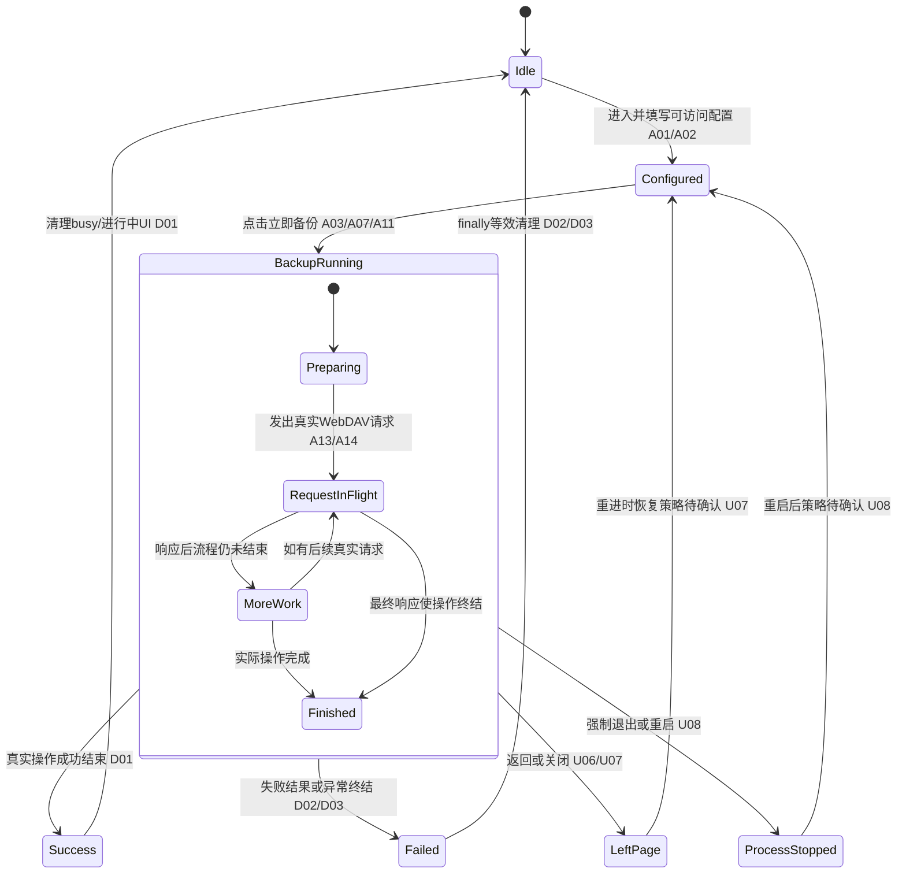
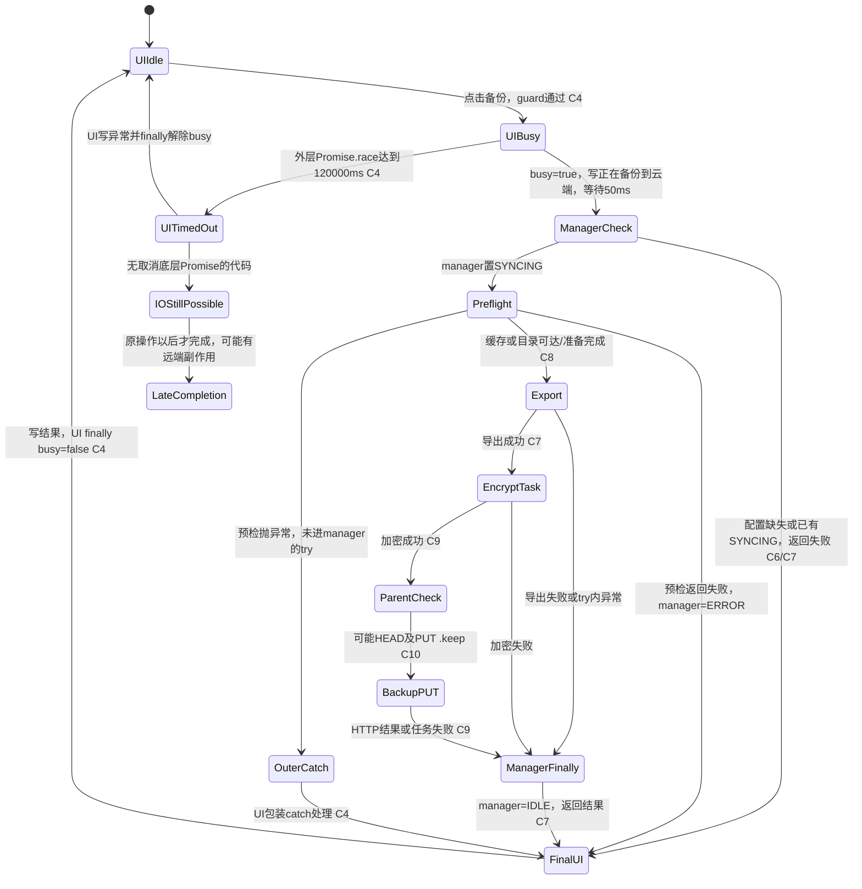

# vg-spec13 验收矩阵（仅分析）

## 1. 范围、快照与证据规则

- 输入：`spec/requirement.md`、`spec/metadata.json`、`spec-harness/0-analyze.md`，以及本题未修改基线源码。未读取其他赛题、题包、上游功能版本或修复历史。
- 元数据 `base_commit`：`88db8789e28333c7b7dcc8db078f394a262b73c3`。本文源码位置均由 `git show <base_commit>:<本题路径>` 读取，只表示该基线的静态事实；运行证据由 `spec/baseline-notes.md` 单独承担。
- Spec SHA256：`ba156110d18109eecd2627ab66690b293da6cac504caef6650333a9a6e124677`，本角色已重新计算核对。
- 需求角色真实会话标识：`CODEX_THREAD_ID=01a1438c-25bf-7831-93ca-1b4ade7410ee`，直接读取该环境变量；未使用继承的 `CODEX_SESSION_ID`。
- 本角色只创建此文档；没有修改业务代码、测试、workflow 状态，也没有执行构建或设备命令。本文列出的检查均为验收设计，不能视为已通过。
- `SPEC_EXPLICIT`：Spec 明文。`REASONABLE_DERIVATION`：为解释明文而提出的可检验推导，不能作为新增 Spec 明文。`UNCONFIRMED_ASSUMPTION`：Spec 没有决定的产品策略，必须保留分支，不能按推荐方案擅自判失败。
- 代码实证另标 `BASELINE_CODE`；它解释现状，不会把基线行为提升为产品要求。
- 数量：**16 个明文原子项 A01–A16、7 个推导原子项 D01–D07、28 个边界探针 B01–B28、10 个待确认策略 U01–U10**。同一行为在不同场景重复列出是为了逐步骤追溯；这些数量均不代表官方 F-point 数量或分值。

## 2. Spec 原文目录（逐字摘录）

下表保留原文文字、标点、空格和 `LoadingProgress` 大小写。后文“原文 Qxx”即指此处完整原文；不是改写后的需求。

| 引用 | 原文位置 | 逐字原文 |
| --- | --- | --- |
| Q01 | `spec/requirement.md:7`，场景一概述 | 用户点击「立即备份」后，WebDAV 配置页必须在备份操作仍在运行时渲染 ArkUI `LoadingProgress` 加载指示器。 |
| Q02 | `spec/requirement.md:11`，场景一步骤 1 | 1. 用户进入 WebDAV 配置页，并填写可访问的 WebDAV 配置。 |
| Q03 | `spec/requirement.md:12`，场景一步骤 2 | 2. 用户点击「立即备份」按钮。 |
| Q04 | `spec/requirement.md:13`，场景一步骤 3 | 3. 页面进入备份忙碌状态。 |
| Q05 | `spec/requirement.md:14`，场景一步骤 4 | 4. 页面显示 ArkUI `LoadingProgress` 加载指示器。 |
| Q06 | `spec/requirement.md:20`，场景二概述 | 备份期间，页面必须展示「正在...」或「处理中...」一类的状态提示文字，让用户能够区分正在工作和空闲状态。 |
| Q07 | `spec/requirement.md:24`，场景二步骤 1 | 1. 用户点击「立即备份」。 |
| Q08 | `spec/requirement.md:25`，场景二步骤 2 | 2. 页面进入备份忙碌状态。 |
| Q09 | `spec/requirement.md:26`，场景二步骤 3 | 3. 页面显示操作进行中的状态提示。 |
| Q10 | `spec/requirement.md:27`，场景二步骤 4 | 4. 该文案在备份操作进行期间可见。 |
| Q11 | `spec/requirement.md:33`，场景三概述 | 加载状态必须绑定真实的 WebDAV 操作。备份流程在忙碌状态可见时，必须向配置的 WebDAV 端点发送请求。 |
| Q12 | `spec/requirement.md:37`，场景三步骤 1 | 1. 用户点击「立即备份」。 |
| Q13 | `spec/requirement.md:38`，场景三步骤 2 | 2. 页面显示备份加载状态。 |
| Q14 | `spec/requirement.md:39`，场景三步骤 3 | 3. 应用向配置的 WebDAV 服务端发送请求。 |
| Q15 | `spec/requirement.md:40`，场景三步骤 4 | 4. 如果只出现加载状态而没有 WebDAV 请求，则该功能点不满足要求。 |

文案边界：Q06 的「正在...」「处理中...」是明文列出的**一类**提示，而非规定唯一完整字符串。基线文字 `正在备份到云端...`、`处理中...` 属于代码事实，不能以 Spec 为由强制新增固定整句、Toast、成功或失败文案。按钮名「立即备份」、组件类型 ArkUI `LoadingProgress` 则是明确要求。

## 3. 静态证据与稳定选择器

为缩短后表，使用以下源码别名；所有行号都是指定基线的行号。

| 别名 | 文件 | 与验收有关的代码实证 |
| --- | --- | --- |
| C1 | `entry/src/main/ets/pages/SettingsPage.ets` | `:41` 配置分区项标题为 `WebDAV 配置`；`:507–529` 点击目录项设置 `activeSectionId`；`:447–462` 值为 `sync` 时构建 `SettingsSyncSection`。这里只证明静态进入路径，实际安装后的入口由基线验证角色确认。 |
| C2 | `entry/src/main/ets/pages/SettingsPage.ets` | `:163–168` 初始化管理器并加载 WebDAV 设置；`:190–196` 将管理器配置填入页面；`:172–179` 页内返回先退到设置目录；`:484–487` 标题栏箭头绑定该返回函数；`:565` 唯一相关外层 id 是动态的 `settings_` 加主题刷新 token。它不是备份控件 id。 |
| C3 | `entry/src/main/ets/pages/settings/SettingsSyncSection.ets` | `:25–37` 配置字段为 `@Link`；`:41–44` 结果、busy 为组件本地 `@State`；`:100–111` 保存动作组装当前字段并调用管理器 `setSettings`；`:320–335` 测试连接通过字段校验后也会用当前输入调用 `setSettings`（`:334`），`:289–308` 立即同步先调用保存方法。立即备份自身不把当前字段送给管理器，而读取管理器已有配置。endpoint/username/remoteRoot 在组装配置时 trim，空 remoteRoot 默认 `/weiyu_sync`。 |
| C4 | 同 C3 | `:114–122` 外层操作超时为 **120000ms**，`Promise.race` 没有取消底层 Promise；`:141–158` 备份包装先判 busy，再置 busy 与文案，等待 50ms，`await` 真正操作，成功/失败/异常写结果，`finally` 解除 UI busy；`:161–162` 手动备份调用 `backupToCloudInBackground()`，并传入 `正在备份到云端...`。50ms 和 120000ms 均不是 Spec 指定数值。 |
| C5 | 同 C3 | `:348–396` 通用输入框/密码框没有 `.id()`；`:439–443` 五个配置字段；`:543–562` 保存/测试连接；`:578–586` 立即同步；`:594–613` 立即备份/恢复共用 `webdavBusy`，忙时按钮文字均为 `处理中...` 且禁用；`:618–624` 显示 `webdavBackupResult`。基线目标组件整文件未出现 `LoadingProgress` 或 `.id()`。 |
| C6 | `entry/src/main/ets/sync/WebDavSyncManager.ets` | `:115–125` 保存后更新管理器缓存并尝试持久化；`:132–161` 初始化加载保存配置；`:164–174` 配置校验（trim 后 endpoint、username/password 非空，syncPassword 至少 4 位）。这些输入限制是代码事实，Spec 未明确枚举。 |
| C7 | 同 C6 | `:911–937` 后台备份先校验配置、检查 manager `SYNCING`，再置 `SYNCING` 并执行远端预检；`:942–973` try 内导出，再执行加密上传任务；`:976–1005` 整理结果，try 的 `finally` 置 manager `IDLE`。注意预检在 try 之前，预检返回失败置 `ERROR`，预检直接抛异常不经过该 finally；不能笼统宣称经理所有异常均复位。 |
| C8 | 同 C6 | `:284–344` 远端预检：缓存命中或远端 `/` 时可能不发预检请求；其他分支可能 `HEAD`、创建目录后 `HEAD`、写入探针并删除探针；`:245–281` 探针 `PUT`/`DELETE`；`:349–379` 通过 `PUT .keep` 尝试创建目录。预检请求不是每次必有。 |
| C9 | `entry/src/main/ets/sync/webdav/WebDavSyncTask.ets` | `:149–188` 加密后创建 WebDavClient，`:167` 对备份路径 `PUT`，非 2xx 返回失败，2xx 返回 `备份已上传`。这才是当前“立即备份”使用的任务；不能拿另一个未被该按钮调用的备份方法当作本链路证据。 |
| C10 | `entry/src/main/ets/sync/webdav/WebDavClient.ets` | `:27–30` endpoint 去尾斜线并设置 Basic Auth；`:41–75` PUT 前可能检查/准备父目录，`:88–95` endpoint 与相对 path 拼 URL；`:139–149` 真正 `request.request`；`:143–144` 连接/读超时 15s/20s；`:167–183` 完成/错误后 destroy，网络异常可转为 statusCode 0。方法、请求数、状态码细节均非 Spec 明文。 |
| C11 | `entry/src/main/ets/pages/settings/SettingsSyncSection.ets` | `:165–193` 恢复动作有确认/取消，`:203–286` 下载解析与第二次确认；这不是手动备份步骤。手动备份 `:161–162` 没有确认、取消或关闭控件。不要把恢复对话框列为本题备份必经流程。 |
| C12 | `entry/src/main/ets/pages/settings/SettingsSyncDialog.ets` | `:93–102` 的 `关闭`、`:118–127` 的 `取消` 属于 JSON 导入/导出对话框；C1 `SettingsPage.ets:464–469,556–563` 将其用于另一分区。不能当作 WebDAV 手动备份取消入口。 |
| C13 | `entry/src/main/ets/entryability/EntryAbility.ets` | `:49–54` 前台事件初始化自动同步管理器并调用 `tryRun('foreground')`。不能仅因请求发生在页面进入附近，就认定它由手动备份触发；本题网络证据须隔离自动同步并关联点击时间窗/备份链路。 |

候选 id 只是后续实现/测试约定，**基线均未存在**。本阶段禁止补 id。

| 选择器代号 | 目标与候选 id | 基线状态与临时定位风险 |
| --- | --- | --- |
| T1 | 设置目录的 WebDAV 入口 `webdav_settings_entry` | 需在实现时补 `.id()`。临时可按精确文字 `WebDAV 配置` 定位，但目录文字和分区标题可能同名。 |
| T2 | WebDAV 内容容器 `webdav_settings_section` | 需在实现时补 `.id()`；不能用动态的 `settings_<token>` 代替内容身份。 |
| T3 | 地址/账号/密码/同步密码/远端目录：`webdav_endpoint_input`、`webdav_username_input`、`webdav_password_input`、`webdav_sync_password_input`、`webdav_remote_root_input` | 需在实现时补 `.id()`。基线可按 placeholder 辅助，但密码/同步密码有同类 TextInput，必须避免依赖子节点序号。 |
| T4 | 立即备份 `webdav_backup_button` | 需在实现时补 `.id()`。空闲有精确文字 `立即备份`；忙时改为 `处理中...`，并与其他四个动作同名，文字选择器不再唯一。 |
| T5 | 实际 ArkUI `LoadingProgress` `webdav_backup_loading` | 基线组件不存在，需在实现时补组件与 `.id()`。Hypium 应同时检查身份、类型和实际可见性；截图圆环不能独自证明组件类型。 |
| T6 | 专属操作进行中文字 `webdav_backup_status` | 需在实现时补 `.id()`；可落在基线结果 Text 上，文案取值应与操作一致。不能仅搜索任意 `处理中...` 就认定备份在运行。 |
| T7 | 保存/测试/立即同步/恢复：`webdav_save_button`、`webdav_test_button`、`webdav_sync_button`、`webdav_restore_button` | 需在实现时补 `.id()`；用于排除把其他 WebDAV 请求误计到备份。 |
| T8 | 页内返回 `settings_back_button` | 需在实现时补 `.id()`；当前为文字 `←`，不能推定系统返回与页内返回具有相同路径。 |
| T9 | 配置保存/测试结果 `webdav_config_result` | 需在实现时补 `.id()`；与备份状态 T6 区分，避免旧成功文案误判。 |
| N1 | 测试服务端日志/请求捕获记录（不是组件 id） | 记录 URL、method、到达/完成时间、该次操作的时间窗及必要的路径/体摘要；真实网络不能靠新增 UI id 或本地 console 伪造。不要记录明文凭据。 |

## 4. 明文原子项

八维度详见下一表；相同编号两张表合起来是一条完整验收项。所有本节条目为 `SPEC_EXPLICIT`。重复的点击/忙碌项有独立场景来源，但可以共用一次有完整证据的操作。

| 编号 | 来源 / 逐字原文 | 原子行为 | 可观察结果 | 稳定选择器 |
| --- | --- | --- | --- | --- |
| A01 | 场景一步骤 1，原文 Q02 | 用户能进入 WebDAV 配置界面。 | 沿实际设置入口进入，展示目标配置表单和备份动作；不能误入“备份与恢复”JSON 分区。 | T1、T2、T4，均需在实现时补 `.id()`。 |
| A02 | 场景一步骤 1，原文 Q02 | 为手动备份提供可访问的 WebDAV 配置。 | 五个现有字段可定位输入；测试服务端可从设备访问且授权/路径可用。Spec 没有列字段清单，也没有“必须先点保存”步骤；已保存分支与本次输入未保存分支见 U01。 | T3、T7、N1；id 均缺失。 |
| A03 | 场景一步骤 2，原文 Q03 | 用户点击「立即备份」启动本场景。 | 在空闲状态找到该按钮并点击，后续状态来自这一动作；记录动作时间 t0。 | T4，需补 `.id()`。 |
| A04 | 场景一步骤 3，原文 Q04 | 点击后页面进入备份忙碌状态。 | 页面可观察到备份进行中，不停留空闲外观。禁用按钮是基线表现，不是 Spec 指定的唯一忙碌表现。 | T2、T4、T5、T6；需补 `.id()`。 |
| A05 | 场景一步骤 4，原文 Q05 | 备份忙碌时渲染 ArkUI `LoadingProgress`。 | UI 树中存在目标 ArkUI `LoadingProgress`，有可见区域且未隐藏；不能用普通 Text、静态图片或不同组件代替。 | T5，基线组件缺失，需补组件与 `.id()`。 |
| A06 | 场景一概述，原文 Q01 | 备份仍在运行时指示器可见。 | 用可控延迟服务端保持操作未结束，在请求等待期间多次采样 T5 可见；不能只在操作结束后闪现。最短持续毫秒数未规定（U04）。 | T5、N1，需补 UI id。 |
| A07 | 场景二步骤 1，原文 Q07 | 用户点击「立即备份」启动文案场景。 | 空闲按钮可点击，文案后续变化与本次 t0 关联。 | T4，需补 `.id()`。 |
| A08 | 场景二步骤 2，原文 Q08 | 本次点击后进入备份忙碌状态。 | 能确认该次操作正在进行，并与 A09 的文案观察落在同一操作时间窗。 | T4、T6，需补 `.id()`。 |
| A09 | 场景二步骤 3及概述，原文 Q09、Q06 | 页面显示能表达操作进行中的文字。 | 可见 Text 或按钮文字表达“正在工作”，可属于「正在...」或「处理中...」一类；只显示成功/空闲文案不满足本项。全文精确字面值不由 Spec 固定。 | T6（优先）或有身份的 T4，均需补 `.id()`。 |
| A10 | 场景二步骤 4，原文 Q10 | 操作进行中的文案在备份运行期间保持可见。 | 在可控未结束窗口中重复断言文案可见且语义仍为进行中，不能立即换成“已完成”。 | T6、N1；需补 UI id。 |
| A11 | 场景三步骤 1，原文 Q12 | 用户点击「立即备份」启动网络场景。 | 在本次点击前后划定请求观察窗，清理旧日志/记录基准序号；不能拿先前测试连接请求当证据。 | T4、N1；需补 UI id。 |
| A12 | 场景三步骤 2，原文 Q13 | 页面显示本次备份的加载状态。 | 加载 UI 来自本次点击；可关联 A05 的组件与 A09 的进行中文字，不以旧状态截图代替。 | T5、T6；需补 `.id()`。 |
| A13 | 场景三步骤 3，原文 Q14 | 本次备份向 WebDAV 服务端发出真实请求。 | 测试服务端确实记录到此备份流程发来的请求。只调用函数、写 console 或本地设置 busy 不足以证明网络。 | N1，加 T4/T5 关联；UI id 缺失。 |
| A14 | 场景三步骤 3及概述，原文 Q14、Q11 | 请求发送到配置的 WebDAV 端点。 | 对照测试配置与服务端 URL/路径，确认目标属于该配置端点；不得发向无关固定地址作为替代。页面当前值/管理器已有配置问题见 U01。 | T3、N1；需补 UI id。 |
| A15 | 场景三步骤 4，原文 Q15 | 只有加载状态、没有 WebDAV 请求时判不满足。 | 在环境已可访问且备份流程确实执行的受控窗口，UI 有加载但服务端没有该流程请求，则 A13/A15 失败；不能用 spinner 存在抵消网络缺失。 | T5、N1；需补 UI id。 |
| A16 | 场景三概述，原文 Q11 | 加载状态与真实 WebDAV 操作处在同一备份流程，忙碌可见时发生请求。 | 至少一条该流程真实请求的发送/到达事件可与本次忙碌可见区间关联；延迟响应时同时取得 LoadingProgress、进行中文字和服务端 pending 请求证据。不是要求每个忙碌毫秒都有报文。 | T4、T5、T6、N1；需补 UI id。 |

### 4.1 明文项的八维度

“无新增规定”表示维度仍可记录，但 Spec 没有要求某种额外结果；“不适用”均附原因。Bxx 覆盖详见第 7 节。

| 编号 | 入口 | 前置数据 | 用户动作 | UI 结果 | 数据结果 | 网络结果 | 返回结果 | 边界条件 |
| --- | --- | --- | --- | --- | --- | --- | --- | --- |
| A01 | 应用实际设置入口 | 已完成应用正常进入所需前置；运行细节待基线验证 | 进入 WebDAV 配置 | 目标配置界面与备份入口可见 | 无新增规定：本项是进入界面 | 不适用：仅进入不是备份动作 | 无新增规定：此步未描述返回 | 空/未保存配置 B01–B07、返回 B24–B25 |
| A02 | A01 配置表单 | 可访问端点、合法授权、可用目录；应用本地可导出数据 | 填写配置 | 输入内容可观察（密码可保持遮蔽） | 配置可供备份使用；是否自动保存未规定 U01 | 配置本身要可访问；仅填写不要求发请求 | 无新增规定：填写后未描述返回 | 空/空格/部分输入 B01–B07；仅填未存 B17 |
| A03 | WebDAV 配置页 | 可访问配置、当前可发起操作 | 点击「立即备份」 | 产生本次操作的后续反馈 | 无独立新增规定：由后续项检查 | 请求由 A13/A16 检查，不能仅假定 | 不适用：本步骤没有返回动作 | 取消 B08、连点 B11–B13 |
| A04 | 本次备份动作 | A03 已点击且操作未结束 | 等待 UI 更新 | 可观察忙碌态 | 无新增规定：busy 不等于数据上传成功 | 与 A16 联合观察，忙态本身不能证明请求 | 无新增规定：运行中返回见 U07 | 部分执行 B18、慢/快完成 B27–B28 |
| A05 | 备份忙碌界面 | 操作仍在运行，服务端可延迟 | 观察 UI 树及可见性 | 真实 `LoadingProgress` 可见 | 不适用：本项断言组件类型与渲染 | 不适用：组件本身不证明联网，另查 A13 | 无新增规定：离开页面策略 U07 | 关闭 B10、等待/异常 B19–B23 |
| A06 | 同次备份运行界面 | 可控延迟，未终结的真实操作 | 在运行窗口连续/多次观察 | LoadingProgress 在运行时可见 | 无新增规定：不规定备份格式 | 请求等待窗口与可见性关联 | 无新增规定：后台或重入 U07–U08 | 超时 B23、慢 B27、快 B28 |
| A07 | WebDAV 配置页 | 有效配置、操作可开始 | 点击「立即备份」 | 为文案场景建立 t0 | 无新增规定：同 A03 | 由 A13/A16 检查 | 不适用：未触发返回 | 重复 B11–B13 |
| A08 | 本次文案场景 | A07 已点击、未结束 | 等待忙碌渲染 | 忙碌状态可观察 | 无新增规定：不要求数据计数 | 与 A16 联合检查 | 无新增规定：返回策略未写 | 部分执行 B18、失败 B19–B23 |
| A09 | 备份忙碌界面 | 本次操作运行中 | 观察文字节点 | 可见进行中文字，非仅终态/空闲 | 不适用：此项是状态文案 | 不适用：文字不能独自证明网络 | 无新增规定：重入文案 U07 | 同名按钮风险 T4/T6；快慢 B27–B28 |
| A10 | 同次备份运行界面 | 持续未终结窗口 | 多次读取文案 | 运行期间文字持续可见 | 无新增规定：不规定内容变化次数 | 可利用 pending 请求确定运行窗口 | 无新增规定：离开界面见 U06–U07 | 超时 B23、关闭 B10、慢 B27 |
| A11 | WebDAV 配置页 | 可访问配置、单独的服务端记录窗口 | 点击「立即备份」 | 动作与忙碌状态能关联 | 无独立新增规定 | 建立本次请求的归因窗口 | 不适用：没有返回步骤 | 保存/测试/同步不能冒充 B17/B26 |
| A12 | 本次网络场景 | A11 已点击，操作正在执行 | 观察加载 UI | 本次备份加载状态可见 | 无新增规定：忙态不是上传结果 | 与 A13 同窗口记录 | 无新增规定：重入 U07 | 未请求伪忙 A15，超时 B23 |
| A13 | WebDAV 配置页启动的备份 | 可访问测试服务端，设备连通，合法配置 | 点击后观察服务端 | 与 A12/A16 关联 | Spec 未规定序列化内容/远端文件名/成功备份格式 | 真实 WebDAV 请求；具体方法/个数未规定 U02 | 无新增规定：未规定新页面或路由 | 无数据 B14、失败 B19–B23 |
| A14 | 同次备份及其配置 | 已记录配置端点和服务端身份 | 对照请求地址 | 无新增规定：不用 UI URL 替代请求日志 | 不规定凭据存储实现 | 目标为配置端点；页面输入/管理器配置选择 U01 | 不适用：此项只对照网络目标 | 空/空格 B01–B07、部分填 B17 |
| A15 | 已发生加载的备份场景 | 环境确认可达，可观察日志窗口完整 | 查找该次流程请求 | 即使 LoadingProgress 可见也不能单独通过 | 不适用：负例检查不额外写数据 | 有加载无请求判失败；无效配置分支不冒充有效前置 | 无新增规定：不规定失败后路由 | 配置不成立 B01–B07；归因污染 B26 |
| A16 | 本次备份运行界面 | 单次操作、日志基准、可控未结束窗口 | 点击后同时观察 UI 和服务端 | spinner 与进行中文字处在同一忙碌区间 | 不额外规定备份数据格式 | 同一流程请求事件落入忙碌可见区间；不用旧请求替代 | 无新增规定：离开后策略 U06–U08 | 预检/上传 B18–B20、超时 B23、快 B28 |

### 4.2 十二个操作步骤的覆盖核对

| 场景 | 步骤 1 | 步骤 2 | 步骤 3 | 步骤 4 | 概述补充 |
| --- | --- | --- | --- | --- | --- |
| 一 | Q02 → A01、A02 | Q03 → A03 | Q04 → A04 | Q05 → A05 | Q01 → A06（运行期间） |
| 二 | Q07 → A07 | Q08 → A08 | Q09 → A09 | Q10 → A10 | Q06 → A09（文案语义范围） |
| 三 | Q12 → A11 | Q13 → A12 | Q14 → A13、A14 | Q15 → A15 | Q11 → A16（真实操作与加载绑定） |

## 5. 合理推导项（不作为新增明文要求）

本节为 `REASONABLE_DERIVATION`。来源引文只提供推导动机，不声称原文明写了恢复、重试或具体失败文案。若后续用户确定其他策略，应更新本节对应项。

| 编号 | 来源 / 原文 | 原子行为与推导理由 | 可观察结果 | 稳定选择器 |
| --- | --- | --- | --- | --- |
| D01 | Q01、Q06、Q11 | 一次真实备份结束后 UI 应退出进行中。理由是状态提示须能区分正在工作和空闲；Spec 没有逐字规定完成后的具体外观。 | 释放延迟响应并等待备份终结后，spinner 消失或不可见，进行中文字转为终态/空闲；按钮如何恢复沿可确认策略。 | T4–T6，均需补 `.id()`。 |
| D02 | Q01、Q06、Q11 | 请求返回失败结果也不应永久停留忙碌；失败是一次操作终结路径。 | HTTP 失败或 statusCode 0 被处理后退出 busy；不要求固定报错整句。C4 已有 UI finally，运行仍需验证。 | T4–T6、N1；UI id 缺失。 |
| D03 | Q01、Q06、Q11 | 真实备份操作已因异常终结时，也应收敛 UI 状态，而非跳过清理；外层等待超时但底层尚未终结不属于本项确定恢复前提。 | 确认真实操作及其 I/O 已终结后，busy 解除、进度和进行中文字不悬挂；若仅 Promise.race 超时而底层可能存活，只按 U06 观察，不预定清除或继续 busy。 | T4–T6、N1；UI id 缺失。 |
| D04 | Q01、Q11 | 加载绑定应覆盖备份内尚未完成的本地导出、加密和网络阶段，不能只在发请求前显示一下。 | 用阶段日志和 UI 时间线记录从本次开始到终结；导出/加密/上传仍运行时可见加载。任务调度、线程 API 和阶段比例不是验收规定。 | T5、T6、N1；UI id 缺失。 |
| D05 | Q03、Q07、Q12、Q11 | 每轮有效手动备份需与本轮请求关联；上轮终结后的再次点击应重新执行真实链路。 | 首轮结束后再次点击，新的 busy 窗口中出现新请求记录；不把上轮请求或旧结果视为第二轮证据。 | T4–T6、N1；UI id 缺失。 |
| D06 | Q01、Q06、Q11 | 从未发起备份且没有备份存活时不应伪装为该备份进行中。 | 有效配置下仅打开/填写/保存界面，不能据此把其它请求和 loading 归因为手动备份。共享 busy 的其它操作可有自身状态，不由此项禁止。 | T2–T7、N1；UI id 缺失。 |
| D07 | Q11、Q14、Q15 | 用同一操作的 UI 与服务端证据建立因果关联。这是可测试性推导，不要求应用暴露测试专用 operation id。 | 记录 t0、busy 可见采样、服务端请求开始/结束与最终 UI；排除自动同步、测试连接、旧日志。 | T4–T7、N1；UI id 缺失。 |

### 5.1 推导项的八维度

| 编号 | 入口 | 前置数据 | 用户动作 | UI 结果 | 数据结果 | 网络结果 | 返回结果 | 边界条件 |
| --- | --- | --- | --- | --- | --- | --- | --- | --- |
| D01 | WebDAV 备份界面 | 合法配置，已在真实进行中 | 放行成功响应，等待整条操作结束 | 退出进行中 | 不强制特定远端内容，仅记录终态 | 请求已完成；不能只看 UI 定义完成 | 无新增路由要求；恢复空闲供再次操作 | 正常/慢完成 B27；快 B28 |
| D02 | 同次备份界面 | 服务端返回失败，可重现 | 点击并等待失败返回 | 退出忙碌、可区分失败与进行中 | 不宣称失败一定没有任何远端副作用 | 记录非 2xx/连接失败阶段 | 无新增路由要求；再次操作策略 U05 | B19–B22 |
| D03 | 同次备份界面 | 可定位的运行异常，且真实备份操作及其 I/O 已终结 | 等待已终结异常的处理 | 在此终结前提下清理 busy，不残留“正在”；仅外层超时而底层未终结时按 U06 观察，不预定 UI 策略 | 不假定远端回滚 | 需确认真实 I/O 终结；外层超时与晚到结果另按 U06/B23 记录 | 无新增返回路由；重入 U07 | B18–B22、B25；B23 仅作 U06 未决分支 |
| D04 | 备份界面 | 足以观察导出/加密/网络各阶段的数据 | 启动后观察阶段时间线 | 操作仍运行时加载/文案可见 | 仅观察阶段，不强制实现方式 | 网络阶段出现真实请求；本地阶段无需持续报文 | 无新增规定：离开策略 U06–U07 | 部分操作 B18–B20，慢 B27 |
| D05 | 首轮已结束的同页 | 有效配置和独立日志序号 | 再次点击 | 新一轮忙碌与恢复 | 不规定覆盖/版本命名策略 | 第二轮新请求，不复用旧日志 | 无新增规定：可在当前页重试 | 完成后重复 B11；快速 B13 为未决并发策略 |
| D06 | 进入/填写/保存配置 | 当前没有手动备份存活；其它网络需区分 | 不点击立即备份 | 不错误标为手动备份进行中 | 可以保存配置；不等于备份数据 | 进入/填写通常不发备份；其它请求不得充当 A13 | 返回后是否延续在途操作 U07 | 部分步骤 B17、其它操作 B26 |
| D07 | 单次备份与测试服务端 | 排除其它操作，日志时间可对齐 | 点击并捕获证据 | spinner、文案与窗口一一对应 | 不要求业务数据里增加测试字段 | 方法/路径/时序用于归因，不新增硬性方法要求 | 不适用：本项是证据关联方法 | 重复 B11–B13、自动同步污染 B26 |

## 6. 真实 WebDAV 状态机与动作请求表

### 6.1 明文约束与推导模型

下图描述验收模型，节点不是强制实现变量或类。实线 E 受明文约束；标 D 的终结恢复来自推导；U 代表未决策略。

绑定规则：A05/A06 要求备份运行时存在可见 `LoadingProgress`；A09/A10 要求同期间进行中文字可见；A16 要求同一忙碌可见流程发送真实请求。Preparing 包括导出、加密或请求准备，**不要求从点击开始的每一瞬间都已有请求**。用网络延迟制造一个可观察的运行窗口；不能用计时器做一个没有真实备份的假加载。

Spec 未要求某种 HTTP 方法、固定请求数、固定文件名、服务端必须成功、百分比进度、固定显示时长或上传后恢复路由。它要求真实备份操作中的真实 WebDAV 请求；仅伪造 console、请求无关 URL 或只更改 UI 都不能当成满足。对于“仅预检而无上传是否足够”，保留 U02，不擅自扩大明文。

### 6.2 基线真实调用链与超时分叉（BASELINE_CODE）

读取此图时必须区分两个时钟：**UI 等待 Promise 已拒绝**，不证明**底层 I/O 已取消**。外层超时后 spinner 是否必须继续显示、能否发起下一轮、晚到成功如何呈现，Spec 未作规定，见 U06；此处只列基线风险。C4 UI finally 不能证明 manager 也始终复位；C7 预检抛错发生在 manager try/finally 外。不得在分析阶段修复，也不得把这些附加风险一律标成官方功能失败。

基线网络序列：`webdavBackup()` → `backupToCloudInBackground()` → 可选预检 → 本地导出 → 加密任务 → `WebDavClient.put(backupFilePath, ...)` → 真实 `http.request`。PUT 前还可能检查父目录。预检缓存/根目录分支可能无请求；成功上传路径的 PUT 是现有实现事实，**不是把 PUT、HEAD、DELETE 或某个请求数提升为 SPEC_EXPLICIT**。当前按钮不调用 `WebDavBackupManager.backupToCloud()`，不能把那个方法的后续 HEAD 误写进本按钮的必经链路。

### 6.3 每个相关用户动作是否触发请求

“新请求”与在途请求分开统计。下表没有把非备份功能扩展为本题新增实现目标。

| 动作 | 基线静态请求触发 | 本题验收解释 / loading 绑定 |
| --- | --- | --- |
| 进入 WebDAV 分区 | C1/C2/C3 读取配置及自动同步设置，无该按钮的备份请求调用；C13前台事件可能启动自动同步 | 不是备份触发；启动/前台自动同步若发生，需单独归因。仅进入不算 A13。 |
| 填写/修改五个字段 | C3/C5 仅赋值 @Link，无请求 | 不用填字段时的 UI 变化证明备份；本次输入未保存是否生效见 U01。 |
| 点「保存设置」 | C3/C6 设置管理器缓存并保存本地配置，无 WebDAV 请求调用 | 可以作为隔离环境的测试准备，但不得冒充 Spec 明文必经步骤。 |
| 点「测试连接」 | C3 `:320–336` 通过字段校验后，用当前输入调用 `setSettings`（`:334`）更新管理器，再调用 testConnection，可触发真实服务端请求；共用 busy | 会改变随后备份读取的管理器配置，不能与“仅填写后直接备份”混为同一分支；连接测试请求不能充当“立即备份”请求，本题不要求为测试连接新增 spinner。 |
| 点「立即同步」 | C3 `:289–317` 先通过保存方法更新管理器配置，保存返回成功后调用 syncIncremental，共用 busy | 会改变随后备份读取的管理器配置；不是手动备份，保持独立请求窗口，本题不规定增量同步行为。 |
| 空闲时点「立即备份」 | C4/C7/C9：有效配置时进入真实备份链；校验失败可在网络前返回 | 对有效前置必须联合检查 A05、A09、A13、A16；无效前置的错误策略 U03。 |
| busy 中再点备份或快速连点 | C4 guard，C5 disabled；被忽略的调用不会另起备份请求 | 基线倾向拒绝并发；Spec 未明确排队/忽略/并发策略 U05。不能要求每次被禁用点击均发请求。 |
| 首轮真正终结后再点备份 | C4 guard 解除后可重新执行 | D05 用新的请求序号与忙碌窗验证。 |
| 返回设置目录/离开页面 | C2 切分区或 router.back，未见取消备份调用 | 不触发新的手动备份；不能由页面消失推出在途请求已取消。重入策略 U07。 |
| 点备份「取消」/「关闭」 | 本备份流程无此控件；C11/C12 的同名对话框属于其他功能 | 不适用为必经动作；如需新增取消能力须先确认 U06，不能借恢复取消来验收备份。 |
| 关闭/终止应用并重启 | 源码不足以证明设备/进程生命周期及自动同步运行结果 | 不把重启自动备份当作 Spec 需求；终结/恢复策略 U08，实际现象待运行。 |
| 其它操作/自动同步占用经理时点备份 | C7 status 为 SYNCING 时可直接失败；与 UI 本地 busy 是两层状态 | 不能拿其它任务请求当手动备份成功证据；是否排队/报忙 U05。 |

## 7. 边界探针（穷举任务书指定类别）

本节不是已通过测试。每项含八维度；“建议观察”是测试设计，不会将未确认结果强制化。字段校验值来自 C6，属于基线实证。所有条目均引用 Qxx 原文；对 Spec 没有定义的取舍，证据等级为 `UNCONFIRMED_ASSUMPTION`，策略统一到第 8 节。复合输入表格中的每个字段应独立运行，避免第一个校验失败遮蔽后续字段。

| 编号 / 类别 / 证据等级 | 来源原文 | 原子探针与可观察结果 | 八维度（入口／前置数据／用户动作／UI结果／数据结果／网络结果／返回结果／边界条件） | 选择器 |
| --- | --- | --- | --- | --- |
| B01 空地址；`UNCONFIRMED_ASSUMPTION` U03 | Q02、Q11 | 单独清空 endpoint 后备份，观察校验与 UI 收敛；不可声称空地址满足“可访问”。 | 入口：配置页；前置数据：其它字段有效；用户动作：清空地址并点备份；UI结果：记录错误/忙态恢复，不强制文案；数据结果：记录是否沿用旧配置 U01；网络结果：校验拒绝时无新备份请求，若用旧值要单列；返回结果：不适用，无返回动作；边界条件：空字符串。 | T3–T6、N1，id 缺失 |
| B02 空账号；`UNCONFIRMED_ASSUMPTION` U03 | Q02、Q11 | 单独清空 username，区分旧配置与当前输入。 | 入口：配置页；前置数据：地址/密码/同步密码有效；用户动作：账号置空并备份；UI结果：记录校验/收敛；数据结果：不规定清空是否立即持久化；网络结果：C6 采用空值时先拒绝，无请求；返回结果：不适用，无返回；边界条件：单字段空。 | T3–T6、N1，id 缺失 |
| B03 空密码；`UNCONFIRMED_ASSUMPTION` U03 | Q02、Q11 | 单独清空 password，不能将遮蔽文字误判为有值。 | 入口：配置页；前置数据：其它字段有效；用户动作：清空密码并备份；UI结果：记录错误/恢复，不披露密码；数据结果：不规定凭据持久化策略；网络结果：C6 采用空值时拒绝；返回结果：不适用，无返回；边界条件：真正空值与遮蔽显示区分。 | T3–T6、N1，id 缺失 |
| B04 空/短同步密码；`UNCONFIRMED_ASSUMPTION` U03 | Q02、Q11 | syncPassword 分别为长度 0、1、3、4 的独立样本；4 位是基线阈值，不是 Spec 新阈值。 | 入口：配置页；前置数据：其它字段有效；用户动作：逐例填写后备份；UI结果：观察拒绝/进行状态；数据结果：记录本次采用值；网络结果：C6 trim 后小于4拒绝，4位进入后续不保证网络成功；返回结果：不适用，无返回；边界条件：阈值两侧，不能混为合法前置。 | T3–T6、N1，id 缺失 |
| B05 空远端目录；`UNCONFIRMED_ASSUMPTION` U03 | Q02、Q14 | 清空 remoteRoot，确认是否使用默认目录及服务器路径。 | 入口：配置页；前置数据：其它有效，默认目录可用；用户动作：清空目录后备份；UI结果：观察忙态和结果；数据结果：C3 保存时默认 `/weiyu_sync`，未保存分支 U01；网络结果：记录实际路径，不硬性要求默认名；返回结果：不适用，无返回；边界条件：空目录是否默认由策略决定。 | T3–T6、N1，id 缺失 |
| B06 纯空格；`UNCONFIRMED_ASSUMPTION` U03 | Q02、Q11 | endpoint、username、password、syncPassword、remoteRoot 分别以纯空格独立测试，再测全为空格。 | 入口：配置页；前置数据：每例仅目标字段为空格；用户动作：填写并备份；UI结果：记录校验与finally恢复；数据结果：区分 C3 保存trim与 C6校验trim；网络结果：非法配置不要求请求，目录空白可能默认；返回结果：不适用，无返回；边界条件：不把密码前后空格擅自规范化为Spec规则。 | T3–T6、N1，id 缺失 |
| B07 部分输入；`UNCONFIRMED_ASSUMPTION` U01/U03 | Q02、Q03 | 仅填地址、仅填部分必需字段、字段全部为空分别执行；区分缓存旧值。 | 入口：配置页；前置数据：首次配置和已有旧配置两组；用户动作：只完成部分填写就备份；UI结果：记录校验/真实忙态；数据结果：比较当前值/缓存值；网络结果：不能把无效前置当 A15 正例；返回结果：不适用，无返回；边界条件：每个缺失字段独立覆盖。 | T3–T6、N1，id 缺失 |
| B08 备份前取消；`REASONABLE_DERIVATION` | Q03、Q07、Q12 | 不点击备份而退出填写；本流程没有确认对话框的“取消”。 | 入口：配置表单；前置数据：无在途备份；用户动作：不点备份/离开；UI结果：不适用取消按钮，基线无此控件；数据结果：输入保存策略 U01；网络结果：没有本次手动备份触发；返回结果：按 C2 回设置目录，实际待验证；边界条件：取消填写不能代替恢复取消。 | T2–T4、T8、N1，id 缺失 |
| B09 运行中取消；`UNCONFIRMED_ASSUMPTION` U06 | Q01、Q11 | 记录本备份没有取消按钮；若以后新增，应另外确认取消是停止UI还是终止I/O。 | 入口：进行中的备份；前置数据：pending请求；用户动作：取消不适用，基线无入口；UI结果：不规定新增取消；数据结果：远端副作用不默认回滚；网络结果：不能假定Promise结束即取消；返回结果：不适用，无现有取消返回；边界条件：策略未确认。 | T5/T6、N1；不虚构cancel id |
| B10 关闭；`UNCONFIRMED_ASSUMPTION` U06/U07/U08 | Q01、Q11 | 区分关闭页面/系统返回、切后台、强制终止进程，不把 JSON 对话框“关闭”混入。 | 入口：备份进行页；前置数据：可控pending；用户动作：分别离页、后台、终止；UI结果：页面不可见不等于操作结束；数据结果：记录远端是否已有副作用；网络结果：记录在途请求是否继续，无新增手动请求；返回结果：重入/重启按 U07/U08 记录；边界条件：三种生命周期独立。 | T5/T6/T8、N1，id 缺失 |
| B11 完成后重复点击；`REASONABLE_DERIVATION` D05 | Q03、Q11 | 第一轮真实结束后再备份，观察第二轮新请求。 | 入口：同一配置页；前置数据：第一轮已终结；用户动作：再次点击；UI结果：新的加载/文案窗口；数据结果：不要求版本命名；网络结果：新增同流程请求；返回结果：不适用，无返回；边界条件：不能沿用旧成功/日志。 | T4–T6、N1，id 缺失 |
| B12 busy中重复点击；`UNCONFIRMED_ASSUMPTION` U05 | Q03、Q11 | 在首轮pending时再次尝试同一按钮；记录忽略、禁用或其它策略。 | 入口：busy界面；前置数据：第一轮未结束；用户动作：重复点击；UI结果：C5禁用按钮，记录既有忙碌态/文案是否持续；目标 LoadingProgress 按 A05 实测，基线组件缺失；数据结果：不默认允许并发备份；网络结果：C4 guard不另起请求；返回结果：不适用，无返回；边界条件：Spec未规定每次重复动作均发请求。 | T4–T6、N1，id 缺失 |
| B13 快速连点；`UNCONFIRMED_ASSUMPTION` U05 | Q03、Q11 | 在UI首帧更新前快速触发多次点击，检查操作归因。 | 入口：初始空闲界面；前置数据：合法配置、服务端延迟；用户动作：短间隔多次点击；UI结果：记录busy及可见性；数据结果：记录是否重复任务；网络结果：操作内多个HEAD/PUT不等于多个备份，按链路分组；返回结果：不适用，无返回；边界条件：C4先置busy的guard需运行验证。 | T4–T6、N1，id 缺失 |
| B14 本地无数据；`UNCONFIRMED_ASSUMPTION` U09 | Q02、Q11、Q14 | 无学习/复习/用户词书等业务记录时备份；不可直接断言无数据必须跳过或必须上传空文件。 | 入口：配置页；前置数据：有效服务端，最小本地数据库；用户动作：点击备份；UI结果：若操作运行则A05/A09适用；数据结果：记录导出是否成功、是否仍有结构性数据；网络结果：真实流程若执行则按A13记录；返回结果：不适用，无返回；边界条件：Spec未指定无记录策略。 | T4–T6、N1，id 缺失 |
| B15 云端无旧备份；`REASONABLE_DERIVATION` | Q11、Q14 | 新目录无旧备份，不等同“无可恢复备份”；观察首次上传链。 | 入口：配置页；前置数据：有效可写空目录，本地可导出；用户动作：备份；UI结果：运行中spinner/文案；数据结果：记录新远端副作用，不指定文件名；网络结果：真实请求，可能预检/父目录检查/上传；返回结果：不适用，无返回；边界条件：恢复空云端检查不适用，动作不同。 | T4–T6、N1，id 缺失 |
| B16 最后一页；`REASONABLE_DERIVATION` | Q02、Q03 | 分页末页场景不适用；配置界面是表单，没有分页列表。需滚动至按钮属于可达性检查。 | 入口：配置页Scroll；前置数据：任意可显示配置；用户动作：必要时滚动至手动操作；UI结果：备份按钮和进行状态可见；数据结果：不适用，无分页数据；网络结果：滚动不触发备份，点击才触发；返回结果：不适用，无分页返回；边界条件：没有页码/下一页，不能捏造末页用例。 | T2/T4/T5/T6，id 缺失 |
| B17 部分操作/仅填后直接备份；`UNCONFIRMED_ASSUMPTION` U01 | Q02、Q03、Q11 | 分别执行仅填后直接备份、保存后备份、测试连接后备份、立即同步后备份；保留每种操作对管理器配置的影响。 | 入口：配置页；前置数据：旧端点A/新端点B均可达，各例独立初始化；用户动作：填写B后按各分支操作再备份；UI结果：只在真实动作归属下判忙态；数据结果：仅填写不送管理器，保存/通过字段校验的测试连接/立即同步保存路径会更新管理器，记录缓存与持久化结果；网络结果：区分A/B端点、连接测试/同步/备份请求；返回结果：不适用，无返回；边界条件：仅填后直接备份分支不能被此前测试连接或同步更新配置掩盖，不把先保存写成Spec步骤。 | T3–T7/T9、N1，id 缺失 |
| B18 预检后/导出前后局部失败；`REASONABLE_DERIVATION` D02–D04 | Q01、Q11 | 预检已请求但本地导出失败或抛错；记录已发生请求与未完成上传。 | 入口：备份页；前置数据：有效配置，可定位失败阶段；用户动作：备份并观察阶段；UI结果：运行中可见，终结按D02/D03恢复；数据结果：不能声称完成有效备份；网络结果：可能只有预检，上传是否必须见U02；返回结果：不适用，无返回；边界条件：预检抛错在manager try外，经理状态需独立记录。 | T4–T6、N1，id 缺失 |
| B19 加密/TaskPool失败；`REASONABLE_DERIVATION` D02/D03 | Q01、Q11 | 导出后、上传前失败时区分UI恢复和网络是否曾发生。 | 入口：备份页；前置数据：能定位任务失败，禁止凭想象宣称注入成功；用户动作：启动并等待失败；UI结果：不长期残留进行中；数据结果：不能认作上传成功；网络结果：可能有预检，未必有备份PUT；返回结果：不适用，无返回；边界条件：测试工具无法注入则标未验证，不改代码。 | T4–T6、N1，id 缺失 |
| B20 上传响应失败；`REASONABLE_DERIVATION` D02 | Q01、Q11、Q14 | 服务端收到真实请求但返回失败，区分“请求已发”与“备份成功”。 | 入口：备份页；前置数据：服务端能识别上传并返回非2xx；用户动作：点击备份；UI结果：等待期可见，终结后退出busy；数据结果：不假定无副作用或自动回滚；网络结果：真实请求可满足请求存在项，不能充当成功备份；返回结果：不适用，无返回；边界条件：不固定错误文案。 | T4–T6、N1，id 缺失 |
| B21 离线/连接拒绝/DNS失败；`REASONABLE_DERIVATION` D02/D03 | Q01、Q11、Q15 | 网络失败时记录状态恢复；环境不满足可访问前置，不能伪造服务端收到请求。 | 入口：备份页；前置数据：已记录有效配置，但故障网络；用户动作：点击等待；UI结果：可能短暂busy后失败恢复；数据结果：不宣称已备份；网络结果：记录发送尝试与服务端到达证据区别，C10可返回0；返回结果：不适用，无返回；边界条件：此例不代替正常可达正例。 | T4–T6、N1，id 缺失 |
| B22 鉴权/目录/服务端失败；`REASONABLE_DERIVATION` D02 | Q01、Q11、Q14 | 独立覆盖401、403、404、409、5xx，记录预检/上传各阶段，不要求精确请求数。 | 入口：备份页；前置数据：受控状态码/权限/目录；用户动作：点击备份；UI结果：真实等待期加载，终态恢复；数据结果：记录目录/探针部分副作用；网络结果：真实请求已到达，部分配置不再“可访问”；返回结果：不适用，无返回；边界条件：各失败阶段独立，不以第一种失败覆盖全部。 | T4–T6、N1，id 缺失 |
| B23 挂起/超时/晚到；`UNCONFIRMED_ASSUMPTION` U06 | Q01、Q10、Q11 | 可控延迟超出请求或操作期限，分别记录UI结束与底层存活。 | 入口：busy页；前置数据：pending真实请求；用户动作：等待超时，再观察晚到结果/再次点击；UI结果：C4约120s外层可恢复，不能由此证明I/O结束；数据结果：晚到上传可能有副作用；网络结果：15s/20s单请求与120s外层是不同期限；返回结果：无导航规定；边界条件：不强制120s为Spec时限，超时策略待确认。 | T4–T6、N1，id 缺失 |
| B24 完成/失败后返回重进；`UNCONFIRMED_ASSUMPTION` U07 | Q01、Q02、Q11 | 成功与失败分别完成后退回目录/退设置再重进；验证新一次点击仍可关联。 | 入口：终态配置页；前置数据：各终态独立样本；用户动作：页内/系统返回后重进再备份；UI结果：不把旧文本当新操作，是否保留结果未规定；数据结果：已保存配置加载沿C2/C6事实；网络结果：重进不等于手动备份，新点击另建请求窗；返回结果：路由实测，Spec未指定；边界条件：完成和失败分别记录。 | T1–T8、N1，id 缺失 |
| B25 运行中返回重进/重启；`UNCONFIRMED_ASSUMPTION` U07/U08 | Q01、Q02、Q11 | 分别覆盖在途返回重进、终结后重启、在途强制终止后重启。 | 入口：进行页或终态页；前置数据：有效配置/可控pending；用户动作：分组返回或终止并重进；UI结果：记录新组件本地busy与经理状态，不能假定一致；数据结果：已保存/未保存配置分别记录，持久化策略未明文；网络结果：观察旧请求、自动同步、新手动请求，分开归因；返回结果：恢复/取消/重新开始策略未定；边界条件：不把进程复活功能列为必需实现。 | T1–T8、N1，id 缺失 |
| B26 其它WebDAV动作/编辑并发；`UNCONFIRMED_ASSUMPTION` U05/U10 | Q11、Q14、Q15 | 备份前/进行中测试连接、同步、自动同步、改端点分别记录，不混请求。 | 入口：配置页；前置数据：其它任务占用或备份pending；用户动作：另操作/修改字段；UI结果：共享busy不自动等于备份busy；数据结果：配置快照/编辑禁用策略U10；网络结果：只把本备份链请求计入A13，不能误归因自动任务；返回结果：不适用，无返回；边界条件：Spec不要求改造所有操作的加载UI。 | T3–T7、N1，id 缺失 |
| B27 慢速成功；`SPEC_EXPLICIT` A06/A10/A16 | Q01、Q10、Q11 | 延迟合法响应，在同一进行窗口观察spinner、文案、真实请求。 | 入口：配置页；前置数据：有效端点、本地可导出、可控延迟；用户动作：点备份，保持响应pending，再放行；UI结果：运行时LoadingProgress与进行中文字同时可见；数据结果：记录终态不强制备份格式；网络结果：服务端真实pending请求与UI关联；返回结果：不适用，无返回；边界条件：不超过合理测试超时，释放响应后另看D01。 | T4–T6、N1，id 缺失 |
| B28 快速成功；`UNCONFIRMED_ASSUMPTION` U04 | Q01、Q10、Q11 | 服务端立即完成时保留真实时间线，不能虚构Spec有固定最短显示时长。 | 入口：配置页；前置数据：快速合法响应；用户动作：点击并高频观察；UI结果：记录渲染是否发生，未捕获不等于已证明没渲染；数据结果：记录操作终结；网络结果：真实请求存在并归因本轮；返回结果：不适用，无返回；边界条件：优先以B27消除采样竞争，不用假延时替代真实请求。 | T4–T6、N1，id 缺失 |

### 7.1 任务书边界类别完整性核对

| `0-analyze.md` 指定类别 | 覆盖 | 适用/不适用理由 |
| --- | --- | --- |
| 空输入 | B01–B05、B07 | 各配置字段独立清空；默认目录与必填项分开。 |
| 纯空格 | B06 | 五字段分别测试，再全空格；规则只作为基线事实。 |
| 取消 | B08、B09 | 取消填写可观察；运行中没有备份取消入口，不适用为现有必经步骤，U06待定。 |
| 关闭 | B10 | 关闭页面、后台、终止应用分开；其它分区的关闭对话框不适用。 |
| 重复点击 | B11、B12 | 终结后新一轮与运行中重复分别覆盖。 |
| 快速连点 | B13 | 包含首帧前重入窗口，不用请求数量直接推算操作数量。 |
| 无数据 | B14、B15 | 本地无业务记录和云端无旧备份独立；恢复无备份规则不适用本动作。 |
| 最后一页 | B16 | 没有分页列表，末页/加载更多不适用；滚动可达性仍应验证。 |
| 部分操作 | B07、B17–B19 | 部分填写、仅保存/测试、预检成功后导出/加密失败。 |
| 请求失败 | B20–B23 | 上传非2xx、不可达、鉴权/目录/5xx、超时与晚到。 |
| 返回后重进 | B24、B25 | 完成/失败后及运行中分别测；页内返回与系统返回分别记录。 |
| 重启应用后重进 | B25 | 成功/失败后正常重启与在途强制终止后重启、已存/未存配置均分支记录；恢复策略未规定。 |

## 8. 待确认假设汇总与建议（不自行决定）

下表每项均为 `UNCONFIRMED_ASSUMPTION`。建议供后续判断，当前分析不要求实现推荐策略。所有来源的逐字原文在第 2 节，相关八维度在指向的 Bxx 项中。

| 编号 | 原文依据及未消除的歧义 | 合法候选解释 | 推荐处理方式与理由 | 关联项 / 更新影响 |
| --- | --- | --- | --- | --- |
| U01 | Q02 后直接 Q03，没有保存步骤；C3/C4 立即备份自身不送当前字段，但保存、通过字段校验的测试连接、立即同步保存路径都会更新管理器 | 立即备份应直接采用页面当前输入；或沿基线读取此前由保存/测试连接/立即同步更新的管理器配置 | 主正例可先保存有效配置以隔离加载问题，但明确这是测试准备；保留“仅填新端点后直接备份，期间不测试连接或同步”独立分支，并另记录测试连接/同步后备份，由用户确认产品契约。不能把必须先保存升格为Spec，也不能声称测试连接后当前字段仍完全未送管理器。 | A02/A14、B01–B07/B17；决定输入与请求端点契约、设计、测试前置。 |
| U02 | Q11/Q14 只规定真实操作与配置端点请求，未规定方法/成功/文件内容 | 真实备份流程的预检请求已满足请求存在项；或要求实际上传请求才能算“备份操作” | 明文最低检查保留请求真实性/配置端点/忙碌关联；另记录真实上传PUT作为强诊断证据，在用户决定前不把PUT/上传成功定为额外硬要求。 | A13–A16、B18–B20；影响网络断言和失败分支评分解释。 |
| U03 | Q02 限定可访问配置，未写无效/空输入的产品行为 | 提示校验并不发请求；保存默认值；保留旧配置；部分允许匿名服务端 | 无效值作为前置不满足分支记录，优先沿基线校验；不以“不发请求”认定违反正常正例。非法输入文案、默认路径和4位阈值不能冒充Spec明文。 | B01–B07；影响输入边界测试与错误文案要求。 |
| U04 | Q01/Q10 要运行期间可见，未规定最短可见毫秒数 | 快速结束仍需至少渲染一帧；或只按可观察运行窗口检查 | 使用受控延迟服务端构造确定的运行窗口，记录快速样本。不要擅自加固定最短延时，也不要因采样漏帧就断言实现没渲染。 | A06/A10、B27/B28；影响时间断言和实现是否需额外渲染让步。 |
| U05 | 三个场景均一次点击，没有定义重复、快速连点或其它同步占用 | 忽略/禁用重复动作；排队；合并；允许并发 | 以基线禁用+guard为候选，记录真实请求分组和UI状态；在用户确认前不要求多次点击必发多次请求。 | B11–B13/B26；影响并发策略、按钮状态和请求计数测试。 |
| U06 | Q01/Q11 未规定取消/关闭/超时语义；C4超时不取消I/O | 不提供取消；支持真实取消；离开继续；超时后继续或终止底层任务 | 明确区分UI等待结束与真实I/O终结。先记录基线超时分叉，不在分析阶段引入取消能力或强制具体时限；后续决策要同时约束晚到结果与下一次操作。 | B09/B10/B23，D03；影响状态机、cleanup方案、长时故障测试。 |
| U07 | Q02 只写进入一次，未写运行中返回重进/终态保留 | 继续原任务并恢复busy；取消并回空闲；后台继续但页面不还原 | 分别记录经理单例与组件本地@State现状；建议重入时避免把存活任务显示为空闲，但是否实现由用户确认。 | B24/B25；影响返回流程、任务归属与重入测试。 |
| U08 | Spec未描述重启、持久化busy或任务恢复 | 重启只恢复已存配置；重试任务；从不自动恢复备份 | 建议不凭Spec新增断点续传/自动恢复；完成后重启和在途终止后重启分别记录，自动同步请求单独归因。 | B10/B25；影响持久化与生命周期方案/测试。 |
| U09 | Q02 有效配置但未要求本地必须有业务记录 | 生成结构性空备份并请求；提示无数据而不请求 | 记录基线导出结果，用有数据正例验证A13；另保留无业务记录分支，用户决定前不强制空文件上传或跳过。 | B14；影响测试种子、空数据导出策略。 |
| U10 | Q14 未界定备份启动后再编辑配置取哪个快照；busy在基线共用于多个动作 | 当前操作快照；随输入变化；忙时禁止编辑 | 建议每轮有确定配置归属，避免请求跨两个端点；先记录基线阶段取值，用户确认前不强制禁用所有输入或重构其它动作。 | A14、B26；影响配置快照/表单交互、同窗请求归因。 |

## 9. 后续验证证据与复审失效条件

推荐最小正例证据包（尚未执行）：有效测试端点与设备可达性记录；本次点击 t0；UI 树中 T5 的实际 `LoadingProgress` 类型及可见性；同窗 T6 进行中文字；服务端本次真实请求 URL/method/开始及结束；放行后 UI 终态。UI 与服务端采样需对齐，最好让服务端保持真实请求 pending，分别在等待期间两次检查 UI，避免仅靠截图或仅靠 console。

Hypium 可断言页面/组件/文字/状态，但单凭 Hypium UI 不证明服务器收到请求；网络项需要测试服务端日志或等价真实网络证据。未具备服务端/设备可达性时应标“网络未验证”，不能标通过或凭此否定明文要求。Spec 没有写应用账号登录步骤；正常网络正例需要设备可访问且有权限的 WebDAV 服务端、有效配置和可导出的本地数据库。首次引导/其它入口前置以基线实操记录为准，本文未运行验证。

复审时下列变化须更新或失效：

1. Spec 内容/哈希改变：第2节原文目录、A01–A16、步骤覆盖表与对应推导/边界全部重审，不能沿用旧“明文”标签。
2. U01/U02 等策略获用户裁定：保留原始证据等级来源，新增“用户确认”说明，更新受影响的输入前置、端点归因、网络断言、状态机和测试；不能反向声称原Spec已经明写该裁定。
3. 后续实现加/改 id 或重排组件：第3节候选选择器须按真实代码更新；旧 text-only/序号选择器结论失效。此阶段没有授权补id。
4. 生命周期、超时或并发实现改变：C4/C7 的基线事实仍只适用于指定提交；新实现状态机和 D01–D07、B09–B13/B23–B26 需重新验证，不能用基线finally说明新代码已正确。
5. 基线安装实操与静态入口不同：由 `spec/baseline-notes.md` 提供路径/运行证据并回报，更新A01前置和T1/T2；不凭静态代码宣称已实测成功。
6. 不得因测试工具难以观察而降低A05的组件类型要求，或把A13真实请求改成函数调用/伪请求；也不得把D/U项未经确认塞进Spec明文硬要求。

建议下一步：先由基线验证角色补齐当前安装实操和网络环境事实，主Agent汇总U项后由用户判断需要裁定的产品策略；本阶段保持分析产物，不实施功能、补id或修复基线。
