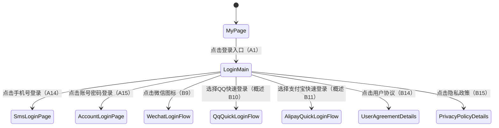
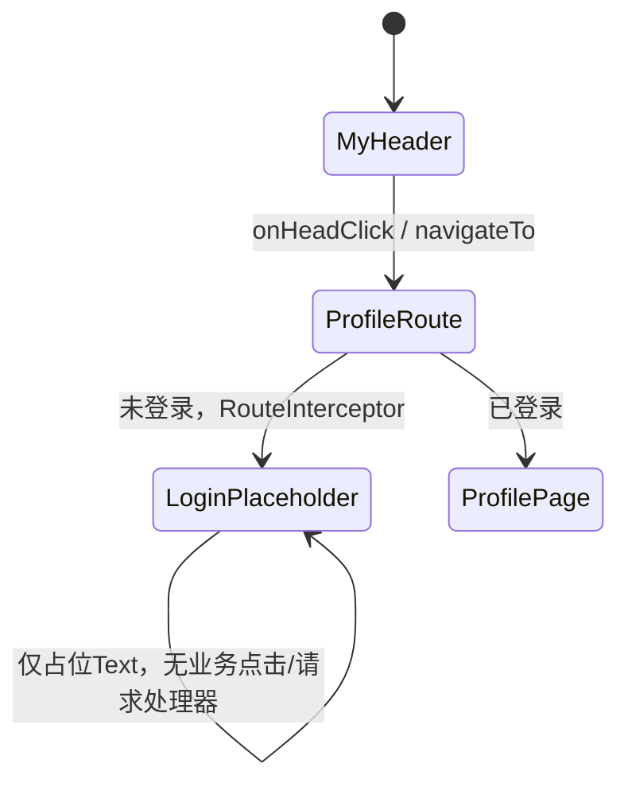
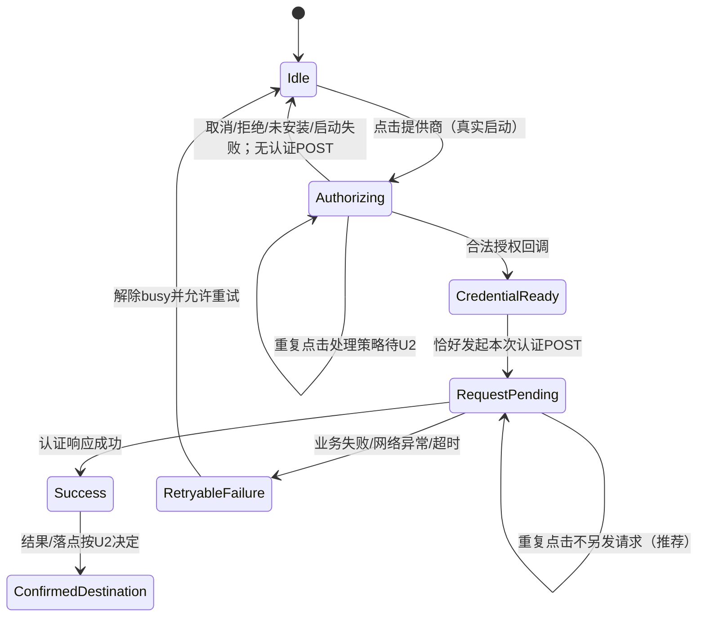

# cml-spec7 验收矩阵草稿（仅分析）

## 1. 输入、范围与证据约定

- 派工：`workflow/requirements/dispatch-01.md`。本轮只执行 `spec-harness/0-analyze.md` 的需求拆解；不设计或实现业务，不写生产代码、测试、全局状态或最终 `spec/acceptance.md`。
- 2026-10-20 静态核实：HEAD 为 `75fd0066a7fc0c1e8cedb6218df081f86d307f45`，与 `spec/metadata.json:2` 的 `base_commit` 一致；开始时 `git status --short` 仅有本题准备目录为 untracked，无 tracked 源码差异。
- `spec/requirement.md` SHA256：`d4600d3b744f8d5cd11d2c5e09e2148798a439b5206c03ffbf3c8c70a411fed9`。
- `spec/metadata.json` SHA256：`cf5f402ae5042331bf332c4173a3b26ddb3c2494cee9976bd2b39106ca0e5a88`。
- 原生子会话环境 `CODEX_THREAD_ID=01a158b7-9d99-7260-95c0-1f8da4f27301`；它不同于继承的 `CODEX_SESSION_ID=01a158b5-95c1-7843-be11-cfb16aaa2e74`，后者不作为子会话 UUID。调度路径为 `/root/requirements`。
- 仅读取本题 Spec、metadata、任务说明和本题基线源码；没有读取其他题、上游实现/修复历史或初始化总览会话。
- 本角色没有构建、安装或实际操作设备。文内“代码事实”均仅静态核对，不能替代验证角色的构建、UI 树、截图、网络或设备证据。下文 Hypium 内容是验收断言方案，全部尚未执行。

证据等级：`SPEC_EXPLICIT` 为 Spec 明文；`REASONABLE_DERIVATION` 为有依据但不冒充明文的推导；`UNCONFIRMED_ASSUMPTION` 为尚无证据可唯一决定的假设。基线代码事实另标“静态事实”，不是业务要求。矩阵拆分数量不代表官方 F-point 数或分值。

## 2. 观察与选择器约定

以下稳定 id 全部为**建议补充，需在实现时补 `.id()`**，不是现存 id。静态检索 `feature/auth/src/main/ets`、`feature/main/src/main/ets/view/MePage.ets`、`feature/main/src/main/ets/view/MainPage.ets` 与 `core/ui/src/main/ets/component/icon/LogoIcon.ets` 未发现 `.id()`。新增 id 必须落到真实可观察的组件，不能增加不可见测试文字来替代真实内容。

| 简称 | 建议 id | 用途与基线事实 |
| --- | --- | --- |
| 我的页签 | `main_tab_me` | 现有主页面第 4 个 Tab，`feature/main/src/main/ets/view/MainPage.ets:71`；显示名来自 `feature/main/src/main/ets/viewmodel/MainViewModel.ets:25`。 |
| 登录入口 | `me_login_entry` | 现有用户信息区域/头像点击入口，`feature/main/src/main/ets/view/MePage.ets:102`、`:108`、`:114`；登录提示文字位于 `:167`。 |
| 登录页/可用内容区 | `auth_login_page` / `auth_login_content` | 当前 `feature/auth/src/main/ets/view/LoginPage.ets:21` 容器下仅有 `:35` 的占位 Text；建议分别量测页面和内容边界。 |
| Logo | `auth_login_logo` | 尚未放入登录页。可复用 `core/ui/src/main/ets/component/icon/LogoIcon.ets:8`。 |
| 按钮区 | `auth_login_button_region` | 基线缺失；必须与个别 Button 的内部留白区别，供比例断言使用。 |
| 主/次按钮 | `auth_login_phone` / `auth_login_account` | 基线缺失。 |
| 其他登录文字/图标行 | `auth_login_other_methods` / `auth_login_social_row` | 基线缺失。 |
| 三方图标 | `auth_login_wechat_icon` / `auth_login_qq_icon` / `auth_login_alipay_icon` | 基线缺失。id 应对应真实可点击图标或其点击区域；不能仅给标签加 id。 |
| 三方标签 | `auth_login_wechat_label` / `auth_login_qq_label` / `auth_login_alipay_label` | 基线缺失，分别断言文字和图标下方位置。 |
| 底部文案与链接 | `auth_login_agreement_footer` / `auth_login_user_agreement` / `auth_login_privacy_policy` | 基线缺失。若使用 Span，须在设备上确认 UiTest 能否独立定位并点击；不可见时需真实独立点击节点或经过验证的文本范围点击方案。 |
| 短信/账号目标页 | `auth_sms_login_page` / `auth_account_login_page` | 已有页面和路由，无 id；页面源码分别 `feature/auth/src/main/ets/view/SmsLoginPage.ets:9`、`AccountLoginPage.ets:9`。 |
| 协议/隐私目标页和正文 | `common_user_agreement_page` / `common_user_agreement_content` / `common_privacy_policy_page` / `common_privacy_policy_content` | 已有占位页面，无真实详情正文，见第 7 节。 |
| 三方流程/忙碌/错误观察点 | `auth_login_provider_state` / `auth_login_loading` / `auth_login_error` | 基线缺失；只在实际业务确有相应可见状态且完成 U2 决策后确定，不能为测试伪造成功状态。 |

Hypium 观察原则：

1. 用 id 定位组件并断言存在、显示文字、目标页唯一性及组件边界。以实际可见 UI 为准；`auth_sms_login_page` 与 `auth_account_login_page` 均须区分目标页，不只断言共有的“登录”。内部路由名可用有依据的日志/栈检查作补充，不声称普通 UI 树直接暴露路由名。
2. 位置/比例由同一屏幕同一单位的组件边界计算。`w = right-left`，`cx = (left+right)/2`。建议几何比对允许不超过 1 个物理像素的布局舍入误差，记录密度和实际边界；这只是测试测量建议，不改变 Spec 的 100%/70%/60%。U3 未决前保留页面/内容/窗口三种宽度原值。
3. Hypium 通用 UiTest 组件检查不等同于可直接读取颜色、填充、圆角半径或图片语义。A2/A8/A9/A12/A13/B18/B19 需在 Hypium 定位后取得截图，辅以图像/人工核对；不可只凭 `.id()` 或 Button 类型宣告样式通过。图像比对工具及基准尚未建立。
4. “顶部”“最底部”不擅自增加固定 y 值或固定边距；检查区域先后关系、底部归属、居中和不被系统安全区遮挡。精确纵向间距未被 Spec 指定。
5. 三图标均匀间距检查按 x 排序后的相邻图标边缘间距相等；外侧留白是否与内侧间距相等没有明文要求。按列举顺序排列是合理建议，不将左右顺序升格为硬性要求。
6. 网络数量仅统计本次登录交互的相关请求，不能把首页/其他模块后台请求算作登录动作触发。只断言导航也不能证明没有 HTTP 请求；需要网络记录或可控数据源补充。

## 3. 明文验收矩阵：41 个原子项

以下每项均为 `SPEC_EXPLICIT`。来源行号均指本题 `spec/requirement.md`；引号中的内容按原文逐字摘录。八维信息在第 4 节按相同编号逐项给出，属于该验收项的组成部分。

### 场景一：15 项

| 编号 | 来源与证据等级 | Spec 原文摘录 | 原子行为 | 可观察的 Hypium 断言 | 稳定选择器 |
| --- | --- | --- | --- | --- | --- |
| A1 | 场景一/步骤 1，L11；SPEC_EXPLICIT | `用户点击"我的"页面中的登录入口，进入登录主页面。` | 从“我的”的登录入口进入登录主页。 | 点击真实入口后 `auth_login_page` 可见；不是个人资料页；记录进入前后 UI 树和截图。 | `main_tab_me`、`me_login_entry`、`auth_login_page`；均需补 id。 |
| A2 | 场景一/概述 L7、步骤 2 L12；SPEC_EXPLICIT | `页面顶部居中显示应用 Logo 图标（尺寸 120）。` | 登录主页显示应用 Logo 图标。 | `auth_login_logo` 可见，截图图案与本应用 Logo 相符；普通 Image 组件存在本身不证明图案正确。 | `auth_login_logo`；需补 id。 |
| A3 | 场景一/步骤 2，L12；SPEC_EXPLICIT | `页面顶部居中显示应用 Logo 图标（尺寸 120）。` | Logo 位于页面顶部区域。 | Logo 在主要内容的上方，位于按钮区之前；截图确认属于顶部而非页面中/底部。Spec 无固定顶部间距。 | `auth_login_content`、`auth_login_logo`、`auth_login_button_region`；需补 id。 |
| A4 | 场景一/步骤 2，L12；SPEC_EXPLICIT | `页面顶部居中显示应用 Logo 图标（尺寸 120）。` | Logo 水平居中。 | Logo 的 `cx` 与所属页面内容区域 `cx` 相等（仅允许测量舍入）。 | `auth_login_content`、`auth_login_logo`；需补 id。 |
| A5 | 场景一/步骤 2，L12；SPEC_EXPLICIT | `页面顶部居中显示应用 Logo 图标（尺寸 120）。` | Logo 尺寸为 120。 | 记录 Logo 边界；采用 D1 的既有组件单位约定后断言宽高均为 120vp 的像素换算值。120 数值是明文，方形和 vp 是推导。 | `auth_login_logo`；需补 id。 |
| A6 | 场景一/概述 L7、步骤 3 L13；SPEC_EXPLICIT | `"手机号登录"主按钮（实心圆角样式）` | 显示文字为“手机号登录”的主按钮。 | `auth_login_phone` 是可点击主操作，真实显示文字逐字等于 `手机号登录`；不能用基线资源“验证码登录”替代。 | `auth_login_phone`；需补 id。 |
| A7 | 场景一/步骤 3，L13；SPEC_EXPLICIT | `Logo 下方有"手机号登录"主按钮（实心圆角样式）` | 手机号登录主按钮位于 Logo 下方。 | 按钮的 `top >= logo.bottom`（屏幕 y 向下增加）；按钮显示在 Logo 下方的纵向区域。 | `auth_login_logo`、`auth_login_phone`；需补 id。 |
| A8 | 场景一/步骤 3，L13；SPEC_EXPLICIT | `"手机号登录"主按钮（实心圆角样式）` | 手机号主按钮为实心样式。 | Hypium 定位并截图；按钮内部有连续实体填充。不是只有描边；填充色具体色值未指定。 | `auth_login_phone`；需补 id；样式另需截图核对。 |
| A9 | 场景一/步骤 3，L13；SPEC_EXPLICIT | `"手机号登录"主按钮（实心圆角样式）` | 手机号主按钮为圆角样式。 | Hypium 定位并截图；四角呈圆角，具体半径不作为明文断言。 | `auth_login_phone`；需补 id；样式另需截图核对。 |
| A10 | 场景一/概述 L7、步骤 3 L13；SPEC_EXPLICIT | `"账号密码登录"次级按钮（空心圆角样式）` | 显示文字为“账号密码登录”的次级按钮。 | `auth_login_account` 可点击且文字逐字等于 `账号密码登录`；与实心主操作形成次级视觉层次。 | `auth_login_account`；需补 id。 |
| A11 | 场景一/步骤 3，L13；SPEC_EXPLICIT | `Logo 下方有"手机号登录"主按钮（实心圆角样式）和"账号密码登录"次级按钮（空心圆角样式）。` | 账号密码次级按钮位于 Logo 下方。 | 次按钮的 `top >= logo.bottom`（屏幕 y 向下增加）。两个按钮之间的固定间距/上下顺序不是独立明文数值要求。 | `auth_login_logo`、`auth_login_account`；需补 id。 |
| A12 | 场景一/步骤 3，L13；SPEC_EXPLICIT | `"账号密码登录"次级按钮（空心圆角样式）` | 账号密码次按钮为空心样式。 | 定位并截图；存在边框、内部呈空心视觉，与实心主按钮不同。具体边框色和宽度未指定。 | `auth_login_account`；需补 id；样式另需截图核对。 |
| A13 | 场景一/步骤 3，L13；SPEC_EXPLICIT | `"账号密码登录"次级按钮（空心圆角样式）` | 账号密码次按钮为圆角样式。 | 定位并截图确认圆角；不擅定具体半径。 | `auth_login_account`；需补 id；样式另需截图核对。 |
| A14 | 场景一/概述 L7、步骤 4 L14；SPEC_EXPLICIT | `用户点击"手机号登录"按钮，跳转到手机短信验证码登录页面。` | 点击手机号主按钮跳转到短信验证码登录页。 | 点击后 `auth_sms_login_page` 可见、`auth_account_login_page` 不可见；可补核路由 `auth/sms-login`。仅跳转不等于发送验证码或登录成功。 | `auth_login_phone`、`auth_sms_login_page`、`auth_account_login_page`；需补 id。 |
| A15 | 场景一/步骤 5，L15；SPEC_EXPLICIT | `用户点击"账号密码登录"按钮，跳转到账号密码登录页面。` | 点击账号密码次按钮跳转到账号密码登录页。 | 点击后 `auth_account_login_page` 可见、短信目标页不可见；可补核路由 `auth/account-login`。 | `auth_login_account`、`auth_account_login_page`、`auth_sms_login_page`；需补 id。 |

### 场景二：19 项（包含概述独有要求）

| 编号 | 来源与证据等级 | Spec 原文摘录 | 原子行为 | 可观察的 Hypium 断言 | 稳定选择器 |
| --- | --- | --- | --- | --- | --- |
| B1 | 场景二/步骤 1，L25；SPEC_EXPLICIT | `登录按钮下方显示"其他登录方式"提示文字。` | 显示提示“其他登录方式”。 | 提示节点可见，文字逐字等于 `其他登录方式`。 | `auth_login_other_methods`；需补 id。 |
| B2 | 场景二/步骤 1，L25；SPEC_EXPLICIT | `登录按钮下方显示"其他登录方式"提示文字。` | 提示位于登录按钮下方。 | `hint.top >= max(phone.bottom, account.bottom)`（屏幕 y 向下增加），纵向不重叠。 | `auth_login_phone`、`auth_login_account`、`auth_login_other_methods`；需补 id。 |
| B3 | 场景二/概述 L21、步骤 2 L26；SPEC_EXPLICIT | `三个第三方登录图标：微信、QQ、支付宝。` | 显示微信、QQ、支付宝三个第三方登录图标。 | 目标区域三图标均可见，数量为 3，截图分别识别对应品牌；不把文字标签当作图标。 | 三个 `auth_login_*_icon`、`auth_login_social_row`；需补 id。 |
| B4 | 场景二/步骤 2，L26；SPEC_EXPLICIT | `文字下方以均匀间隔排列三个第三方登录图标：微信、QQ、支付宝。` | 三图标位于提示文字下方。 | 三个图标各自的 `top >= hint.bottom`（屏幕 y 向下增加），均处于提示下方。 | `auth_login_other_methods`、`auth_login_social_row`、三个图标；需补 id。 |
| B5 | 场景二/步骤 2，L26；SPEC_EXPLICIT | `文字下方以均匀间隔排列三个第三方登录图标：微信、QQ、支付宝。` | 三图标的相邻间距均匀。 | 读取三图标边界，按 x 排序后两段相邻边缘间距相等且非负；截图确认横向排列。 | 三个 `auth_login_*_icon`；需补 id。 |
| B6 | 场景二/步骤 3 L27，图标对应名 L26；SPEC_EXPLICIT | `每个图标下方有对应的文字说明。`；`微信、QQ、支付宝` | 微信图标下方显示对应文字说明。 | `auth_login_wechat_label` 文字为 `微信`，位于微信图标下方且水平对应。 | `auth_login_wechat_icon`、`auth_login_wechat_label`；需补 id。 |
| B7 | 场景二/步骤 3 L27，图标对应名 L26；SPEC_EXPLICIT | `每个图标下方有对应的文字说明。`；`微信、QQ、支付宝` | QQ 图标下方显示对应文字说明。 | `auth_login_qq_label` 文字为 `QQ`，位于 QQ 图标下方且水平对应。 | `auth_login_qq_icon`、`auth_login_qq_label`；需补 id。 |
| B8 | 场景二/步骤 3 L27，图标对应名 L26；SPEC_EXPLICIT | `每个图标下方有对应的文字说明。`；`微信、QQ、支付宝` | 支付宝图标下方显示对应文字说明。 | `auth_login_alipay_label` 文字为 `支付宝`，位于支付宝图标下方且水平对应。 | `auth_login_alipay_icon`、`auth_login_alipay_label`；需补 id。 |
| B9 | 场景二/步骤 4，L28；SPEC_EXPLICIT | `用户点击微信图标，触发微信登录流程。` | 点击微信图标启动微信登录流程。 | 点击真实图标后观察确实进入微信授权/登录交互或真实登录服务流程；同时记录可见状态和对应调用证据。仅弹出“暂不支持”或仅换文字不满足触发流程。具体 SDK/HTTP/成功落点待 U2。 | `auth_login_wechat_icon`；流程观察点及外部应用选择器需 U2 后确定。 |
| B10 | 场景二/概述，L21；SPEC_EXPLICIT | `第三方登录入口（微信、QQ、支付宝），可以选择第三方账号快速登录` | QQ 入口可选择，用于对应第三方账号快速登录。 | 从可见 QQ 入口选择后有对应快速登录交互证据；不能仅为不可操作装饰。点击图标为建议操作方式，最终完成范围待 U2。 | `auth_login_qq_icon`；需补 id；流程选择器待 U2。 |
| B11 | 场景二/概述，L21；SPEC_EXPLICIT | `第三方登录入口（微信、QQ、支付宝），可以选择第三方账号快速登录` | 支付宝入口可选择，用于对应第三方账号快速登录。 | 从可见支付宝入口选择后有对应快速登录交互证据；不能仅为不可操作装饰。最终完成范围待 U2，基线支付接口不能当作登录接口。 | `auth_login_alipay_icon`；需补 id；流程选择器待 U2。 |
| B12 | 场景二/概述 L21、步骤 5 L29；SPEC_EXPLICIT | `页面底部展示用户协议和隐私政策`；`《用户协议》` | 底部展示用户协议文字入口。 | 底部区域可见 `《用户协议》`，可独立定位点击范围。 | `auth_login_agreement_footer`、`auth_login_user_agreement`；需补 id。 |
| B13 | 场景二/概述 L21、步骤 5 L29；SPEC_EXPLICIT | `页面底部展示用户协议和隐私政策`；`《隐私政策》` | 底部展示隐私政策文字入口。 | 底部区域可见 `《隐私政策》`，可独立定位点击范围。 | `auth_login_agreement_footer`、`auth_login_privacy_policy`；需补 id。 |
| B14 | 场景二/概述，L21；SPEC_EXPLICIT | `页面底部展示用户协议和隐私政策，用户可点击查看详情。` | 点击用户协议可查看对应详情。 | 点击 `《用户协议》` 后对应详情页/详情视图可见，并有实际协议内容；仅显示目标页标题或“用户协议页面内容视图”不足以证明详情。内容来源/正文判据待 U4。 | `auth_login_user_agreement`、`common_user_agreement_page`、`common_user_agreement_content`；需补 id。 |
| B15 | 场景二/概述，L21；SPEC_EXPLICIT | `页面底部展示用户协议和隐私政策，用户可点击查看详情。` | 点击隐私政策可查看对应详情。 | 点击 `《隐私政策》` 后对应详情页/详情视图可见，并有实际隐私内容；仅标题或占位文字不足。内容来源/正文判据待 U4。 | `auth_login_privacy_policy`、`common_privacy_policy_page`、`common_privacy_policy_content`；需补 id。 |
| B16 | 场景二/步骤 5，L29；SPEC_EXPLICIT | `登录即代表同意《用户协议》和《隐私政策》` | 展示完整且逐字一致的登录同意说明。 | 可见句子按显示顺序拼合后精确等于 `登录即代表同意《用户协议》和《隐私政策》`；不得插入“您已阅读并”。允许自然换行，不改文案。 | `auth_login_agreement_footer` 及真实可见文本子节点；需补 id。 |
| B17 | 场景二/步骤 5，L29；SPEC_EXPLICIT | `页面最底部展示"登录即代表同意《用户协议》和《隐私政策》"的文案` | 同意说明位于页面最底部。 | 页脚位于主要登录内容之后且贴近页面底部区域，截图确认没有被挤至中段或系统栏下；精确底部留白未指定。 | `auth_login_page`、`auth_login_content`、`auth_login_agreement_footer`；需补 id。 |
| B18 | 场景二/步骤 5，L29；SPEC_EXPLICIT | `链接文字为主题色。` | 用户协议链接使用主题色。 | 定位 `《用户协议》` 并截图与当前主题主色核对；D2 推荐基线 `app.color.primary`。普通文字存在不能证明颜色。 | `auth_login_user_agreement`；需补 id；另需截图/颜色证据。 |
| B19 | 场景二/步骤 5，L29；SPEC_EXPLICIT | `链接文字为主题色。` | 隐私政策链接使用主题色。 | 定位 `《隐私政策》` 并截图与当前主题主色核对；不能把整个句子变色当作两个链接可点击性的证明。 | `auth_login_privacy_policy`；需补 id；另需截图/颜色证据。 |

### 场景三：7 项

| 编号 | 来源与证据等级 | Spec 原文摘录 | 原子行为 | 可观察的 Hypium 断言 | 稳定选择器 |
| --- | --- | --- | --- | --- | --- |
| C1 | 场景三/步骤 1，L39；SPEC_EXPLICIT | `用户在手机设备上打开登录页面，按钮区域宽度为屏幕全宽。` | 手机设备的按钮区域为屏幕全宽。 | 在手机环境量测按钮区域与屏幕/窗口原始边界，断言比例为 100%；宽度口径与分屏分类的 U1/U3 必须先明确，不能默认把带 padding 的内区当全屏。 | `auth_login_button_region`、`auth_login_page`、`auth_login_content`；需补 id。 |
| C2 | 场景三/概述 L35、步骤 2 L40；SPEC_EXPLICIT | `在平板设备上打开登录页面，按钮区域宽度缩小至页面宽度的 70%，居中对齐。` | 平板设备按钮区域宽度为页面的 70%。 | 平板环境断言 `buttonRegion.width / page.width = 0.70`；保存绝对宽度与密度；页面宽度口径待 U3。 | `auth_login_button_region`、`auth_login_page`、`auth_login_content`；需补 id。 |
| C3 | 场景三/概述 L35、步骤 2 L40；SPEC_EXPLICIT | `在平板设备上打开登录页面，按钮区域宽度缩小至页面宽度的 70%，居中对齐。` | 平板的按钮区域水平居中。 | `buttonRegion.cx = page.cx`，左右外侧留白相等。 | `auth_login_button_region`、`auth_login_page`；需补 id。 |
| C4 | 场景三/概述 L35、步骤 3 L41；SPEC_EXPLICIT | `在更宽的设备上，按钮区域进一步缩小至页面宽度的 60%。` | 更宽/大屏设备按钮区域宽度为页面的 60%。 | 大屏环境断言 `buttonRegion.width / page.width = 0.60`；保留绝对宽度记录。分类和口径待 U1/U3。 | `auth_login_button_region`、`auth_login_page`、`auth_login_content`；需补 id。 |
| C5 | 场景三/概述，L35；SPEC_EXPLICIT | `大屏设备缩小为 60%，保持居中显示。` | 大屏按钮区域保持水平居中。 | 大屏环境 `buttonRegion.cx = page.cx`，左右外侧留白相等。不能因步骤 3 没复述居中而漏测。 | `auth_login_button_region`、`auth_login_page`；需补 id。 |
| C6 | 场景三/步骤 4，L42；SPEC_EXPLICIT | `所有尺寸下第三方登录图标均以均匀间距在按钮区域内排列。` | 每种尺寸的三方图标均以均匀间距排列。 | 在手机、平板、大屏逐一断言相邻图标边缘间距相等且非负。B5 不能只在单一手机尺寸测一次替代。 | `auth_login_social_row`、三个图标；需补 id。 |
| C7 | 场景三/步骤 4，L42；SPEC_EXPLICIT | `所有尺寸下第三方登录图标均以均匀间距在按钮区域内排列。` | 每种尺寸的三方图标均排列在按钮区域内。 | 在手机、平板、大屏逐一断言三个图标的边界包含于按钮区域，不超出或裁切；该区域需要包含三方登录内容的真实可测边界。 | `auth_login_button_region`、`auth_login_social_row`、三个图标；需补 id。 |

## 4. 每项八维信息

本表与第 3 节同编号合并构成完整验收项。前置“未登录”是基线可达路径的测试条件，不是将 Spec 改成仅未登录时才须实现页面。通用边界编号详见第 6 节；表内引用表示也要执行对应边界审查，不表示自动变成额外明文要求。

| 编号 | 入口 | 前置数据 | 用户动作 | UI 结果 | 数据结果 | 网络结果 | 返回结果 | 边界条件 |
| --- | --- | --- | --- | --- | --- | --- | --- | --- |
| A1 | “我的”登录入口 | 未登录、主页面可用 | 点击登录入口 | 登录主页可见 | 不适用：只规定导航，未要求数据写入 | 未规定 HTTP；基线路由拦截本身无登录请求 | 未规定回传值；建议返回“我的”，见 D4 | E03–E06、E11–E12；已登录分支不替换未登录入口测试 |
| A2 | 登录主页 | A1 已进入 | 查看 | 应用 Logo 可见 | 不适用：静态图像显示 | 不适用：此项无远端图片要求 | 不适用：只显示组件 | E07、E11–E12；三尺寸均检查 |
| A3 | 登录主页 | A1 已进入 | 查看布局 | Logo 在顶部 | 不适用：静态布局 | 不适用：此项无请求 | 不适用：无离页动作 | E07、E11–E12；小高度/横屏记录顶部关系 |
| A4 | 登录主页 | A1 已进入 | 查看布局 | Logo 水平居中 | 不适用：静态布局 | 不适用：此项无请求 | 不适用：无离页动作 | 三尺寸及旋转后居中；动态 resize 属 D5 |
| A5 | 登录主页 | A1 已进入；密度已记录 | 测量 Logo | 尺寸 120；D1 解释 vp/方形 | 不适用：尺寸显示 | 不适用：此项无请求 | 不适用：无离页动作 | 不同密度换算；不把 120px 当作明文 |
| A6 | 登录主页 | A1 已进入 | 查看主按钮 | 显示“手机号登录” | 不适用：静态文字 | 不适用：查看按钮不定义请求 | 不适用：无离页动作 | E01–E02 不适用主页面输入；E07、E11–E12 |
| A7 | 登录主页 | Logo 与主按钮可见 | 查看布局 | 主按钮在 Logo 下方 | 不适用：静态布局 | 不适用：此项无请求 | 不适用：无离页动作 | 三尺寸/短窗口无重叠，见 E07 |
| A8 | 登录主页 | 主按钮可见 | 查看并截图 | 实心 | 不适用：视觉样式 | 不适用：此项无请求 | 不适用：无离页动作 | 当前主题下核对；具体填充色未指定 |
| A9 | 登录主页 | 主按钮可见 | 查看并截图 | 圆角 | 不适用：视觉样式 | 不适用：此项无请求 | 不适用：无离页动作 | 三尺寸核对；具体半径未指定 |
| A10 | 登录主页 | A1 已进入 | 查看次按钮 | 显示“账号密码登录” | 不适用：静态文字 | 不适用：查看按钮不定义请求 | 不适用：无离页动作 | E01–E02 不适用主页面输入；E07、E11–E12 |
| A11 | 登录主页 | Logo 与次按钮可见 | 查看布局 | 次按钮在 Logo 下方 | 不适用：静态布局 | 不适用：此项无请求 | 不适用：无离页动作 | 三尺寸/短窗口无重叠；无指定两个按钮间距 |
| A12 | 登录主页 | 次按钮可见 | 查看并截图 | 空心 | 不适用：视觉样式 | 不适用：此项无请求 | 不适用：无离页动作 | 当前主题下可辨；边框数值未指定 |
| A13 | 登录主页 | 次按钮可见 | 查看并截图 | 圆角 | 不适用：视觉样式 | 不适用：此项无请求 | 不适用：无离页动作 | 三尺寸核对；半径未指定 |
| A14 | 手机号登录主按钮 | 登录主页可见；无须输入手机号 | 点击主按钮 | 短信验证码登录页可见 | 未要求发送验证码、写 Token 或修改用户状态 | Spec 仅要求跳转；无发送短信/认证请求要求，见网络表 | 未规定回传结果；D4 建议返回原主页 | E03–E06、E09–E12；目标页的输入校验不属本题明文 |
| A15 | 账号密码次按钮 | 登录主页可见；无须输入账号密码 | 点击次按钮 | 账号密码登录页可见 | 未要求校验凭据或写登录态 | Spec 仅要求跳转；无密码登录请求要求 | 未规定回传结果；D4 建议返回原主页 | E03–E06、E09–E12；凭据校验不扩展为本题要求 |
| B1 | 登录主页 | 按钮区域已显示 | 查看提示 | 显示“其他登录方式” | 不适用：静态文字 | 不适用：无请求要求 | 不适用：只显示文字 | E07、E11–E12；三尺寸不漏字 |
| B2 | 登录主页 | 两登录按钮与提示可见 | 查看布局 | 提示在登录按钮下方 | 不适用：静态布局 | 不适用：无请求要求 | 不适用：无离页动作 | 三尺寸/短高度不重叠 |
| B3 | 登录主页 | 提示已显示 | 查看三图标 | 微信/QQ/支付宝三种图标 | 不适用：静态图标集合 | 不适用：查看图标不定义请求 | 不适用：无离页动作 | E07；服务端无数据不决定图标集合 |
| B4 | 登录主页 | 提示与三图标可见 | 查看布局 | 三图标在提示下方 | 不适用：静态布局 | 不适用：此项无请求 | 不适用：无离页动作 | 三尺寸/短高度无重叠 |
| B5 | 登录主页 | 三图标可见 | 测量相邻间距 | 相邻间距均匀 | 不适用：静态布局 | 不适用：此项无请求 | 不适用：无离页动作 | 三尺寸；外侧间距不擅自等同内侧间距 |
| B6 | 微信图标及标签 | 微信图标可见 | 查看标签 | 微信文字在微信图标下方 | 不适用：静态说明 | 不适用：此项无请求 | 不适用：无离页动作 | 三尺寸；长字体/缩放记录裁切风险，非新增字号要求 |
| B7 | QQ 图标及标签 | QQ 图标可见 | 查看标签 | QQ 文字在 QQ 图标下方 | 不适用：静态说明 | 不适用：此项无请求 | 不适用：无离页动作 | 三尺寸；不能拿其他 QQ 文本命中替代对应关系 |
| B8 | 支付宝图标及标签 | 支付宝图标可见 | 查看标签 | 支付宝文字在对应图标下方 | 不适用：静态说明 | 不适用：此项无请求 | 不适用：无离页动作 | 三尺寸；不得仅展示支付宝名称无图标 |
| B9 | 微信图标 | 登录主页；外部授权/账号条件待 U2 | 点击微信图标 | 启动微信登录流程 | Spec 未定义凭据、Token、成功后的用户模型 | 是否 HTTP、发起时机/参数/加载态未写明；基线微信 POST 存在但未接 UI | 取消/成功/失败后的落点未写明，见 U2/D3 | E03–E06、E09–E12；未安装、拒绝、取消与请求失败均需后续决策 |
| B10 | QQ 快速登录入口 | 登录主页；外部授权/账号条件待 U2 | 选择 QQ 入口（建议点击图标） | 对应可操作快速登录交互 | 登录完成与持久化未写明 | 基线 QQ POST 存在但未接 UI；Spec 无请求契约 | 成功/取消/失败落点未写明，见 U2/D3 | E03–E06、E09–E12；真实流程不可用不得标通过 |
| B11 | 支付宝快速登录入口 | 登录主页；外部授权/账号条件待 U2 | 选择支付宝入口（建议点击图标） | 对应可操作快速登录交互 | 登录完成与持久化未写明 | 已读认证数据源无支付宝登录接口；不能用支付请求替代 | 成功/取消/失败落点未写明，见 U2/D3 | E03–E06、E09–E12；无接口是能力缺口，不降低要求 |
| B12 | 登录页底部 | 登录主页可见 | 查看用户协议入口 | “《用户协议》”可见 | 不适用：静态文字 | 不适用：仅显示无请求要求 | 不适用：只显示；点击另见 B14 | E07；小屏自然换行仍须可见 |
| B13 | 登录页底部 | 登录主页可见 | 查看隐私政策入口 | “《隐私政策》”可见 | 不适用：静态文字 | 不适用：仅显示无请求要求 | 不适用：只显示；点击另见 B15 | E07；小屏自然换行仍须可见 |
| B14 | 《用户协议》 | 底部链接可见 | 点击用户协议 | 对应详情及正文可见 | 未规定保存同意状态或其他写入 | 未规定本地正文、HTTP 或 WebView；U4 未决，不擅定请求 | 未规定回传值；D4 建议返回登录主页 | E03–E06、E07、E09–E12；加载/离线行为受 U4 决策影响 |
| B15 | 《隐私政策》 | 底部链接可见 | 点击隐私政策 | 对应详情及正文可见 | 未规定保存同意状态或其他写入 | 未规定本地正文、HTTP 或 WebView；U4 未决 | 未规定回传值；D4 建议返回登录主页 | E03–E06、E07、E09–E12；不得串至用户协议详情 |
| B16 | 登录页页脚 | 登录主页可见 | 查看完整句子 | 逐字符合 Spec 的同意文案 | 不适用：文字本身不是同意记录 | 不适用：此项未定义请求 | 不适用：无离页动作 | 自然换行/Span 拆分不改字符；不擅加勾选框门槛 |
| B17 | 登录主页 | 页脚可见、屏幕边界已记录 | 查看纵向布局 | 文案在页面最底部区域 | 不适用：布局 | 不适用：此项无请求 | 不适用：无离页动作 | 三尺寸/短高/系统栏不遮挡；无固定底部间距要求 |
| B18 | 用户协议链接 | 当前主题和链接可见 | 定位并截图 | 用户协议链接为主题色 | 不适用：视觉样式 | 不适用：此项无请求 | 不适用：无离页动作 | 明暗主题采用当前主题；D2 解释资源，不新增配色要求 |
| B19 | 隐私政策链接 | 当前主题和链接可见 | 定位并截图 | 隐私政策链接为主题色 | 不适用：视觉样式 | 不适用：此项无请求 | 不适用：无离页动作 | 与 B18 一致；两个独立链接各自核对 |
| C1 | 手机设备登录主页 | 手机分类和宽度口径 U1/U3 已定 | 打开页面并量测 | 按钮区域全屏宽 | 不适用：布局状态不写业务数据 | 不适用：宽度适配本身无网络要求 | 不适用：无离页动作 | 窄屏/密度/横屏/分屏；分类不能凭物理机名擅定 |
| C2 | 平板设备登录主页 | 平板分类 U1、页面基准 U3 已定 | 打开页面并量测 | 按钮区为页面 70% | 不适用：布局 | 不适用：无请求要求 | 不适用：无离页动作 | 阈值两侧/边界点为 U1 后的参数化测试 |
| C3 | 平板设备登录主页 | C2 的边界已记录 | 量测中心点 | 按钮区居中 | 不适用：布局 | 不适用：无请求要求 | 不适用：无离页动作 | 留白对称；安全区变化记录实际页面边界 |
| C4 | 大屏设备登录主页 | 大屏分类 U1、页面基准 U3 已定 | 打开页面并量测 | 按钮区为页面 60% | 不适用：布局 | 不适用：无请求要求 | 不适用：无离页动作 | 阈值两侧/超宽屏；不自行加最大宽度上限 |
| C5 | 大屏设备登录主页 | C4 的边界已记录 | 量测中心点 | 按钮区居中 | 不适用：布局 | 不适用：无请求要求 | 不适用：无离页动作 | 大屏及窗口变化；动态 resize 属 D5 |
| C6 | 各尺寸登录主页 | 手机、平板、大屏分别可用 | 分别量测三图标间距 | 相邻间距均匀 | 不适用：布局 | 不适用：此项无请求要求 | 不适用：无离页动作 | 三尺寸全覆盖；极窄屏无重叠 |
| C7 | 各尺寸登录主页 | 手机、平板、大屏及按钮区域分别可测 | 分别量测三图标和按钮区域 | 图标均在区域内 | 不适用：布局 | 不适用：此项无请求要求 | 不适用：无离页动作 | 三尺寸全覆盖；极窄屏不能裁掉第三个图标 |

## 5. 合理推导与待确认假设（不混入 41 个明文项）

### 5.1 有代码依据的推导

| 编号/等级 | 依据与推荐解释 | 可观察结果及八维信息 | 选择器 |
| --- | --- | --- | --- |
| D1 / REASONABLE_DERIVATION | A5 的“尺寸 120”沿用现有 LogoIcon 的单一 `iconSize`，解释为 120×120vp。依据：`core/ui/src/main/ets/component/icon/LogoIcon.ets:10` 标注 vp，`:27` 传递大小；`CommonIcon.ets:35`、`:36` 同时设置宽高。Spec L12 只写 120。 | 入口：登录页；前置：密度已知；动作：量测；UI：宽高换算均为 120vp；数据：不适用，尺寸项；网络：不适用，静态资源；返回：不适用，未离页；边界：多密度下不能固定取 120px。 | `auth_login_logo`；需补 id。 |
| D2 / REASONABLE_DERIVATION | B18/B19 的“主题色”推荐沿用设计系统 `app.color.primary`，不发明独立颜色。依据：`core/designsystem/src/main/resources/base/element/color.json:4` 定义 `primary`；`feature/main/src/main/ets/view/MainPage.ets:120` 现有主色使用方式。 | 入口：页脚链接；前置：当前主题；动作：截图；UI：两链接与当前主色一致；数据：不适用，样式；网络：不适用，样式；返回：不适用，未离页；边界：当前明暗主题、抗锯齿像素不能当色值漂移。 | 两个协议链接 id；需补 id；截图补证。 |
| D3 / REASONABLE_DERIVATION | 三方授权取消、失败或请求结束时，应恢复可操作状态且不凭取消/失败伪造登录态。Spec L28 要求真实流程，恢复细节未明文。基线 `RequestHelper.ets:126`–`:129` 在 finally 结束 loading；`UserState.ets:134` 以 Token 判断登录。此项为推荐恢复约束，不指定必须出现某句 toast。 | 入口：三方流程；前置：U2 已决、可控制成功/取消/异常；动作：取消/拒绝/失败；UI：忙碌状态结束、能重试；数据：不写假 Token；网络：取消发生在凭据前不认证请求，已发请求以实际结束状态恢复，见状态机；返回：主页可操作；边界：E03–E06/E09/E10，晚回调不能污染新操作。 | 三方 id、实际 busy/error 状态；待 U2 决策后定。 |
| D4 / REASONABLE_DERIVATION | 普通目标页返回后仍能重进登录页并继续操作。Spec 没规定自定义回传值。推荐复用 `core/navigation/src/main/ets/NavigationService.ets:83`–`:89` 的 pop 行为，不额外发认证请求。 | 入口：短信/账号/协议/隐私目标页；前置：未提交登录；动作：系统返回再进入；UI：登录主页内容和入口仍可见；数据：不适用，未提交业务写入；网络：无本题要求的认证请求；返回：主页，再返回“我的”；边界：E11/E12，重启后通过正常入口重进，不要求自动恢复最后路由。 | 页面/入口/两个按钮/两个链接 id；需补 id。 |
| D5 / REASONABLE_DERIVATION | 场景三按不同尺寸适配，建议在运行中旋转或改窗口宽度也更新。依据：Spec L35 的“自适应调整”；基线 `entry/src/main/ets/adapter/WindowAdapter.ets:156`–`:166` 已监听窗口尺寸变化。但“无需重进即可实时更新”未明文。 | 入口：登录页；前置：有可调窗口；动作：改变窗口宽度；UI：按已决定分类重新计算比例/居中/间距；数据：不适用，布局；网络：不适用，无请求；返回：不适用，不离页；边界：U1 阈值两侧来回变化，观测首次宽度和后续更新。 | 页面、按钮区域、图标 id；需补 id。 |

### 5.2 无法由现有输入唯一决定的 4 项假设

这些不是新增硬性需求，不自行采纳。每项列出可以由主 Agent 审阅后路由的问题及推荐，不能因基线缺失就删掉 B9/B10/B11/B14/B15。

| 编号/等级 | 真实歧义与证据 | 可选解释与推荐处理 | 可观察结果和八维信息 | 影响项/建议选择器 |
| --- | --- | --- | --- | --- |
| U1 / UNCONFIRMED_ASSUMPTION | “手机”“平板”“更宽的设备”没有像素/vp 阈值，也未明确物理设备类型还是当前窗口宽度。Spec L35/L39–L41；基线 `BreakpointState.ets:21`/`:25`/`:29`/`:33` 定义 `<320` XS、`<600` SM、`<840` MD、其余 LG，`:78` 使用严格 `<`。 | 解释一：XS/SM→100%、MD→70%、LG→60%；解释二：按设备类型；解释三：另定断点。推荐解释一以复用当前窗口断点并覆盖窄屏，但必须明确这是建议，600/840 不是 Spec 明文。 | 入口：各尺寸页面；前置：所选映射已定；动作：在边界两侧打开/改宽；UI：100/70/60 对应一致；数据：不适用，布局；网络：不适用；返回：不适用；边界：319/320、599/600、839/840vp，以及同一手机横屏/平板分屏。 | C1–C7、D5；页面/按钮区域 id。 |
| U2 / UNCONFIRMED_ASSUMPTION | “触发微信登录流程”和“可以选择第三方账号快速登录”未定义 SDK、提供商安装要求、凭据来源、成功标准、后端参数、成功落点、授权取消/失败提示、重复点击策略或 loading。Spec L21/L28。基线 UI 无处理器；微信/QQ 仓库方法存在，不证明 UI 已授权，更不提供支付宝登录契约。 | 解释一：真正唤起提供商授权且在可用环境走完认证；解释二：本题只检验真实流程的启动，之后保持已有服务契约。推荐先明确“启动”和“完整认证”验收分层；B9 的真实启动必须有证据，QQ/支付宝同样保留可操作入口。当前无授权/服务条件不能擅用“暂不支持”toast 充抵。取得合法本题配置、可控回调或服务环境后再定状态机和成功测试。 | 入口：三方图标；前置：应用/账号/合法配置可用；动作：点击、授权、取消、重试；UI：真实交互、忙碌与终态；数据：凭据/Token 是否写入按确认范围；网络：微信/QQ 的既有 endpoint 可作候选，支付宝未知；返回：成功/取消/失败落点待定；边界：E03–E06/E09–E12、未安装、拒绝、超时、重复回调。 | B9–B11、D3；三方图标及真实流程观察点，不能预先虚构。 |
| U3 / UNCONFIRMED_ASSUMPTION | 手机步骤写“屏幕全宽”，平板/大屏写“页面宽度”。未明确窗口/显示器、标题/安全区、页面内 padding、按钮区域外框与按钮自身宽度的参照。Spec L39–L41；`AppNavDestination.ets:138` 默认有安全区 padding，`:145`–`:150` 提供四侧 inset。 | 推荐将登录目标页的可用窗口宽度作为布局基准，按钮区域外框取 100%/70%/60%，按钮自身如需留白与区域区分；但手机“屏幕全宽”若按字面要求物理显示器则分屏不同，必须保留原始测量并由主 Agent 定口径。不要用内部 100% 再叠外层 padding 掩盖比例。 | 入口：三种尺寸页面；前置：页面/窗口/内容边界可观察；动作：量测；UI：正确比例和中心；数据：不适用，布局；网络：不适用；返回：不适用；边界：横向安全区、分屏、窗口宽度小于显示器、按钮区内外 padding。 | A4、C1–C7；页面/内容/按钮区域三个 id 都保留。 |
| U4 / UNCONFIRMED_ASSUMPTION | “用户可点击查看详情”未给协议/隐私正文、来源 URL、加载协议、离线方案或详情的完成范围。Spec L21；两个既有详情页仅有占位文字，两个 VM 为空，见第 7 节。 | 推荐复用已注册的两个对应路由；正文必须有可确认来源并真实可读。待确定是本地资源还是远程文档后，再决定请求/loading/失败重试状态机。不能把仅跳到占位页的标题当作“详情已完成”。无需为了确认入口是否可跳转而先决定整个应用的协议体系。 | 入口：两个底部链接；前置：正文来源明确；动作：分别点击；UI：对应详情和可读正文；数据：不适用，Spec 无写同意记录要求；网络：本地正文无 HTTP，远程正文有加载分支；返回：推荐回登录页，无规定回传值；边界：E03/E04/E07/E09–E12、加载失败/正文为空。 | B14/B15；两详情页/两正文 id。 |

## 6. 边界条件全覆盖表

按 `0-analyze.md` 指定的 12 类逐一覆盖。“不适用”仅说明对当前明文行为不适用；若 U2/U4 将来引入输入或请求，必须重新展开，不能沿用本表的 N/A 逃避测试。

| 边界编号 | 边界 | 对应项 | 分析/断言与证据等级 |
| --- | --- | --- | --- |
| E01 | 空输入 | A6/A10/A14/A15 | 登录主页面 Spec 无 TextInput；空手机号/密码/验证码校验不适用本题主页要求。未输入任何凭据时点击两按钮仍应到对应页（A14/A15 明文）。不能先强制输入凭据才能跳转。 |
| E02 | 纯空格 | A6/A10/A14/A15 | 同 E01；主页无可供填空格的字段。目标表单如何校验纯空格是未指定下游行为，不外推为本题原子项。 |
| E03 | 取消 | A1/A14/A15/B9–B11/B14/B15 | 主页未要求取消弹窗/勾选确认。对导航中途返回执行 D4；对三方授权取消执行 D3 推荐恢复，具体文案/回传 U2 未定；协议如无弹窗则不存在“取消按钮”。 |
| E04 | 关闭 | 同 E03，另 B17 | 系统关闭/离开页面不应被当作登录成功（D3）；页面再次打开复核完整显示（D4）。Spec 未要求主页关闭按钮、退出确认或关闭后自动恢复。外部授权关闭处理受 U2 影响。 |
| E05 | 重复点击 | A1/A14/A15/B9–B11/B14/B15 | 一次正常点击必须满足明文目标。建议重复点击不堆出重复目标页/并行授权/认证请求，但去重窗口与栈去重不是明文；记录为健壮性观察并随 U2 明确请求策略。不能将普通点击的未实现归咎于节流。 |
| E06 | 快速连点 | 同 E05 | 分别对同一入口连点和手机/账号两个入口交错点击观测；建议最终只有一个有效流程、无不可恢复 loading（D3），精确“首击/末击优先”未定义，不擅定隐藏判据。 |
| E07 | 无数据 | A2–A13/B1–B8/B12/B13/B16–B19/C1–C7，另 B14/B15 | 静态登录页面没有列表数据依赖；无账号、无历史数据时仍须显示 Spec 的全部静态 UI。协议正文为空对“详情”相关，不能 N/A；U4 需定义取得正文的证据。布局的极窄/短高也记录可见性与裁切。 |
| E08 | 最后一页 | 全部明文项 | 不适用：Spec 没有分页、列表加载或“下一页/最后一页”动作。协议长文滚动末尾属于 U4 的阅读呈现，不能擅增分页接口。 |
| E09 | 部分操作 | A14/A15/B9–B11/B14/B15 | 进入短信/账号页后未提交即返回，不能据此认定已登录；授权取得前取消与凭据取得后请求未完成分别观察（D3）。只点协议不等于提交登录，也没有明文要求写同意标志。 |
| E10 | 请求失败 | B9–B11/B14/B15 | 微信/QQ 候选服务失败、拒绝、超时要按 U2 和 D3 收敛状态；支付宝登录契约未知。协议若采用远程内容则要按 U4 展开加载/失败/重试；若本地正文则该请求边界不适用。A1/A14/A15 只导航，Spec 不要求为了跳转发送认证/验证码请求。 |
| E11 | 返回后重进 | A1/A14/A15/B9–B11/B14/B15，及所有显示/布局项 | D4 推荐对各目标页系统返回后重新点击，再核全部主页文本/样式/比例；不要求返回结果 payload。三方登录成功后的路由与新登录状态受 U2 影响，不能沿用“仍未登录”前置。 |
| E12 | 重启应用后重进 | 全部项；登录态仅 U2 范围 | 通过应用正常启动→“我的”→登录入口重新进入，复核静态项及尺寸适配（D4）。基线 `UserState.ets:169` 持久化连接，已有有效 token 会改变入口分支；测试必须记录并控制前置状态。Spec 不要求自动重开登录页或跨重启保持未完成授权/表单。 |

补充尺寸边界：U1 若采用现有规则，应参数化覆盖 319/320、599/600、839/840vp；这些数值是代码事实派生的候选检查，不是 Spec 新增要求。至少保留手机、平板、大屏三种实际窗口布局各一次的截图/边界（可用对应模拟器或设备）；注入断点状态不能单独替代实际窗口布局验证。运行中 resize/横竖屏为 D5。无上限宽度/特定按钮高度/具体间距数值的明文，不能自行添加。

## 7. 基线静态证据与缺口（尚无设备通过结论）

| 编号 | 静态事实与文件位置 | 对验收的含义 |
| --- | --- | --- |
| F1 | `feature/auth/src/main/ets/view/LoginPage.ets:20`–`:26` 建立标题为“登录”的 AppNavDestination；`:34`–`:35` 内容仅 `Text("登录页面内容视图")`。`viewmodel/LoginViewModel.ets:8`–`:9` 为空子类。 | 登录主页所需 Logo、双按钮、三方入口、页脚、响应式按钮区和全部处理器均未在当前登录页实现；不能把路由存在当功能完成。 |
| F2 | `feature/main/src/main/ets/view/MainPage.ets:71`–`:73` 创建 MePage；`viewmodel/MainViewModel.ets:25` 配置“我的”资源。`MePage.ets:108`/`:114` 头部和头像 onTap 调用 `onHeadClick`；`:167` 显示 `click_to_login`。 | 这是可复用的既有入口链候选，须由验证角色实际操作确认可达性和点击区域。不是另建临时入口的依据。 |
| F3 | `MeViewModel.ets:269`–`:270` 调 `toProfilePage`，`:329`–`:330` 导航至 `UserRoutes.Profile`。`core/navigation/src/main/ets/RouteInterceptor.ts:18` 把 Profile 列为受保护路由；`:62`–`:63` 返回 AuthRoutes.Login。`NavigationService.ets:56`–`:73` 未登录时改路由再 pushPath。 | 未登录经“我的”头部可静态推导到登录页；已登录会去资料页。A1 的测试必须控制未登录状态，不能据已登录行为误报“入口错误”。运行时未验证。 |
| F4 | `core/navigation/src/main/ets/routers/AuthRoutes.ts:9`/`:13`/`:17` 定义 `auth/login`、`auth/account-login`、`auth/sms-login`；`feature/auth/src/main/ets/navigation/AuthGraph.ets:17`–`:19` 注册；各 `*Nav.ets:10` 调相应页面。 | A14/A15 可复用路由已存在，但登录主页尚无按钮和跳转调用。 |
| F5 | `SmsLoginPage.ets:22` 标题“短信登录”，`:35` 占位 Text；`AccountLoginPage.ets:22` 标题“账号登录”，`:35` 占位 Text；两个 VM 均 `:8`–`:9` 为空。 | 可用目标页身份作为导航验收观察点；本题不因此自动扩展成实现短信发送/账号表单。本题页面标题没有明文逐字要求，不能强改“账号登录”只为匹配测试文案。 |
| F6 | `core/ui/src/main/ets/component/icon/LogoIcon.ets:26` 使用 `app.media.ic_logo`，`:27` 传 iconSize；`CommonIcon.ets:35`–`:36`、`:41`–`:42` 同设宽高。 | Logo 资源/组件可复用，登录页未使用；D1 说明尺寸解释来源。 |
| F7 | `feature/auth/src/main/resources/base/element/string.json:33` 为“登录即代表您已阅读并同意”，`:77` 为“验证码登录”，`:81` 为“账号密码登录”，`:85` 为“其他登录方式”，`:89`/`:93`/`:97` 为三方名称，`:41`/`:45` 为两个链接文字。 | 既有 prefix 与 sms_login 文案和 Spec 不一致，不能直接复用导致 A6/B16 失败。Spec 明文优先；不得按基线资源改写验收。 |
| F8 | 同一资源文件 `:204`–`:205` 存在“三方登录暂时仅支持QQ登录”，`:196`–`:197` 为“登录取消”；但登录 VM 为空且无点击处理器。 | 资源是未使用的文案事实，不证明 QQ 已实现；“仅支持QQ”与微信触发要求冲突，不能把它当业务范围。 |
| F9 | `core/data/src/main/ets/repository/AuthRepository.ets:27`–`:28` 转发微信请求；`:36`–`:37` 转发 QQ 请求。`core/network/src/main/ets/datasource/auth/AuthNetworkDataSourceImpl.ets:16`–`:19` POST `user/login/wxApp`；`:27`–`:30` POST `user/login/qq`。QQ 参数在 `core/model/src/main/ets/request/QQLoginRequest.ets:9`/`:13` 为 accessToken/openId。 | 只是未接入主页的候选能力；没有由这段代码证明授权来源、服务可用性、UI loading 或登录成功，不能当 Spec 指定 endpoint。 |
| F10 | `AuthNetworkDataSourceImpl.ets:10`–`:97` 没有支付宝登录方法。受限检索本题认证源码未发现第三方 SDK 启动/回调实现；`feature/auth/oh-package.json5:8`–`:16` 只有本地模块依赖。 | 支付宝快速登录存在实现/契约缺口；未找到不等于全系统绝对不存在，不能从别题/上游补答案。当前仓库的支付宝付款能力不是登录流程。 |
| F11 | `AuthRepository.ets:54`/`:72`/`:81` 分别短信、手机号认证、密码认证；网络端对应 `AuthNetworkDataSourceImpl.ets:51`/`:73`/`:84`。登录主页面与两个目标 VM 当前都未调用。 | 点击“手机号登录”不等于触发 `smsCode` 或 `phone`；点击“账号密码登录”不等于触发 password。不要制造导航先发认证的前置门槛。 |
| F12 | `core/navigation/src/main/ets/routers/CommonRoutes.ts:21`/`:25` 为协议与隐私路由；`feature/common/src/main/ets/navigation/CommonGraph.ets:21`–`:22` 注册。`UserAgreementPage.ets:22`/`:35` 和 `PrivacyPolicyPage.ets:22`/`:35` 仅标题及占位内容；对应 VM 均 `:8`–`:9` 为空。 | 路由可复用，主页链接和真实“详情”内容缺失。仅导航到占位页不能宣称 B14/B15 完成。 |
| F13 | `core/state/src/main/ets/BreakpointState.ets:17`–`:34` 定义 XS/SM/MD/LG，`:76`–`:82` 按严格小于阈值计算；`:125`–`:154` 支持当前值和回退；`:208`–`:209` 导出 bp。`WindowAdapter.ets:156`–`:166` 监听窗口宽度，`:201`–`:202` 转 vp 后更新。 | 有响应式基础设施；登录页尚未使用。断点数值可复用候选与 Spec 设备分类之间的映射仍是 U1。 |
| F14 | `core/designsystem/src/main/ets/constants/LayoutPercent.ets:69`/`:79`/`:109` 定义 P60/P70/P100；`MainPage.ets:105`–`:109` 已有 bp 使用实例。 | 比例常量与响应式方式可复用；不证明本题按钮区当前适配。 |
| F15 | `core/state/src/main/ets/UserState.ets:134`–`:135` 用 token 判登录；`:41`–`:44` 更新认证/用户并 persist；`:77`–`:80` 清除状态；`:169`–`:175` 使用 PersistenceV2。 | 入口与重启前置状态需记录；Spec 未要求本题自行新增持久化模型或自动登录跳转。 |
| F16 | `core/result/src/main/ets/RequestHelper.ets:18` 默认不 loading；`:68` 可启用；`:103`–`:129` 执行时处理成功/异常并 finally 关闭本次启用的 loading。没有登录页调用。 | 可作为将来网络交互约定参考；不等于登录流程已具备 busy 恢复，且该类接收已有 Promise，不证明调用它之前请求尚未发出。 |
| F17 | `core/ui/src/main/ets/component/navdestination/AppNavDestination.ets:25` 默认开启安全区；`:138` 使用 padding；`:145`–`:150` 提供四侧 inset。 | U3 的宽度基准必须实测；不能只读 `.width("100%")` 就证明手机全屏宽。 |

## 8. 网络/导航状态机

### 8.1 Spec 的最小可确定状态图

此图只表达明文用户动作与结果，不发明 endpoint、loading、授权平台配置或登录成功落点。

| 用户动作 | Spec 能确定的结果 | HTTP 是否触发 | loading 与恢复 | 当前基线静态事实 |
| --- | --- | --- | --- | --- |
| 从“我的”点击登录入口 | 到登录主页 | 没有认证请求要求；入口可通过路由完成 | 未要求 loading | 路由拦截可推导到占位主页（F2/F3）；未设备验证。 |
| 点击手机号登录 | 到短信验证码登录页 | 不要求发送短信或提交认证 | 未要求 loading | 按钮/处理器缺失；目标页存在（F1/F4/F5）。 |
| 点击账号密码登录 | 到账号密码登录页 | 不要求提交密码认证 | 未要求 loading | 按钮/处理器缺失；目标页存在。 |
| 点击微信 | 触发微信登录流程 | Spec 未给 HTTP 时机/参数；不能把“未知”写成“无需请求” | 加载/取消/失败/成功恢复未写，U2/D3 | 无 UI 处理器；候选仓库 POST 存在但未被点击调用（F9）。 |
| 选择 QQ/支付宝 | 对应第三方快速登录可选择 | Spec 无 endpoint；QQ 候选接口存在；支付宝登录未知 | 同 U2/D3 | UI 未接线；QQ 数据层存在，支付宝登录契约缺口（F9/F10）。 |
| 点击两个协议链接 | 对应详情可查看 | 取决于 U4 本地/远程正文，不可擅定 | 本地无网络 loading；远程需真实绑定其文档请求 | 当前仅占位详情和空 VM（F12）。 |
| 返回/关闭 | 明文未定回传值与认证结果 | 不推导额外认证请求 | D3/D4 建议终止失效忙碌态并恢复 | 普通导航有 pop；本页无三方操作或请求（F1、NavigationService.ets:83）。 |
| 尺寸变化/查看静态 UI | 对应尺寸布局 | 这些显示/布局项无网络要求 | 不适用：非网络操作 | 有窗口监听基础设施，主页未使用（F13）。 |

### 8.2 基线实际接线状态（只读代码证据）

微信/QQ 的 AuthRepository 和网络数据源方法是**尚无登录主页调用边的候选节点**，不在本图伪接成功路径。不能用静态接口存在、资源“登录成功”或一个 toast 代替真实流程证据。

### 8.3 U2 待确认后的候选网络契约（推荐，尚未采纳/实现）

以下是为使 U2 决策可审阅而列出的条件状态图，不是当前代码行为，也不是 Spec 明文规定的 OAuth 协议。若采用真正第三方认证，具体提供商启动、凭据和成功落点须在本题允许范围内得到证据。

候选绑定规则：点击先启动真实提供商流程，不能无凭据制造认证 POST；取消发生在凭据前则不发认证 POST；持有真实凭据才走候选微信/QQ endpoint，支付宝必须另有合法契约。若显示 HTTP loading，其生命周期从该请求实际开始到成功/业务失败/异常/超时结束，所有终态都清除；SDK 授权等待不能假称为正在 HTTP 请求。取消后晚回调与重复回调的接受/忽略规则、请求进行中返回页面的处理要随 U2 明确并独立验证。认证失败不写成功 Token，成功数据和落点不凭本图擅定。

协议详情若 U4 选择本地正文：`LoginMain → DetailsReady → 返回 LoginMain`，无网络请求和网络 loading。若选择远程正文：`点击 → DocumentPending(真实文档请求 + 对应loading) → DetailsReady 或 DocumentFailure(loading结束、可重试) → 返回`；具体 URL、成功正文与重试策略在 U4 决策后才可固定断言。当前无法声称网络类验收已闭合。

## 9. 覆盖核对与建议下一步

- 覆盖 3 个场景、14 个编号步骤（5+5+4）及 3 个概述，拆为 41 个明文原子项（A 15、B 19、C 7）；每项包含来源原文、证据等级、原子行为、可观察断言、八维信息和选择器。
- 场景一概述 L7 映射 A2/A6/A10/A14；L11→A1，L12→A2–A5，L13→A6–A13，L14→A14，L15→A15。
- 场景二概述 L21 映射 B3、B9–B15；L25→B1/B2，L26→B3–B5，L27→B6–B8，L28→B9，L29→B12/B13/B16–B19。尤其 QQ/支付宝可选择和两个详情点击不能因未在编号步骤重述而遗漏。
- 场景三概述 L35 映射 C2–C5，L39→C1，L40→C2/C3，L41→C4，L42→C6/C7。大屏居中来自概述，也要验收。
- 另外记录 5 个合理推导 D1–D5、4 个待确认假设 U1–U4、12 类边界 E01–E12、17 组基线静态证据 F1–F17。所有样式、几何、实际导航和网络调用均尚未在设备断言。
- 验证角色应先完成未修改基线的构建/安装/正常入口操作，再把 UI 树、入口路径截图、设备密度/尺寸、原始边界、基线 warning 和运行限制纳入 `baseline-notes`。尤其静态可达链 F2/F3 仍需实测，不能抄成本角色已验证结果。
- 主 Agent 在分析阶段审阅 U1–U4；D1/D2 可依据已有组件/设计系统采用，不必把已有证据能决定的常规约定交给用户。U1–U4 尚无唯一证据时应保留待确认标记，由主 Agent 决定是否提问及后续路由。
- 本阶段没有方案、业务修改或测试代码可判失效。未来若 U1/U3 结论改变，C1–C7、D5 及所有边界计算/设备参数测试须更新；U2 改变时，B9–B11、D3、网络图/请求次数/取消重试/登录态测试须更新；U4 改变时，B14/B15、正文/加载/失败/返回测试须更新。A6/B16 的逐字文案不能因采用旧资源而降低要求。
- 不推进功能实现，不把“构建成功”“路由已注册”“接口已存在”或“显示提示”写成全部功能通过；最终验收文档由主 Agent 审阅本草稿后落盘。
