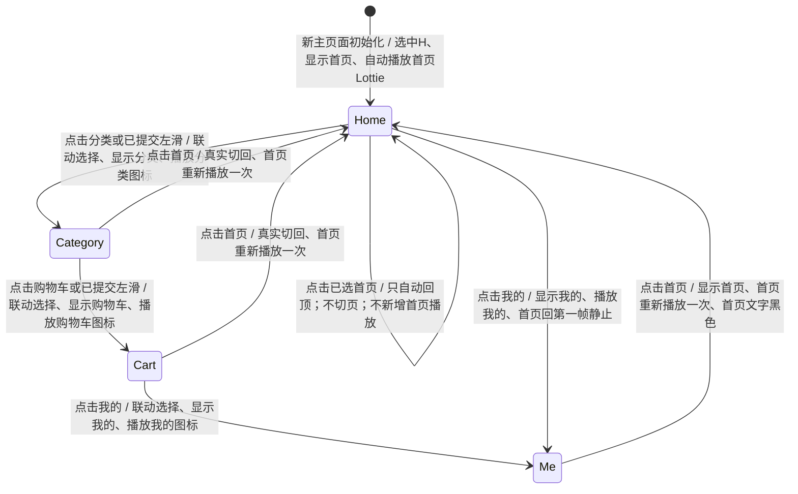

# cml-spec1 验收矩阵草案 r1

## 产物状态与证据范围

- 本文是本次派工的完整 `spec/acceptance.md` 草案，供主 Agent 合并评审；本次只写 `workflow/requirements/acceptance-r1.md`。未修改生产代码、测试、全局状态或正式 Spec 文档。
- 分析依据：`spec/requirement.md`，SHA256 `491ea9b5efe284f449873234ba0c86345a0cc2eece2e097898de06a2c4f59d4b`；`spec/metadata.json`，SHA256 `8b4f53895d59cc4a74780c9d6d24d80ae59d236965755a7091f92375eb695768`。本次读取实算值与派工批准值一致。
- 静态基线 HEAD：`7014cebd60f2181fac2a36d399ca16b3d6a175ab`，与 metadata 的 `base_commit` 一致。只读本题源码，未读取初始化总览原生会话、其他题或上游功能实现/历史。
- 需求子会话 UUID：`01a1574f-a76b-7b40-a501-a34a767746dc`。本 Agent 先实读环境值，后由主 Agent 核对该原生会话首行的 `payload.id`、父会话、`agent_path=/root/requirements`、角色与 cwd，确认归属；`CODEX_SESSION_ID` 是继承根会话值，不能当作本子会话 UUID。
- 证据等级：`SPEC_EXPLICIT` 为题目明文；`REASONABLE_DERIVATION` 是由明文得到的边界/一致性要求；`UNCONFIRMED_ASSUMPTION` 只列解释分支，不能作为已批准的硬性判定。
- 四场景共 17 个编号步骤，均有下面的 A 项映射。A 项数不代表官方 F-point 数或分值。
- 本 Agent 未构建、安装或运行应用，也未执行 Hypium；所有 A 项当前运行状态均为 **未验证**。基线运行及静态总览另由主 Agent 调度，本文的代码事实不等于运行验证通过。

## Spec 原文定位与逐字文案

行号以下列本地文件为准：`spec/requirement.md`。

| 来源 | 原文（逐字） | 对应验收项 |
| --- | --- | --- |
| 场景一概述，L7 | 用户进入应用后，看到底部导航栏显示四个标签：首页、分类、购物车、我的。用户点击不同的标签，页面切换到对应内容区域，并触发 Lottie 动画效果高亮选中项。 | A1–A9、A29 |
| 场景一步骤1，L11 | 1. 用户启动应用，进入主页面，底部导航栏显示"首页"、"分类"、"购物车"、"我的"四个标签。 | A1 |
| 场景一步骤2，L12 | 2. 默认选中"首页"标签，首页内容区域显示在上方。 | A2、A3 |
| 场景一步骤3，L13 | 3. 用户点击"分类"标签，页面内容区域切换为分类页面。 | A4 |
| 场景一步骤4，L14 | 4. 底部"分类"标签图标触发 Lottie 动画，图标颜色变为黑色，其余标签图标重置为灰色。 | A5、A6、A7 |
| 场景一步骤5，L15 | 5. 用户点击"购物车"标签，页面内容切换为购物车页面，购物车图标播放动画。 | A8、A9 |
| 场景二概述，L21 | 用户通过左右滑动屏幕内容区域来切换底部导航栏对应的标签页，底部导航栏随滑动联动更新选中状态并触发相应的 Lottie 动画。 | A10–A15、A29、A30 |
| 场景二步骤1，L25 | 1. 用户在"首页"内容区域向左滑动，页面滑动到"分类"页面。 | A10 |
| 场景二步骤2，L26 | 2. 底部导航栏"分类"标签自动高亮，对应图标播放动画。 | A11、A12 |
| 场景二步骤3，L27 | 3. 用户继续向左滑动，页面切换到"购物车"。 | A13 |
| 场景二步骤4，L28 | 4. 用户点击底部"我的"标签，内容区域跳转到"我的"页面，图标动画播放。 | A14、A15 |
| 场景三概述，L34 | 用户首次进入应用，底部导航栏"首页"标签处于初始选中状态，对应 Lottie 动画自动播放；当用户回到该标签时，动画重新播放一次以提示当前位置。 | A2、A16、A20 |
| 场景三步骤1，L38 | 1. 应用启动，主页面初始化完成，底部"首页"标签图标自动播放 Lottie 动画。 | A16 |
| 场景三步骤2，L39 | 2. 用户点击"我的"标签切换到我的页面，"我的"图标播放动画，"首页"图标回到第一帧静止。 | A17、A18、A19 |
| 场景三步骤3，L40 | 3. 用户点击"首页"标签返回，首页图标重新播放动画。 | A20 |
| 场景三步骤4，L41 | 4. 内容区域显示首页内容，"首页"标签文字颜色变为黑色。 | A21、A22 |
| 场景四概述，L47 | 用户在"首页"内容区域向下浏览了一段距离（例如已经滚动过"限时精选""推荐商品"区域），此时再次点击底部导航栏中已经处于选中状态的"首页"标签，首页内容区域会自动滚动回到顶部；这次点击不会触发页面切换（本来就在首页），也不会额外重播首页图标的 Lottie 动画。 | A23–A28、A31、A32 |
| 场景四步骤1，L51 | 1. 用户当前位于"首页"，底部导航栏的"首页"标签已选中，向下滑动内容区域，顶部的优惠券"领取"入口已经滚出可视区域。 | A23 |
| 场景四步骤2，L52 | 2. 用户再次点击底部导航栏的"首页"标签（该标签已处于选中状态，不是从其他标签切回）。 | A24–A28 的动作与前置 |
| 场景四步骤3，L53 | 3. 首页内容区域自动滚动回顶部，顶部优惠券"领取"入口重新出现在可视区域内。 | A24、A25 |
| 场景四步骤4，L54 | 4. 底部"首页"标签保持选中状态，不触发页面切换动画。 | A26、A27 |

文案要求：底部可见标签必须使用 `首页`、`分类`、`购物车`、`我的`；场景四定位文字为 `领取`。`限时精选`、`推荐商品` 是 L47 中“例如”的浏览区域示例，不能据此强加商品数量、排序、分页、价格、购物或领券提交功能。Spec 没有要求点击 `领取`，也没有规定该入口所打开的页面或请求结果。

## 观察与选择器约定

### 静态事实与观察限制

1. 静态加载链为 `entry/src/main/ets/entryability/EntryAbility.ets:50–58` 加载 `view/EntryPage`，`entry/src/main/ets/view/EntryPage.ets:39–42` 构建 `NavigationHost`，`entry/src/main/ets/navigation/NavigationHost.ets:36–42` 在 Navigation 根部构建 `MainPage()`。这是源码事实，实际启动路径及权限弹窗影响待运行角色验证。
2. `feature/main/src/main/ets/view/MainPage.ets:25–31` 包装主页面，`:39–130` 是“主页面内容视图”及通知演示；`feature/main/src/main/ets/viewmodel/MainViewModel.ets:7–9` 是空类。本地这两个文件未提供底部四标签、联动选择或 Lottie 状态。
3. `feature/main/src/main/ets/view/HomePage.ets:20–35` 只有标题“首页”和“首页内容视图”，`HomeViewModel.ets:7–9` 为空；其中没有可用于场景四的滚动容器及 `领取` 入口。
4. `CategoryPage.ets:20–35`、`CartPage.ets:20–35`、`MePage.ets:20–35`（均位于 `feature/main/src/main/ets/view/`）分别只有对应标题和占位文字。它们不是已验证的底部标签内容。
5. `feature/main/src/main/ets/navigation/MainGraph.ets:16–21` 注册了 Main/Home/Category/Cart/Me 路由；不能由“已有单页路由”推断“已有底部标签”或“切标签必须 push 路由”。
6. 上述 Main/Home/Category/Cart/Me 页面及 Main/Home VM 所读完整源码没有 `.id()`。下面所有 ID 均为 **prospective（建议名称），需在实现时补 `.id()`**，不能当作基线已有选择器。其他静态清单及运行结果由主 Agent 汇总。

Hypium 可按稳定 ID 作用于目标标签、滑动区域和内容区，并断言文字、可见性、几何位置及可用的组件状态。颜色、动画播放、第一帧和播放次数应使用相应的可用 UI 属性或设备多帧捕获/动画运行证据；只看到静态图标或仅发现“动画相关代码”不能证明播放通过。尤其 A19、A20、A28 必须区分“第一帧静止”“播放一次”“没有新增播放”。如果当前工具读不到所需状态，应报告未验证并补采运行证据，不能将不可观测项记为通过。ID 本身不提供动画状态。

### Prospective ID 字典

以下每一个 ID 都是 **需在实现时补 `.id()` 的建议 ID**；最终实现可选择等价稳定命名，随后必须同步矩阵与测试。

| 简称 | 建议组件 ID | 作用 |
| --- | --- | --- |
| ROOT | `main_root` | 主页面根区域 |
| BAR | `main_tab_bar` | 底部四标签的共同父区域；避免与页面标题同名文字混淆 |
| PAGER | `main_content_pager` | 横向切页内容区域；不能以整个屏幕替代精确滑动目标 |
| T(H/C/K/M) | `main_tab_home` / `main_tab_category` / `main_tab_cart` / `main_tab_me` | 四个可点击标签；H=首页、C=分类、K=购物车、M=我的 |
| L(H/C/K/M) | `main_tab_home_text` / `main_tab_category_text` / `main_tab_cart_text` / `main_tab_me_text` | 对应标签文字 |
| I(H/C/K/M) | `main_tab_home_icon` / `main_tab_category_icon` / `main_tab_cart_icon` / `main_tab_me_icon` | 对应 Lottie 图标观察区域 |
| P(H/C/K/M) | `home_page` / `category_page` / `cart_page` / `me_page` | 对应内容区域的唯一根标识；以当前活动/可视页面为准，不能只断言某节点存在 |
| SCROLL | `home_scroll` | 首页纵向滚动容器 |
| RECEIVE | `home_coupon_receive` | 首页顶部优惠券 `领取` 入口；不能误取其他同名按钮 |

下面的“选择器”列使用此字典，每次引用仍表示 prospective、需实现 `.id()`，并不表示已经存在。

## A1–A28：Spec 明文原子验收项

### 场景一：启动、点击切页与图标

| 编号 | 来源 | 证据等级 | 原子行为 | 可观察结果 | 选择器（全部需补 `.id()`） |
| --- | --- | --- | --- | --- | --- |
| A1 | 场景一/步骤1，L11 | SPEC_EXPLICIT | 启动进入主页面时展示四个底部标签 | BAR 中同时可见且可定位 `首页`、`分类`、`购物车`、`我的` 四标签，位置在内容下方 | ROOT、BAR、四个 T、四个 L |
| A2 | 场景一/步骤2 L12；场景三概述 L34 | SPEC_EXPLICIT | 初始化默认选中首页 | 当前选中标签是 `首页` | T(H)、L(H)、I(H)、BAR |
| A3 | 场景一/步骤2，L12 | SPEC_EXPLICIT | 初始化显示首页内容 | P(H) 为当前可见内容且在 BAR 上方 | P(H)、PAGER、BAR |
| A4 | 场景一/步骤3，L13 | SPEC_EXPLICIT | 从首页点击分类后显示分类内容 | 点击 T(C) 后，当前活动内容为 P(C) | T(C)、P(C)、PAGER |
| A5 | 场景一/步骤4，L14 | SPEC_EXPLICIT | 点击切到分类时触发其 Lottie 动画 | I(C) 确实开始播放 Lottie；不能用颜色变化替代播放证据 | T(C)、I(C) |
| A6 | 场景一/步骤4，L14 | SPEC_EXPLICIT | 分类选中时其图标变黑 | 本次选择后的 I(C) 为黑色 | I(C)、T(C) |
| A7 | 场景一/步骤4，L14 | SPEC_EXPLICIT | 分类选中时其他图标重置为灰色 | I(H)、I(K)、I(M) 均为灰色，不残留上次选中黑色 | I(H/C/K/M) |
| A8 | 场景一/步骤5，L15 | SPEC_EXPLICIT | 从分类点击购物车后显示购物车内容 | 点击 T(K) 后，P(K) 为当前活动内容 | T(K)、P(K)、PAGER |
| A9 | 场景一/步骤5，L15 | SPEC_EXPLICIT | 点击切到购物车时播放其图标动画 | I(K) 开始播放 Lottie | T(K)、I(K) |

每项八维如下；“数据结果”记录可观察的语义状态，不要求采用特定状态字段或数据结构。

| 编号 | 入口 | 前置数据 | 用户动作 | UI 结果 | 数据结果 | 网络结果 | 返回结果 | 边界条件 |
| --- | --- | --- | --- | --- | --- | --- | --- | --- |
| A1 | 应用启动到主页面 | 有效安装；初始化完成；无需 Spec 外账号/商品数据前置 | 启动应用 | 四个逐字标签位于底部 | 标签集合为四项 | 不适用：本项未规定请求 | 不适用：启动不是返回 | 首次启动；完整冷启动重进见 A38；权限弹窗须另记录 |
| A2 | 同 A1 | 新的主页面初始化 | 等待初始化完成 | `首页` 呈选中态 | 当前标签=H | 不适用：本项未规定请求 | 不适用：初始化不是返回 | 不得用上次选择覆盖新的默认初始化；暖恢复另见 A42 |
| A3 | 主页面 | A2 | 等待首屏布局 | 首页内容处于 BAR 上方可视区 | 当前内容=H | 不适用：本项未规定请求 | 不适用：没有返回动作 | 节点被预构建但不可见不能算显示 |
| A4 | 选中的首页 | T(C) 可操作 | 点击 `分类` | 分类内容成为活动页面 | 当前内容=C | 不适用：本项未规定请求 | 不适用：底部切换非返回动作 | 单次有效点击；连点与混合动作见 A33 |
| A5 | A4 的切换动作 | 分类图标准备可播放 | 点击未选中的 `分类` | 分类图标出现播放过程 | 产生该次选择的播放事件 | 不适用：图标播放未规定网络 | 不适用：无返回动作 | 播放过程与最终静态帧须区分；时长未规定见 A43 |
| A6 | 分类已选中 | A4 | 观察选中结果 | 分类图标为黑色 | 当前选中=C | 不适用：颜色状态未规定网络 | 不适用：无返回动作 | 精确 RGB/取样容差未规定，不能自行把任意深色当作黑色 |
| A7 | 分类已选中 | 其他图标可能曾选中过 | 观察同次选择结果 | 其余三图标均灰色 | 非活动图标集合=H/K/M | 不适用：图标复位未规定网络 | 不适用：无返回动作 | 同时检查三项；第一帧要求的明文对象为首页，见 A19 |
| A8 | 当前分类页面 | A4 已完成；购物车可为空 | 点击 `购物车` | 购物车活动内容可见 | 当前内容=K | 不适用：本项未规定购物车请求 | 不适用：非返回动作 | 无商品不得阻止标签切换，派生见 A36 |
| A9 | A8 的切换动作 | 购物车图标准备可播放 | 点击未选中的 `购物车` | 购物车图标出现播放过程 | 产生该次选择的播放事件 | 不适用：图标播放未规定网络 | 不适用：无返回动作 | 不能只验证 P(K) 而略过图标播放 |

### 场景二：横向滑动与底部联动

| 编号 | 来源 | 证据等级 | 原子行为 | 可观察结果 | 选择器（全部需补 `.id()`） |
| --- | --- | --- | --- | --- | --- |
| A10 | 场景二/步骤1，L25 | SPEC_EXPLICIT | 首页内容向左滑动切到分类 | 对 PAGER 内首页作有效左滑后 P(C) 成为当前页 | PAGER、P(H/C) |
| A11 | 场景二/步骤2，L26 | SPEC_EXPLICIT | 左滑到分类时底部分类自动高亮 | 无另行点击标签，T(C) 已高亮并与内容对应 | T(C)、I(C)、L(C)、P(C) |
| A12 | 场景二/步骤2，L26 | SPEC_EXPLICIT | 左滑选中分类时播放其图标动画 | I(C) 由这次滑动触发 Lottie 播放 | I(C)、PAGER |
| A13 | 场景二/步骤3，L27 | SPEC_EXPLICIT | 从分类继续左滑切到购物车 | P(K) 成为活动内容 | PAGER、P(C/K) |
| A14 | 场景二/步骤4，L28 | SPEC_EXPLICIT | 滑到购物车后点击我的显示我的内容 | T(M) 点击后 P(M) 为当前活动内容 | T(M)、P(M) |
| A15 | 场景二/步骤4，L28 | SPEC_EXPLICIT | 此次点击我的时播放我的图标动画 | I(M) 开始播放 Lottie | T(M)、I(M) |

| 编号 | 入口 | 前置数据 | 用户动作 | UI 结果 | 数据结果 | 网络结果 | 返回结果 | 边界条件 |
| --- | --- | --- | --- | --- | --- | --- | --- | --- |
| A10 | 首页内容 | 首页已选中；PAGER 可滑动 | 在内容区域有效左滑 | 分类成为活动页 | 当前内容=C | 不适用：切页未规定请求 | 不适用：不是返回动作 | 横向滑动须实际发生在内容区；取消手势见 A35 |
| A11 | A10 切换后 | 本次未点分类标签 | 观察底部 | 分类自动高亮 | 内容与选中均=C | 不适用：联动未规定请求 | 不适用：无返回动作 | 不能靠第二次点击纠正高亮 |
| A12 | A10 的滑动选择 | I(C) 可观察 | 有效左滑 | 分类图标播放 | 为一次滑动提交产生播放 | 不适用：图标播放未规定网络 | 不适用：无返回动作 | 双重回调造成重播风险见 A33 |
| A13 | 分类内容 | A10 已完成 | 再有效左滑 | 购物车成为活动页 | 当前内容=K | 不适用：切页未规定请求 | 不适用：不是返回动作 | 应联动购物车选中与动画，概述派生见 A29 |
| A14 | 购物车内容 | A13 已完成 | 点击 `我的` | 我的内容成为活动页 | 当前内容=M | 不适用：未规定个人信息请求 | 不适用：不是返回动作 | 不得残留购物车高亮；无账号资料见 A36 |
| A15 | A14 的点击切换 | I(M) 可观察 | 点击未选中的 `我的` | 我的图标播放 | 产生该次选择的播放事件 | 不适用：图标播放未规定网络 | 不适用：无返回动作 | 内容已切换不能替代动画证据 |

### 场景三：初始化播放、离开复位与回到首页

| 编号 | 来源 | 证据等级 | 原子行为 | 可观察结果 | 选择器（全部需补 `.id()`） |
| --- | --- | --- | --- | --- | --- |
| A16 | 场景三/步骤1 L38；概述 L34 | SPEC_EXPLICIT | 主页面初始化自动播放首页图标 | 无点击操作时 I(H) 自动开始 Lottie 播放 | ROOT、I(H)、T(H) |
| A17 | 场景三/步骤2，L39 | SPEC_EXPLICIT | 从初始首页点击我的显示我的内容 | P(M) 成为活动内容 | T(M)、P(M) |
| A18 | 场景三/步骤2，L39 | SPEC_EXPLICIT | 从初始首页切到我的时播放我的图标 | I(M) 开始播放 Lottie | T(M)、I(M) |
| A19 | 场景三/步骤2，L39 | SPEC_EXPLICIT | 离开首页后首页图标复位并静止 | I(H) 回到所属动画第一帧，之后保持静止 | I(H)、I(M)、T(M) |
| A20 | 场景三/步骤3 L40；概述 L34 | SPEC_EXPLICIT | 从我的点击回到首页时重新播放一次首页图标 | 已经发生过首页初始化播放，此次返回再触发一次播放；同次返回不额外再播 | T(H)、I(H)、P(M/H) |
| A21 | 场景三/步骤4，L41 | SPEC_EXPLICIT | 从我的回到首页时显示首页内容 | P(H) 成为活动内容 | T(H)、P(H)、PAGER |
| A22 | 场景三/步骤4，L41 | SPEC_EXPLICIT | 回到首页时首页标签文字变黑 | L(H) 文字颜色为黑色 | L(H)、T(H) |

| 编号 | 入口 | 前置数据 | 用户动作 | UI 结果 | 数据结果 | 网络结果 | 返回结果 | 边界条件 |
| --- | --- | --- | --- | --- | --- | --- | --- | --- |
| A16 | 启动到主页面初始化 | 首页为初选标签；无用户点击 | 只等待初始化/动画就绪 | 首页图标自动播放 | 初始播放已发生 | 不适用：初始化图标播放未规定网络 | 不适用：启动不是返回 | 只测点击播放会漏掉本项；全新实例见 A38 |
| A17 | 初始首页 | A2/A16 的首页状态 | 点击 `我的` | 我的内容显示 | 当前内容=M | 不适用：本项未规定请求 | 不适用：不是返回动作 | 与场景二保持独立入口序列，不能只引用 A14 代替执行 |
| A18 | A17 的切换动作 | 我的图标可观察 | 点击未选中的 `我的` | 我的图标播放 | 产生该次选择的播放事件 | 不适用：图标播放未规定网络 | 不适用：无返回动作 | 可在首页动画尚在播放时切走，见 A39 |
| A19 | 从首页切到我的后 | 已知首页动画第一帧参照；首页动画可能尚未结束 | 观察离开后的首页图标 | 首页在第一帧静止 | 首页播放停止且复位 | 不适用：复位未规定请求 | 不适用：无返回动作 | 不能只检查变灰或不可见；需第一帧和跨时刻静止证据 |
| A20 | 当前我的内容 | 首页已初始化播放过且离开时复位 | 点击未选中的 `首页` | 首页图标重新播放一次 | 新增一次返回触发的首页播放 | 不适用：返回标签未规定请求 | 从我的标签回到首页标签 | 不同于 A24 的已选首页重击；不允许统一“点首页总重播” |
| A21 | A20 的点击返回 | 当前我的内容 | 点击 `首页` | 首页成为活动内容 | 当前内容=H | 不适用：本项未规定请求 | 内容返回首页 | 不规定此时首页滚动偏移，见 A44 |
| A22 | 返回首页后 | A21 | 观察首页标签文字 | 文字为黑色 | 当前选中=H | 不适用：文字颜色未规定请求 | 底部首页选中正确 | 与“图标黑色”是不同观察对象；必须检查文字 |

### 场景四：已选首页重击回顶

| 编号 | 来源 | 证据等级 | 原子行为 | 可观察结果 | 选择器（全部需补 `.id()`） |
| --- | --- | --- | --- | --- | --- |
| A23 | 场景四/步骤1 L51；概述 L47 | SPEC_EXPLICIT | 在已选首页纵向浏览到顶部领取入口不可见 | SCROLL 确有向下浏览后的偏移，顶部 RECEIVE 已滚出视口，T(H) 仍选中 | T(H)、P(H)、SCROLL、RECEIVE |
| A24 | 场景四/步骤2–3，L52–53 | SPEC_EXPLICIT | 点击已选首页后内容自动滚回顶部 | 单次点击已选 T(H) 后，SCROLL 达到顶部；无需用户再手动滚动 | T(H)、SCROLL、P(H) |
| A25 | 场景四/步骤3，L53 | SPEC_EXPLICIT | 回顶后顶部优惠券领取入口重新可见 | 同一个顶部 RECEIVE 的 `领取` 文字重新进入可视区 | RECEIVE、SCROLL、P(H) |
| A26 | 场景四/步骤4，L54 | SPEC_EXPLICIT | 同标签重击期间首页保持选中 | 动作前、过程中、完成后 T(H) 仍为选中项 | T(H)、BAR、P(H) |
| A27 | 场景四/步骤4 L54；概述 L47 | SPEC_EXPLICIT | 同标签重击不触发页面切换或页面切换动画 | 当前内容始终为首页，没有切到其他标签/重新切入首页的页面过渡 | PAGER、P(H)、BAR |
| A28 | 场景四概述，L47 | SPEC_EXPLICIT | 同标签重击不额外重播首页 Lottie | 点击前后没有新增由此次点击触发的首页图标播放 | T(H)、I(H)、SCROLL |

| 编号 | 入口 | 前置数据 | 用户动作 | UI 结果 | 数据结果 | 网络结果 | 返回结果 | 边界条件 |
| --- | --- | --- | --- | --- | --- | --- | --- | --- |
| A23 | 已选首页 | 顶部存在 `领取`；内容足够产生非零滚动 | 在内容中向下浏览 | 领取入口离开视口；底栏仍可操作 | 首页偏移大于顶部；当前标签=H | 不适用：Spec 未规定浏览加载请求 | 不适用：此时没有返回操作 | “例如”区域非强制数据结构；不能通过隐藏/删除入口伪造滚出 |
| A24 | A23 的已选且已下滚首页 | 当前标签确为 H，不能从其他标签切回代替 | 点击 T(H) 一次 | 内容自动到达顶部 | 首页偏移=顶部 | 不适用：回顶未规定刷新请求 | 返回首页内容顶部，仍在同一标签 | 不能改成先切其他页再切回；允许滚动过程动画，禁止切页动画 |
| A25 | A24 完成后 | 同一个顶部优惠券入口先前不可见 | 等待自动回顶完成 | 顶部 `领取` 入口重新可见 | 未要求领取、库存或券状态变更 | 不适用：只是入口可见性，非领券请求 | 顶部入口可见性恢复 | 光检测树中存在节点不够；需确认与视口相交且未被遮挡 |
| A26 | 同标签重击全过程 | 首页已选中 | 点击已选 T(H) | 首页持续选中 | 当前标签持续=H | 不适用：选中状态未规定请求 | 未离开首页标签 | 不允许中间短暂取消选择或亮其他标签 |
| A27 | 同 A24 | 内容正在首页 | 点击已选 T(H) | 不发生切页过渡 | 当前内容持续=H | 不适用：页面保持未规定请求 | 同页回顶，不产生一次“返回首页”的标签切换 | 回顶的纵向滚动动画不等同页面切换动画；不能一概禁用滚动动画 |
| A28 | 同 A24 | 记录点击前的首页动画状态/播放证据 | 点击已选 T(H) | 没有新增首页图标播放 | 首页动画播放触发次数不因本次点击增加 | 不适用：图标重播限制未规定请求 | 仅回顶，无返回触发播放 | 若点击前已有一次播放正在进行，它可继续；不能把继续播放误判为新增重播 |

## A29–A39：合理派生的一致性与边界项

这些项用于覆盖明文操作的边界，不能据此扩张到商品、账号、订单等功能。

| 编号 | 来源与推导依据 | 证据等级 | 原子行为 | 可观察结果 | 选择器（全部需补 `.id()`） |
| --- | --- | --- | --- | --- | --- |
| A29 | L7、L14、L21 的“对应内容”“选中状态”“其余…重置为灰色” | REASONABLE_DERIVATION | 每次已提交的标签切换完成后保持唯一选中、内容与标签对应 | H/C/K/M 任一当前页与同名标签一致，其他标签不保留选中图标；滑到购物车也更新其选中/动画 | PAGER、BAR、全部 T/I/P |
| A30 | L21 明确“左右滑动”与 L25/L27 的相邻顺序 | REASONABLE_DERIVATION | 在中间页反向右滑恢复相邻前页，四页按对应次序联动 | 分类右滑到首页、购物车右滑到分类、我的右滑到购物车；购物车左滑到我的时同样联动 | PAGER、全部 T/I/P |
| A31 | L47、L52 的“已经处于选中状态”并未限定必须非零偏移才禁重播 | REASONABLE_DERIVATION | 已在首页顶部时重复点击首页保持同页且不新增播放 | 顶部位置不变、首页选中不变、无切页过渡/图标重播 | T(H)、SCROLL、I(H)、P(H) |
| A32 | L47、L52–54 同标签动作的重复应用 | REASONABLE_DERIVATION | 连续重复点击已选首页仍只回顶 | 从下滚状态重复/快速点击 H 后最终在顶部；所有点击不新增切页或首页图标播放 | T(H)、SCROLL、I(H)、PAGER |
| A33 | L7、L21 的点击/滑动同一对应关系及 L34 的“重新播放一次” | REASONABLE_DERIVATION | 快速交替点击/滑动后保持一致，单次已提交选择不因重复通知再播 | 每次稳定落定的内容、标签与活动图标对应；无一次选择被重复记成两次首页返回播放；最终状态无残留矛盾 | PAGER、BAR、全部 T/I/P |
| A34 | L21 的横向切页与 L51 的首页纵向浏览并存 | REASONABLE_DERIVATION | 首页纵向浏览不被当作横向切标签 | 完成场景四前置后仍是首页选中；底部标签可见可点 | SCROLL、PAGER、T(H)、BAR |
| A35 | L21 的滑动切换语义及 L47 的只有真实切回才重播 | REASONABLE_DERIVATION | 未提交/取消的横向手势不留下假选中或虚假返回播放 | 最终落定页及选中一致；若手势取消回原页，不产生一次并未发生的标签返回播放 | PAGER、全部 T/I/P |
| A36 | L11–15、L25–28 的切标签前置均未要求商品、购物车条目或账号资料 | REASONABLE_DERIVATION | 相关业务内容无数据时仍可使用底部导航 | 空购物车/空分类数据/未提供个人资料不阻止四标签切换与图标反馈 | BAR、PAGER、全部 T/P/I |
| A37 | 全文无导航所需请求或 loading 要求；L47 为本地滚动语义 | REASONABLE_DERIVATION | 不因无关内容请求失败而卡住导航、动画或已备妥首页回顶 | 若存在页面数据请求，其 pending/失败不永久阻止点击/滑动；同页回顶完成且不冒充刷新 | BAR、PAGER、SCROLL、I(H) |
| A38 | L11–12、L34、L38 的应用启动/主页面初始化 | REASONABLE_DERIVATION | 完全终止后重新启动产生新主页面实例时重做默认首页与初始播放 | 先选择其他标签后终止应用，冷启动的新实例仍按 A1–A3/A16 初始化 | ROOT、BAR、P(H)、I(H) |
| A39 | L39 的首页离开复位，与 L21 的滑动也切标签 | REASONABLE_DERIVATION | 首页被真实切走时，即使动画尚在进行，也不残留首页播放 | 从首页通过点击分类/购物车或滑动离开后，首页回到第一帧并静止；重新选回按 A20 播放 | PAGER、T(H/C/K/M)、I(H) |

| 编号 | 入口 | 前置数据 | 用户动作 | UI 结果 | 数据结果 | 网络结果 | 返回结果 | 边界条件 |
| --- | --- | --- | --- | --- | --- | --- | --- | --- |
| A29 | 任一活动标签 | 任一明文有效切换可完成 | 点击不同标签或有效滑动 | 当前内容、唯一选中标签和图标对应 | 当前选择只有一项 | 不适用：一致性未规定请求 | 若回首页则满足 A20/A21 | 其他三页选中文字具体色值未明文规定，勿误写为所有文字均黑/灰 |
| A30 | 分类/购物车/我的的非越界相邻方向 | 已到对应页 | 有效右滑；购物车有效左滑 | 对应相邻页与标签/动画联动 | 当前页按 H/C/K/M 次序变化 | 不适用：横向切换未规定请求 | 分类右滑回首页时首页需按真实返回播放 | 最左/最右越界方向另列 A40，不能偷定循环规则 |
| A31 | 已在首页顶部 | 顶部状态；首页选中 | 再点 H | 保持顶部、无切页/新增重播 | 选择=H，偏移=顶部 | 不适用：同页点击未规定请求 | 不适用：原本已在顶部 | 不能用新初始化/新页面重置实现回顶 |
| A32 | 下滚的已选首页或顶部首页 | 已记录点击前播放状态 | 连续或快速多次点击 H | 平稳回顶/保持顶部，不切标签 | 偏移收敛顶部；不新增首页播放 | 不适用：重复点击未规定请求 | 仍在同一首页，最终顶部可见 | 包含回顶尚未结束时再点；不强制多个滚动动作的内部实现 |
| A33 | 任一标签及进行中的切换/图标播放 | H/C/K/M 可用 | 快速交替点击，及点击与滑动交错 | 最终落定状态一致，不崩溃/卡死 | 以实际被接受并提交的切换为准；一次提交不重复播放 | 不适用：未规定导航请求；如有业务请求见 A37 | 有效回首页满足 A20；同标签点首页满足 A28 | 不预设每个未完成手势都必须提交，也不预设必须处理所有过快输入 |
| A34 | 首页纵向内容 | 有可滚动内容及顶部入口 | 纵向浏览，不作横向手势 | 首页仍选中，底部可操作 | 仅首页滚动位置改变 | 不适用：浏览未规定请求 | 不适用：不是返回操作 | 斜向阈值未规定；只用明确纵向动作建立前置 |
| A35 | 任一页内容 | 横向拖动可被取消/不足以提交 | 部分拖动后回拖/取消 | 回原页或实际提交页后，选中一致 | 没有虚假页面切换记录 | 不适用：取消滑动未规定请求 | 若未真正离开首页，不能误算回首页播放 | 精确距离/速度阈值未规定；按可观察的是否提交判定 |
| A36 | 主页面 | 分类/购物车等业务数据为空；主页面正常可呈现 | 点击/滑动四标签 | 导航、内容区域与图标仍能对应 | 不要求生成假商品/账号资料 | 不适用：Spec 没有数据请求成功前置 | 回首页按真实切换处理 | 场景四仍必须建立存在顶部 `领取` 和可滚动内容的明文前置；不能因数据空直接跳过 |
| A37 | 任一页；场景四需已备妥首页内容 | 若实现确有内容请求，可处 pending/失败 | 切换标签；或点已选首页回顶 | 导航/回顶有完成路径，无永久 loading | 导航状态与数据请求状态可区分 | 无 Spec 强制请求；失败不应伪装成功领取/刷新 | 返回首页/顶部语义不因请求失败改变 | 若最终无导航相关请求则网络故障注入为不适用并说明，不得凭空增设 API |
| A38 | 应用完全停止后的新启动 | 先在任一非首页结束应用；保留普通应用数据 | 终止并重启应用 | 新实例默认首页与自动播放 | 新实例选择=H；持久业务数据未规定变化 | 不适用：冷启动导航未规定请求 | 冷启动重新进入；不同于暖恢复 | 不要求清数据/重装才能回默认；暖恢复政策为 A42 |
| A39 | 首页动画初始播放中或已结束 | 首页当前选中 | 点击不同标签或有效左滑切走 | 首页复位第一帧并静止 | 首页不再是活动播放项 | 不适用：复位未规定请求 | 再真正回首页新增一次播放 | “所有非首页图标也必须第一帧”并非本项明文，见 A43 |

## A40–A44：真实未消除歧义与待确认假设

以下项目均为 `UNCONFIRMED_ASSUMPTION`。它们不是已经成立的需求，验收不得偷偷选择某分支。推荐项仅供主 Agent 决策；这些歧义不妨碍先完成 A1–A39 所覆盖的明文及合理边界分析。

| 编号 | 来源/为何无法由证据决定 | 原子问题与备选解释 | 可观察结果的分支 | 推荐及理由 | prospective 选择器（需补 `.id()`） |
| --- | --- | --- | --- | --- | --- |
| A40 | L21 只写左右滑动；L25/L27 只给内部相邻左滑 | 首页右滑、我的左滑是否越界循环：①停留边界页；②循环到另一端 | ①标签/页不变、无虚假播放；②到另一端，标签与真实切换动画联动 | 推荐①边界停留，符合四标签相邻顺序且不会引入 Spec 未描述的端点跳转。仍待主 Agent 确认 | PAGER、全部 T/P/I |
| A41 | L47/L52 的“同标签重击”仅限首页 | 重击已选分类/购物车/我的：①不新增图标播放；②允许原标签重播；是否有各页回顶也未规定 | 同页选择保持；播放次数/滚动位置依据所选分支判定 | 推荐①只保持页面，不扩展首页专属回顶行为；Spec 没给其他页同点效果 | T(C/K/M)、I(C/K/M)、P(C/K/M) |
| A42 | L11/L34/L38 规定启动初始化，未说明主页面未销毁时从子路由返回或后台回前台 | ①保留现有标签/滚动位置且不新增初始化播放；②每次重新可见都重置首页并播放 | 再进入时的活动页、偏移与播放次数不同 | 推荐①保留未销毁实例；只有新的主页面初始化按 A2/A16。避免将“首次/初始化”扩张为每次露出 | ROOT、BAR、全部 P/T/I、SCROLL |
| A43 | L14 给黑/灰；L39 仅对首页要求第一帧；L34 仅明确回首页“重新播放一次”；未给资源、时长/缓动或其他页循环策略 | 动画素材/时长/完成帧、非首页是否循环和第一帧复位：①有限播放且其他非选中静止；②只约束 Spec 明确项，其他资源/终态另约定 | 真正 Lottie 播放、黑/灰和首页第一帧是已确定底线；具体时序/其他图标终态依分支 | 推荐有限播放并在非选中时静止，按实际资源约定完成时间；不得把 CSS/符号位移动画等同 Lottie。不编造固定毫秒、素材哈希或所有图标强制第一帧 | 全部 I、T |
| A44 | L40–41 要求切回首页及重播；L47 明确的是“已选首页再次点击”回顶 | 从其他标签切回首页时滚动位置：①保留此前浏览位置；②同时重置顶部 | 两分支均需首页可见及播放一次；回到首页的偏移不同 | 推荐①保留，随后同标签重击再按 A24 回顶；能清晰保留两个操作语义，Spec 未要求跨标签返回自动回顶 | T(H)、P(H)、SCROLL、I(H)、RECEIVE |

每项八维均保留未决状态：

| 编号 | 入口 | 前置数据 | 用户动作 | UI 结果 | 数据结果 | 网络结果 | 返回结果 | 边界条件 |
| --- | --- | --- | --- | --- | --- | --- | --- | --- |
| A40 | 首页或我的端点内容 | 对应端点已选中 | 首页右滑/我的左滑 | 待确认：边界停留或首尾循环；须保持一致 | 当前页依分支 | 不适用：未规定网络 | 若循环回首页，是否真实返回取决于获准策略 | 两端都需记录；不能仅测中间页后声称已定端点规则 |
| A41 | 已选 C/K/M | 该页已显示；动画可观察 | 点击同一已选标签 | 待确认：保持或重播；不能切到错误页面 | 选择至少保持原页；其他副作用未定 | 不适用：未规定网络 | 不适用：未离开该标签 | 仅首页同标签点击的禁止重播是确定要求 |
| A42 | 子路由返回主页面或应用暖恢复 | 原主页面实例可能仍在，曾选非首页或下滚首页 | 返回/关闭子页；后台回前台 | 待确认：保留或重置 | 当前选择/偏移依生命周期政策 | 不适用：未规定返回请求 | 待确认；与 A38 冷启动分开 | 实例已销毁重建时重新适用 A2/A16；关闭应用后重启见 A38 |
| A43 | 任一图标播放/切换 | 有可播放 Lottie 资源 | 初始化、切页、离开标签 | 明文结果确定；时长/素材/其他图标终态未定 | 播放状态依获准约定 | 不适用：未规定远程动画资源请求 | 回首页必须播一次；首页重击必须不新增播放 | 固定时长、所有图标第一帧和通用循环不能当作明文 |
| A44 | 先下滚首页再去其他标签 | 首页曾有非零偏移 | 点击未选中的首页 | 首页内容+一次动画明确；偏移待确认 | 首页偏移保留或归零 | 不适用：未规定刷新/数据请求 | 真正切回首页；与 A24 同页回顶不同 | 不可通过要求 A24“从其他页返回”来替代其前置 |

## 边界交叉索引（包含不适用理由）

| 指定边界 | 映射 | 判定与证据等级 |
| --- | --- | --- |
| 空输入 | 不适用 | 四场景没有文本提交、搜索或输入框；不为导航擅增空串校验或请求。`领取` 只是观察入口 |
| 纯空格 | 不适用 | 同上，没有可对空白字符串定义输入语义的 Spec 动作 |
| 取消 | A35；A42 | 横向手势取消是合理派生，不能留假选中；Spec 没有确认/取消弹窗，不增设弹窗取消需求。子页返回的生命周期政策归 A42 |
| 关闭 | A38、A42；其他不适用 | 完全终止再启动见 A38；未销毁主实例的覆盖页关闭/返回见 A42。四场景没有导航栏关闭按钮或领券弹窗，不要求新增 |
| 重复点击 | A24–A28、A31、A41 | 已选首页重击是明文；顶部重击是派生；其他已选标签重击行为是待确认，不能混同 |
| 快速连点 | A32、A33、A39 | 首页回顶未结束继续点击，及切页/动画中交错操作；实际接受的切换最终一致且不重复新增播放；不编造强制毫秒阈值 |
| 无数据 | A36；A23–A25 | 空购物车/分类等不能阻断导航是派生。场景四的顶部入口与可滚动内容是明文前置，基线缺失必须记录/满足，不能以无后端为由豁免 |
| 最后一页 | A40；商品数据分页不适用 | 我的为末端标签/首页为首端，越界是否循环未定。Spec 无商品列表分页/页码/加载更多要求，不能扩成数据末页测试 |
| 部分操作 | A29、A35、A39 | 只执行某场景前几步时必须保持当时正确选中与内容；部分横向手势看是否提交；动画中途离开首页仍需复位。不存在多选/批量业务的“只完成部分条目”要求 |
| 请求失败 | A37；网络状态说明 | 全文无本题导航 API/提交请求，不能凭空设接口。若业务页存在加载失败，导航本地状态仍可完成是派生；不存在请求时注入网络失败写“不适用”，不得声称网络测试已通过 |
| 返回后重进 | A20–A22、A30、A42、A44 | 其他标签切回首页的内容+动画是明文；右滑返回是派生；子页/暖恢复政策与返回首页偏移未定，分别记录 |
| 重启应用后重进 | A38；A1–A3、A16 | 新主页面实例重新初始化首页与初始播放；区分进程停止后启动与只切后台恢复，不把两者合并 |

## 动作、播放、滚动及请求/loading 状态机

这是验收语义模型，不指定代码结构或组件选型。

### 已确定的导航语义

记 `S∈{H,C,K,M}` 为当前已提交的标签，`V` 为当前活动内容，`Y` 为首页滚动位置（顶部/非顶部/回顶中），`AH` 为首页图标（第一帧静止/播放中/播放完成）。未列出的动画资源与终态见 A43。

图中是代表性已确定转换；任意点击不同标签都遵从 L7 对应切换；中间页左右滑动的补全及一般切走首页复位属 A29/A30/A39。端点越界 A40、非首页同标签点击 A41、主实例重新可见 A42 未批准前不在图中擅定。

| 事件 | 选择/内容 | 首页滚动 | 图标与触发计数 | 本题必须发送的请求 | loading 绑定/结束恢复 |
| --- | --- | --- | --- | --- | --- |
| 新主页面初始化 | S=V=H | 初始可呈现顶部入口；Spec 未规定持久滚动恢复 | 自动触发首页播放 A16 | 无：Spec 未规定 | 无本题网络 loading 要求；动画就绪/播放结束不能被伪装成请求完成 |
| 点击不同标签 | 提交 S=V=目标 | 非首页滚动无要求；返回 H 的偏移见 A44 | 目标图标播放；离开 H 时第一帧静止；真实返回 H 一次 | 无：Spec 未规定 | 本地导航必须可落定；若存在业务加载，完成/失败后不能留下错误选中或永久锁住底栏（A37） |
| 有效横向滑动提交 | S=V=落定目标 | 不把横滑当首页纵滚 | 目标图标联动播放；同一提交不能因多通知重复返回播放 | 无：Spec 未规定 | 无独立导航网络 loading；目标页自身请求状态与选择状态区分 |
| 部分横滑取消且未换页 | S/V 保持原值 | 不要求改 Y | 不创造一次未发生的离开再返回 H（A35） | 无：Spec 未规定 | 不残留切换中锁定；不捏造请求取消行为 |
| 首页纵向浏览 | S=V=H | 顶部→非顶部；入口滚出 | 没有由纵滚产生的选标签事件 | 无：Spec 未规定 | 不适用：本项没有请求或加载义务 |
| 点击已选 H | S/V 始终 H | 非顶部→回顶中→顶部；或顶部保持 | 不新增首页播放，不切页；原先已在播放可自然继续 A28 | 无：未要求刷新或领券 | 允许纵向回顶动画；完成后 RECEIVE 可见；不引入“刷新完成才回顶”的依赖 |
| 快速多次点击已选 H | S/V 始终 H | 最终顶部 | 每个同标签点击均不新增首页播放 | 无：未要求重复刷新 | 多次动作最终收敛顶部；无永久回顶/切换中状态 |
| 应用终止后新实例启动 | 重新 S=V=H（A38） | 新实例初始化；具体业务持久数据未规定 | 初始首页自动播放 | 无：Spec 未规定 | 重新可操作；无前次切换残留 |

### 网络与 loading 的适用性结论

- **Spec 事实**：全文 L1–54 没有本题导航网络请求、接口参数、服务器响应、loading 文案、重试按钮或请求取消语义；因此不存在可从原文推导出的“每点某标签必须请求一次”或“回顶必须刷新一次”。本文不设接口地址、次数或后端成功结果。
- **静态代码事实**：本次所读 Main/Home 及其他三标签占位页面没有对应标签数据请求；Main/Home VM 为空，见前述逐行引用。其他模块是否有业务服务不用于扩张本题要求。
- **派生约束 A37**：若后续保留/新增了独立业务请求，导航的选择/动画/回顶不能用未完成请求充当未实现部分。请求 pending→成功/空数据/失败后，该请求的 loading 应按其真实结束恢复；这个网络分支的具体 UI/文案不在本 Spec 中，必须另有批准依据才能硬性验收。
- 因没有本题强制网络类需求，不捏造网络状态机。上表已经逐动作列出“没有 Spec 强制请求”、loading 适用性和动作完成状态；不能把“无强制请求”误读为禁止现有业务内容加载，也不能将无需请求的动作伪装成已发请求。

## 复审约束与交付下一步

1. 正式文档应保留 A1–A28 的原文来源及独立观察点。将“分类页面显示”替代 Lottie、颜色、灰色复位；将“回首页”替代已选首页回顶；或把 A28 漏掉，均不足以覆盖 Spec。
2. 若方案规定“任意点击首页都重播”“同页回顶通过重建/切换首页完成”“只有点击能切页”“滑动只切内容而不联动标签”，对应方案和测试必须更新，分别冲突 A20/A28、A27、A10/A13、A11/A12。
3. 若测试要求固定 RGB、固定毫秒、所有非首页图标第一帧、首尾循环、其他标签重击回顶、跨标签返回必须置顶或每次回前台都重播，需先补证据或由主 Agent 批准 A40–A44 对应分支；目前不能写成 Spec 明文。反之，“回首页播放一次”和“首页重击不额外重播”已有原文，不属于可省略歧义。
4. 最终实现 ID 若不同于本草案，需更新选择器映射；在 ID/动画证据未落地前，不得声称具备稳定自动化可观测性。页面根节点“存在”不能替代“当前活动内容”，`领取` 节点“存在”不能替代“进入可视区域”。
5. 主 Agent 下一步应将本草案与独立静态映射及基线运行证据核对，补入真正构建/安装/实操结果，决策是否采纳合理派生及 A40–A44 推荐，再发布 `spec/acceptance.md`。本阶段不设计或实现功能；无未执行测试通过声明。

## 派工返回摘要

- 产物：`workflow/requirements/acceptance-r1.md`。
- 覆盖：四个场景的全部 17 步；28 项明文原子观察、11 项合理派生、5 项独立待确认假设；12 类指定边界均有交叉索引及不适用理由。
- 真实未决：端点越界循环、非首页同标签重击、副路由/暖恢复策略、未规定的动画资源/时长/其他图标终态、跨标签回首页的滚动偏移。推荐均已附理由，不擅定为已批准要求。
- 基线证据：批准 Spec/metadata 哈希及 HEAD 一致；本地 Main 为通知演示、Home/其他目标页为占位，未提供建议选择器或场景四滚动入口。只有静态证据；运行和构建均未由本 Agent 验证。
