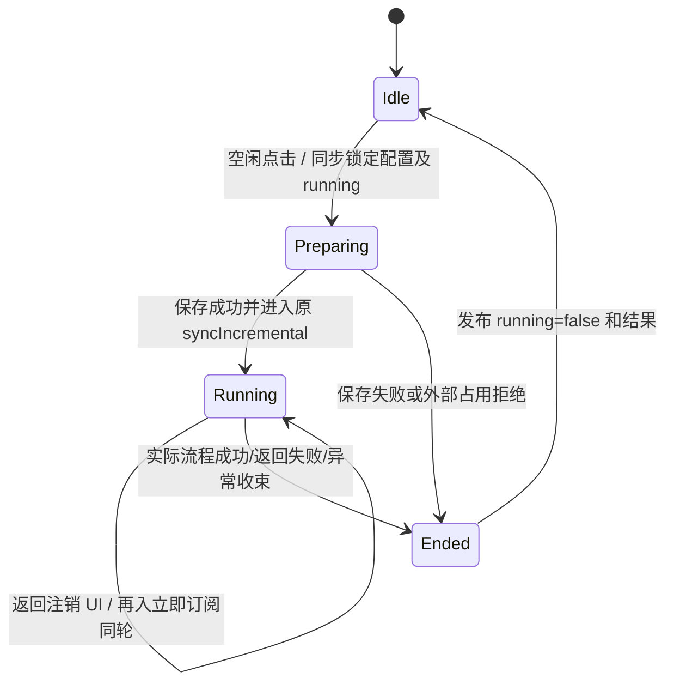

# vg-spec9 实现方案 v1.0（round 01）

日期：2026-10-16。方案角色原生会话：`01a14491-f121-7960-a9b6-155ce2b272d8`。状态：可交编码；本文件不代表实现或验证通过。

## 1. 输入、授权和结论

已读取 `spec/requirement.md`、`spec/metadata.json`、`spec/acceptance.md`、`spec/baseline-notes.md`、`workflow/requirements/round-02-implementation-review.md`、`workflow/implementation/orchestrator-decisions.md`，并检查本题现有源码。Spec SHA256：`c6236994e253c6de9f6decd99d7c0637620027ac16ce3699154796cba7a5edbf`；批准基线：`a22f32b07bf81c6dde4367e2543ebac29186cbc1`。四份输入哈希以 round 02 复审和恢复检查点为准。未读取其他赛题、题包、上游历史或初始化总览会话。

采用主 Agent 已批准的 U1—U6 策略：保留保存/校验；单流程忽略重复；不设置最短加载时长；保留导航、进程内重入绑定在途手动任务；直接等待 `syncIncremental()`；本轮沿用发起时配置。临时 busy 不持久化。这些是本轮普通实现选择，不是新增 Spec 明文。

最小充分变更是：增加一个不持 UI/AbilityContext 引用的手动同步控制器；配置区订阅其运行状态；实际 `LoadingProgress` 仅绑定本轮手动同步；移除该入口的 UI `Promise.race`；原同步请求、TaskPool、加密和存储路径继续使用。为遵守 AGENTS 的组件文件不超过 500 行，按原样抽取原配置卡片和手动操作卡片，避免改动备份/恢复业务。

## 2. 现有入口和风险证据

以下行号均为批准基线，编码后须用新行号交接。

| 位置 | 代码事实 | 方案含义 |
| --- | --- | --- |
| `pages/index/components/TopNavigation.ets:69—79`、`pages/Index.ets:325` | 齿轮进入既有 `pages/SettingsPage` | 保留导航；现有入口可按唯一文本定位，无需为本题修改该文件。 |
| `pages/SettingsPage.ets:447—462、527—529` | `activeSectionId === 'sync'` 时构造 `SettingsSyncSection` | 标题返回清空分区，子组件被销毁；仅局部 `@State` 无法保证重入时反映在途任务。 |
| `pages/settings/SettingsSyncSection.ets:41—56、289—317` | 局部 busy；等待 100/50ms；保存后调用 manager；finally 清 busy | 改由进程期控制器拥有本轮任务；删除本入口的人为等待，UI 不持长任务闭包。 |
| 同文件 `114—122、308` | `Promise.race` 在 120000ms 拒绝，没有取消请求 | 该包装返回不是同步结束；本入口直接 await 实际流程，其他手动动作包装保持原行为。 |
| 同文件 `100—111、320—335` | 保存/连接测试会 `setSettings`；输入只是 `@Link` 编辑 | 抓取发起时设置对象；运行中允许编辑下一轮值，但禁止提交、测试及其他冲突操作替换在途设置。 |
| `sync/WebDavSyncManager.ets:672—905` | 校验、防重、预检和四阶段顺序 await；最终重置 status | 不改流程/协议；把 `692—701` 的创建客户端、预检、yield 纳入原 try/catch/finally，避免预检异常逸出后遗留 SYNCING。 |
| 同文件 `711—717、766—772、794—800、864—870` | 后续阶段再次读取共享 settings 和路径 | 首个 client 建立不等于整轮配置已冻结；必须阻止在途提交新设置。 |
| `sync/webdav/WebDavClient.ets:143—149、167、179—183` | 单请求连接/读取超时为 15s/20s，完成/异常 destroy | 保留底层超时；长流程测试不能把单请求等待 120s 当作活动请求证据。 |
| `sync/AutoWebDavSyncManager.ets:33—65` | 前台自动同步复用 manager；不修改 settings | 核心取证关闭自动同步；扩展竞争测试区分手动任务和外部已占用任务。 |
| `pages/settings/SettingsSyncSection.ets` | 基线 693 行，无 `LoadingProgress` 和 `.id()` | 必要卡片拆分后每个改动组件文件 <=500 行；仅补 spinner 不能关闭生命周期风险。 |

路径表中的相对路径均位于 `entry/src/main/ets/`。基线实测已有延迟 403 请求但没有 LoadingProgress；失败夹具不是成功全链路证据，见 `baseline-notes.md`。

## 3. 状态所有权、接口和时序

新增 `sync/ManualWebDavSyncController.ets`。建议接口如下，编码可在不改变语义的前提下调整类型名称：

```text
ManualWebDavSyncSnapshot { readonly running: boolean; readonly resultText: string; readonly toastMessage: string; }
type ManualWebDavSyncListener = (state: ManualWebDavSyncSnapshot) => void
ManualWebDavSyncController.getInstance(): ManualWebDavSyncController
getSnapshot(): ManualWebDavSyncSnapshot
subscribe(listener: ManualWebDavSyncListener): number  // 立即交付当前快照
unsubscribe(token: number): void
start(settings: WebDavSettings): void                // 同步设锁，内部异步运行并自收束错误
```

控制器只持类型化快照、监听器、token 计数和现有 manager。监听器用具名函数类型与 `Map<number, ManualWebDavSyncListener>` 或类型化数组保存；无 any/unknown、无动态对象属性或方法 patch。每次更新替换快照，组件订阅回调对 `@State` 逐项赋值。通知异常需隔离，不能让监听器异常使任务跳过 finally 或形成未处理拒绝。

任务时序：

1. 配置区挂载时订阅；立即读取当前快照。销毁时注销 token，不清控制器的 running，不取消既有任务，不持久化状态。连续返回/再入不能积累订阅。
2. 点击入口同步检查组合忙碌状态（原本地操作 busy 或手动控制器 running），在第一次 await 前用表单当下值新建 `WebDavSettings`。保持 endpoint/username trim、空目录默认 `/weiyu_sync`、密码原值和 enabled=true。
3. 控制器 `start` 再检查自身 running；已运行则直接忽略，不能修改快照或启动第二个任务。检查 manager 是否已处于 SYNCING/TESTING/RESTORING；外部已占用时按既有“操作进行中”失败语义结束本次尝试，不改其 settings/status，不把外部任务记为手动完成。
4. 接受新手动轮次后同步发布 running=true、原有“正在同步数据...”提示，再启动内部 async 函数。仅此控制器可清本轮 running。原 100/50ms 延迟不迁移；不制造最短显示时间。
5. 在同一 try 内 `await manager.setSettings(frozenSettings)`，保存失败按原语义返回失败结果；成功则直接 `await manager.syncIncremental()`。不通过 SS 的 `runWithTimeout`，不增加另一个替代 race、动画倒计时或请求。
6. 保存期间若自动同步先取得 manager，原 manager 防重可以拒绝该手动尝试；记录为“未接受手动同步/外部忙碌”，不能用其短返回清外部状态，也不能据外部请求宣称手动主路径成功。控制器只拥有手动轮次，不覆盖 manager 的既有防重。
7. 成功、返回失败或异常后，生成基线风格结果文本；finally 发布 running=false。唯一终态依据是实际 await 的收束，不能是第一条响应或观察超时。快照保留最后结果，进程结束自然消失。
8. 配置区的 `webdavBusy` 继续表示原其他操作；新增 `manualSyncRunning` 表示订阅状态，`isWebDavBusy()` 返回二者 OR。所有按钮禁用、入口 guards 使用组合值；实际 LoadingProgress 只使用 `manualSyncRunning`，避免保存/测试/备份被冒充本题同步。
9. 订阅回调更新状态及结果。仅挂载组件观察到 running true→false 时可按既有风格显示 toast；首次订阅终态无需重播 toast。`webdavSyncNow` 改为同步抓取设置并调用 `start` 的薄入口，不 await 持有组件的长 Promise。

输入可以继续编辑为下一轮草稿；共享 manager 的本轮 settings 对象不可被替换。除按钮 `.enabled(!isWebDavBusy())` 外，保存/测试/备份/恢复方法入口也检查组合 busy，含恢复确认 await 返回后、真正提交/发请求前的再检查。控制器内的保存走专用路径，不能被 UI 的“手动运行中禁止保存”guard 挡住。恢复的确认、下载、导入及取消语义均不改；本轮不修复其他动作自己的 timeout。



不变量：页面显示且本轮 running 时，实际 LoadingProgress 可见；后端同步真正结束前不清 running；重复点击不清原状态；在途配置提交被挡住；离页不创造新同步；重启不恢复历史临时 busy。无效配置可快速结束而无网络，不用它判断有效配置主路径通过。

## 4. 最小写范围和组件拆分

| 文件 | 允许的变更 |
| --- | --- |
| 新增 `entry/src/main/ets/sync/ManualWebDavSyncController.ets` | 上述状态、订阅、冻结设置、保存及直接 await 既有同步；不新增端点、协议、持久化或 UI 引用。 |
| 修改 `entry/src/main/ets/pages/settings/SettingsSyncSection.ets` | 订阅/注销、组合 busy、薄同步入口、提交 guards；原样调用抽出卡片。保留自动同步、备份/恢复等原逻辑。 |
| 新增 `entry/src/main/ets/pages/settings/SettingsSyncConfigCard.ets` | 原 `buildInputField`、`buildPasswordField`、`buildBasicConfigCard` 的布局/主题和输入绑定，给实际输入加 ID；用原 @Link 语义接收各字段和密码显隐值。 |
| 新增 `entry/src/main/ets/pages/settings/SettingsSyncActionCard.ets` | 原 `buildActionButtonsCard`，包括说明文字；以 @Prop 接收 busy/manualRunning/结果，以类型化 void 回调调用原动作。新增实际 LoadingProgress，其余按钮/样式/顺序保留。 |
| 修改 `entry/src/main/ets/sync/WebDavSyncManager.ets` | 仅把 syncIncremental 已有预检区纳入原 try/catch/finally，确保所有已接收路径释放 manager 状态。不要顺带重写其他方法或修旧测试。 |

SS 原 693 行，迁出基础配置约 80 行、操作卡片约 150 行，再迁出原手动同步主体约 30 行，加入订阅/guards 后目标 <=500 行；两个卡片及控制器各自也 <=500 行。若实际行数仍超限，只把同一相关卡片的原样 builder 迁至上述文件，不拆迁无关业务。配置与操作卡片使用父状态/回调，不再创建第二套任务所有者。

不修改 SettingsPage、TopNavigation、WebDavClient、WebDavSyncTask、AutoWebDavSyncManager、数据库、权限、路由、依赖或存储格式；导航原文本可用既有选择器。既有未改文件的行数问题不扩大成本题重构。测试脚本/结果由验证角色写入本题 workflow/verification、traces 的新轮次目录；本方案角色只写本文件。

## 5. 稳定选择器和外观

| ID | 必须落在的目标 |
| --- | --- |
| `webdav_config_section` | SS 的配置分区根 Column |
| `webdav_endpoint_input` | 地址 TextInput |
| `webdav_username_input` | 账号 TextInput |
| `webdav_password_input` | 密码 TextInput |
| `webdav_sync_password_input` | 同步密码 TextInput |
| `webdav_remote_root_input` | 目录 TextInput |
| `webdav_sync_now_button` | 原“立即同步”Button |
| `webdav_sync_loading` | 真正的 LoadingProgress，不能标于容器/文字 |
| `webdav_action_result` | 原操作结果 Text |
| `webdav_save_button`、`webdav_test_connection_button` | 原保存/测试按钮 |
| `webdav_backup_button`、`webdav_restore_button` | 原备份/恢复按钮，供交错回归定位 |
| `webdav_auto_sync_toggle` | 原自动同步 Toggle（共用 builder 增加 ID 参数即可） |

I0/I1/I11 沿用基线唯一文本 `⚙`、`WebDAV 配置`、`←` 定位；I2 用分区根 ID，不新增第二个动态标题 ID。原分析的 ID 均为建议，以上为本轮实际测试契约。UI 测试须核验组件类型、可见范围和按钮启用性，不能只按 ID 存在判通过。

LoadingProgress 放在原“立即同步”行/其紧邻行，使用原 `colors.PRIMARY`、DesignTokens 间距，尺寸约 20—24vp 即可；不用全屏遮罩或新增装饰性动画。使用 `visibility(manualSyncRunning ? Visibility.Visible : Visibility.None)` 或等效条件渲染；核心是运行时可见及终态隐藏，不把空闲树中隐藏组件当运行证据。若占位影响布局，以基线间距最小调整；构建和设备截图确认没有遮挡输入或按钮。

## 6. A1—A18 覆盖

| 原子项 | 实现落点 | 必须取证 |
| --- | --- | --- |
| A1 | 原导航与 SS 分区未改 | 正常入口首次到达、返回再入；禁止测试专用路由绕行。 |
| A2 | 原字段与保存/校验、冻结设置 | 真实可写受控服务及正确配置；403 夹具不能代替。 |
| A3、A6、A10 | 原按钮稳定 ID 与薄入口 | 同一按钮点击时间和本轮日志边界。 |
| A4 | 控制器 running 与组合 busy | 请求保持时按钮禁用/基线 busy 文案。 |
| A5、A7、A11 | ActionCard 的实际 LoadingProgress | 同时核验 ArkUI 类型、ID、可见性和截图。 |
| A8 | 控制器直接调用原 syncIncremental | 调用链辅助归因 + 本轮真实后端记录。 |
| A9、A12 | 原 WebDavClient/TaskPool 请求 | 正确端点、目录、时间窗的实际服务端请求；不能使用连接测试/历史请求。 |
| A13 | 联合 UI/网络测试断言 | 缺本轮请求即失败；检查测试会拒绝空日志，不在生产造假模式。 |
| A14 | 单所有者与直接 await；页面重入订阅 | 首、中、末阶段及处理间隙持续 loading，真实终态才隐藏。 |
| A15 | 成功结果 + finally 发布 false | 完整成功、恢复启用、再次点击产生新轮请求。 |
| A16 | 保存/失败/异常收束；manager 预检受 finally 保护 | 错误响应及连接失败后无残留 loading，更正服务后真实重试成功。 |
| A17 | 不改原预检/下载链，空增量不本地短路 | 无业务增量仍有真实请求及 loading。 |
| A18 | 控制器同步 guard + UI guard/禁用 | 初帧连点、已 busy 重复点、返回再入重复点均不提前清状态；终态可新开轮次。 |

前三个场景可共享一轮完整证据，但每个编号单独登记结果；A15—A18 为合理推导，不升级为 Spec 明文。

## 7. B1—B15 实测计划

所有设备/构建进程先加载 `D:/HCUP/.hcup-local/Enter-HarmonyEnv.ps1`。验证必须在源码冻结后重新构建并安装本题刚构建 HAP，比较基线告警，记录 HAP 哈希；方案阶段不执行构建/设备命令。

每轮夹具使用独立 run-id/目录和新日志，关闭自动同步并记录关闭状态；记录点击、请求接收、响应释放、UI 快照和终态时间。单看日志“有请求”不足以归因。凭据只用测试值，报告不输出真实密码。首响、中间响、最后请求和本地处理属于同一流程，不按 HTTP 数量推算点击次数。

| 测试 | 边界 | 动作和通过条件 |
| --- | --- | --- |
| T1 有效成功主路径 | A1—A15、B9/B14 | 首次进入、填真实可写配置、点击；夹具在预检和后续下载各保持一段小于底层读取时限的窗口，捕获 LoadingProgress 类型/截图及请求重叠；释放全部后完整成功，隐藏 loading 并恢复按钮。再快速完成一轮，记录自然终态，不强制额外驻留。 |
| T2 失败与恢复 | A16、B10 | 正确端点先返回受控 401/403 或后续阶段 500；保持期间有 loading，实际结束后隐藏；更正服务后点击必须真实成功。另测连接拒绝/断网，实际超时收束后可操作；服务未收到的离线轮只证明恢复，不计 A9/A12。 |
| T3 重复与连点 | A18、B5/B6 | 首帧多次触发和忙碌窗口重复点击；不接受第二个手动流程、不清原 loading；原末阶段结束前一直可见；完成后点击新轮。一次流程多条 HTTP 合法。 |
| T4 无数据 | A17、B7 | 空本地增量/远端无业务文件，及已成功后立即再同步；至少仍发生同轮真实预检/下载请求，运行中可见，终态恢复。允许没有业务 PUT。 |
| T5 未触发、取消和关闭 | B3/B4/B9 | 只编辑、切换密码显隐、收起键盘、未点同步就返回，不能建立新手动任务或本轮同步请求；只保存不记为同步；只测试连接的请求单独标源。无运行中取消按钮/同步确认框，分别记 not_applicable。 |
| T6 空/空格兼容 | B1/B2 | 地址、账号、密码、同步密码逐项为空和纯空格；目录空单独验证默认值；地址/账号两端空格仍按原 trim；密码中的空格不得被擅自移除。实际拒绝结束后无永久 loading，恢复有效配置能真实重试。无效轮不计有效主路径网络通过。 |
| T7 返回再入 | B4/B11 | 终态后标题返回再入无残留；在请求保持时标题返回设置目录再入、系统返回到首页后按原路再入，分别核验同轮 busy/loading、无新流程/无 config 提交。离页后任务可继续，完成期间不更新已销毁 UI；再入正确显示活动或终态。 |
| T8 重启 | B12 | 终态后冷启动验证配置沿基线恢复、无历史 busy；另在手动运行中 force-stop、等待服务端记明断连/剩余旧请求后重新启动。新进程无手动 loading，不自动补发旧手动轮；自动同步关闭。不能要求服务端已经接收的旧请求立即取消。 |
| T9 多阶段和旧超时 | B9/B13 | 正常链首/中/末阶段分别采样；构造总耗时 >120s、每条响应低于 15s/20s 限制的真实多请求流程，在 t>120s 且仍有本轮活动请求时断言 loading 持续。可用多层新 remoteRoot，按原 ensureRemoteDirectory 的父 HEAD/.keep PUT 递归实现足够多的顺序请求，每条约 8s；夹具必须真的支持这些既有路径并最终正常结束。不得靠修改客户端超时、生产开关、mock 请求或单条挂起 120s 过关；无法构造时如实列未验证，不用源码搜索替代实测。 |
| T10 配置和其他任务交错 | B15 | 本轮 A 端点运行时编辑成 B，尝试保存/测试/备份/恢复：组合 busy 和入口 guard 应拒绝提交；后续所有本轮请求仍去 A。结束后再点同步应使用 B。返回再入后重复该断言。自动任务先运行时手动尝试不得替换其 settings、清其 status 或冒充手动成功；手动先接受时自动尝试受原 manager 防重约束。 |
| T11 分页 | B8 | not_applicable：本题无 UI 列表/页码/加载更多。 |

测试层适合增加的有意义检查为：控制器首次异步前设锁、重复 start 不清状态、pending 后 unsubscribe/resubscribe 得到同轮快照、保存/同步失败后复位；可用测试替身验证状态机，但这些不能替代 T1/T4/T9 的真实后端与设备证据。不向生产增加仅供测试的延迟/成功开关，不用现有动态 patch 风格测试充当 ArkTS 合规证明。既有 `WebDavSyncManagerIncremental.test.ets` 针对旧 helper 的 patch 与当前四阶段实现不一致，作为已有测试限制登记，不为本题修整套旧测试。

## 8. 实现顺序、复核和回退

1. 增加控制器和状态订阅，保存/同步错误全部自收束；完成 manager 预检 try 范围的最小修正。
2. 按原样抽出 ConfigCard/ActionCard，连接原父状态/回调并补实际目标 ID；只加入绑定 manual running 的 LoadingProgress。
3. SS 接入订阅/注销、薄入口、组合 guards；检查 await 确认后的冲突点；核对所有改动组件文件 <=500 行。
4. 编码角色静态检查后冻结源码；验证角色构建/告警差分/安装/T1—T11，A/B 每项登记 pass/fail/not_run/not_applicable 及路径。
5. 主 Agent 复核真实请求与 UI 重叠、成功全链路、失败后重试、旧 120s 风险和重入，再作结案；不得以仅源码组件、仅失败预检或未跑项计通过。

失败归因：若源码保留 UI race、页面消失清控制器、同任务被两个 finally 清状态、ID 标错组件或回调遗漏 guards，属于实现偏离，修对应文件即可。若控制器依然依赖组件存活/允许活动轮替换 settings，属于方案状态所有权缺陷，回到本方案第 3 节收缩调整。夹具未实现可写 WebDAV、自动同步混入、只采首响应或单请求已超底层时限，先修测试归因和夹具，不能降原文。Spec 或输入哈希变化则交主 Agent 需求复审。

## 9. ArkTS 依据、权衡和未解决项

按派工读取 `C:/Users/22580/.codex/skills/hmos-arkts-knowledge-retriever/SKILL.md`。其规定检索脚本实际报缺 `references/doc_index.json`，因此直接读同包现有文档；文档实际目录为 `Basic-Syntax`，不是技能描述的 `02-Basic-Syntax`。未安装依赖或修改技能包。

- `docs/ArkTS-Language-Guide/Basic-Syntax/functions.md`，Function Types:226—255、Arrow Functions:314 起；来源种类为本地语言指南副本。支持具名函数类型/类型化回调及箭头函数，匹配订阅接口。
- 同目录 `classes.md`，Static Members:251—285；本地语言指南副本。匹配常规类/静态 getInstance 的进程期所有者，不把类当动态对象。
- 同目录 `error-handling.md`，finally、Error Handling in Async Code；本地语言指南副本。匹配 await 外围 try/catch/finally、异常收束、清理临时状态；catch 参数不写 any/unknown 注解。
- `docs/ArkTS-Language-Guide/Concurrency/async-concurrency-overview.md`，Promise、Async/Await；本地语言指南副本。Promise 以实际 fulfilled/rejected 收束，await 等待该操作完成，不能把竞争 Promise 当底层取消。
- `docs/linter/ArkTS_Syntax_Knowledge_From_Linter.md:118—160`；明确是 linter 派生总结。支持箭头回调、常规类声明，避免嵌套函数声明/动态方法赋值；不是额外官方产品需求。
- 本题 `pages/TaskLoadingOverlay.ets:18—22` 仅作为已有 LoadingProgress/主题用法，不复用全屏遮罩。原生角色定义读取自 `D:/HarmonyDev/codex/agents/harmony_design.toml`。

权衡：轻量单例比仅局部 busy 多一个小文件，但自然覆盖分区销毁/整个设置页重入，无全局持久化或轮询。卡片抽取增加两个 UI 文件，是满足组件 <=500 行的相关范围拆分；主题、顺序和其他动作业务保持原样。允许编辑下一轮而禁止在途提交，避免重写 manager 的每个配置/路径参数。外部自动同步占用仍按已有防重处理，不加入队列或强行共享手动 spinner。

未解决产品问题：无。待实证项：本轮新 HAP 构建/新增告警、控件实际类型与可见性、可写服务成功全链路、长流程 >120s、重入/重启/并发回归，均由后续验证报告决定；本文件不将它们标通过。
