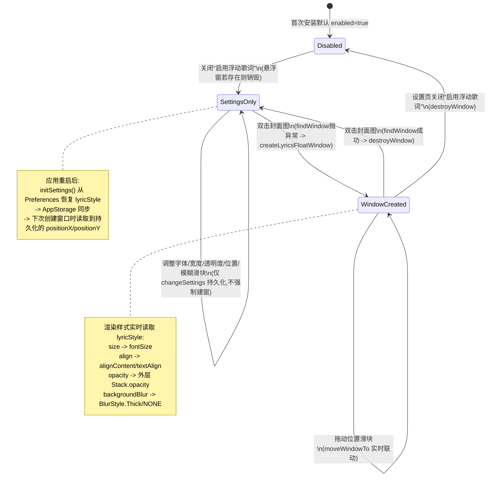

# cmu-spec9 测试设计与验收矩阵

## 1. 题目上下文

- 题目 ID：cmu-spec9（悬浮歌词设置选项扩展）
- Spec：`/Users/bress/Documents/code/SWE-OpenHarmony/specs/cmu-spec9.md`
- `base_commit`：`dc94c44f2e6288dffd556f3ce311a834c2594af1`
- `baseline_bundle`：`repo_bundles/cloudmusic-harmonyosnex-dc94c44f2e-base.bundle`
- 工程路径：`/Users/bress/Documents/code/harmonycup-work/cmu-spec9`
- 已确认的设备、登录、网络和数据前置条件：
  - 独立工程当前 HEAD 与 `base_commit` 一致，工作区存在未提交改动（新增 `FloatLyricsSettingsPage.ets`、修改 `Settings.ets`/`settings.ets`/`WindowUtils.ets`/`BottomBarComponent.ets`/`FloatingLyrics.ets`/`PlaySettingsPage.ets`/`SettingsPage.ets`/三份 `string.json`），已逐一核对 diff。
  - 本题功能为纯本地设置与窗口渲染，不依赖登录态和网络请求；但播放设置页/底部播放栏需要应用处于正常播放态（已有歌曲加载、`picUrl` 非空）才能展示双击封面交互。
  - 已存在本地自测脚本骨架 `hypium_tests/test_floating_lyrics_settings.py` 及通用框架 `test-harness/harness/{driver,device,env_check}.py`，官方评测环境规格见 `test-harness/harness/env_check.py` 内 `OFFICIAL_SPEC`（Pura 90 Pro Max / PHEMU-FD00 / HarmonyOS 6.1.0 / API 23 / 1308x2880 @560dpi）。
- 未确认条件：
  - 悬浮窗实际坐标读取方式（hidumper 查询 `WindowManagerService` 后如何精确解析出 `lyricsFloatWin` 对应的 `[x y w h]`）尚未验证，`env_check.py` 现有正则只按"第一条分辨率合理的记录"解析桌面窗口，并非按窗口名过滤，需要人工在真机/模拟器上验证 hidumper 输出格式后补全。
  - "背景模糊"开关切换后毛玻璃效果的像素级/属性级验证方式（`backgroundBlurStyle` 在 hidumper 节点树或 UI dump 中是否可读）待人工确认。
  - 应用重启后"重新打开应用"在 Hypium 层的标准做法（stop + start ability，还是直接 `hdc shell` 冷启动）待结合 harness 实际能力确认，当前 `HarnessTestCase` 未提供封装方法。

## 2. 需求原子化

| 编号 | 来源场景/步骤 | 原子行为 | 证据等级 | 可观察结果 | 可能影响 |
|---|---|---|---|---|---|
| A1 | 场景一·步骤1 | 从"播放设置"点击"浮动歌词设置"进入详情页 | SPEC_EXPLICIT | 路由跳转到 `FloatLyricsSettingsPage`，标题文案为"浮动歌词设置" | 入口丢失/路由注册遗漏会导致功能完全不可达 |
| A2 | 场景一·步骤2 | 详情页展示 8 个控件：启用开关/居中开关/字体大小滑块/宽度滑块/透明度滑块/左右位置滑块/上下位置滑块/背景模糊开关 | SPEC_EXPLICIT | 页面可见对应文本和控件类型（Toggle×3、Slider×5） | 控件缺失直接导致该功能点不可用 |
| A3 | 场景一·步骤3 | 调整字体大小滑块为较大值，设置页滑块状态立即反馈变化 | SPEC_EXPLICIT | 滑块右侧数值文案随拖拽实时更新为新值（`toFixed(2)` 格式） | 若 onChange 未触发状态更新，用户无法感知调整是否生效 |
| A4 | 场景一·步骤4 | 调整位置滑块到屏幕右侧，悬浮窗位置随比例实时更新 | SPEC_EXPLICIT | 已创建悬浮窗时，`moveWindowTo` 被调用，窗口坐标随比例变化；未创建悬浮窗时仅持久化不报错 | 实时联动失败会导致"所见非所得"，用户需要退出重进才能看到效果 |
| A5 | 场景一（隐含） | 字体大小/宽度/透明度/位置滑块的取值范围分别为 10~30 / 0.4~1 / 0.2~1 / 0~1 | REASONABLE_DERIVATION（来自代码常量，Spec 未写明具体数值） | 滑块可拖拽的最小/最大边界与代码一致 | 范围错误会导致极端值下 UI 溢出或窗口超出屏幕 |
| B1 | 场景二·步骤1 | 通过"上下调节"/"左右调节"将悬浮歌词调整到屏幕右下方 | SPEC_EXPLICIT | `positionX`/`positionY` 被写入并持久化到 Preferences | 持久化缺失会导致 B3 失败 |
| B2 | 场景二·步骤2 | 退出并重新打开应用，双击底部播放栏封面图开启悬浮歌词 | SPEC_EXPLICIT | 双击后创建悬浮窗（`handleDoubleClick` 捕获"窗口不存在"异常后调用 `createLyricsFloatWindow`） | `enabled` 开关为 false 时双击无效，需在前置条件中保证开关为 true |
| B3 | 场景二·步骤3 | 悬浮歌词窗口出现在上次保存的位置 | SPEC_EXPLICIT | 新建窗口坐标 `posX = displayW * positionX`、`posY = displayH * positionY`（`positionY>=0`时）与 B1 保存值一致 | 若重启后读取到默认值而非持久化值，判定为核心功能不通过 |
| B4 | 场景二（隐含边界） | `positionY` 为默认值 -1（从未调整过纵向位置）时，不应使用 `displayH * (-1)`，而应使用顶部避让高度 | REASONABLE_DERIVATION（代码显式处理，Spec 未直接提及该边界） | 首次开启悬浮窗时 Y 坐标为 `FLOAT_LYRICS_TOP_MARGIN`（`vp2px(42)`），不出现负坐标或窗口飘出屏幕外 | 边界处理缺失会导致首次使用时窗口位置异常 |
| C1 | 场景三·步骤1 | 开启"背景模糊"开关 | SPEC_EXPLICIT | `backgroundBlur` 置为 true 并持久化 | - |
| C2 | 场景三·步骤2 | 悬浮歌词窗口背景呈现毛玻璃效果 | SPEC_EXPLICIT | 悬浮窗渲染时 `backgroundBlurStyle(BlurStyle.Thick)` 生效，背景色为 `Color.Transparent` | 若渐变未读取到最新 `lyricStyle`（`@StorageProp` 未及时同步），会出现"开关已变但窗口未变" |
| C3 | 场景三·步骤3 | 关闭"背景模糊"开关，背景恢复半透明样式 | SPEC_EXPLICIT | `backgroundBlurStyle(BlurStyle.NONE)`，背景色为 `rgba(0,0,0,0.35)` | 同 C2 |
| D1（跨场景隐含） | 场景一/三操作均发生在悬浮窗未必已创建的情况下 | 设置页所有调整在悬浮窗未创建时只做持久化，不强制创建窗口；悬浮窗已创建时需实时联动 | SPEC_EXPLICIT（场景一步骤4"实时更新"隐含要求区分两种状态）＋REASONABLE_DERIVATION（创建判断的异常捕获方式） | 两种状态下均不抛出未捕获异常，设置页不崩溃 | 异常处理遗漏会导致设置页在悬浮窗未创建时调整滑块直接崩溃 |
| D2（隐含） | "启用浮动歌词"关闭后双击封面图无效果 | 全局开关可阻断悬浮窗创建和销毁入口 | REASONABLE_DERIVATION（代码新增校验，Spec 未直接提及，但属于"启用/禁用"语义的合理闭环） | 关闭开关后双击封面不产生任何窗口变化 | 若此校验缺失，会出现开关为关但仍能通过双击打开悬浮窗的语义矛盾 |

## 3. 候选功能检查点

> 以下为基于 Spec 推导的候选检查点，不是官方 F-point 清单。

- **检查点 1：浮动歌词设置入口与控件完整性**
  - 依据：A1、A2
  - 前置状态：应用已启动，播放设置页可达
  - 触发动作：点击"浮动歌词设置"
  - 通过断言：进入页面且 8 个控件（3 开关 + 5 滑块）均存在
  - 失败表现：路由跳转失败，或控件数量/文案缺失
  - 是否需要网络/持久化/返回/重启：否
  - 优先级：P0
  - 未确认假设：无

- **检查点 2：滑块调整的即时 UI 反馈**
  - 依据：A3
  - 前置状态：已进入设置详情页
  - 触发动作：拖拽字体大小滑块至较大值
  - 通过断言：数值文案（`toFixed(2)`）随拖拽变化且与拖拽方向一致增大
  - 失败表现：数值文案不更新或更新值与拖拽方向不符
  - 是否需要网络/持久化/返回/重启：持久化（每次 onChange 都会调用 `changeSettings`）
  - 优先级：P0
  - 未确认假设：无

- **检查点 3：位置滑块对已创建悬浮窗的实时联动**
  - 依据：A4、D1
  - 前置状态：悬浮窗已创建（先双击封面开启）
  - 触发动作：在设置页拖拽左右/上下位置滑块
  - 通过断言：悬浮窗坐标随滑块比例实时变化（可用 hidumper 轮询坐标验证，或退化为"设置页不崩溃 + 持久化值变化"）
  - 失败表现：窗口坐标不变化，或设置页抛异常崩溃
  - 是否需要网络/持久化/返回/重启：是（需要跨进程/跨窗口观察悬浮窗坐标）
  - 优先级：P1（实时联动是增强体验，核心是"重启后位置正确"见检查点 4）
  - 未确认假设：hidumper 坐标解析方式待确认

- **检查点 4：位置持久化与重启后恢复（核心场景二）**
  - 依据：B1、B2、B3、B4
  - 前置状态：已调整并持久化 `positionX`/`positionY`
  - 触发动作：退出应用 → 重新打开 → 双击底部播放栏封面
  - 通过断言：悬浮窗坐标与退出前持久化的比例换算结果一致（允许像素级小误差）
  - 失败表现：窗口回到默认位置（如默认 `positionX=0.1`、顶部避让 Y）而非上次保存位置
  - 是否需要网络/持久化/返回/重启：是，需要重启应用
  - 优先级：P0（Spec 场景二的核心验收点）
  - 未确认假设：hidumper 坐标解析、应用重启的标准操作方式

- **检查点 5：背景模糊开关对悬浮窗渲染样式的影响（核心场景三）**
  - 依据：C1、C2、C3
  - 前置状态：悬浮窗已创建且可见
  - 触发动作：切换"背景模糊"开关
  - 通过断言：开启时窗口呈现 `BlurStyle.Thick` + 透明背景；关闭时呈现 `BlurStyle.NONE` + `rgba(0,0,0,0.35)` 背景
  - 失败表现：切换开关后悬浮窗视觉效果不变，或崩溃
  - 是否需要网络/持久化/返回/重启：持久化
  - 优先级：P0
  - 未确认假设：UI dump/hidumper 是否能读取到 `backgroundBlurStyle` 属性，否则需退化为交互层验证（见第 9 节风险）

- **检查点 6：启用开关总闸语义**
  - 依据：D2
  - 前置状态：悬浮窗已创建
  - 触发动作：在设置页关闭"启用浮动歌词"
  - 通过断言：悬浮窗被销毁（`findWindow` 后续应抛"窗口不存在"或等价表现）；再双击底部封面图，悬浮窗不会被创建
  - 失败表现：关闭开关后悬浮窗仍存在，或双击封面仍能打开窗口
  - 是否需要网络/持久化/返回/重启：持久化
  - 优先级：P1（Spec 未直接要求，但属于合理功能闭环，影响场景二/三测试执行顺序）
  - 未确认假设：此为 REASONABLE_DERIVATION，非 Spec 明确要求

- **检查点 7：取值边界（滑块最小/最大值）**
  - 依据：A5
  - 前置状态：已进入设置详情页
  - 触发动作：将每个滑块分别拖到最小值和最大值
  - 通过断言：窗口不崩溃，极端值下窗口仍在屏幕可视范围内（如 `widthRatio=1` 时窗口宽度等于屏幕宽度而不溢出）
  - 失败表现：极端值导致窗口超出屏幕或应用崩溃
  - 是否需要网络/持久化/返回/重启：是（需创建悬浮窗观察）
  - 优先级：P2
  - 未确认假设：边界数值来自代码而非 Spec，若后续实现调整范围需同步更新

## 4. 详细测试用例

```text
测试编号：TC-01
名称：浮动歌词设置页入口可达且控件齐全
优先级：P0
覆盖的 Spec：场景一·步骤1-2
证据等级：SPEC_EXPLICIT
目的：验证从播放设置能正确进入浮动歌词设置详情页，且所有控件均渲染
前置条件：应用已启动，已进入"播放设置"页面
测试数据：无
操作步骤：
  1. 在"播放设置"页点击"浮动歌词设置"
  2. 等待页面跳转完成
逐步预期：
  1. 点击后触发路由跳转
  2. 页面标题显示"浮动歌词设置"
最终断言：
  - 页面存在文本"启用浮动歌词""浮动歌词居中""背景模糊"
  - 页面内 `BY.type("Slider")` 查找到的组件数量 >= 5
  - 页面内 `BY.type("Toggle")` 查找到的组件数量 >= 3
网络行为：无
持久化行为：无
清理与复现：返回上一页即可，无需额外清理
失败时优先排查：路由名 'FloatLyricsSettingsPage' 是否在 SettingsPage.ets 中正确注册；入口文案资源 app.string.SET_FLOATLYRICS 是否存在

测试编号：TC-02
名称：字体大小滑块拖拽后数值文案即时更新
优先级：P0
覆盖的 Spec：场景一·步骤3
证据等级：SPEC_EXPLICIT
目的：验证调整字体大小滑块时设置页有即时反馈
前置条件：已进入浮动歌词设置详情页
测试数据：字体大小滑块范围 10~30，默认 20
操作步骤：
  1. 定位"字体大小"行内的 Slider 组件
  2. 记录拖拽前的数值文案（如 "20.00"）
  3. 向右拖拽滑块至接近最大值
  4. 读取拖拽后的数值文案
逐步预期：
  1-2. 能定位到组件并读到初始值文案
  3. 拖拽动作被 onChange 回调捕获
  4. 数值文案变为更大的值（接近 30.00），且与拖拽前的值不同
最终断言：拖拽后数值文案对应的数字大于拖拽前的数字
网络行为：无
持久化行为：每次 onChange 都会调用 changeSettings 写入 Preferences（可在断言后额外检查 Preferences 中 lyricStyle.size 已更新，若 Hypium 层可读）
清理与复现：测试结束后可将滑块拖回 20 还原默认值，避免影响后续用例
失败时优先排查：Slider 的 onChange 是否真正调用了 this.style.size = value 和 updateLyricStyle()；@State style 是否正确触发重渲染

测试编号：TC-03
名称：位置滑块调整后已创建悬浮窗坐标实时联动
优先级：P1
覆盖的 Spec：场景一·步骤4
证据等级：SPEC_EXPLICIT
目的：验证已创建悬浮窗时，拖动位置滑块能让窗口位置实时更新，而非需要重新打开才生效
前置条件：
  1. 悬浮歌词开关已启用
  2. 已双击底部播放栏封面图创建悬浮窗（lyricsFloatWin 存在）
测试数据：左右调节(positionX) 从默认 0.1 调整到约 0.8（屏幕右侧）
操作步骤：
  1. 进入浮动歌词设置详情页
  2. 通过 hidumper 记录当前悬浮窗坐标（调整前）
  3. 拖拽"左右调节"滑块到接近最大值
  4. 再次通过 hidumper 读取悬浮窗坐标
逐步预期：
  2. 能读到初始坐标 x0
  3. onChange 触发 syncFloatWindowPosition，调用 moveWindowTo
  4. 新坐标 x1 明显大于 x0，接近 displayW * 0.8
最终断言：x1 相比 x0 的变化方向和幅度与滑块调整方向一致（允许合理误差）
网络行为：无
持久化行为：持久化到 lyricStyle.positionX
清理与复现：将滑块调回默认值 0.1，关闭悬浮窗（双击封面图）
失败时优先排查：window.findWindow 是否因窗口名不匹配而抛异常导致 syncFloatWindowPosition 静默失败；hidumper 坐标解析方式（待人工确认，见第9节）

测试编号：TC-04
名称：悬浮窗未创建时拖动位置滑块仅持久化不崩溃
优先级：P1
覆盖的 Spec：场景一·步骤4（边界：D1）
证据等级：REASONABLE_DERIVATION
目的：验证设置页在悬浮窗未创建的状态下调整位置/其他滑块不会抛出未捕获异常
前置条件：确保当前没有已创建的 lyricsFloatWin（未双击开启过，或已销毁）
测试数据：任意滑块调整
操作步骤：
  1. 进入浮动歌词设置详情页（确认悬浮窗未创建）
  2. 依次拖拽字体大小、宽度、透明度、左右调节、上下调节滑块
逐步预期：每次拖拽后设置页正常响应，无崩溃、无 ANR
最终断言：操作完成后页面仍可继续交互（如仍能读到"启用浮动歌词"文本）
网络行为：无
持久化行为：每次调整均写入 lyricStyle
清理与复现：无需特殊清理
失败时优先排查：syncFloatWindowPosition 中 try/catch 是否完整覆盖 window.findWindow 和后续调用链

测试编号：TC-05
名称：位置调整持久化后重启应用恢复到上次保存位置（核心场景二）
优先级：P0
覆盖的 Spec：场景二·步骤1-3
证据等级：SPEC_EXPLICIT
目的：验证悬浮歌词位置的跨重启持久化，是本题最核心的验收点
前置条件：悬浮歌词开关已启用
测试数据：将 positionX 调整为约 0.8，positionY 调整为约 0.7（右下方）
操作步骤：
  1. 进入浮动歌词设置详情页，将"左右调节"和"上下调节"分别拖到约 0.8 和 0.7
  2. 完全退出应用（非仅切后台，需终止进程）
  3. 重新启动应用
  4. 双击底部播放栏封面图开启悬浮歌词
  5. 通过 hidumper 查询 lyricsFloatWin 的实际坐标
逐步预期：
  4. 悬浮窗被创建（之前没有残留窗口）
  5. 坐标 ≈ (displayW * 0.8, displayH * 0.7)，而非默认坐标 (displayW * 0.1, FLOAT_LYRICS_TOP_MARGIN)
最终断言：实际坐标与期望坐标的差异在合理误差范围内（如 <5% 屏幕尺寸）
网络行为：无
持久化行为：验证的正是 Preferences 持久化在应用重启后仍能被正确读取
清理与复现：测试后可将位置调回默认值
失败时优先排查：
  - initSettings() 启动时是否会用默认值覆盖已持久化的 lyricStyle
  - createLyricsFloatWindow 中读取 AppStorage.get 时机是否早于 Preferences 恢复完成
  - 完全退出应用的操作方式是否触发了状态重置（而非真实冷启动）

测试编号：TC-06
名称：positionY 默认值(-1)不应导致窗口出现在无效坐标
优先级：P1
覆盖的 Spec：场景二（边界 B4）
证据等级：REASONABLE_DERIVATION
目的：验证从未调整过纵向位置的全新安装场景下，首次开启悬浮窗使用顶部避让而非负坐标
前置条件：清除应用数据或使用全新安装，保证 lyricStyle.positionY 为默认值 -1
测试数据：无
操作步骤：
  1. 全新安装/清除数据后启动应用
  2. 直接双击底部播放栏封面图开启悬浮歌词（不进入设置页调整）
  3. 查询悬浮窗坐标
逐步预期：窗口创建成功，Y 坐标为固定顶部避让值，不是负数或屏幕外坐标
最终断言：Y 坐标等于 FLOAT_LYRICS_TOP_MARGIN 对应的像素值，窗口在屏幕可视范围内
网络行为：无
持久化行为：首次会通过 initSettings 写入默认 lyricStyle
清理与复现：无
失败时优先排查：WindowUtils.createLyricsFloatWindow 中 positionY < 0 的分支判断

测试编号：TC-07
名称：背景模糊开关开启后悬浮窗呈现毛玻璃效果（核心场景三）
优先级：P0
覆盖的 Spec：场景三·步骤1-2
证据等级：SPEC_EXPLICIT
目的：验证开启背景模糊开关后悬浮窗渲染样式切换为 Thick 模糊 + 透明背景
前置条件：悬浮歌词开关已启用，悬浮窗已创建
测试数据：无
操作步骤：
  1. 进入浮动歌词设置详情页
  2. 开启"背景模糊"开关
  3. 观察/查询悬浮窗渲染属性
逐步预期：开关切换为开启状态后，悬浮窗背景效果变化
最终断言：
  - 若 UI dump / hidumper 可读取到组件属性：backgroundBlurStyle 为 Thick、backgroundColor 为透明
  - 若无法读取属性（见第9节风险）：退化为"开关可点击且状态持久化为 true，且页面/窗口不崩溃"的交互层验证
网络行为：无
持久化行为：backgroundBlur 写入 lyricStyle
清理与复现：测试后可关闭开关还原默认状态（默认即为 true，需确认还原方向）
失败时优先排查：FloatingLyrics.ets 中 @StorageProp 是否及时响应 lyricStyle.backgroundBlur 变化并重新渲染

测试编号：TC-08
名称：背景模糊开关关闭后悬浮窗恢复半透明样式
优先级：P0
覆盖的 Spec：场景三·步骤3
证据等级：SPEC_EXPLICIT
目的：验证关闭背景模糊开关后悬浮窗渲染样式切换为 NONE + 半透明黑色背景
前置条件：承接 TC-07，背景模糊当前为开启状态
测试数据：无
操作步骤：
  1. 在浮动歌词设置详情页关闭"背景模糊"开关
  2. 观察/查询悬浮窗渲染属性
逐步预期：开关切换为关闭状态后，悬浮窗背景效果变化
最终断言：
  - 可读取属性时：backgroundBlurStyle 为 NONE，backgroundColor 为 rgba(0,0,0,0.35)
  - 不可读取属性时：退化为"开关状态正确持久化为 false，页面/窗口不崩溃"
网络行为：无
持久化行为：backgroundBlur 写入 lyricStyle 为 false
清理与复现：可重新开启还原默认 true
失败时优先排查：同 TC-07

测试编号：TC-09
名称："启用浮动歌词"关闭后双击封面图无效果
优先级：P1
覆盖的 Spec：场景一/二隐含（D2）
证据等级：REASONABLE_DERIVATION
目的：验证启用开关作为全局总闸的语义，避免开关为关时仍可通过双击打开悬浮窗
前置条件：悬浮窗未创建（或已创建但即将验证关闭开关后的销毁行为）
测试数据：无
操作步骤：
  1. 进入浮动歌词设置详情页，关闭"启用浮动歌词"开关
  2. 返回播放页，双击底部播放栏封面图
  3. 查询是否存在 lyricsFloatWin 窗口
逐步预期：
  1. 若之前悬浮窗已创建，关闭开关后窗口被销毁
  2. 双击动作被 handleDoubleClick 捕获但因 enabled=false 直接 return
  3. 悬浮窗不存在
最终断言：双击后 lyricsFloatWin 查询不到（findWindow 应抛"窗口不存在"或等价表现）
网络行为：无
持久化行为：enabled 写入 lyricStyle 为 false
清理与复现：测试后重新开启"启用浮动歌词"开关，恢复默认 true，避免影响后续用例
失败时优先排查：BottomBarComponent.handleDoubleClick 中新增的 enabled 校验是否生效；FloatLyricsSettingsPage.applyEnabledState 是否正确销毁已存在窗口

测试编号：TC-10
名称：滑块取值边界下窗口不溢出屏幕、应用不崩溃
优先级：P2
覆盖的 Spec：场景一隐含边界（A5）
证据等级：REASONABLE_DERIVATION
目的：验证宽度/透明度/位置滑块在最小最大边界值下的健壮性
前置条件：悬浮歌词开关已启用，已创建悬浮窗
测试数据：宽度滑块拖到 1（最大），positionX/positionY 拖到 1（最大，屏幕右下边缘）
操作步骤：
  1. 进入设置详情页，将"宽度"滑块拖到最大值
  2. 将"左右调节""上下调节"均拖到最大值
  3. 查询悬浮窗坐标和尺寸
逐步预期：窗口宽度等于屏幕宽度，不会超出；窗口左上角坐标 + 宽度不超过屏幕右边界
最终断言：窗口可见区域仍在屏幕范围内，应用无崩溃无 ANR
网络行为：无
持久化行为：对应字段写入 lyricStyle
清理与复现：测试后恢复默认值（widthRatio=0.8, positionX=0.1, positionY=-1 或默认位置）
失败时优先排查：WindowUtils.createLyricsFloatWindow 中 winW/posX/posY 的计算是否有边界保护；是否需要 clamp 到屏幕范围内
```

## 5. 状态、数据和网络模型



- 初始状态：全新安装，`lyricStyle` 为 `LyricStyleItem` 默认值（`enabled=true, widthRatio=0.8, opacity=1, positionX=0.1, positionY=-1, backgroundBlur=true, size=20, align='center'`）。
- 用户动作：设置页滑块/开关调整；底部播放栏双击封面图；应用退出重启；拖拽悬浮窗本体（`FloatingLyrics.ets` 内的 `PanGesture`，拖拽结束会调用 `persistPosition()` 反向写回 `positionX/positionY`，这是另一条持久化入口，不只设置页会修改坐标）。
- UI 状态：设置页 `@State style` 本地状态与 `@StorageProp lyricStyle` 全局状态；悬浮窗页面 `@StorageProp lyricStyle` 直接驱动渲染。
- 数据状态：`AppStorage` 内存态与 `Preferences`（`StorageConstants.SET_PERF`）落盘态，通过 `changeSettings()` 保持同步。
- 网络副作用：无，本功能完全本地化。
- 成功、失败、取消和返回后的状态：设置页所有调整都是"即时生效 + 立即持久化"，没有"取消/撤销"交互，返回上一页不会回滚已做的调整（这与大多数设置页语义一致，Spec 未提及取消流程，不作为缺陷）。
- 哪些状态必须跨页面或跨重启保持：`positionX`、`positionY`（场景二核心）、`enabled`、`backgroundBlur`、`size`、`widthRatio`、`opacity`、`align` 均应跨重启保持（存于 Preferences），且需要在设置页、悬浮窗页面、底部播放栏三处保持一致（均通过 `AppStorage` 共享同一 key）。

## 6. 当前基线定位

| 文件 | 与测试的关系 |
|---|---|
| `entry/src/main/ets/pages/settings/FloatLyricsSettingsPage.ets` | 被测页面本身，TC-01~TC-04、TC-07~TC-10 均在此页面操作；提供所有滑块/开关的 UI 和 onChange 逻辑 |
| `entry/src/main/ets/common/entities/local/Settings.ets` | `LyricStyle` 接口和默认值 `LyricStyleItem`，决定 TC-05/TC-06 的默认值断言基准；`cloneLyricStyle` 影响状态更新是否会产生引用共享问题 |
| `entry/src/main/ets/common/functions/app/settings.ets` | `changeSettings`/`initSettings` 持久化入口，TC-05（重启恢复）直接依赖其正确性 |
| `entry/src/main/ets/common/utils/system/WindowUtils.ets` | `createLyricsFloatWindow` 悬浮窗创建逻辑，TC-05/TC-06/TC-10 的坐标计算均来自此处 |
| `entry/src/main/ets/components/play/BottomBarComponent.ets` | `handleDoubleClick` 双击触发逻辑，TC-05/TC-09 依赖其 `enabled` 校验和创建/销毁分支 |
| `entry/src/main/ets/pages/lyrics/FloatingLyrics.ets` | 悬浮窗实际渲染页面，TC-07/TC-08 验证的样式切换逻辑所在；`persistPosition()` 是坐标持久化的另一入口 |
| `entry/src/main/ets/pages/settings/PlaySettingsPage.ets` / `SettingsPage.ets` | 路由入口和注册，TC-01 验证的跳转依赖这两处 |
| `entry/src/main/resources/{base,zh_CN,en_US}/element/string.json` | 控件文案资源，TC-01 等用例中 `require_text` 的文本来源 |
| `test-harness/harness/env_check.py` | 官方评测环境规格来源，用于判断本地自测设备与正式评测环境的偏差 |
| `test-harness/harness/driver.py` / `device.py` | Hypium 测试基类和设备连接工具，第7节脚本骨架依赖它们 |
| `hypium_tests/test_floating_lyrics_settings.py` | 已有骨架文件，场景二坐标断言当前为 `skipTest`，场景一字号拖拽断言为注释占位，场景三模糊开关只验证"存在"——第7节脚本骨架在此基础上补全结构，但本次产出不直接修改该文件（用户已选择"只输出文档"） |

无法定位 / 需要人工继续探索的范围：hidumper 查询 `lyricsFloatWin` 窗口坐标的精确命令和输出格式解析方式；UI dump 是否暴露 `backgroundBlurStyle`/`opacity` 等渲染属性；Hypium/harness 层标准的"完全退出应用并重启"操作封装。

## 7. Hypium 脚本骨架

> 以下为建议对现有 `hypium_tests/test_floating_lyrics_settings.py` 的补全结构示意，供人工后续改造参考，本次未直接写入该文件。

```python
from __future__ import annotations

from hypium import BY

from harness.driver import HarnessTestCase
from harness import device as device_mod


class FloatingLyricsSettingsTest(HarnessTestCase):
    """场景一：设置页控件完整性与即时反馈。TC-01 / TC-02 / TC-03 / TC-04"""

    def test_settings_page_controls_present(self):
        # TC-01：对应现有实现，保持不变
        ...

    def test_font_size_slider_reacts_to_drag(self):
        # TC-02：需要人工确认 Slider 组件的拖拽 API
        # 建议方式（待确认 driver 实际支持的拖拽接口签名）：
        # slider = self.require_component(BY.type("Slider"), "...")
        # before_text = slider.get_text()  # TODO: 确认实际取值方法
        # driver.drag(slider.bounds_center(), end_point=(slider.right, slider.center_y))
        # after_text = <重新查找该 Slider 对应的数值 Text 组件>.get_text()
        # self.assertGreater(float(after_text), float(before_text))
        self.skipTest("待确认 Slider 拖拽 API 和数值文案关联方式后补全。")

    def test_position_slider_syncs_live_window(self):
        # TC-03：需要先双击封面创建悬浮窗，再在设置页拖动位置滑块
        # TODO: 补充"双击底部播放栏封面图"组件定位方式（当前无显式 id，
        # 需结合实际 UI dump 确定 BottomBar 内 Image 组件的 BY 选择器）
        self.skipTest("待补充双击封面图组件定位和 hidumper 坐标读取方式。")


class FloatingLyricsPositionPersistenceTest(HarnessTestCase):
    """场景二：位置持久化与重启恢复。TC-05 / TC-06"""

    def test_position_restored_after_restart(self):
        # TC-05 核心场景，流程：
        # 1. 进入设置页，拖动位置滑块到可区分于默认值的坐标
        # 2. 记录预期坐标（self.style.positionX/positionY 对应比例 * 屏幕宽高）
        # 3. 完全退出应用：
        #    TODO: 确认 harness.device 是否需要新增 stop_ability / restart_app 封装，
        #    当前 device.py 只有 shell() 通用方法，可能需要
        #    device_mod.shell(sn, "aa", "force-stop", "<bundle_name>") 之类的调用，
        #    需结合实际 bundle name 和 aa 工具用法确认。
        # 4. 重新启动应用，双击底部播放栏封面图
        # 5. 用 hidumper 查询 lyricsFloatWin 坐标：
        #    TODO: 确认 hidumper -s WindowManagerService -a -a 输出中如何按窗口名
        #    （Constants.FLOAT_LYRICS_WIN_NAME = 'lyricsFloatWin'）而非仅按分辨率过滤定位记录，
        #    现有 env_check._get_resolution() 的正则策略不满足此需求，需要新的解析函数。
        # 6. 断言坐标与预期一致（允许误差）
        self.skipTest("待确认完全退出应用的操作方式和 hidumper 按窗口名解析坐标的方法。")

    def test_default_position_y_uses_top_margin(self):
        # TC-06：需要清除应用数据或全新安装环境，当前 harness 未提供清除数据的封装
        # TODO: 确认是否需要新增 device_mod.shell(sn, "bm", "clean", "-n", "<bundle_name>", "-c")
        self.skipTest("待确认清除应用数据的标准操作方式。")


class FloatingLyricsBlurToggleTest(HarnessTestCase):
    """场景三：背景模糊开关的渲染样式切换。TC-07 / TC-08"""

    def test_blur_enabled_applies_thick_style(self):
        # TC-07：优先尝试读取渲染属性，若不可行则退化为交互层验证
        # TODO: 确认 driver 是否暴露组件级 backgroundBlurStyle / backgroundColor 读取能力，
        # 若不支持，替代方案为：
        #   1. 切换开关后截图，交由人工比对毛玻璃效果（非自动化断言）
        #   2. 或仅断言开关状态文案/persistence 正确，不验证视觉效果
        toggle = self.require_component(BY.text("背景模糊"), "应展示背景模糊开关标签。")
        _ = toggle
        self.skipTest("待确认是否可读取悬浮窗渲染属性，否则需退化为人工视觉验证方案。")

    def test_blur_disabled_restores_translucent_style(self):
        # TC-08，同上，依赖 TC-07 确认的验证方式
        self.skipTest("待确认视觉效果验证方式后补全，依赖 test_blur_enabled_applies_thick_style 的结论。")


class FloatingLyricsEnableToggleTest(HarnessTestCase):
    """启用开关总闸语义。TC-09（REASONABLE_DERIVATION，非 Spec 直接要求）"""

    def test_disabled_blocks_double_click_window_creation(self):
        # TC-09：需要双击底部播放栏封面图的组件定位方式（同 TC-03 的 TODO）
        self.skipTest("待补充双击封面图组件定位方式后补全。")


class FloatingLyricsBoundaryTest(HarnessTestCase):
    """滑块边界健壮性。TC-10（P2，可选）"""

    def test_slider_max_values_do_not_overflow_screen(self):
        self.skipTest("P2 可选用例，待核心用例（TC-01~TC-09）稳定后再补全。")
```

关键 `TODO` 汇总（需人工确认，不得编造）：
- Slider 组件的拖拽 API 签名和数值读取方式。
- 底部播放栏封面图 `Image` 组件在 Hypium 下的稳定定位方式（当前无显式 id/key）。
- hidumper 按窗口名（`lyricsFloatWin`）解析坐标的具体命令和正则。
- 完全退出应用 / 清除应用数据在 harness 层的标准封装（当前 `device.py` 仅有通用 `shell()`）。
- 悬浮窗渲染属性（`backgroundBlurStyle`、`opacity`）是否可通过 UI dump 或其他方式读取，否则模糊效果验证需退化为人工视觉确认。

## 8. 实现后回归清单

- P0：TC-01、TC-02、TC-05、TC-07、TC-08 — 对应构建版本：待填（构建产物路径、commit hash、运行记录链接）
- P1：TC-03、TC-04、TC-06、TC-09 — 对应构建版本：待填
- P2：TC-10 — 对应构建版本：待填

每次实现变更后，需在此补充对应的测试编号、代码版本（commit hash）、构建产物（HAP 路径）和运行记录（日志/截图路径），当前实现相对 `base_commit` 的改动已完成但尚未产出构建记录，需要人工在构建通过后补全本节。

## 9. 风险和未确认项

- Spec 明确但当前代码未支持：未发现——场景一/二/三描述的控件、持久化、模糊效果在已阅读的代码中均已有对应实现。
- 当前基线行为与 Spec 不一致：未发现明显不一致；`positionY` 默认 -1 的特殊处理是 Spec 未直接提及但不矛盾的合理补充。
- 需要真实服务端但本地无法验证：无，本功能不涉及网络。
- 依赖设备、权限或媒体资源：悬浮窗创建依赖 `window.createWindow` 权限（`TYPE_FLOAT`），需要在真机/模拟器上确认权限已声明；依赖已有歌曲播放态才能触发双击封面图交互。
- 选择器或时序可能不稳定：底部播放栏封面图无显式 id，依赖布局顺序定位，UI 改版风险较高；位置滑块实时联动依赖 `window.findWindow` 的同步时序，可能存在竞态。
- 仅为合理推导、不能当作官方要求的内容：
  - 滑块取值范围（10~30、0.4~1、0.2~1、0~1）来自当前代码常量，Spec 未给出具体数值，若实现调整范围不构成"违反 Spec"。
  - "启用浮动歌词"开关作为总闸阻断双击创建窗口（TC-09、D2）是代码新增的合理闭环，Spec 场景一仅提到该开关用于"配置"，未明确描述其对双击交互的阻断语义。
  - 背景模糊的毛玻璃效果验证方式（hidumper/UI dump 读取属性 vs 退化为交互层验证）取决于测试环境实际能力，不能预先假定可行。

## 10. 结论

- 推荐实现顺序（已全部完成改动，此处为验证顺序建议）：先验证 TC-01（入口可达）→ TC-02（基础交互反馈）→ TC-07/TC-08（背景模糊核心场景三）→ TC-05/TC-06（位置持久化核心场景二）→ TC-03/TC-04/TC-09/TC-10（联动与边界）。
- 最小可交付主路径：TC-01 + TC-05 + TC-07/TC-08，分别覆盖"入口可达""位置持久化跨重启恢复""背景模糊样式切换"三个 Spec 场景的核心断言。
- 本题最容易漏测的三个问题：
  1. 场景二的"重启后恢复位置"容易被简化为"设置页数值没丢"，但真正的验收点是悬浮窗实际创建坐标，必须结合 hidumper 或等效手段验证窗口级坐标，而非仅验证 Preferences 里的数值。
  2. `positionY` 默认值 -1 的特殊语义（代表"从未设置过，用顶部避让"）容易被忽略，若测试直接假设默认是 0 会产生误判。
  3. 背景模糊效果属于纯视觉渲染属性，若 Hypium/hidumper 层读取不到该属性，容易误判为"测试通过"（因为退化成了只验证开关可点击），需要在验证前明确声明验证层级，避免产生"测试通过但视觉未变化"的虚假信心。
- 本题完成前必须取得的证据：至少一次成功的"调整位置 → 完全退出应用 → 重新打开 → 双击封面 → hidumper 坐标核对一致"的端到端运行记录（截图或日志），以及背景模糊开关切换前后的对比截图。
- 是否建议继续投入，及止损条件：建议继续投入完成 TC-05/TC-07/TC-08 的实机验证（当前因 hidumper 坐标解析方式和模糊属性读取方式未确认，脚本骨架中标记为 `skipTest`）；若在合理尝试后确认 Hypium/hidumper 均无法读取悬浮窗坐标和渲染属性，应止损并转为"交互层验证 + 人工截图留证"的降级方案，而不是在自动化断言上无限排查环境问题。
</content>
