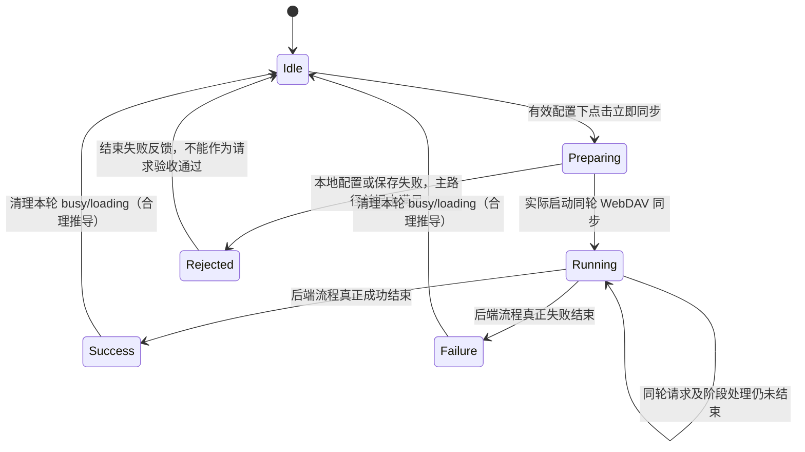

# vg-spec9 可验证验收矩阵（0-analyze）

本文件是分析阶段的验收标准，覆盖 Spec 全部步骤；不是功能已实现或测试全通过的声明。业务代码保持基线不变。代码位置以批准基线为准，本轮已核对工程文件未变化。设备上的构建、安装、入口和延迟请求实测结果见 [baseline-notes.md](baseline-notes.md)，其中成功全链路与未测边界明确保留未验证。

14 项明文验收（A1—A14）、4 项合理推导（A15—A18）、15 类边界（B1—B15）及 6 组待确认假设（U1—U6）分别登记。编号仅供覆盖追踪，不代表官方 F-point 数量或权重。

## 1. 输入身份、证据等级与引用约定

- Spec：`spec/requirement.md`，SHA256 `c6236994e253c6de9f6decd99d7c0637620027ac16ce3699154796cba7a5edbf`，已与批准值核对一致。
- 元数据：`spec/metadata.json`，SHA256 `496950d171e032fe6f10cf76fd485341f4f293b6f162857d60a46bd98756f660`，已核对一致；第 2 行给出基线提交。
- 基线 HEAD：`a22f32b07bf81c6dde4367e2543ebac29186cbc1`，实际 `git rev-parse HEAD` 与批准值一致。
- 分析规则：`spec-harness/0-analyze.md:34-53` 要求逐步骤、八维、稳定 ID、边界、状态机和原文；构建／安装证据单列于 `baseline-notes.md`，不以矩阵代替实测报告。
- `SPEC_EXPLICIT`：Spec 明文，包括明文前置条件。`REASONABLE_DERIVATION`：由加载与操作一致性推导的回归检查，不冒充原文。`UNCONFIRMED_ASSUMPTION`：原文无法决定的策略，不直接成为强制验收。
- 下文 `Spec:Lx` 均指批准版本 `spec/requirement.md` 的精确行号。`SS`=`entry/src/main/ets/pages/settings/SettingsSyncSection.ets`；`SP`=`entry/src/main/ets/pages/SettingsPage.ets`；`WM`=`entry/src/main/ets/sync/WebDavSyncManager.ets`。所有代码行号均以批准基线为准。
- 八维中的“不适用”表示本原子项没有该结果要求，并不表示整个同步业务可以忽略数据、网络或错误。

## 2. Spec 逐字摘录与步骤覆盖索引

概述原文（保留原文中的空格）：

> 用户点击「立即同步」后，WebDAV 配置页必须进入忙碌状态，并在后端同步操作运行期间渲染 ArkUI `LoadingProgress` 加载指示器。

来源：Spec:L7。

> 同一个忙碌状态必须对应真实的 WebDAV 同步流程。只有在能够观察到后端请求时，加载状态 才被认为有效。

来源：Spec:L20。

> 「立即同步」不能只改变 UI 状态。同步操作必须向配置的 WebDAV 端点发送请求，加载反馈必须和真实的后端同步请求绑定。

来源：Spec:L33。

| 场景、步骤 | 逐字原文 | 行号 | 原子项 |
| --- | --- | --- | --- |
| 场景一、1 | 1. 用户进入 WebDAV 配置页，并填写可访问的 WebDAV 配置。 | 11 | A1、A2 |
| 场景一、2 | 2. 用户点击「立即同步」按钮。 | 12 | A3 |
| 场景一、3 | 3. 页面进入同步忙碌状态。 | 13 | A4 |
| 场景一、4 | 4. 页面显示 ArkUI `LoadingProgress` 加载指示器。 | 14 | A5 |
| 场景二、1 | 1. 用户点击「立即同步」按钮。 | 24 | A6 |
| 场景二、2 | 2. 页面显示加载指示器。 | 25 | A7 |
| 场景二、3 | 3. 应用启动 WebDAV 同步流程。 | 26 | A8 |
| 场景二、4 | 4. 测试环境能够观察到应用向配置的 WebDAV 服务端发送请求。 | 27 | A9 |
| 场景三、1 | 1. 用户点击「立即同步」。 | 37 | A10 |
| 场景三、2 | 2. 页面展示同步中的加载反馈。 | 38 | A11 |
| 场景三、3 | 3. 应用向配置的 WebDAV 服务端发起请求。 | 39 | A12 |
| 场景三、4 | 4. 如果只有加载状态而没有后端请求，则该功能点不满足要求。 | 40 | A13 |
| 三个概述的绑定约束 | 上述三段完整逐字引文 | 7、20、33 | A14 |

重复场景步骤保留各自编号以便追踪，不能据此推断 F-point 数量或计分权重。A15—A18 为合理推导项，不是额外 Spec 原文。

## 3. 选择器现状和建议登记

以下“建议 ID”全部尚不存在，均**需在实现时补 `.id()`**；本轮不改代码。ID 是测试可观测性建议，不是 Spec 指定名称。主 Agent 可统一重命名，但需同步验收文档和测试。

| 标记 | 目标 | 已有 ID／基线事实 | 建议 ID（需在实现时补 `.id()`） |
| --- | --- | --- | --- |
| I0 | 首页设置入口 | 首页 `Index.ets:325` 将回调接至 `pages/SettingsPage`；`pages/index/components/TopNavigation.ets:69-79` 的齿轮容器无 ID | `index_settings_entry` |
| I1 | 设置页 WebDAV 入口行 | `SP:41` 标题 `WebDAV 配置`；`:507-529` 点击令 `activeSectionId=item.id`；对象的 `id:'sync'` 是数据字段，**不是组件 `.id()`** | `settings_webdav_entry` |
| I2 | 配置页标题／内容容器 | `SP:447-461` 构造 `SettingsSyncSection`，`:489` 是动态标题；`:565` 只有根 `.id('settings_' + this.themeRefreshToken)`，随主题变更且不能唯一表示 WebDAV 子页 | `webdav_config_section`、`webdav_config_title` |
| I3 | WebDAV 地址输入 | `SS:439`；共用 `TextInput` 实体在 `:356-363`，无 ID | `webdav_endpoint_input` |
| I4 | 账号输入 | `SS:440`，共用构造器同上，无 ID | `webdav_username_input` |
| I5 | 密码输入 | `SS:441`；共用密码 `TextInput` 在 `:379-387`，无 ID | `webdav_password_input` |
| I6 | 同步密码输入 | `SS:442`，共用密码构造器同上，无 ID | `webdav_sync_password_input` |
| I7 | 远端目录输入 | `SS:443`，共用输入构造器同上，无 ID | `webdav_remote_root_input` |
| I8 | 立即同步按钮 | `SS:578-586`，空闲文案 `立即同步`、busy 时 `处理中...`、busy 时禁用；无 ID | `webdav_sync_now_button` |
| I9 | 同步加载指示器 | 基线整个 `SS` 中无 `LoadingProgress`，也无任何 `.id()`；不能把 busy 文案当成该组件 | `webdav_sync_loading`（必须标在实际 `LoadingProgress` 上） |
| I10 | 操作结果文本 | `SS:567-573`，绑定 `webdavResult`；无 ID | `webdav_action_result` |
| I11 | 设置页头返回 | `SP:484-487` 返回箭头，`:172-179` WebDAV 子页先回设置目录；无 ID | `settings_header_back` |
| I12 | 保存、测试连接 | `SS:543-562` 两按钮无 ID | `webdav_save_button`、`webdav_test_connection_button` |
| I13 | 自动同步开关 | `SS:466-469`，共用 Toggle `:419-422`；无 ID | `webdav_auto_sync_toggle` |

已有根 ID `settings_<themeRefreshToken>`（SP:565）和 `index_<themeRefreshToken>`（`Index.ets:362`）仅是代码事实；不能登记成已经存在的稳定 WebDAV 选择器。多个手动操作按钮 busy 时都显示 `处理中...`（SS:543、553、578、594、604），因此按该文本查找会有歧义。输入的 label、placeholder 是基线事实，不是 Spec 新增文案。

## 4. 原子验收矩阵

### A1 — 到达既有 WebDAV 配置入口

- 来源／原文：场景一、步骤 1，Spec:L11，逐字见第 2 节该行；其中原子部分为“用户进入 WebDAV 配置页”。
- 证据等级：`SPEC_EXPLICIT`（入口前置条件；具体导航路径是基线代码事实）。
- 原子行为：用户能沿既有设置流程到达 WebDAV 配置内容。
- Hypium 可观察结果：点击设置入口及 `WebDAV 配置` 行后，显示配置标题和地址等输入控件；本轮基线已沿既有路径实测可达，证据见 `baseline-notes.md`；其他验收项仍需分别取证。
- 稳定选择器：I0、I1、I2、I3；已有稳定目标 ID 无，建议 ID 均需在实现时补 `.id()`。
- 八维：**入口**＝首页设置→WebDAV 配置；**前置数据**＝应用已完成必要初始化，具体首启阻挡流程需实测；**用户动作**＝点击既有设置及 WebDAV 行；**UI 结果**＝可见配置内容；**数据结果**＝不适用，本项不要求更改数据；**网络结果**＝不适用，进入页面不作为手动同步的请求证据；**返回结果**＝不适用，本步骤未规定返回；**边界条件**＝B11、B12 的空闲再入覆盖入口回归，运行中离开策略见 U4。

### A2 — 填写可访问的配置作为主路径前置条件

- 来源／原文：场景一、步骤 1，Spec:L11：“1. 用户进入 WebDAV 配置页，并填写可访问的 WebDAV 配置。”
- 证据等级：`SPEC_EXPLICIT`；填写哪些字段由基线提供，不把基线校验阈值升级为 Spec。
- 原子行为：用户填写指向受控且可访问 WebDAV 服务的有效配置。
- Hypium 可观察结果：配置输入显示本轮测试值（密码不要求明文可见）；结合受控服务端确认地址可达、账户和目录允许同步。仅填入外观合法字符串不足以证明“可访问”。
- 稳定选择器：I2— I7，均需在实现时补 `.id()`；密码值通过安全测试夹具设定，证据中不输出真实凭据。
- 八维：**入口**＝WebDAV 配置内容；**前置数据**＝可访问测试端点、有效账号、密码、同步密码、远端目录；**用户动作**＝填写配置；**UI 结果**＝输入生效，仍在配置内容；**数据结果**＝不适用，Spec 未要求单独保存或持久化步骤；**网络结果**＝端点可访问是夹具前提，填字本身不算同步请求；**返回结果**＝不适用，未规定；**边界条件**＝B1、B2、B9；无效配置不满足本条主路径前提，处理方式不得凭空确定。

### A3 — 场景一从“立即同步”发起

- 来源／原文：场景一、步骤 2，Spec:L12：“2. 用户点击「立即同步」按钮。”
- 证据等级：`SPEC_EXPLICIT`。
- 原子行为：有效配置下点击既有 `立即同步` 按钮，发起本次手动操作。
- Hypium 可观察结果：点击动作针对 I8；随后观察 A4、A5、A14，并由网络证据关联本次点击。只有点击记录不能独立判为功能通过。
- 稳定选择器：I8，需在实现时补 `.id()`；空闲文案 `立即同步` 为 Spec 明文。
- 八维：**入口**＝WebDAV 配置页手动操作区域；**前置数据**＝A2 配置、无既有手动任务；**用户动作**＝一次点击 `立即同步`；**UI 结果**＝转入 A4/A5；**数据结果**＝不适用，本项不规定同步载荷；**网络结果**＝本点击需最终关联真实流程，具体断言在 A9/A12/A14；**返回结果**＝不适用，未规定；**边界条件**＝B5、B6，重复与连点策略见 A18/U2。

### A4 — 点击后进入同步忙碌状态

- 来源／原文：场景一、步骤 3，Spec:L13：“3. 页面进入同步忙碌状态。”；概述 Spec:L7。
- 证据等级：`SPEC_EXPLICIT`。
- 原子行为：本次手动同步运行时，配置页呈现同步忙碌状态。
- Hypium 可观察结果：在受控请求未完成时，页面具有可辨识的忙碌外观；可记录 I8 禁用或文字变化作为基线证据，但 Spec 未规定必须禁用、变灰或具体 busy 文案。I9 的实际 `LoadingProgress` 另由 A5 强制核对，完整场景须同时满足 A4/A5/A14。
- 稳定选择器：I8、I9，均需在实现时补 `.id()`；内部 `webdavBusy` 本身不是 Hypium UI 断言。
- 八维：**入口**＝A3 后原配置页；**前置数据**＝有效配置和可保持进行中的同步；**用户动作**＝点击后等待观察；**UI 结果**＝可辨识的同步忙碌状态；**数据结果**＝不适用，未规定；**网络结果**＝需与 A14 同次真实流程对应；**返回结果**＝不适用，未规定；**边界条件**＝B5、B6、B10、B13，终态恢复见 A15/A16。

### A5 — 场景一显示实际 LoadingProgress

- 来源／原文：场景一、步骤 4，Spec:L14：“4. 页面显示 ArkUI `LoadingProgress` 加载指示器。”；运行期间约束来自 Spec:L7 的完整引文。
- 证据等级：`SPEC_EXPLICIT`。
- 原子行为：同步期间渲染并显示实际 ArkUI `LoadingProgress` 组件。
- Hypium 可观察结果：I9 可查且在可视范围；结合 UI 层次、实际组件类型取证或构建后源码核验，证明确为 `LoadingProgress`。仅有旋转图片、文字、同名 ID 或不可见控件不能证明组件要求。现有 `test-harness/harness/driver.py:57` 的 `require_type()` 使用 `BY.type()`；稳定 id 可配合 `BY.key()` 定位。加载组件须同时核对类型与可见性。
- 稳定选择器：I9，需在实现时补 `.id()`，且标于真正组件；I8 用于触发。
- 八维：**入口**＝A3 后配置页；**前置数据**＝本次流程确在运行，服务端保持未完成窗口；**用户动作**＝点击并在未完成窗口观察；**UI 结果**＝实际 `LoadingProgress` 可见；**数据结果**＝不适用，本项未规定业务数据变化；**网络结果**＝须联合 A9/A14，不能只做静态 UI 断言；**返回结果**＝不适用，未规定；**边界条件**＝B7、B10、B13；Spec 未规定组件颜色、尺寸、位置或最短展示秒数。

### A6 — 场景二从同一手动按钮触发

- 来源／原文：场景二、步骤 1，Spec:L24：“1. 用户点击「立即同步」按钮。”
- 证据等级：`SPEC_EXPLICIT`。
- 原子行为：从配置页点击 `立即同步`，作为场景二加载与请求关联的起点。
- Hypium 可观察结果：I8 点击时间与本轮端点请求记录可关联，随后满足 A7—A9。
- 稳定选择器：I8，需在实现时补 `.id()`；不新增第二个同步入口。
- 八维：**入口**＝既有 WebDAV 配置页；**前置数据**＝A2 的可访问配置，本轮独立请求日志；**用户动作**＝点击 `立即同步`；**UI 结果**＝随后 A7；**数据结果**＝不适用，未规定；**网络结果**＝随后 A8/A9；**返回结果**＝不适用，未规定；**边界条件**＝B5、B6、B10，不能用前一轮请求证明本轮触发。

### A7 — 场景二显示加载指示器

- 来源／原文：场景二、步骤 2，Spec:L25：“2. 页面显示加载指示器。”；Spec:L7/L14 已明确组件种类。
- 证据等级：`SPEC_EXPLICIT`。
- 原子行为：场景二手动同步运行时显示同一加载组件。
- Hypium 可观察结果：A6 后 I9 的实际 `LoadingProgress` 可见，且与 A9 请求进行中窗口重叠。
- 稳定选择器：I8、I9，均需在实现时补 `.id()`。
- 八维：**入口**＝A6 后配置页；**前置数据**＝真实同步未完成；**用户动作**＝点击后观察；**UI 结果**＝加载组件可见；**数据结果**＝不适用，本项未规定业务数据变化；**网络结果**＝联合 A9/A14；**返回结果**＝不适用，未规定；**边界条件**＝B7、B10、B13，只有短暂假加载不通过。

### A8 — 场景二启动真实同步流程

- 来源／原文：场景二、步骤 3，Spec:L26：“3. 应用启动 WebDAV 同步流程。”
- 证据等级：`SPEC_EXPLICIT`。
- 原子行为：A6 的点击确实进入既有 WebDAV 同步流程。
- Hypium 可观察结果：UI 操作与受控服务端观测联合证明流程启动；调用链源码/日志只能辅助说明请求属于同步，不能用 `busy=true` 或打印“开始同步”替代真实请求。
- 稳定选择器：I8、I9 需在实现时补 `.id()`；服务端日志不是组件，无 UI ID。
- 八维：**入口**＝A6；**前置数据**＝有效配置、可连接服务端；**用户动作**＝点击并等待真实流程；**UI 结果**＝A7 的加载反馈；**数据结果**＝不适用，Spec 未限定下载/上传哪些数据；**网络结果**＝A9 必须出现本次真实请求；**返回结果**＝不适用，未规定成功文案或协议结果；**边界条件**＝B7、B9、B10，空业务数据不能成为只改 UI 的理由。

### A9 — 场景二在配置服务端观察请求

- 来源／原文：场景二、步骤 4，Spec:L27：“4. 测试环境能够观察到应用向配置的 WebDAV 服务端发送请求。”
- 证据等级：`SPEC_EXPLICIT`。
- 原子行为：本次同步向用户配置的 WebDAV 服务发送至少一个真实请求，且测试环境可观测。
- Hypium 可观察结果：Hypium 触发点击并断言 I9；配套服务端/测试夹具在本轮时间窗记录来自应用、目标匹配本轮端点的请求。UI 自动化单独不能证明网络。请求日志需记录接收及响应释放时间，以支持 A14。
- 稳定选择器：I8、I9 需在实现时补 `.id()`；服务端证据使用隔离端点/目录及运行时间窗，不要求在产品 UI 中新增网络日志控件。
- 八维：**入口**＝A6 后同步流程；**前置数据**＝可访问受控端点、干净日志、自动同步干扰已隔离；**用户动作**＝点击并采集该轮网络证据；**UI 结果**＝加载与请求重叠；**数据结果**＝不适用，未限定请求载荷或持久化结果；**网络结果**＝目标正确且至少一个真实同步请求；**返回结果**＝不适用，Spec 未要求某状态码或成功消息；**边界条件**＝B7、B9、B10、B13；请求方法、数量上限、路径后缀未指定。

### A10 — 场景三从“立即同步”触发

- 来源／原文：场景三、步骤 1，Spec:L37：“1. 用户点击「立即同步」。”
- 证据等级：`SPEC_EXPLICIT`。
- 原子行为：点击同一按钮以发起场景三的本次同步。
- Hypium 可观察结果：I8 收到点击，建立本轮起点，随后 A11/A12 都发生。
- 稳定选择器：I8，需在实现时补 `.id()`。
- 八维：**入口**＝既有配置页；**前置数据**＝有效可访问配置，当前无测试残留任务；**用户动作**＝点击 `立即同步`；**UI 结果**＝随后 A11；**数据结果**＝不适用，本项未规定业务数据变化；**网络结果**＝随后 A12；**返回结果**＝不适用，未规定；**边界条件**＝B5、B6、B10，独立关联本轮而非仅重用上一轮日志。

### A11 — 场景三显示同步中的反馈

- 来源／原文：场景三、步骤 2，Spec:L38：“2. 页面展示同步中的加载反馈。”
- 证据等级：`SPEC_EXPLICIT`。
- 原子行为：本次真实同步进行中，配置页展示加载反馈。
- Hypium 可观察结果：I9 可见且是 Spec:L7/L14 指定的 `LoadingProgress`；绑定要求见 A14。
- 稳定选择器：I8、I9，均需在实现时补 `.id()`。
- 八维：**入口**＝A10 后配置页；**前置数据**＝同步流程处于进行中；**用户动作**＝点击后观察；**UI 结果**＝加载反馈可见；**数据结果**＝不适用，本项未规定业务数据变化；**网络结果**＝与 A12 同轮请求重叠；**返回结果**＝不适用，未规定；**边界条件**＝B7、B10、B13，不指定额外“同步中”字样。

### A12 — 场景三发出本次同步请求

- 来源／原文：场景三、步骤 3，Spec:L39：“3. 应用向配置的 WebDAV 服务端发起请求。”
- 证据等级：`SPEC_EXPLICIT`。
- 原子行为：A10 发起的同步向本轮配置服务端发送真实请求。
- Hypium 可观察结果：以 A9 同样的 UI 与服务端联合证据，确认本轮目标、来源和时间窗；请求属于同步流程，不能用独立“测试连接”动作冒充。
- 稳定选择器：I8、I9 需在实现时补 `.id()`；网络凭证不输出真实秘密。
- 八维：**入口**＝A10 同步流程；**前置数据**＝可观测、可访问配置端点；**用户动作**＝点击后采集请求；**UI 结果**＝A11 正在显示；**数据结果**＝不适用，未规定；**网络结果**＝至少一个向配置服务端的真实同步请求；**返回结果**＝不适用，未要求一定同步成功；**边界条件**＝B7、B9、B10、B13，失败响应仍能证明“已发请求”，但恢复需另测。

### A13 — 拒绝只有加载没有请求的结果

- 来源／原文：场景三、步骤 4，Spec:L40：“4. 如果只有加载状态而没有后端请求，则该功能点不满足要求。”
- 证据等级：`SPEC_EXPLICIT`（负面判定）。
- 原子行为：有效可访问配置主路径中，若显示加载却无本轮同步后端请求，判为不满足要求。
- Hypium 可观察结果：把 I9 存在与服务端本轮请求记录一同检查；只有 UI 成功、mock 返回成功、计时器结束、函数调用日志或其他轮请求不能通过。隔离无效配置、DNS/连接失败及自动同步等混淆因素后再归因。
- 稳定选择器：I8、I9 需在实现时补 `.id()`；网络日志不适用 UI ID。
- 八维：**入口**＝A10；**前置数据**＝A2、受控服务正常且日志可靠；**用户动作**＝点击并观察完整操作窗口；**UI 结果**＝即便有 loading 也不足以单独通过；**数据结果**＝不适用，数据变化也不能替代网络证据；**网络结果**＝无本轮同步请求即失败；**返回结果**＝不适用，成功提示不能抵消缺请求；**边界条件**＝B7、B9、B10；无效配置提前拒绝不能用作“有效配置主路径通过”的证据。

### A14 — 加载、忙碌和真实请求在同一流程中绑定

- 来源／原文：Spec:L7、L20、L33，三段逐字完整引文见第 2 节；同时对应 A4/A5、A7/A9、A11/A12 的联合约束。
- 证据等级：`SPEC_EXPLICIT`。
- 原子行为：同一次手动同步的忙碌与实际 `LoadingProgress` 覆盖后端同步运行时段，并与该流程真实请求在时间上重叠。
- Hypium 可观察结果：受控服务收到本次请求后先保持响应不结束；在该请求仍未完成时观察配置页 I9 可见及忙碌外观；释放响应并继续观察流程终态。至少形成“本轮点击→本轮请求已到达且未完成→加载实际可见”的连续证据。不要用“先看到 spinner，后看到任意请求”两个无时间关联的断言替代绑定。
- 稳定选择器：I8、I9 需在实现时补 `.id()`；I9 实际组件类型也须证实。
- 八维：**入口**＝同轮 `立即同步`；**前置数据**＝可访问可控服务、能够暂停响应、隔离自动同步；**用户动作**＝点击→保持真实请求→观察→释放响应；**UI 结果**＝后端操作运行期间有忙碌和 `LoadingProgress`；**数据结果**＝不适用，未指定数据变更；**网络结果**＝同轮配置端点真实同步请求与 loading 重叠；**返回结果**＝终态恢复见 A15/A16，具体文案未指定；**边界条件**＝B5—B7、B10、B13；快速响应不取消组件要求，但 Spec 无最短驻留时长，不得人为加长计时器来伪造绑定。

### A15 — 成功完成后的忙碌恢复

- 来源／原文：由 Spec:L7 的“在后端同步操作运行期间”和 Spec:L20 的“同一个忙碌状态必须对应真实的 WebDAV 同步流程”推导；完整原文见第 2 节。成功终态恢复没有独立步骤原文。
- 证据等级：`REASONABLE_DERIVATION`。
- 原子行为：本次后端流程实际成功结束后，页面退出该次忙碌和加载状态。
- Hypium 可观察结果：服务端按既有协议完成本轮流程后，I9 不再显示，I8 恢复空闲可操作状态；不把“同步完成”等基线文案设为 Spec 指定文本，也不要求一个固定毫秒期限。
- 稳定选择器：I8、I9；可用 I10 辅助记录，均需在实现时补 `.id()`。
- 八维：**入口**＝A14 中同轮进行中同步；**前置数据**＝可使既有流程正常结束的服务端夹具；**用户动作**＝释放响应并等待流程真正完成；**UI 结果**＝终态无该次 loading、忙碌结束；**数据结果**＝不适用，未规定具体同步合并结果；**网络结果**＝本轮后端流程已结束；**返回结果**＝停留配置页可再次发起，精确提示未指定；**边界条件**＝B5、B7、B11；若无法提供完整成功夹具应标成功路径未验证，不能把失败终态当成功证据。

### A16 — 失败完成后的忙碌恢复

- 来源／原文：由 Spec:L7/L20 的同一运行期与绑定原文推导，逐字见第 2 节；Spec 未写失败文案和错误种类。
- 证据等级：`REASONABLE_DERIVATION`。
- 原子行为：本次流程在错误后实际结束时，加载与忙碌退出，不永久卡住。
- Hypium 可观察结果：受控服务收到请求后返回错误，确认流程已失败结束；I9 隐去，I8 恢复可操作，能在更正服务后重新触发真实同步。精确错误文案不作 Spec 断言。连接建立前失败只能用于恢复回归，不能代替 A9/A12 的服务端可观察请求证据。
- 稳定选择器：I8— I10，均需在实现时补 `.id()`。
- 八维：**入口**＝本次同步进行中；**前置数据**＝受控响应失败或异常夹具；**用户动作**＝触发→制造失败→等待实际结束→重试；**UI 结果**＝loading 解除并可重试；**数据结果**＝不适用，Spec 未要求事务回滚或断点续传；**网络结果**＝有响应失败可证请求；恢复后点击产生新轮真实请求；**返回结果**＝精确错误反馈、自动重试次数未规定；**边界条件**＝B9、B10、B13；单纯 UI 超时不等于底层请求终止，见 U5。

### A17 — 无待同步业务数据也保持真实请求与加载绑定

- 来源／原文：Spec:L11 的可访问配置和 Spec:L33 的“同步操作必须向配置的 WebDAV 端点发送请求”共同推导；完整原文见第 2 节，Spec 未设“有业务数据”条件。
- 证据等级：`REASONABLE_DERIVATION`（无数据夹具的扩展覆盖）；真实请求要求本身为 A12/A14 的明文。
- 原子行为：空业务增量或刚同步完再次手动同步时，也不能只展示 loading 后本地短路而无任何后端请求。
- Hypium 可观察结果：有效配置、无待上传变更时点击 I8，受控服务仍观察到真实同步请求；在未完成窗口 I9 可见。允许没有业务数据上传，不要求每次有 PUT 或数据量增长。
- 稳定选择器：I8、I9，均需在实现时补 `.id()`。
- 八维：**入口**＝WebDAV 配置页；**前置数据**＝有效配置、无待同步业务增量；**用户动作**＝点击立即同步；**UI 结果**＝同 A14 的运行期 loading；**数据结果**＝允许业务数据不变，未要求制造变更；**网络结果**＝至少一个真实同步请求；**返回结果**＝结束后同 A15/A16；**边界条件**＝B7；无数据不是分页场景，不要求末页或空列表提示。

### A18 — 重复操作不破坏当前加载与请求的对应关系

- 来源／原文：由 Spec:L20 的“同一个忙碌状态必须对应真实的 WebDAV 同步流程”及 Spec:L7 的运行期约束推导；完整原文见第 2 节。
- 证据等级：`REASONABLE_DERIVATION`；**只保证状态对应，具体禁止并发/排队策略属于 U2**。
- 原子行为：进行中再次点击或快速连点，当前尚未结束的真实同步不能因另一操作提前清掉 loading。
- Hypium 可观察结果：暂停同轮请求期间，重复点击 I8，I9 持续可见；基线“busy 禁用+早返回”可以作为保持单流程的建议，但 Spec 未规定点击次数、排队数或请求总数必须恰为 1。
- 稳定选择器：I8、I9 需在实现时补 `.id()`；不能依赖 busy 时重复文本找目标。
- 八维：**入口**＝WebDAV 配置页，流程已进行中；**前置数据**＝有效配置与未完成请求；**用户动作**＝重复点击/快速连点；**UI 结果**＝当前运行期 loading 连续保持；**数据结果**＝不适用，未规定重复数据去重规则；**网络结果**＝当前请求持续有归属；是否合并/排队/并发待 U2；**返回结果**＝所有被接受流程结束后再恢复；**边界条件**＝B5、B6、B13，不能将多阶段正常请求数量误作多次按钮触发。

## 5. 穷举边界登记（不将待定策略偷偷变成明文）

| 编号 | 边界／动作 | 证据等级及适用范围 | 可观察检查与不适用理由／待决策 |
| --- | --- | --- | --- |
| B1 | 空输入：地址、账号、密码、同步密码逐个清空；目录单独为空 | 实际拒绝结束后无永久 busy 为 `REASONABLE_DERIVATION`；具体校验/提示政策为 U1，A2 主路径前提不满足 | 基线 SS:102-106 对地址/账号/目录 trim，空目录用默认值；WM:164-174 拒绝空地址/账号/密码和过短同步密码。可读代码确定现状，但 Spec 没有新增校验规则。建议回归既有规则、实际拒绝结束后恢复可操作；不把“无请求的无效配置拒绝”记为核心主路径通过或失败。目录空与必填凭据空不可合并。 |
| B2 | 纯空格输入；地址/账号前后空格；密码/同步密码中的空格 | 实际失败结束后的恢复为 `REASONABLE_DERIVATION`；具体清洗/错误词政策为 U1 | SS:102-106 只 trim 部分字段，WM:165-172 用 safeTrim 检查；不能一律删除密码中的空格。建议保留基线语义，分别测纯空格与夹空格凭据；错误路径真正结束后检查无永久 loading，不规定新错误文案。 |
| B3 | 取消 | 手动同步的“取消按钮”不适用：Spec 全文无取消要求；基线 SS:578-586 点击直接启动 | 不新增取消控件或断言取消提示。取消表单输入/键盘只属未触发操作，不能作为一次同步。如果未来提出运行中取消，必须新确认任务和请求取消语义，见 U4/U5。 |
| B4 | 关闭 | 关闭确认框不适用：本次立即同步无确认框；关闭页面/应用适用 U4/U5 | 不把备份/JSON 导入弹窗的关闭/取消控件当手动同步入口。运行中离开与进程终止分别记录，不假定后台继续或停止。 |
| B5 | 重复点击 | A18 为 `REASONABLE_DERIVATION`；具体拒绝/合并/排队为 U2 | 未完成窗口重复点击，原任务 loading 不早退；完成后再点击应建立新轮请求。基线 SS:290 busy guard 和 :585 禁用仅支持建议保持单流程，不形成 Spec 的“仅一次 HTTP 请求”。 |
| B6 | 快速连点 | 同 B5 | 在首次点击与下一帧之间和 busy 已渲染后分别覆盖。观察是否被接受多个流程、是否提前清状态。多步同步本就可有多个协议请求，不按请求数直接断言点击次数。 |
| B7 | 无数据 | A17；A9/A12 的真实请求仍适用 | 空本地增量、空远端数据、完成后再次同步分别可覆盖；不要求每种空载荷新增提示，也不要求数据写入。至少有本次真实同步请求且加载与运行期绑定。 |
| B8 | 最后一页 | 不适用：Spec 全文没有列表、分页、页码或加载更多；目标为同步按钮 | 不为本题编造末页状态、请求参数或“没有更多”文案。即使同步协议内部划分批次，也不能将它当 UI 分页需求。 |
| B9 | 部分操作：只填部分配置、填写后未点击、只点保存、只点测试连接；同步多阶段部分已完成 | 前半为 U1 和不触发手动流程的回归；后半由 A14/A16 推导 | 未点击立即同步不能记为本次同步；保存设置不是网络同步证明；测试连接可能发请求但不能冒充手动同步；多阶段未结束时 loading 应持续，若后续失败则 A16。Spec 未要求部分回滚、重放或续传。 |
| B10 | 请求失败：服务端错误、认证失败、连接建立失败、断网、异常 | A16 为推导，真实请求判定仍按 A9/A12 | 服务端收到但返回错误可证明发请求；DNS/连不上、离线不保证服务端可观测，只能证明恢复检查。无效配置/不可访问端点不满足 A2，不能据此放宽有效配置主路径。错误消息、重试次数未指定。 |
| B11 | 返回后重进 | 空闲再入为 A1/A15/A16 回归；运行中再入为 U4 | 在一次流程真正结束后返回再入，不能出现那次残留 loading。运行中离开再入须记录任务是否继续及 UI 是否重新绑定，Spec 未决定继续/取消策略。标题返回的基线代码是 SP:172-179；系统返回须实测，不能假定同实现。 |
| B12 | 重启应用后重进 | `UNCONFIRMED_ASSUMPTION`，持久化与自动恢复政策未指定 | 已结束的临时 busy 不应当作历史任务永久恢复，这是状态一致性的建议。配置恢复和首次进入前台可能触发自动同步须隔离后检查；不要求新造持久化任务恢复、自动补发或固定重启文案。 |
| B13 | 长请求、UI 包装超时、最后一条请求仍在运行 | A14 明文覆盖后端运行期间；A16 仅在任务实际结束后；超时政策 U5 | SS:116-122 的 Promise.race 只在代码中竞争返回，未提供请求取消证据；SS:308/:315-316 会在包装返回后清 busy。不能把“120 秒到了”视作底层已结束。建议验证真实未完成时仍有 loading；有限观察超时要标未确认，不能无限等，也不能让超时本身冒充完成。 |
| B14 | 请求极快完成 | A5/A14，最短时长 U3 | Spec 未指定持续若干毫秒。用可控延迟夹具证明运行中组件存在；高速路径记录实际渲染，不强加固定等待制造假 loading。 |
| B15 | 运行中修改配置；自动同步/其他手动操作与立即同步交错 | `UNCONFIRMED_ASSUMPTION`，U2/U6 | 请求应归属到发起该轮使用的配置，不能用任意服务端请求过关。Spec 没有冻结输入或自动同步共用 loading 规定。建议夹具固定本轮配置、隔离其他操作；扩展回归单列，不新增业务限制。 |

## 6. 网络行为状态机（验收行为模型，不是实现方案）

`B` 表示本次同步忙碌，`L` 表示实际 ArkUI LoadingProgress 可见，`R` 表示本次同步已有可观测真实请求，`F` 表示后端同步流程尚未真正结束。`R` 不是“每个瞬间都必须有一个 HTTP 包在传输”；同一流程的本地处理和多请求间隙仍属于 F。流程中至少一个请求必须与 L 的可见窗口重叠。

| 状态／转换 | UI 与网络约束 | 证据等级 |
| --- | --- | --- |
| Idle | 本次无活动流程；不能把过往 loading 或历史请求当本次证据。打开页面、输入文字不是本次手动请求触发。 | 后句为流程归因；空闲不显示本次旧 loading 为合理推导 |
| Preparing | 点击可以先更新忙碌并做必要配置准备，第一条请求不要求与 UI 更新在同一指令发生；但不能准备阶段显示一下 loading、随后隐藏才发请求，也不能用定时器模拟整次同步。准备最终不进入实际请求者不满足有效配置核心主路径。 | 绑定为 Spec 明文；准备时间、校验提示未规定 |
| Running | F 为真时保持 B/L；同轮必须有 R。保持受控响应未完成时必须能看到 L，从而证明时间重叠。多阶段本地处理、请求间隙仍可持续忙碌，不要求为了匹配每个数据包频繁闪烁。 | Spec:L7/L20/L33，A14 |
| Success | 以整个后端流程真正结束为终态，不以收到第一条响应或显示成功字样为终态。退出 B/L，允许再次触发。 | 结束一致性为合理推导 A15；成功文字、统计和数据合并未指定 |
| Failure | 真实请求失败且流程结束、异常真正收束后退出 B/L；可再次触发。若底层仍在运行，单独 UI Promise 超时尚不足以证明终止。 | 恢复为合理推导 A16；运行期覆盖为 A14 明文 |
| Rejected | 无效配置或本地持久化失败可未到请求阶段；不把短暂 loading 记录成满足 A9/A12。建议结束后恢复可操作，具体错误文案和校验规则由 U1 决定。 | 主路径前提来自 Spec:L11；拒绝策略未规定 |

不变量：

1. **强制（A14）**：页面保持显示且同轮后端同步仍运行时，不能只有 busy 文案而没有实际 `LoadingProgress`；不能在真实同步尚未结束时提前撤去加载。
2. **强制（A9/A12/A13）**：可访问有效配置主路径中，只改 UI、假请求、仅调用 mock、向错误地址发无关请求、使用历史日志均不满足真实同步要求。调用既有同步流程中的预检请求可以是实际请求证据的一部分；独立执行“测试连接”后展示假 loading 不可以。
3. **强制（A14）**：按本轮点击关联、向本轮所配置端点发送、且与加载进行期重叠。Spec 没有要求特定 HTTP 动词、请求条数、固定文件名或状态码。
4. **推导（A15/A16）**：实际流程结束后恢复空闲；加载不能仅靠固定倒计时控制。
5. **并发假设（U2）**：建议保持基线单流程拒绝重复触发；若选择排队或并发，也必须为所有被接受任务保持准确 loading，不能任一 finally 提早清除其他活动流程的状态。此处不强行规定“一次按钮点击等于恰好一个 HTTP 请求”。
6. **生命周期假设（U4/U5）**：模型主验证范围为页面仍展示、应用仍存活的一轮操作。导航离开、进程终止、网络取消/恢复语义未由 Spec 决定；不能据此降低页面内运行期间的明文要求。

动作与请求触发边界：

| 用户动作 | 本次手动同步是否应触发请求 | 解释／证据 |
| --- | --- | --- |
| 有效配置下空闲点击 `立即同步` | 是，必须实际启动同步并有可观察真实请求 | Spec:L12/L24/L26/L27/L33/L37/L39 |
| 无业务增量时点击 `立即同步` | 是，仍须符合真实请求要求；不强制有业务上传 | A17，未见业务数据前提 |
| 只进入配置、编辑字段、切换密码显示 | 这些动作不是本次手动同步触发；不能把它们的请求记作本次请求 | SS:363/:387 onChange、:389-396 仅 onToggle；Spec 触发点明确。应用后台/自动同步可能另发请求，因此不是全应用“绝对无网络”断言 |
| 点 `保存设置` | 基线只保存设置，不作为同步请求 | SS:100-111/:551；WM:115-125 本地 store.saveSettingsJson；这是代码事实，不扩大为全局禁止网络 |
| 点 `测试连接` | 基线会调用连接测试；不替代“立即同步”流程 | SS:320-336/:562；不得用其请求冒充 A9/A12 |
| 取消输入或未点击就返回 | 不认定启动本次手动同步；离开后的自动同步须另行识别 | Spec 未规定取消触发；运行中返回见 U4 |
| busy 期间重复点击／快速连点 | 接受策略未规定；建议不新建手动流程，当前请求继续、当前加载不早退 | SS:290、:585 为基线 guard；A18/U2 |
| 成功/失败实际结束后再点击 | 新一轮，重新建立真实请求与加载证据 | 一致性推导 A15/A16，不能复用前一轮日志 |
| 立即备份、从云端恢复 | 不适用本题手动同步验收；它们各自的网络不能算当前同步 | SS:594-613 不同按钮和处理入口 |
| 返回再入／重启再入／切回前台 | 不能仅以再入发生的任意请求满足“立即同步” | 基线 `entryability/EntryAbility.ets:49-54` 前台调用自动同步；须隔离来源，具体重入策略 U4/U5 |

## 7. 测试证据建议与不可推高的约束

以下为验证建议，不创建测试、不选择技术实现：

1. 受控服务端绑定本轮专用地址/目录、清理日志并记录时间；有效配置由夹具预置或用户填写。测试进入页后清晰标记点击前后边界。敏感值无需公开在报告中。
2. 隔离或暂停自动同步干扰；基线 SS:466-469 提供开关，`EntryAbility.ets:49-54` 又会在前台触发自动同步，不能只用“服务收到请求”推断来自本次点击。若未能隔离，必须提供足以区分本轮的证据。
3. 请求到达后保持响应未完成，Hypium 在保持期间定位 I9 并取 UI 层次/截图；确认组件类型和屏幕可见性。随后释放响应并观察后续流程直到真实结束。不要用固定 sleep 推测网络正在进行。
4. UI ID 只能定位目标，不能单凭 ID 名称证明其实际类型；服务端日志只能证明网络，不能单独证明页面渲染；两类证据必须联合。
5. 再覆盖有响应的失败、无业务变更、终态后的再次点击与快速连点。成功路径须有能让既有流程正常完成的服务端数据；若只有失败路径，明确标记成功终态未验证。
6. Spec 明文的 UI 文案只有 `立即同步`；`LoadingProgress` 为组件种类。原文没有 `正在同步数据...`、`处理中...`、`同步完成`、错误文本或 toast 时长要求。测试可以记录现有文字辅助定位，不能将它们升为额外 Spec 条款。
7. Spec 未限定 GET/HEAD/PUT/PROPFIND/MKCOL、具体目录、加密协议、同步文件、上传条数、数据回滚或服务端成功码。可按既有流程实现测试夹具，但其协议细节属于基线兼容要求或测试准备，不是本题新明文。

## 8. 真实歧义／待确认假设（全部 UNCONFIRMED_ASSUMPTION）

| 编号 | 原文缺口与可能假设 | 证据与推荐处理 | 对验收／后续工作的影响 |
| --- | --- | --- | --- |
| U1 | 无效配置是否必须先校验、哪些字段空白可默认、是否必须持久化成功才发请求 | Spec:L11 只要求“可访问的 WebDAV 配置”；基线 SS:100-111/:298-303 与 WM:164-174 可解释既有行为。建议保留既有规则和主路径，错误输入作回归，不新造强制文案、验证阈值或先点保存步骤。 | A2 主路径已可确定，无需向用户询问已有字段事实；若要改变校验/保存语义，须另行需求决策。 |
| U2 | busy 中多次点击应忽略、禁用、排队还是并发；与自动同步竞争如何呈现 | Spec 无并发政策；SS:290/:585 与 WM:682-685 有单流程防重代码。建议继续单流程；只将“不提前清当前 loading”记为 A18，具体策略待用户判断。 | 不写“恰好一条网络请求”或“必须有排队提示”的测试；后续并发政策一旦决定，更新 A18/B5/B6/B15 与相应测试。 |
| U3 | 快速请求的最短可见时间、精确位置/尺寸/颜色、是否必须改变按钮文案 | Spec:L7/L14 要求真实组件与运行期间渲染，未给样式和秒数。建议以可控慢请求取证，不加硬性最短时间；忙碌文案沿用基线仅作兼容。 | A4/A5/A14 的类型与时间绑定不能降低；固定时长、坐标、成功文字断言应移除或标额外回归。 |
| U4 | 运行中返回配置目录、离开设置、后台切换、关闭应用后任务继续还是取消；再入如何绑定 | Spec 只叙述页面中本次点击，没有导航/生命周期规则。SP:172-179 表示标题返回改变子区；不能从中证明取消请求。建议本阶段记录不确定，空闲再入先回归；不擅自要求取消或后台任务恢复。 | 核心页面内 A14 不受影响；运行中再入/重启测试须标探索或待定，不能判通过未证实政策。 |
| U5 | 操作超时何时算后端结束，是否取消未完成请求，异常抛出如何收束 | Spec:L7/L33 强制运行期绑定，但不规定超时秒数；SS:114-122 有 120000 和 Promise.race，SS:308/:315-316 会随后清 busy，代码未证明底层取消。建议在后续方案审查中明确真实结束的判据；可选择有证据的取消终止或保持绑定直到真正结束，不强推某 API。 | 延迟超过包装超时是明确风险，不能把包装结束当真实结束；若证据显示请求继续而 loading 消失，A14 失败，不因既有代码而放宽 Spec。 |
| U6 | 运行中编辑 endpoint/目录/账号，或者其他同步动作同时变更共享设置时，哪份配置属于当前轮 | Spec 仅说“配置的”端点；SS:25-29 绑定输入，:298 保存，:308 启动。建议以发起轮固定配置做核心验收，避免测试过程中改配置造成归因歧义；扩展交错策略待用户判断。 | A9/A12 必须验证正确目标，不能降成“任意后端请求”；是否禁用输入/拍快照不属本轮需求角色决定。 |

上述推荐均未在本分析阶段擅自批准为产品政策；请用户判断需明确的策略。它们不阻碍确认明文要求，也不影响本轮分析文档交付；后续实现不得把推荐假设冒充 Spec 明文。

## 9. 代码实证、缺口与复审失效条件

仅记录与本需求有关的基线代码事实：

- SS:43 已有 `webdavBusy=false`；:289-317 的 `webdavSyncNow` 设置 busy、先保存配置、调用 `syncIncremental`、在 finally 清 busy；:295/:306 有固定等待；:308 使用 timeout 包装。以上说明存在既有同步调用链，**不证明运行时请求可达、渲染正常或同步成功**。
- SS:578-586 已有既定按钮、忙碌时禁用和动态文案。整文件查询不到 `LoadingProgress` 或 `.id()`；因此新组件与稳定选择器是明确静态缺口。仅将按钮改为 busy 文案不能满足 A5。
- WM:672-698 先检查配置与同步状态，再创建 client 做预检；:298（WM）可发远端目录检查请求；:719 进入后续下载任务。既有真实请求路径可作静态定位，不代表本轮已发过真实请求。
- WM:887-904 已有成功/异常结果与终态重置，但这些成功文案不属于 Spec；不能以它们替代网络证据。
- WM:115-125 在 setSettings 中写 store；SS:102-106 对部分配置 trim 与默认目录。只作为错误输入/部分操作解释，非新增需求。
- 页面入口的静态调用点、动态根 ID 和缺失子控件 ID 已登记第 3 节。本轮设备实测与代码事实分开登记，见 `baseline-notes.md`；延迟失败路径不能替代完整成功同步证据。

复审时必须更新或判失效的情形：

| 新证据／变化 | 应更新的需求、方案、测试 |
| --- | --- |
| Spec 或批准 SHA256 改变 | 重新逐字映射全部 A1—A18；不能直接沿用本轮矩阵或已判通过结论。 |
| 基线/实现入口或 selector 改变 | 更新第 3 节 I0— I13、A1/A2/A3/A6/A10 与 Hypium 定位；不得仅删失败断言。 |
| 增加 spinner 但用文字、图片或其他组件代替实际 LoadingProgress | A5/A7/A11 不通过；方案和实现须回退修订，不能将需求降为“任意加载外观”。 |
| UI 显示 loading，但正确端点无同轮请求或请求无法归因 | A8/A9/A12/A13/A14 未满足；先检查夹具和请求归因，再由主 Agent 路由。不能只保留 UI 测试声称完成。 |
| 请求与 loading 没有重叠，或超时/并发导致未结束时 loading 消失 | A14 失败；更新方案的状态生命周期、A18/U5 处理和验证时间证据。 |
| 明确并发、超时、导航、重启政策 | 把相应 U2/U4/U5/U6 中已确认部分移入正式验收，并更新行为状态机、B5/B6/B11/B12/B13/B15 与测试；旧的相反假设测试失效。 |
| 测试要求固定成功文案、特定 HTTP 方法、恰好一条请求或新取消按钮 | 对照 Spec 原文归类为基线兼容/测试准备/待确认假设；不能提升为 Spec 明文，也不能删减真实组件和请求绑定要求。 |
| 只能证明失败或只有静态源码证据 | 该路径仍可贡献网络/错误恢复证据，但成功终态、实际入口可达和组件渲染保留未验证；不宣称全通过。 |

本轮交付止于需求分析和基线取证。后续进入方案／实现阶段时，以本矩阵、`baseline-notes.md` 及用户对待确认假设的判断为输入；本轮没有实现功能或修改测试工程。
