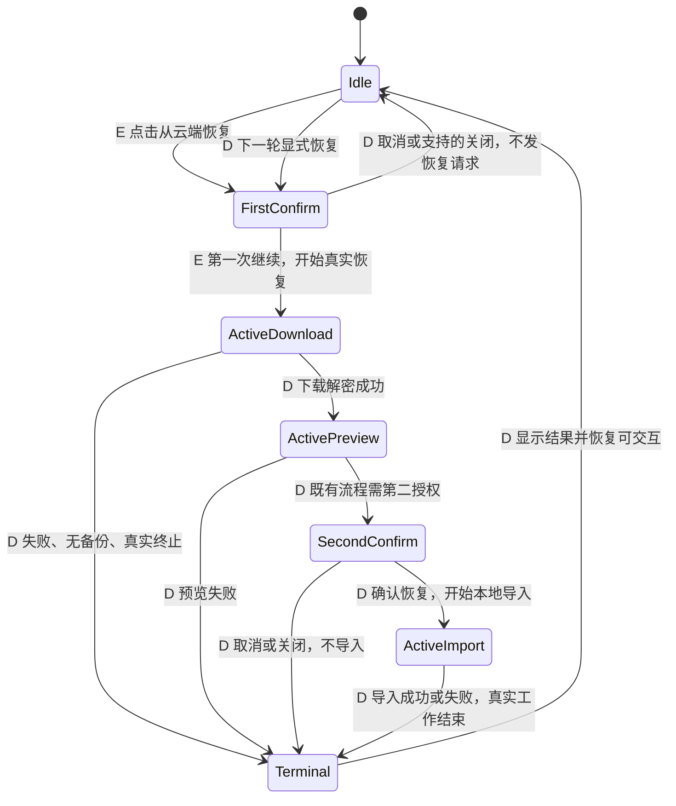

# vg-spec15 验收矩阵（分析阶段，未执行验收）

本文件仅归一化本题 Spec 与未修改基线的可观察行为，作为验收计划，不汇报执行状态，也不是功能设计。本轮哪些项目已实测以及对应结论，以 `spec/baseline-notes.md` 为准；本文静态发现不替代设备证据。下文“未验证”均说明需求角色未亲自执行该项，不能覆盖或否定基线报告已有证据。条目数不等于官方 F-point 数，也不推断分值。

## 1. 输入与证据约定

- Spec：`spec/requirement.md:1–40`，SHA256 `65bb001ac7d97ac9a66685430b559fb42977b615ceea32554ddd738ad1c03acc`。
- metadata：`spec/metadata.json:2` 的 `base_commit` 为 `88db8789e28333c7b7dcc8db078f394a262b73c3`；文件 SHA256 `6ace3344962c66300a23b017d435e18bc9d340d8b77eaec478a3f6a96006f920`。
- 本次只读核对 HEAD 与上述提交一致。主 Agent 提供的 `workflow/analyze-code-fingerprint.json` 记录 `changes_since_setup: []`；未读取来源项目历史、其他赛题、初始化总览会话或实现副本。
- `SPEC_EXPLICIT`：Spec 原句直接规定的行为。`REASONABLE_DERIVATION`：为验证原句或维持既有流程而提出的推导，不能冒充 Spec 明文。`UNCONFIRMED_ASSUMPTION`：Spec 与本题代码仍不能消除的选择，须由主 Agent 裁定；本文件只给推荐。
- 下文“网络无新增请求”均指**由该恢复动作引起的请求**。基线存在自动同步开关（`entry/src/main/ets/pages/settings/SettingsSyncSection.ets:466–469`），Ability 回到前台时会尝试自动同步（`entry/src/main/ets/entryability/EntryAbility.ets:49–55`）。网络取证应关闭自动同步或明确隔离其时序与请求归属，不能把它算作恢复证据，亦不能将其算作取消失败。
- 表 3、表 4 以 A 编号连接，二者合起来构成每条验收项的全部字段。表 5、表 6 同理。各条均含八维与选择器；“不适用”是该条断言范围，不代表整个恢复功能没有该维度。

## 2. Spec 文案逐字摘录与步骤覆盖

以下保留原文文字、标点与组件名称。原文的「正在...」与「处理中...」是“一类”提示的示例，**不是唯一允许的两条固定文案，也不是必须逐字包含三个点的匹配规则**。

| 来源 | 原文 |
| --- | --- |
| 场景一概述，L7 | 用户点击「从云端恢复」并在确认弹窗中点击「继续」后，页面必须在恢复流程运行期间渲染 ArkUI `LoadingProgress` 加载指示器。 |
| 场景一第 1 步，L11 | 1. 用户进入 WebDAV 配置页，并填写可访问的 WebDAV 配置。 |
| 场景一第 2 步，L12 | 2. 用户点击「从云端恢复」打开确认弹窗。 |
| 场景一第 3 步，L13 | 3. 用户点击「继续」确认恢复。 |
| 场景一第 4 步，L14 | 4. 页面显示 ArkUI `LoadingProgress` 加载指示器。 |
| 场景二概述，L20 | 恢复忙碌状态必须包含「正在...」或「处理中...」一类的状态提示文字，提示用户当前正在执行云端恢复。 |
| 场景二第 1 步，L24 | 1. 用户确认执行「从云端恢复」。 |
| 场景二第 2 步，L25 | 2. 页面进入恢复忙碌状态。 |
| 场景二第 3 步，L26 | 3. 页面显示操作进行中的状态提示。 |
| 场景二第 4 步，L27 | 4. 该文案在恢复操作进行期间可见。 |
| 场景三概述，L33 | 用户确认恢复后，应用必须向配置的 WebDAV 端点发送请求。仅改变 UI 文案或显示加载状态而不执行实际恢复操作，不满足该功能点。 |
| 场景三第 1 步，L37 | 1. 用户在恢复确认弹窗中点击「继续」。 |
| 场景三第 2 步，L38 | 2. 页面显示恢复加载状态。 |
| 场景三第 3 步，L39 | 3. 应用向配置的 WebDAV 服务端发送请求。 |
| 场景三第 4 步，L40 | 4. 测试环境能够观察到该 WebDAV 请求。 |

| 场景／步骤 | A 编号 | 拆分说明 |
| --- | --- | --- |
| 一／1 | A01、A02 | 进入与填写是两个原子动作。 |
| 一／2、3、4 | A03、A04、A05 | 每步均覆盖；A05 同时覆盖 L7 的持续区间。 |
| 二／1、2、3、4 | A06、A07、A08、A09 | 确认、进入忙碌、提示出现、持续可见分别断言。 |
| 三／1、2、3、4 | A10、A11、A12、A13 | 确认、加载、实际发起、外部观察分别断言。 |

12 个步骤全部覆盖，共 13 条明确条目。重复场景保持来源独立，但可共用同一条真实操作证据链，不能把来源重复当成独立功能数量。

## 3. 明确条目：来源、行为与 Hypium 断言

所有 A01–A13 的证据等级均为 `SPEC_EXPLICIT`。代码定位是基线事实，不能替代 Spec 证据，也不能替代设备验证。

| 编号 | 证据等级 | Spec 场景／步骤／行号 | 原子行为 | Hypium 可观察结果（均待实测） |
| --- | --- | --- | --- | --- |
| A01 | SPEC_EXPLICIT | 一／1／L11 | 用户能够进入 WebDAV 配置页。 | 沿现有设置入口到达标题“WebDAV 配置”及配置输入区；不是进入同页的“备份与恢复”。代码候选入口见 `SettingsPage.ets:41,447–462,527–529`。 |
| A02 | SPEC_EXPLICIT | 一／1／L11 | 用户能够填写可访问的 WebDAV 配置。 | 在地址、账号、密码、同步密码、远端目录控件输入受控服务数据，读取可公开字段确认输入，隐藏密码以输入成功及后续鉴权结果辅助验证；填写后是否必须另存见 A27。 |
| A03 | SPEC_EXPLICIT | 一／2／L12 | 点击“从云端恢复”打开第一次确认弹窗。 | 点击恢复按钮后定位对应标题、存在“继续”动作；此时仍未执行确认。基线第一次弹窗见 `SettingsSyncSection.ets:179–186`。 |
| A04 | SPEC_EXPLICIT | 一／3／L13 | 用户能在第一次确认中点击“继续”确认恢复。 | 在 A03 的弹窗范围点击“继续”，后续进入恢复活动阶段；不能先点击第二次“确认恢复”才认定满足此触发。 |
| A05 | SPEC_EXPLICIT | 一／4／L14；概述 L7 | 第一次“继续”后，在恢复活动阶段渲染 ArkUI `LoadingProgress`。 | 受控服务保持一次真实恢复请求未完成时，查询可见的 `LoadingProgress` 节点；结合源码确认组件类型，不能只凭自绘图形、Toast 或文字判定。下载／解析／已授权导入活动阶段的区间见状态机；第二次等待阶段见 A28。 |
| A06 | SPEC_EXPLICIT | 二／1／L24 | 用户确认执行“从云端恢复”。 | 按 A03、A04 完成原有确认动作，并记录该次动作的测试时间窗，供文案断言关联；不是单独点击保存、测试连接或备份。 |
| A07 | SPEC_EXPLICIT | 二／2／L25 | 该确认使页面进入恢复忙碌状态。 | 确认后、真实操作 pending 期间存在忙碌 UI；可综合进度组件、状态文字及控件可用性观察，但 Spec 未规定特定按钮必须禁用。 |
| A08 | SPEC_EXPLICIT | 二／3／L26；概述 L20 | 恢复忙碌状态显示表示正在云端恢复的文字。 | 在恢复状态区域读取可见状态文字，其含义符合原文“「正在...」或「处理中...」一类”的进行中提示；实现后登记实际文案，不能将本文件示例作为唯一字符串。 |
| A09 | SPEC_EXPLICIT | 二／4／L27 | 该状态提示在恢复操作进行期间保持可见。 | 延迟真实响应，开始、等待、后续活动阶段多次读取同一状态区域，始终有进行中提示；仅显示一瞬或已消失的 Toast 不足。多次采样只证明采样点，须结合真实 Promise 链的代码证据检查完整区间。 |
| A10 | SPEC_EXPLICIT | 三／1／L37 | 用户在第一次恢复确认中点击“继续”。 | 在第一次确认弹窗中点击“继续”，记录动作时间和请求窗口；不把第二次覆盖导入确认当成 L37 所指前提。 |
| A11 | SPEC_EXPLICIT | 三／2／L38 | 该确认后页面显示恢复加载状态。 | 与 A10 同一次操作中、服务延迟返回时观测到恢复的加载 UI；该证据须与 A12、A13 的真实请求处于同一轮恢复。 |
| A12 | SPEC_EXPLICIT | 三／3／L39；概述 L33 | 确认恢复后执行实际恢复链并向所配置 WebDAV 服务端发请求。 | Hypium 触发后由受控服务记录属于该轮恢复的请求；核对目标配置和动作时序，且业务链确为恢复。只增加 UI、发送无关探测充数、复用点击前测试连接日志均不满足。Spec 未指定请求方法、固定子路径或条数，见 A30。 |
| A13 | SPEC_EXPLICIT | 三／4／L40 | 测试环境能观察该轮 WebDAV 请求。 | Hypium 与服务日志／测试控制面配合：测试前划定游标或清空本轮日志，点击后取得目标端点请求记录并关联该轮动作。Hypium 单独发现 LoadingProgress 不构成网络证据。 |

## 4. 明确条目：八维与稳定选择器

选择器简称在第 7 节展开；未声明为现有的 id 均为**需在实现时补 `.id()` 的候选名**，不是本题规定的命名。系统原生 `showDialog` 控件是否暴露可用 id 未验证，不要求向不可控原生节点硬加业务 `.id()`。

| 编号 | 入口 | 前置数据 | 用户动作 | UI 结果 | 数据结果 | 网络结果 | 返回结果 | 边界条件 | 稳定选择器 |
| --- | --- | --- | --- | --- | --- | --- | --- | --- | --- |
| A01 | 现有首页设置入口→设置列表 | 已启动基线应用 | 进入设置，选择 WebDAV 配置 | WebDAV 配置区可见 | 不适用：此条仅导航 | 不适用：不以导航请求作验收 | 不适用：未要求返回导航 | 可滚动到入口；勿混同备份页 | S01、S02、S03，均缺稳定业务 id |
| A02 | WebDAV 配置区 | 可访问受控端点、凭据、匹配同步密码、远端目录 | 填入各字段 | 输入区反映数据，敏感字段保持其既有遮蔽 | 表单值正确；持久化非本条要求 | 不适用：填写本身不证明网络动作 | 不适用：无 Spec 返回值 | 空／空白另见 A14、A15；保存歧义见 A27 | S04–S08，均需补 id |
| A03 | WebDAV 手动操作区 | A02 前置配置已就绪，无活动恢复 | 点击“从云端恢复” | 第一次确认出现，“继续”可操作 | 不适用：尚未授权恢复 | 不适用：此步无明文请求断言；取消负例见 A16 | 不适用：仅打开弹窗 | 取消、关闭、快速连点见 A16、A17、A19 | S09 需补 id；S10 原生弹窗范围定位待验证 |
| A04 | 第一次确认弹窗 | 已打开 A03 弹窗 | 点击“继续” | 进入后续恢复活动 UI | 不适用：不能因此断言本地导入完成 | 与 A12 联查真实恢复调用 | 不适用：未规定返回值或成功文字 | 第二次确认无需提前点击，见 A28 | S10；后续 S11、S12 需补 id |
| A05 | 第一次确认后的当前 WebDAV 页 | 可延迟真实恢复服务响应 | 点击“继续”后观察 pending 区间 | 可见 ArkUI LoadingProgress | 不适用：加载组件不证明数据完成 | 活动链中确有真实未结束操作，联查 A12 | 不适用：结果文字不替代进度组件 | 慢请求、解密／解析、导入；第二等待见 A28 | S11 需补 id；类型与可见性需设备确认 |
| A06 | 第一次恢复确认 | 受控有效配置 | 确认“从云端恢复” | 确认后恢复可观察 | 不适用：只定义触发 | 与 A12 同轮关联 | 不适用：无指定返回值 | 不将其他同步／备份动作计入 | S09、S10 |
| A07 | 第一次继续后当前页 | 真实操作仍未结束 | 保持页面观察 | 恢复忙碌 UI 可见 | 不适用：忙碌不等于写库 | 恢复工作 pending 时同步观察 | 不适用：未到终态 | 不规定所有按钮必须禁用；重复见 A18、A19 | S11、S12，均需补 id |
| A08 | 恢复状态区域 | 活动恢复 | 读取进行中提示 | 可读且表示云端恢复进行中 | 不适用：文字不证明写库 | 不适用：由 A12 独立验证 | 不适用：无指定返回文字 | 示例非唯一；同名按钮不能混淆状态区域 | S12 需补 id |
| A09 | 当前恢复状态区域 | 可控制响应完成时点 | 连续阶段、多次采样 | 操作运行时状态文字持续可见 | 不适用：持续显示非数据验收 | 服务 pending 作为对齐依据 | 不适用：尚未结束 | 不用固定 sleep 代替请求 pending；第二等待见 A28 | S12 需补 id |
| A10 | 第一次确认弹窗 | 服务日志新窗口、有效配置 | 点击“继续”并记录时点 | 随后加载，与 A11 关联 | 不适用：未规定导入结果 | 为 A12、A13 划定动作边界 | 不适用：无指定返回值 | 不接受点击前请求充数 | S10；服务日志无 UI id，需外部证据 |
| A11 | A10 后当前页 | 真实响应被受控延迟 | 在该轮恢复中查询加载 | 恢复加载可见 | 不适用：加载不能证明恢复完成 | 与 A12 同轮同时存在 | 不适用：未到终态 | 不能用另一次同步加载充数 | S11、S12，均需补 id |
| A12 | A10 触发的恢复链 | 已配置目标端点及可访问服务 | 第一次“继续”触发恢复 | 与 A11 的加载相对应 | 实际恢复链被执行；具体覆盖统计非 Spec 明文 | 所配置 WebDAV 服务端收到恢复链请求 | 不适用：Spec 未规定 HTTP 状态或返回值 | 可多次预检／下载／重定向，不固定条数和路径 | S10 触发；网络由服务记录和代码链关联 |
| A13 | 测试控制面＋A10 | 独立本轮日志窗口、可识别目标 | 触发后取证 | 不适用：该条验证网络可观测性 | 不适用：不推断数据库效果 | 本轮请求有可复核记录 | 日志记录可取得；非业务固定返回文案 | 排除自动同步与测试连接噪声 | UI 用 S10；外部日志不适用组件 id |

## 5. 十二类边界及生命周期补充项

这些条目是明确要求的覆盖审计，**不把 Spec 没写的结果升级成明确要求**。每个条目的证据等级独立标示。“最后一页”无对应业务时保留不适用证据，不虚构分页功能。

| 编号 | 边界／补充主题 | 来源与证据等级 | 原子行为／判定范围 | Hypium 可观察结果及证据限制 |
| --- | --- | --- | --- | --- |
| A14 | 空输入 | 一／1 L11 的前置条件边界；`REASONABLE_DERIVATION` | 空配置不冒充可访问配置，失败后不残留恢复忙碌。 | 新配置无保存值的受控环境，地址、账号、密码、同步密码逐字段为空及全空；远端目录空值单列，因为基线有默认值。观察结束状态与既有校验结果；不要求 Spec 未写的错误文案。读取旧保存值的歧义须按 A27 隔离。 |
| A15 | 纯空格 | 一／1 L11 的前置条件边界；`REASONABLE_DERIVATION` | 空白配置的失败／默认处理不制造假恢复。 | 地址、账号、密码、同步密码、远端目录分别仅空格及组合输入；密码含合法空格与“仅空格”分开。输入处理事实见第 8 节，不强令所有字段一律 trim。若校验拒绝，终态不能一直加载。 |
| A16 | 取消 | 一／2–3 L12–13、三／1 L37 的反向操作；`REASONABLE_DERIVATION` | 第一次确认点击“取消”不启动本轮恢复。 | 点击第一次“取消”，服务本轮日志无由此引起的恢复请求，页面无新恢复忙碌；本地业务数据无恢复导入。基线 `SettingsSyncSection.ets:188–190` 支持。第二次取消不同，见 A22、A28。 |
| A17 | 关闭 | 一／2–3 L12–13 的第一次弹窗关闭；`REASONABLE_DERIVATION` | 第一次确认被系统关闭且未点击“继续”时视为未确认。 | 使用设备实际支持的返回／关闭方式，记录关闭成功后无本轮恢复请求和新忙碌。若系统弹窗不支持遮罩关闭，记录该方式不适用，不能假造关闭入口。代码 catch 见 `SettingsSyncSection.ets:191–193`。离开页面另见 A31。 |
| A18 | 重复点击 | 一／3 L13、二／2–4 L25–27 的活动阶段回归；`REASONABLE_DERIVATION` | 恢复活动阶段再次点击不会另起竞争恢复流程。 | 在受控 pending 期间重复尝试恢复动作，不出现第二个竞争恢复流程或提前清除加载；若控件禁用则验证该状态。允许一个流程内多个 HTTP 请求，不断言“恰好一条请求”。一次结束后再次确认是新轮恢复，应再次满足 A05、A08、A12；不规定自动重试。 |
| A19 | 快速连点 | 一／2–3 L12–13 的并发入口回归；`REASONABLE_DERIVATION` | 连点入口和确认不制造重叠确认／恢复。 | 分别在首次弹窗未返回、忙碌刚建立时快速操作，记录弹窗数量与恢复链关系；推荐单一活动流程。基线入口只在第一次弹窗完成后设置标志，存在需验证的窗口（`SettingsSyncSection.ets:167–197`），不能只凭注释宣称已防重。 |
| A20 | 无数据 | 一／4 L14、二／4 L27、三／3–4 L39–40 的异常终态推导；`REASONABLE_DERIVATION` | 服务无可用备份时结束活动状态并给出真实结果。 | 分别覆盖备份不存在、成功响应但明文为空、合法空业务数据、备份未更新。前两者不能伪报成功导入；合法空业务数据／未更新具体结果以既有服务语义记录，不规定新增文案。确有服务交互时 A12、A13 可单独成立，不要求必须 GET 或写库。 |
| A21 | 最后一页 | Spec 全文 L1–40 与本题恢复调用链；`REASONABLE_DERIVATION`（不适用判定） | 不适用：本功能没有 Spec 分页或“下一页”恢复行为。 | 不编造 Hypium 翻页断言。配置页面滚动到底只是定位手动操作区，不是备份分页。源码 `SettingsSyncSection.ets:533–625,684–692` 与下载链 `WebDavBackupManager.ets:70–129` 未呈现分页模型。 |
| A22 | 部分操作 | 一／2–3 L12–13、三概述 L33；`REASONABLE_DERIVATION` | 未完成授权的部分流程不被当作已完成恢复。 | 分别只填不保存／确认、打开第一弹窗不继续、下载预览成功后第二弹窗取消／关闭；前两者无恢复触发，后者已有下载请求但不执行覆盖导入。快照元数据可先写，不能把“无业务导入”扩大为零存储写入；保存歧义见 A27。 |
| A23 | 请求失败 | 三／3–4 L39–40、二／4 L27 的失败区间推导；`REASONABLE_DERIVATION` | 已发起的恢复失败后结束忙碌并呈现相符结果。 | 覆盖连接失败、401/403、404、5xx、断连、超时；补查下载成功后的解密／预览／导入异常分支。pending 时应满足加载与文案；真实链结束后不能永远忙碌或伪报成功。服务不可达时不可能有“服务收到”日志，用客户端失败记录表明尝试，但不得写 A13 已通过。 |
| A24 | 返回后重进 | 一／1 L11 的重入，Spec 无跨页规则；`UNCONFIRMED_ASSUMPTION`（U01） | 待裁定：离开后重进时活动恢复与提示如何衔接。 | 分别在空闲、第一次确认、下载、第二确认、导入和终态离开再进入；记录实际状态与请求，先作探索性证据。推荐避免旧提示冒充活动状态，但不强定恢复继续、取消或重开，也不强定草稿保存。 |
| A25 | 重启应用后重进 | 一／1 L11 的重启，Spec 无恢复／持久化规则；`UNCONFIRMED_ASSUMPTION`（U02） | 待裁定：进程重启后是否续传、重试或保留结果。 | 分别在下载、第二确认、导入、成功／失败后重启，再沿现有入口进入并记录；不在验收中强定自动请求、断点恢复、草稿或结果持久化。推荐新确认前不自动覆盖，已存配置按原有存储流程取证。 |
| A26 | 真实 Promise 生命周期 | 一概述 L7、二／4 L27、三概述 L33；`REASONABLE_DERIVATION` | loading 与本轮真实活动工作的 pending 区间对应，结束后恢复可交互终态。 | 以服务控制响应释放、解密／预览／已确认导入真实结束为边界取证，检查 resolve、失败结果、reject、超时各出口；不能使用固定计时演示代替业务。超时 race 与底层工作未终止的风险见第 6 节，不将“超时返回”直接当成真实请求结束。 |
| A27 | 填写是否立即生效 | 一／1 L11、三概述 L33；`UNCONFIRMED_ASSUMPTION`（U03） | 待裁定：新填写配置是否需要先点“保存设置”。 | 做新安装／已有旧端点两组，填写新端点后不保存就恢复，记录实际目标；另做显式保存对照。推荐主流程先保存隔离 UI 要求，同时将直接填写路径保留待裁定，不能因此宣布 Spec 允许忽略新值。 |
| A28 | 第二确认等待 | 一概述 L7、二／4 L27；`UNCONFIRMED_ASSUMPTION`（U04） | 待裁定：下载预览完毕、第二次等待人工授权是否算恢复运行期间。 | 不点击第二“确认恢复”就延长等待，记录加载／文字；对比继续导入后的活动区间。推荐仅真实下载／解析／已授权导入算活动，等待可退出忙碌，保留既有二次安全确认；另一解释是第一继续直到最终终态全程加载。两者均不影响第一次继续后必须开始真实请求。 |
| A29 | 固定忙碌文案假设 | 二概述 L20；`UNCONFIRMED_ASSUMPTION`（U05，建议排除） | 不把示例“正在...”／“处理中...”限定为唯一固定全文。 | 若有人拟只匹配两条 exact 文本，应撤销该限制，改为核对实现选择的语义明确的状态文字，并绑定恢复区域。Spec 的“一类”足以支持非唯一，不能据测试便利新增约束。 |
| A30 | 固定请求合同假设 | 三概述 L33、三／3–4 L39–40；`UNCONFIRMED_ASSUMPTION`（U06，建议排除） | 不把某个请求方法、固定子路径、条数、响应文案或成功状态写成 Spec 必须。 | 服务记录真实恢复链及配置端点即可检验该要求；分支可能预检、兼容旧路径、重定向、无备份提前返回。若测试拟固定 GET 某路径／恰好一条请求，应移为基线诊断而非 Spec 判负。 |
| A31 | 关闭页面／应用 | 一概述 L7、二／4 L27；`UNCONFIRMED_ASSUMPTION`（U07） | 待裁定：真实工作未结束时关闭页面／应用的取消及持久化语义。 | 与 A17 第一弹窗关闭分开；分别记录离开、回前台、重建页面时任务和 UI，不强定后台继续、取消后零请求、终态保留或配置草稿持久化。推荐按既有生命周期取证，必要时主 Agent 再界定范围。 |

## 6. 边界项八维与网络状态机

### 6.1 八维补全

| 编号 | 入口 | 前置数据 | 用户动作 | UI 结果 | 数据结果 | 网络结果 | 返回结果 | 边界条件 | 稳定选择器 |
| --- | --- | --- | --- | --- | --- | --- | --- | --- | --- |
| A14 | WebDAV 配置→恢复 | 清除旧配置污染，单字段／全空 | 输入空值并按现有流程确认 | 记录校验／失败，终止后非忙碌 | 不应伪造成功导入；根目录默认行为单独记录 | 本地拒绝可无请求，不能硬套有效配置正例 | 不适用：未规定错误字符串 | 五字段逐项及全空；根目录为空可有默认 | S04–S12，业务 id 需补；原生弹窗待验证 |
| A15 | WebDAV 配置→恢复 | 无旧配置，字段仅空格 | 分字段输入空格并确认 | 如拒绝，终态不残留加载 | 不应假成功；不强制统一 trim | 无效配置可本地拒绝；若发请求则记录真实目标 | 不适用：Spec 无空格错误文案 | 五字段逐项；区分密码合法空格 | S04–S12 |
| A16 | 第一次确认 | 有效配置，日志新窗口 | 点击第一次“取消” | 弹窗退出，无新恢复忙碌 | 无恢复业务导入 | 无该取消动作触发的恢复请求 | 不适用：Spec 无取消成功文案 | 自动同步噪声须排除 | S10 原生范围定位；S11、S12 需补 id |
| A17 | 第一次确认 | 有效配置 | 设备支持方式关闭弹窗 | 未进入新恢复忙碌 | 无恢复导入 | 无本轮恢复触发 | 不适用：未规定返回页面或文案 | 遮罩不支持时该关闭方式不适用；页面离开另列 | S10；系统返回无业务组件 id |
| A18 | 恢复活动页 | 一轮真实工作 pending | 再次点击或尝试恢复 | 单一活动流程，不提前解除原提示 | 不起竞争覆盖导入 | 不产生第二竞争恢复；不限制单流程请求数 | 结束后允许新一轮显式确认 | 活动中重复与结束后新操作分开 | S09、S11、S12，均需补 id |
| A19 | 空闲页／首次弹窗 | 有效配置，服务可延迟 | 入口及确认分别快速连点 | 不重叠确认／竞争恢复（推导） | 不竞争导入 | 按恢复流程关联，不按总 HTTP 数判重 | 不适用：无固定返回文案 | 标志设置前窗口、busy 建立窗口均检查 | S09、S10；活动 S11、S12 |
| A20 | 恢复链 | 无文件／空明文／合法空数据／未更新四组 | 确认恢复，释放响应 | 非无期限加载；真实终态 | 不把无备份当成功写库；合法空数据另记录 | 已发请求可成立 A12；无数据不强制 GET | 不适用：Spec 无无数据固定文案 | 四种“空”语义不同 | S11、S12；服务日志无 id |
| A21 | 不适用：无分页入口 | 不适用：无页码数据 | 不适用：无下一页动作 | 不适用：无分页恢复 UI | 不适用：无分页数据结果 | 不适用：无分页网络合同 | 不适用：无最后页返回值 | 不适用：配置滚动不是分页 | 不适用：不新增分页 id |
| A22 | 表单／第一确认／第二确认 | 分阶段已有数据 | 只完成前段后停止或取消 | 与当前阶段相符，不假完成 | 第二取消不导入，但允许既有快照存储 | 第一次继续前无恢复；第二取消前已有下载不能抹掉 | 不适用：不规定取消文案 | 部分填值与部分流程分别记录 | S04–S10、S13；S13 原生范围待验证 |
| A23 | 有效配置→恢复 | 各类失败服务和异常数据 | 确认、等待失败／超时 | pending 有提示，真实终止后退出忙碌 | 不伪造成功；事务／回滚细节未规定 | 发起真实尝试；不可达时 A13 服务收到未证实 | 不适用：未固定错误文案和 HTTP 返回 | 连接、鉴权、404、5xx、断连、超时，解密／预览／导入失败 | S10、S11、S12、S13；日志辅助 |
| A24 | 已离开后重新进入设置 | 空闲、确认、下载、二次等待、导入、终态六组 | 返回后重进 | 探索记录；期望取决 U01 裁定 | 草稿／结果保存不做必选断言 | 不强定继续／取消／新请求 | 不适用：Spec 无返回后页面状态约定 | 本页分区返回与路由离开均区分记录 | S01–S03、S14、S11、S12，id 需补 |
| A25 | 进程重启后现有入口 | 下载、二次等待、导入、成功、失败五组 | 终止后重新启动并进入 | 探索记录；期望取决 U02 裁定 | 不强定草稿／结果／任务持久化 | 不强定重试或恢复请求 | 不适用：无重启恢复返回值 | 正常重启与异常结束分别标证据 | S01–S03、S11、S12；进程操作无组件 id |
| A26 | 第一次继续后的实际工作区间 | 可控制完成与失败的真实服务 | 延迟、释放、失败，必要时第二确认 | 活动 pending 与加载／提示对应；结束后恢复可交互 | 不能凭 UI 认定导入成功 | 底层未结束时不能声称已终止 | 以真实完成结果驱动终态，不固定文案 | resolve、失败对象、reject、timeout race、长解析 | S10–S13；请求控制不适用 UI id |
| A27 | 新配置表单 | 新装／旧端点，另设新端点 | 填写后直接继续，与先保存对照 | 记录实际反馈；U03 未裁定 | 是否保存不是新增必选要求 | 比较新／旧端点命中情况 | 不适用：不限定保存成功文案 | 不让“测试连接”隐式更新 manager 污染直接填写组 | S04–S10、S15；业务 id 需补 |
| A28 | 第二次覆盖导入确认 | 已下载、解密、预览成功 | 延长等待，再取消或继续 | 等待是否忙碌待 U04；继续导入活动须有提示 | 继续才授权业务导入，取消保留既有数据 | 等待本身不新增下载；继续为本地导入无需另加请求 | 不适用：无第二确认固定返回文案要求 | Spec 只明确第一次继续；不能等第二次才满足 A05 | S13 原生范围待验证；S11、S12 需补 id |
| A29 | 恢复状态区 | 实际选定的状态文案 | 查询并读取文本 | 语义满足 L20，排除唯一 exact 示例限制 | 不适用：文字选择非数据结果 | 不适用：本条不替代请求验证 | 不适用：未限定结果文案 | 非恢复操作的同名“处理中...”须排除 | S12 需补 id |
| A30 | 实际恢复链＋日志 | 支持现有链的 WebDAV 服务 | 确认后观察请求 | 不适用：网络合同单独判断 | 不适用：未规定精确导入统计 | 配置端点真实恢复请求；不限定方法／子路径／条数 | 不适用：未规定 HTTP 状态或响应正文 | 预检、旧路径、重定向、早停不同序列 | UI S10；日志不适用组件 id |
| A31 | 活动恢复页／应用 | 工作仍 pending | 离开页面、关闭／回前台 | 探索记录；U07 未裁定 | 不强定草稿／busy／结果持久化 | 不强定后台取消或继续 | 不适用：Spec 无关闭后的返回约定 | 区别于第一弹窗关闭 A17；回入分别见 A24、A25 | S14 需补 id；系统关闭无业务 id |

### 6.2 状态机：明确核心与派生／待确认转换

图中 `E` 为明确触发与进行中要求，`D` 为合理推导的阶段／结束恢复，`U04` 为第二等待区间歧义。状态是需求可观察模型，**不是指定实现状态类**。

- `ActiveDownload`、`ActivePreview`、`ActiveImport`：真实恢复工作 pending，须有 `LoadingProgress`（L7/L14）和进行中文字（L20/L27）。不能只把网络 socket pending 作为全部恢复期间，因为下载后的解密、解析、已授权导入仍是实际恢复工作。
- `SecondConfirm`：基线此时释放 busy 并清空文字；是否需持续提示为 U04。两种解释均不得推迟第一次继续后的请求或加载到第二确认之后。
- `Terminal/Idle`：成功、失败、无备份或已确认的中止一旦真正结束，应停止活动提示并恢复可操作（D）。Spec 未给最短显示时长、120 秒超时阈值、特定成功文案、所有按钮禁用规则。
- 离开、重入、重启与活动中的关闭转换不画成确定路径，分别保留 U01、U02、U07；不得在图中暗自选定持久化／后台语义。

### 6.3 每个用户动作的请求规则

本表是恢复请求归因规则；“不新发请求”为基于基线流程的 D，不能误标为 Spec 新增协议。与恢复无关的自动同步需要在证据中隔离。

| 用户动作／事件 | 恢复相关请求规则 | UI／数据与证据等级 |
| --- | --- | --- |
| 进入页面、滚动、填写字段 | 不因这些动作启动恢复请求；其他初始化请求单独归因 | D；不代表填写已持久化，U03 |
| 保存设置 | 基线只更新本地设置／存储，不以其代替恢复请求 | 代码 `SettingsSyncSection.ets:100–111`、`WebDavSyncManager.ets:115–125`；D 回归 |
| 测试连接 | 可有连接测试请求，但不能用作 A12／A13 恢复证据 | `SettingsSyncSection.ets:320–336`；恢复范围外 |
| 立即同步／立即备份 | 各自业务可发请求，不能用作恢复证据 | `SettingsSyncSection.ets:161–163,289–317`；恢复范围外 |
| 点击从云端恢复 | 打开第一确认；基线此时不调用恢复网络链 | E 打开弹窗，D 未授权不恢复 |
| 第一确认取消／支持的关闭 | 不触发本轮恢复请求，不导入 | D；A16、A17 |
| 第一确认继续 | 实际恢复工作开始，向已配置端点发送真实恢复请求 | E；A04、A05、A10–A13；配置生效 U03 另列 |
| 等待下载／解密／预览 | 请求与本地工作按实际链进行；不能用无业务请求或定时器补演示 | E 进行中可见，D 真实 pending 绑定 |
| 第二确认等待 | 已有下载请求，单纯等待不要求新网络请求 | 基线事实；是否保持加载为 U04 |
| 第二确认取消／关闭 | 已发请求仍保留证据；不进行本地覆盖导入 | D；不要求回滚既有快照元数据 |
| 第二确认继续 | 基线导入已下载明文，不要求再发请求凑数 | `WebDavSyncManager.ets:506–510`、`WebDavBackupManager.ets:196–208`；D |
| 活动中重复／快速连点 | 推荐不创建竞争恢复；单流程可有多条请求 | D；A18、A19，非“HTTP 恰好一条” |
| 真实成功／失败结束 | 不凭终态显示新增恢复请求；释放活动状态 | D；A26；自动重试策略未指定 |
| 超时 wrapper 返回 | 不能推断底层请求或导入已停止；先取证实际终止情况 | D 生命周期风险；见下一节 |
| 返回、关闭页面、重进、重启 | 无 Spec 明确请求／续传／自动恢复合同 | U01、U02、U07；先探索，不判固定语义 |

### 6.4 真实 Promise 链与超时边界

基线真实调用链是：恢复按钮 `SettingsSyncSection.ets:604–613` → `webdavRestore:165–287` → 第一继续后设置 busy、文字并让 UI 调度 `:196–201` → `await runWithTimeout(downloadBackupPlain(false)):207` → `WebDavSyncManager.ets:475–502` 校验已有配置、预检及下载 → `WebDavBackupManager.ets:81–129` 的 HEAD、可选旧路径、快照、GET、TaskPool 解密 → 页面 `previewImport:229` → 第二确认 `:248–258` → 第二继续后 `importPlainBackup:275` → `WebDavBackupManager.ets:196–208` 的真实导入。该链必须仍被执行，不能仅保留 UI。

`runWithTimeout` 使用 `Promise.race`（`SettingsSyncSection.ets:114–122`）。race 超时获胜只使等待者返回，源码没有在此处取消底层 operation；HTTP 还各有 connect/read timeout（`WebDavClient.ets:139–149`）。基线页面 finally 清 busy（`SettingsSyncSection.ets:283–286`），因此**超时后的 wrapper 已结束不等于底层工作已终止**。这是代码风险，未实测，不得写成已发生的缺陷或已通过的恢复结论。

后续验证应以真实链 pending／结束记录与 UI 同轮证据相互校验，区分实际已终止、被真正取消、仅 wrapper 超时三种情况；本分析不指定新增取消实现或精确超时数值。对无法证明底层停止的路径，应记生命周期“未验证”，不能给覆盖通过结论。不得使用固定延迟或假 Promise 撑住 UI 却不执行真实恢复。

## 7. 稳定选择器清单（基线静态审计）

源码没有为下列业务控件设置 `.id()`。唯一相关页面 id 是 `SettingsPage.ets:565` 的动态 `settings_` + `themeRefreshToken`，不是恒定业务 id。此事实来自源码检查，控件在设备树中的实际 type／text／可见性仍未验证。

| 简称 | 目标与源码定位 | 现有情况／候选后续处理 |
| --- | --- | --- |
| S01 | 首页设置按钮，`pages/index/components/TopNavigation.ets:79`；路由调用 `pages/Index.ets:325` | 无稳定业务 id；需在实现时补 `.id()`，例如 `settings_entry`；实际视觉入口由 verification 确认。 |
| S02 | WebDAV 分区入口，`pages/SettingsPage.ets:41,507–529` | 无业务 id；需补，例如 `settings_webdav_entry`。 |
| S03 | 当前配置区／标题，`pages/SettingsPage.ets:447–462,489` | 缺恒定分区 id；需补，例如 `webdav_config_section`。 |
| S04 | 地址输入，`pages/settings/SettingsSyncSection.ets:439`，通用输入 `:356–363` | 需补 `.id()`，例如 `webdav_endpoint_input`。 |
| S05 | 账号输入，`SettingsSyncSection.ets:440` | 需补，例如 `webdav_username_input`。 |
| S06 | 密码输入，`SettingsSyncSection.ets:441`，通用密码输入 `:379–387` | 需补，例如 `webdav_password_input`；不能只按“显示／隐藏”同名按钮定位。 |
| S07 | 同步密码，`SettingsSyncSection.ets:442` | 需补，例如 `webdav_sync_password_input`。 |
| S08 | 远端目录，`SettingsSyncSection.ets:443` | 需补，例如 `webdav_remote_root_input`。 |
| S09 | 恢复按钮，`SettingsSyncSection.ets:604–613` | 需补，例如 `webdav_restore_button`；忙碌时文字变为同名“处理中...”，不能只用全文唯一定位。 |
| S10 | 第一原生确认，`SettingsSyncSection.ets:179–186` | `promptAction.showDialog` 未提供业务 id；用弹窗标题＋“继续／取消”＋层级范围定位，实际可用性未验证。若框架不支持对原生控件补 id，记录限制，不虚构能加 `.id()`。 |
| S11 | 恢复 LoadingProgress | 基线 `SettingsSyncSection.ets` 未声明此组件；实现时新增组件应补 `.id()`，例如 `webdav_restore_loading`，并核验 ArkUI 类型。 |
| S12 | 恢复状态文字，`SettingsSyncSection.ets:618–623` | 已有 Text，缺 id；需补，例如 `webdav_restore_status`。不应误选其他操作结果 `:567–572`。 |
| S13 | 第二原生确认，`SettingsSyncSection.ets:248–255` | 同 S10，用第二标题＋“确认恢复／取消”＋范围；不要求 Spec 未列出的固定标题。 |
| S14 | 设置页返回，`SettingsPage.ets:484–487`、`:172–179` | 无 id；需补，例如 `settings_back_button`；系统返回通过设备动作记录。 |
| S15 | 保存设置，`SettingsSyncSection.ets:543–551` | 无 id；需补，例如 `webdav_save_button`，供保存／未保存对照。 |

## 8. 本题代码事实与前置条件

- 入口候选是首页顶部设置路由 `entry/src/main/ets/pages/Index.ets:325`，目标 `pages/SettingsPage` 注册在 `entry/src/main/resources/base/profile/main_pages.json:7`；WebDAV 分区 id 为 `sync`（`SettingsPage.ets:41`），由点击列表赋值后渲染（`:447–462,527–529`）。**以上仅代码定位，实际可达性未验证**，以 verification 的未修改基线实操为准。
- 页头返回在分区内先清 `activeSectionId`，回到设置列表；设置列表再次返回才保存通用设置并 `router.back()`（`SettingsPage.ets:172–179`）。`aboutToDisappear` 也只调用通用 `saveSettings(false)`（`:159–160`），通用保存方法 `:300–349` 未保存 WebDAV 字段。因此 A24 需区分分区返回和路由离开，不能把普通返回误认作独立的 WebDAV 保存操作；活动任务和草稿后果仍按 U01／U07 取证。
- 表单五字段见 `SettingsSyncSection.ets:439–443`；保存时 trim 地址、账号和目录，空目录落默认值，密码原样传入（`:100–109`）。恢复 manager 校验使用 `safeTrim` 检查地址、账号、密码及同步密码长度（`WebDavSyncManager.ets:164–173`），不能据此推断所有表单字段应采用一致裁剪规则。
- `webdavRestore` 未在请求前调用保存；manager 用自身 settings 建 client（`WebDavSyncManager.ets:177–182,475–482`），页面输入通过 `@Link` 连接父状态（`SettingsSyncSection.ets:25–29`），与 manager settings 不是自动同一对象。新输入未保存可能未被恢复链使用，这是 U03 的代码依据，非运行时定论。
- 基线已有下载忙碌及文字赋值（`SettingsSyncSection.ets:196–229`）、第二确认前释放 busy 清文字（`:238–240`）、导入重新忙碌（`:271–275`）、终态清 busy（`:283–286`）；操作按钮忙碌时改成“处理中...”并禁用（`:543–562,578–613`），结果文字 `:618–623`。基线该文件中不存在 `LoadingProgress`，所以存在明确组件缺口的静态证据；不能因此宣称设备端 A05 已实测失败。
- 初次确认取消／关闭在 `SettingsSyncSection.ets:188–193` 返回；第二取消见 `:263–267`。`restoreDialogShowing` 在第一确认结束后才设为 true（`:172–197`），快速点击防重不能只信注释。
- 预检可缓存目录布局或发 HEAD 并创建／探测目录（`WebDavSyncManager.ets:284–342`），备份 HEAD 404 时尝试旧路径（`WebDavBackupManager.ets:81–94`），因此测试服务必须能承接既有分支；实际请求序列不是 Spec 固定合同。
- 下载前可保存本地快照（`WebDavBackupManager.ets:98–101`），并不等于覆盖导入；第二取消的“数据不导入”不能扩大为“所有本地存储完全无写入”。偏好存储设置路径见 `WebDavStateStore.ets:146–167`。
- 测试需要设备可访问的 WebDAV 服务、真实凭据、远端目录、与同步密码匹配的加密备份，以及可延迟和记录请求的服务控制面。用于全流程正例的备份须能解密并通过预览；仅满足 L11 可访问服务并不保证云端已有有效备份。环境是否具备、应用网络权限和设备连接均**未由需求角色验证**。

## 9. 待确认假设汇总、替代解释与推荐

| 假设 | A 编号／原文依据 | 多个可行解释 | 推荐与理由 | 对方案／测试的影响 |
| --- | --- | --- | --- | --- |
| U01 返回后重进 | A24；L11 只写进入，无重入语义 | 页面重建任务继续并重绑提示；离开时取消；任务继续但返回显示终态；草稿保留或不保留 | 先按基线探索；不新增持久化验收。Spec 只约束正在页面执行的恢复提示，无法选择跨页策略。 | 如需覆盖跨页，先由主 Agent 确定任务归属与预期；现阶段仅证据记录。 |
| U02 重启后的恢复 | A25；L1–40 无相关语句 | 全新空闲等人工确认；后台任务恢复；自动重试；仅恢复已存配置 | 推荐不把续传或自动重试列为必需；保留已存配置行为回归。Spec 无进程持久化合同。 | 任何强制续传／零请求／结果持久化断言应先失效或标探索。 |
| U03 新填写配置何时生效 | A27；L11、L33 | 填写即使用；必须先保存；测试连接顺带更新当前 manager | 主流程先显式保存以隔离加载与网络验证；直接填写路径留为待裁定。Spec 步骤省略保存，而基线有独立保存入口，两者均须说明。 | 未裁定前，不能仅测试已保存配置就宣布完全覆盖 L11，也不能无依据新增自动保存实现。 |
| U04 第二确认等待是否运行期间 | A28；L7、L27 | 第一继续到最终终态全程算运行；仅真实异步工作算运行，人工等待暂停 | 推荐保留既有二次安全确认，将等待与下载／解析／导入活动分开。第二确认是代码既有行为，Spec 没明确移除或在等待时保持忙碌。 | 加载时段测试须单列等待；两种方案均需第一继续立即有真实工作及提示，不能只覆盖第二继续。 |
| U05 仅允许两条固定忙碌文字 | A29；L20 | exact 等于两示例；允许表达进行中语义的其他文字 | **推荐排除此假设**；“一类”明确非穷举。可由原文消除，无须交用户决定。 | 固定示例全文断言失效；按实际实现文案＋进行中语义验证。 |
| U06 固定方法／路径／请求数／响应 | A30；L33、L39–40 | 任意属于真实恢复链的端点请求；固定 GET；固定文件路径；恰好一条 | **推荐排除固定合同**；原文未限定，基线已有分支与多请求。可据现有证据决定，无须询问用户。 | exact 请求序列可作基线诊断，不可作为 Spec 验收硬条件；响应文字和数值同理。 |
| U07 活动中关闭页面／应用 | A31；L7、L27，未提关闭 | 离开即取消；后台继续；界面销毁但任务继续；结果保存或不保存 | 先取现状证据，不规定后台或持久化义务；区分第一次弹窗关闭与页面生命周期。 | 如方案涉及全局任务或持久化，必须先明确增加的语义；不能靠验收矩阵隐式扩展。 |

尚存真实歧义为 U01、U02、U03、U04、U07。U05、U06 为常见无依据限制，建议直接排除。主 Agent 决定是否在后续范围内裁定或发问；本阶段不向用户自作提问。

## 10. 复审对后续产物的约束

- 需求：保留 12/12 步骤映射、12/12 边界审计、证据等级以及上述五项真实歧义，不把派生或假设并入明确功能点。
- 方案：必须说明第一确认后的真实恢复链、活动区间和各出口；若方案只在第二“确认恢复”后显示提示，或只给 UI 定时演示，须退回修订。不得据本文件候选 id 名或状态图强定内部架构。
- 测试：须在第一次继续后、第二确认前就取得加载／文案／真实请求的同轮证据；至少加入受控延迟响应。仅点击第二确认、只查按钮文字、只查 Toast、只引用源码或旧请求均不足以满足三场景。
- 应撤销的硬断言：仅两条 exact 忙碌文案、固定请求方法／子路径／条数、固定成功／失败文案、未说明的关闭／重启持久化语义、未确认的第二等待加载规则，以及把 HTTP 数当并发恢复次数。
- 应有的证据：未修改基线设备入口与请求观察、LoadingProgress 节点类型可见性、原生弹窗选择器可用性、配置保存对照和 timeout 真实生命周期。哪些已执行、哪些仍待补，均以 `spec/baseline-notes.md` 为准；本验收计划不独立给“功能已通过”结论。

覆盖统计：31 条 A 项＝13 条 `SPEC_EXPLICIT`＋11 条 `REASONABLE_DERIVATION`＋7 条 `UNCONFIRMED_ASSUMPTION`；Spec 3/3 场景、12/12 步骤，指定边界 12/12，其中“最后一页”按不适用记录；假设 7 组，其中 5 组真实未决、2 组建议排除；设备／网络实测通过数未统计（需求角色未执行）。
