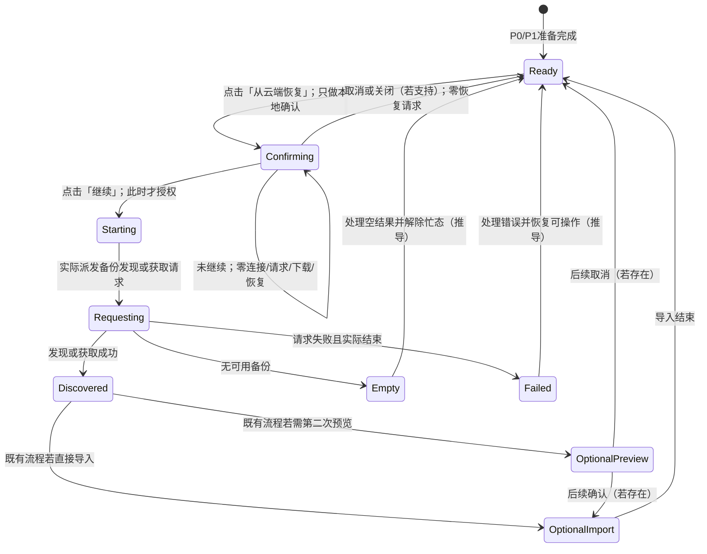

# vg-spec7 验收矩阵（分析阶段）

本文件仅拆解需求，不代表功能已经实现或验收通过。分析输入为 [requirement.md](D:/HCUP/vg-spec7/spec/requirement.md:1)，SHA-256：`60d2e252f5beb18d17717444480ae925f96fc00696cd8ae276c0c07f3fd72276`。基线 HEAD：`9cbcf7292c8cc46955dc3b522ddbda41c66a61d9`。基线构建、安装和操作结果见 [baseline-notes.md](D:/HCUP/vg-spec7/spec/baseline-notes.md)。

编号仅用于内部追踪，不能据此推断官方 F-point 数量、权重或分数。`SPEC_EXPLICIT` 为 Spec 明文；`REASONABLE_DERIVATION` 为有依据的推导；`UNCONFIRMED_ASSUMPTION` 为须保留给用户判断的假设。后两者不能冒充明文检查点。

## 1. 原文与逐步骤覆盖

以下逐字摘录本题提供的 Spec；引用 Q 编号在后续表格中展开为原文行号。

| 引用 | 场景与来源 | 原文（逐字） | 覆盖验收项 |
| --- | --- | --- | --- |
| Q01 | 场景一概述，[第 7 行](D:/HCUP/vg-spec7/spec/requirement.md:7) | 用户在 WebDAV 配置页点击「从云端恢复」后，应用必须先展示确认弹窗。仅打开该弹窗时不得连接 WebDAV 服务端，也不得开始下载或恢复数据。 | A06、A07、A09–A12 |
| Q02 | 场景一步骤 1，[第 11 行](D:/HCUP/vg-spec7/spec/requirement.md:11) | 用户进入 WebDAV 配置页，并配置可访问的 WebDAV 地址、账号、密码和同步密码。 | A01–A05 |
| Q03 | 场景一步骤 2，[第 12 行](D:/HCUP/vg-spec7/spec/requirement.md:12) | 用户点击「从云端恢复」按钮。 | A06 |
| Q04 | 场景一步骤 3，[第 13 行](D:/HCUP/vg-spec7/spec/requirement.md:13) | 页面弹出恢复确认对话框。 | A07 |
| Q05 | 场景一步骤 4，[第 14 行](D:/HCUP/vg-spec7/spec/requirement.md:14) | 在用户尚未点击「继续」前，系统不向 WebDAV 服务端发送任何请求。 | A08–A10，C03–C06 |
| Q06 | 场景二概述，[第 20 行](D:/HCUP/vg-spec7/spec/requirement.md:20) | 用户在确认弹窗中点击「继续」后，应用才可以进入恢复流程，并向已配置的 WebDAV 端点发起请求，用于发现或获取云端备份数据。 | B02–B06 |
| Q07 | 场景二步骤 1，[第 24 行](D:/HCUP/vg-spec7/spec/requirement.md:24) | 用户点击「从云端恢复」按钮打开确认弹窗。 | B01，复用 A06–A12 |
| Q08 | 场景二步骤 2，[第 25 行](D:/HCUP/vg-spec7/spec/requirement.md:25) | 用户在弹窗中点击「继续」。 | A08、B02 |
| Q09 | 场景二步骤 3，[第 26 行](D:/HCUP/vg-spec7/spec/requirement.md:26) | 应用开始数据恢复流程。 | B03 |
| Q10 | 场景二步骤 4，[第 27 行](D:/HCUP/vg-spec7/spec/requirement.md:27) | 测试环境能够观察到应用向配置的 WebDAV 服务端发送请求。 | B04、B05 |

明文规定的交互文字是「从云端恢复」「继续」。页面描述、字段名称并不等于必须逐字显示的标签。Spec 未给出确认框标题、正文、取消文字、loading、成功或错误文案，不能自行补成逐字硬断言。

场景二要求真实开始恢复并发出备份发现或获取请求；不要求本阶段必须完成全部下载、解密、导入或成功恢复。方法、请求总数、文件名、是否保留第二次预览确认均未规定。探活、单独“测试连接”、无关上传不能替代恢复流程中的发现／获取请求。

## 2. 测试前置与计量定义

- **P0（有效配置）**：沿既有首页→设置→WebDAV 配置进入；设备可访问受控端点 E；测试账号、密码正确，同步密码与夹具匹配。主验收显式点 WebDAV 区域的“保存设置”，避免把未保存语义当作既定要求（U02）。配置、进入页面是测试前置，不另增持久化或密码显示要求。
- **P1（隔离）**：关闭自动同步、等待历史任务结束，不点击测试连接、立即同步、立即备份。准备流量单独记录，稳定空闲后开启新的计量窗口。隔离是测试方法，不是给“任何请求”增加豁免；并发自动同步范围见 U07。
- **P2（数据）**：准备可只读核对的业务数据 D0，并记录导入／恢复调用的观测方式。保存配置、日志、UI 状态与恢复业务数据分开计量。仅最终数据相同，不能证明恢复没有开始。
- **Topen / Tcontinue**：实际点击恢复入口／当前确认框「继续」的时间。确认前窗口为 `[Topen, Tcontinue)`；从未继续时，包括等待、取消、关闭及随后观察期。服务器与 UI 时间需对齐，最好同时记录单调时钟和事件序号。
- **Ntotal / Nrestore / Ctotal**：端点全部请求数／可归因于本次恢复的发现或获取请求数／新连接数。连接日志应包含 TCP/TLS 接入；HTTP 请求零条不能单独证明零连接。不得记录认证秘密。
- **确认前**：P1 下 Ntotal=0、Ctotal=0，无下载与恢复开始；不能仅检查“没有 GET”或“没有导入”。
- **确认后**：服务端实收 Nrestore≥1，且属于配置 E 的发现／获取调用链，发生在 Tcontinue 之后。HTTP 401/404/5xx 仍可证明已请求，但有效配置主场景不能用错误凭据替代。
- 有限等待只是采样，不能证明无限期无请求。后续测试应结合服务端连接／请求账本、UI 时间线、下载／导入观测和确认前调用链。等待时长为测试参数，Spec 未指定秒数。

## 3. 原子行为与可观察断言

A01–A05 是 Spec 明定的场景前置能力，不把额外输入校验、长度限制或持久化策略作为明文需求。稳定选择器组 S0–S12 见第 5 节。

| 编号 | 来源 | 证据等级 | 原子行为 | Hypium／配套可观察断言 | 稳定选择器 |
| --- | --- | --- | --- | --- | --- |
| A01 | Q02，场景一 1 | SPEC_EXPLICIT | 能沿既有流程进入 WebDAV 配置区域。 | 区域、配置字段和恢复入口可定位；不强制独立路由或某个页面标题。 | S0、S5 |
| A02 | Q02，场景一 1 | SPEC_EXPLICIT | 配置可访问的 WebDAV 地址 E。 | 地址字段可编辑；生效端点由 B05 的服务端证据核实。 | S1、S6 |
| A03 | Q02，场景一 1 | SPEC_EXPLICIT | 配置正确账号。 | 账号字段可编辑，后续受控端点认证使用测试账号。 | S2、S6 |
| A04 | Q02，场景一 1 | SPEC_EXPLICIT | 配置正确密码。 | 密码字段接收输入，后续认证可用；不要求明文展示。 | S3、S6 |
| A05 | Q02，场景一 1 | SPEC_EXPLICIT | 配置同步密码。 | 字段可编辑，形成可用恢复前置；不额外规定长度规则。 | S4、S6 |
| A06 | Q01、Q03，场景一 2 | SPEC_EXPLICIT | 点击「从云端恢复」入口。 | 对精确文本的入口实际点击，进入 A07，记录 Topen。 | S5 |
| A07 | Q01、Q04，场景一 3 | SPEC_EXPLICIT | 恢复流程首先显示确认对话框。 | 当前确认框可见，不能先请求后弹框；离线／延迟服务器不能成为首框显示的网络前提。 | S7 |
| A08 | Q05、Q08 | SPEC_EXPLICIT | 当前确认框提供「继续」动作。 | 定位确认框内精确文本「继续」且可点击，不能误命中正文中的“继续”。 | S7、S8 |
| A09 | Q01，场景一概述 | SPEC_EXPLICIT | 仅打开确认框不连接 WebDAV 服务端。 | 确认前 Ctotal=0；需连接层记录，单靠 Hypium 或 HTTP 日志不足。 | S5、S7；连接账本 |
| A10 | Q05，场景一 4 | SPEC_EXPLICIT | 未点击「继续」不发任何 WebDAV 请求。 | 确认前 Ntotal=0，包括 HEAD、GET、探测、认证、目录处理等请求。 | S7、S8；请求账本 |
| A11 | Q01，场景一概述 | SPEC_EXPLICIT | 仅打开确认框不开始备份下载。 | 无备份获取任务、获取请求或备份响应体接收；“已下载但未导入”仍不通过。 | S7；下载与网络观测 |
| A12 | Q01，场景一概述 | SPEC_EXPLICIT | 仅打开确认框不开始恢复业务数据。 | D0 不因恢复改变，未触发导入／恢复；不能仅依据状态文案。 | S7、S11；数据观测 |
| B01 | Q07，场景二 1 | SPEC_EXPLICIT | 场景二沿恢复入口打开确认框。 | 重走 A06–A12，不用直接调用业务方法代替 UI。 | S5、S7、S8 |
| B02 | Q08，场景二 2 | SPEC_EXPLICIT | 用户点击当前框「继续」。 | 实际点击一次并记录 Tcontinue。 | S7、S8 |
| B03 | Q06、Q09，场景二 3 | SPEC_EXPLICIT | 点击「继续」后才启动真实恢复流程。 | 后续真实发现／获取调用与请求相对应，不能只有按钮变化或 loading。 | S8、S10；调用链 |
| B04 | Q10，场景二 4 | SPEC_EXPLICIT | 测试环境观察到实际请求。 | 服务端实收本次 Nrestore≥1，时间不早于 Tcontinue；“准备请求”日志不够。 | S8；请求账本 |
| B05 | Q06、Q10，场景二 4 | SPEC_EXPLICIT | 请求发往配置的 E。 | 主机、端口和基础路径与有效配置对应；不是硬编码其他服务。 | S1、S6、S8；请求账本 |
| B06 | Q06，场景二概述 | SPEC_EXPLICIT | 请求用于发现或获取云端备份。 | 用真实调用链、路径、方法及夹具响应证明请求目的；不要求固定方法或条数。 | S8；请求账本和调用链 |

### 每项八维

“返回结果”指页面或流程返回，不是 HTTP 状态码。下表与上表按编号一一组成完整验收项；不适用均注明原因。

| 编号 | 入口 | 前置数据 | 用户动作 | UI 结果 | 数据结果 | 网络结果 | 返回结果 | 边界条件 |
| --- | --- | --- | --- | --- | --- | --- | --- | --- |
| A01 | 首页既有设置入口 | 应用启动 | 进入 WebDAV 区域 | 区域可识别 | 不适用：仅导航 | 不适用：本项不定义进页联网；主测试先执行 P1 | 不适用：尚未返回 | C11、C12 |
| A02 | 地址字段 | E 可达 | 输入，主测试显式保存 | 接收 E | 生效地址为 E | 不要求测试连接；门禁由 A09/A10 检验 | 不适用：配置步骤 | C01、C02、C08、U02 |
| A03 | 账号字段 | 正确测试账号 | 输入并保存 | 接收账号 | 生效账号正确 | 后续认证作证；本步不要求联网 | 不适用：配置步骤 | 空值／纯空格见 C01/C02 |
| A04 | 密码字段 | 正确测试密码 | 输入并保存 | 接收密码，不要求明文 | 配置可用于认证 | 本步不要求联网 | 不适用：配置步骤 | 不擅自 trim 密码；C01/C02 |
| A05 | 同步密码字段 | 匹配夹具的密码 | 输入并保存 | 接收输入 | 形成可用前置 | 不适用：配置此字段不要求联网 | 不适用：配置步骤 | 空／空格／错误同步密码见 C01/C02/C09 |
| A06 | 「从云端恢复」 | P0/P1/P2 | 点击一次 | 触发确认 | 不恢复 D0 | 本次零连接、零请求 | 不适用：打开框未返回 | C05、C06 |
| A07 | 恢复入口 | P0/P1 | 等待首框 | 首先显示本地确认 | D0 保持 | 首框前后零请求 | 不适用：确认等待 | 慢端点、空云端也不得先请求 |
| A08 | 当前确认框 | 框已打开 | 定位，暂不继续 | 精确「继续」可点击 | 不适用：只定位控件 | 尚未继续仍零请求 | 不适用：未作选择 | 同名正文／其他弹窗不能代替 |
| A09 | 当前确认框 | P0/P1 | 打开并持续等待 | 保持确认态 | D0 保持 | Ctotal=0 | 不适用：等待不返回 | HTTP 零条不能掩盖提前建立连接 |
| A10 | 当前确认框 | P0/P1 | 等待，不继续 | 确认态 | D0 保持 | Ntotal=0 | 不适用：等待不返回 | C03–C06；自动同步范围 U07 |
| A11 | 当前确认框 | P0/P1；云端可有备份 | 仅打开／等待 | 不要求下载文字 | 无备份下载开始 | 无获取请求／备份体接收 | 不适用：等待不返回 | 下载成功后才确认不合格 |
| A12 | 当前确认框 | P2 的 D0 | 仅打开／等待 | 不要求恢复完成文字 | 不开始恢复／导入 | A09–A11 同时成立 | 不适用：等待不返回 | 最终数据相同不充分 |
| B01 | 恢复入口 | P0/P1/P2 | 点击一次 | 确认框含继续 | D0 保持 | 继续前零请求 | 不适用：尚未选择 | 复用 A06–A12 |
| B02 | 当前确认框 | B01 成立 | 点击继续一次 | 离开待授权阶段；动画未规定 | 可以开始后续流程 | 此时才允许派发恢复请求 | 不适用：未规定跳页 | 连点／竞争见 C06 |
| B03 | 当前确认框 | 可达 E | 点击继续 | 不能只有假进度 | 真实恢复流程启动，不要求立即导入 | 与 B04/B06 的请求联动 | 不适用：未规定完成后返回 | C07/C09；失败不能倒推未启动 |
| B04 | 确认后的流程 | P0/P1 | 继续后观察 | loading 不作为唯一证据 | 不要求完整恢复 | Nrestore≥1，且在继续之后 | 不适用：未规定导航 | 不限定 HTTP 恰好一次 |
| B05 | 确认后的流程 | 已保存 E | 点击继续 | 不适用：目标由服务端判断 | 不适用：本项核对目标 | 发往 E | 不适用：未规定导航 | 未保存 E2 见 U02 |
| B06 | 确认后的流程 | 能响应备份发现的 E | 点击继续 | 不适用：目的由流程判断 | 可仅发现，不必导入完毕 | 真实发现或获取备份 | 不适用：完整结局不在本项 | 无备份、认证握手、前置探测 |

## 4. 边界穷举与证据分层

边界来源为分析任务 [0-analyze.md](D:/HCUP/vg-spec7/spec-harness/0-analyze.md:1) 的额外要求；其“须分析”不意味着 Spec 已规定所有容错细节。以下每行与后面的八维补全共同使用；涉及的选择器组均须按第 5 节补稳定性。

| 编号 | 边界／来源 | 预期与证据等级 | 可观察断言／记录 | 选择器 |
| --- | --- | --- | --- | --- |
| C01 | 空输入；Q02 前提之外 | 非法配置的提示／禁用／仍弹框为 UNCONFIRMED_ASSUMPTION（U03） | 地址、账号、密码、同步密码分别为空及全空，记录基线；若进入待确认态，仍不得借机提前恢复 | S1–S8、S10 |
| C02 | 纯空格；Q02 前提之外 | 校验和 trim 规则为 UNCONFIRMED_ASSUMPTION（U03） | 四字段分别纯空格及全空；密码是否允许空格不能自行决定；记录是否联网、是否弹框 | S1–S8 |
| C03 | 取消；Q05/Q06 | “未继续不得请求”是 SPEC_EXPLICIT；取消动作是否存在／文案为 U01；退回可操作态为推导 | 若支持，打开→取消→等待，总请求仍零、无下载／导入；重开重新确认 | S5、S7、S9、S11 |
| C04 | 关闭；Q05/Q06 | 支持的关闭不能当作继续是 REASONABLE_DERIVATION；关闭方式为 U01 | 分别测返回键、外部点击、关闭图标；没有的方式记不适用并注明不支持，不要求新增 | S7、S11；系统返回 |
| C05 | 重复点击；Q01/Q05 | 每轮未继续零请求为 SPEC_EXPLICIT；单框去重策略为 U04 | 多轮打开／取消，记录每轮确认与服务端窗口，不能复用上次取消作为授权 | S5、S7、S9 |
| C06 | 快速连点；Q05/Q06 | 继续前门禁为 SPEC_EXPLICIT；一次授权避免重入为 REASONABLE_DERIVATION（具体策略 U04） | 入口连点、继续连点、取消／继续竞争；记录接受的授权事件和流程数，不用 HTTP 条数冒充流程数 | S5、S7–S10 |
| C07 | 无数据；Q06/Q10 | 确认后发现请求为 SPEC_EXPLICIT；空结果文案为 U05 | 空目录／无备份，继续前零请求，继续后真实发现；不要求伪造恢复成功 | S5、S7、S8、S10 |
| C08 | 部分操作；Q02/Q05/Q06 | 未继续门禁为 SPEC_EXPLICIT；未保存配置语义为 U02/U03 | 分开记录只填部分字段、输入未保存、只开框、已发现未下载、已下载未导入；最后一种确认前发生仍违规 | S1–S8、S10、S11 |
| C09 | 请求失败；Q06/Q10 | 确认后实际请求为 SPEC_EXPLICIT；提示／重试／超时数值为 U05 | 连接失败、401/403、404、5xx、超时、断网、解密失败；记录请求时序与忙态清除。连接失败无 HTTP 实收时不能把 B04 记通过 | S7、S8、S10；服务端与连接记录 |
| C10 | 最后一页 | 不适用：Spec 无备份列表、分页或翻页 | 不凭空新增分页验收；内部以后若有分页只列既有流程回归 | 不适用：无该控件 |
| C11 | 返回后重进；Q01/Q06 | 新一次不得继承未发生的授权为 REASONABLE_DERIVATION；已授权在途任务为 U06 | 未继续／取消后返回再入仍先确认；此前已继续的请求单独归因 | S0、S5、S7、S8、S12 |
| C12 | 重启应用后重进；Q01/Q06 | 未发生的授权不得变成新授权为 REASONABLE_DERIVATION；持久化／已授权续跑为 U06/U08 | 上次未继续、取消、已继续未完成各一组；重新执行 P1，区分启动自动同步与恢复 | S0–S8、S12 |

### 边界八维补全

| 编号 | 入口 | 前置数据 | 用户动作 | UI 结果 | 数据结果 | 网络结果 | 返回结果 | 边界条件 |
| --- | --- | --- | --- | --- | --- | --- | --- | --- |
| C01 | 四输入字段、恢复入口 | 分项空／全空 | 保存／点击恢复 | 提示、禁用或弹框待确认 | 未授权无恢复 | 记录，不把非法配置路径冒充有效配置主测试 | 若弹框按实际取消 | U03，不规定错误文字 |
| C02 | 同 C01 | 分项纯空格／全空格 | 同 C01 | trim／提示策略待确认 | 未授权无恢复 | 同 C01 | 同 C01 | 密码空格语义不自行决定 |
| C03 | 首个确认框 | P0/P1/P2 | 若支持则取消 | 取消，不当作继续；重置建议 | D0 不恢复 | 本次零请求、零下载 | 返回配置等待态为推导 | 未支持取消时记录能力事实 |
| C04 | 首个确认框 | P0/P1/P2 | 支持的返回／外点／关闭 | 不当作继续 | D0 不恢复 | 本次零请求 | 支持的关闭回配置；不支持则保持 | 每种关闭方式分别记录 |
| C05 | 恢复入口 | P0/P1/P2 | 多轮打开、取消、再开 | 每轮确认；框数量策略待定 | 不恢复 D0 | 每轮未继续零请求 | 每轮可取消后重开 | 不要求特定去重 toast |
| C06 | 入口及首框动作 | P0/P1/P2；延迟响应 | 快速连点／竞争 | 有效授权被明确接受 | 不重复导入为建议 | 授权前零请求；授权后按流程归因 | 终止后可用为建议 | 多请求可属于单次流程 |
| C07 | 恢复入口 | 有效配置、空云端 | 打开→继续 | 先确认；空结果样式待定 | 不伪造业务数据 | 继续后发现请求 | 请求结束解除忙态为推导 | 空目录不等于本题不适用 |
| C08 | 配置或首框 | 部分字段／脏输入／部分流程 | 中途停止 | 阶段与实际进展一致 | 继续前不恢复 | 继续前不能已下载 | 返回未授权路径仍要确认 | 发现与导入阶段分开判断 |
| C09 | 首框及请求阶段 | 各受控失败夹具 | 继续后触发失败 | 错误提示策略待定；忙态应可恢复 | 不要求本题完成全量恢复 | 失败也必须在授权后；无实收则 B04 未证 | 是否重试／重进按 U05/U06 | UI 超时不等于取消底层工作 |
| C10 | 不适用：无分页入口 | 不适用：无分页数据 | 不适用：无翻页动作 | 不适用：无分页 UI | 不适用：无分页结果 | 不适用：无分页请求要求 | 不适用：无分页返回 | Spec 未定义分页 |
| C11 | 目标区段返回入口 | 未继续／取消／已授权在途分别准备 | 返回后重进，再点恢复 | 新轮先确认 | 未授权新轮不恢复 | 旧授权流量与新轮分开 | 区段→设置菜单→首页依现有导航 | 已授权是否取消待确认 |
| C12 | 应用生命周期入口 | 上次三种授权状态分别准备 | 重启、重进 | 新轮先确认；配置持久化待定 | 未授权不自动成为恢复 | 先隔离前台自动同步，再计量 | 重进沿既有流程 | 不要求断点恢复或保留弹窗 |

## 5. 稳定选择器与基线缺口

以下 id 是后续建议，不是 Spec 的字面要求，也不是已存在的组件。**当前分析阶段不补代码。** 无固定业务 id 的 ArkUI 组件均标“需在实现时补 .id()”。原生弹窗的系统节点不能假称已有业务 id。

| 组 | 目标与建议 id | 基线证据／选择方式 |
| --- | --- | --- |
| S0 | 设置入口／WebDAV 区段：`settingsEntryButton`、`webdavConfigSection` | [TopNavigation.ets:70](D:/HCUP/vg-spec7/entry/src/main/ets/pages/index/components/TopNavigation.ets:70)、[SettingsPage.ets:491](D:/HCUP/vg-spec7/entry/src/main/ets/pages/SettingsPage.ets:491) 无固定 id；需在实现时补 .id()。根 id 在 [Index.ets:360](D:/HCUP/vg-spec7/entry/src/main/ets/pages/Index.ets:360)、[SettingsPage.ets:549](D:/HCUP/vg-spec7/entry/src/main/ets/pages/SettingsPage.ets:549) 拼接主题 token，不能保证固定值。 |
| S1 | 地址：`webdavEndpointInput` | [SettingsSyncSection.ets:270](D:/HCUP/vg-spec7/entry/src/main/ets/pages/settings/SettingsSyncSection.ets:270) 的通用输入，调用 [第 353 行](D:/HCUP/vg-spec7/entry/src/main/ets/pages/settings/SettingsSyncSection.ets:353)；需在实现时补 .id()。 |
| S2 | 账号：`webdavUsernameInput` | [第 354 行](D:/HCUP/vg-spec7/entry/src/main/ets/pages/settings/SettingsSyncSection.ets:354)；需在实现时补 .id()。 |
| S3 | 密码：`webdavPasswordInput` | [第 293 行](D:/HCUP/vg-spec7/entry/src/main/ets/pages/settings/SettingsSyncSection.ets:293)，调用第 355 行；需在实现时补 .id()。 |
| S4 | 同步密码：`webdavSyncPasswordInput` | [第 356 行](D:/HCUP/vg-spec7/entry/src/main/ets/pages/settings/SettingsSyncSection.ets:356)；需在实现时补 .id()。两个密码显隐按钮可同名，不能按“显示”唯一定位。 |
| S5 | 恢复按钮：`webdavRestoreButton` | [第 507 行](D:/HCUP/vg-spec7/entry/src/main/ets/pages/settings/SettingsSyncSection.ets:507)；需在实现时补 .id()。空闲按精确文本「从云端恢复」，避免说明文字包含匹配。 |
| S6 | WebDAV 保存：`webdavSaveSettingsButton` | [第 446 行](D:/HCUP/vg-spec7/entry/src/main/ets/pages/settings/SettingsSyncSection.ets:446)；需在实现时补 .id()。要限定 WebDAV 区域，不能误点其他设置的保存。 |
| S7 | 首个恢复确认框：`webdavRestoreConfirmDialog` | 基线 [第 215 行](D:/HCUP/vg-spec7/entry/src/main/ets/pages/settings/SettingsSyncSection.ets:215) 是下载后的原生框。原生框先用系统 Dialog 范围和文本定位；若改自定义组件，需在实现时补 .id()。 |
| S8 | 继续：`webdavRestoreContinueButton` | 基线按钮是 [第 220 行](D:/HCUP/vg-spec7/entry/src/main/ets/pages/settings/SettingsSyncSection.ets:220)「确认恢复」，没有对应「继续」动作。后续需可精确定位「继续」；自定义按钮需在实现时补 .id()，原生按钮用弹窗范围内精确文本。 |
| S9 | 若支持取消：`webdavRestoreCancelButton` | 基线 [第 219 行](D:/HCUP/vg-spec7/entry/src/main/ets/pages/settings/SettingsSyncSection.ets:219) 为原生「取消」。存在／文案策略见 U01；采用自定义按钮时需在实现时补 .id()。 |
| S10 | 结果／忙态：`webdavRestoreStatus` | [第 521 行](D:/HCUP/vg-spec7/entry/src/main/ets/pages/settings/SettingsSyncSection.ets:521) 无 id，需在实现时补 .id()。五个操作按钮忙时均为「处理中...」，不能按该文本识别恢复按钮。Spec 不要求新增 spinner。 |
| S11 | D0 的业务数据标记／只读快照 | 沿既有词库／词书展示选择唯一测试数据；具体业务页面 id 未在本分析中逐页穷查，未验证。应结合只读数据或导入观测，不能只看结果标签。 |
| S12 | 自动同步：`webdavAutoSyncToggle` | [第 380 行](D:/HCUP/vg-spec7/entry/src/main/ets/pages/settings/SettingsSyncSection.ets:380) 无 id，需在实现时补 .id()；主测试用于隔离，不作为新增功能要求。 |

## 6. 网络状态机与 loading 绑定

实线中的授权门禁与真实请求是 Spec 要求；空结果、失败后的展示、第二次预览及防重入为既有行为或推导，不能扩成 Spec 固定文案。

| 动作／事件 | 是否发请求 | loading 与请求的绑定及恢复 | 证据等级 |
| --- | --- | --- | --- |
| 输入／保存配置 | 不把准备流量计作恢复；基线保存本身为本地操作 | 配置态不等于恢复忙态；主测试保存后清账本 | 测试方法／基线代码事实 |
| 点击恢复入口、等待首框 | 本次不得连接或请求 | 首框不得依赖网络；不能启动下载／导入。具体忙态样式未规定 | 门禁 SPEC_EXPLICIT；UI 表现未规定 |
| 取消／关闭首框 | 不能发起本次恢复请求 | 清除待确认状态、允许后续打开是 REASONABLE_DERIVATION | 未点击继续门禁明确；具体关闭策略 U01 |
| 点击继续 | 必须进入真实恢复并观察到发现／获取请求 | 如展示请求 loading，须与实际派发／在途阶段对应；只有改 UI 不满足 B03–B06 | 实际流程 SPEC_EXPLICIT；样式 U05 |
| 网络成功／空数据／失败而真正结束 | 请求不再在途 | 应结束请求 loading、处理结果并恢复后续操作；文案和重试策略 U05 | REASONABLE_DERIVATION |
| 下载后等可选第二确认 | 可能没有在途请求 | “等待用户”与“正在下载”须区分；后续取消不能被算作首个确认前零请求 | 既有流程回归／推导 |
| UI 超时但底层未取消 | 仍可能有真实请求 | UI 清 busy 不证明请求已结束；排除旧任务污染再开计量窗口 | 测试方法；生命周期策略 U06 |
| 入口／继续连点 | 确认前始终零请求；确认后按接受的授权归因 | 推荐同一次授权防重入；不能要求一个流程只发一个 HTTP | 门禁明确；去重策略 U04 |

Spec 未要求 loading 的具体组件、文字或秒数。分析任务要求明确绑定，故将状态恢复列为设计与回归推导，而非新增固定 UI 检查点。

## 7. 待确认假设与推荐（不自行决定）

| 编号 | 证据等级 | 待用户判断的范围 | 缺少明文的依据 | 推荐处理与理由 |
| --- | --- | --- | --- | --- |
| U01 | UNCONFIRMED_ASSUMPTION | 首框标题、正文、取消文字、返回键／外点／关闭图标策略 | Q01/Q04/Q08 仅要求确认框及「继续」 | 沿既有警告风格；首个授权动作精确用「继续」。其余先不设逐字硬断言，保留用户选择。 |
| U02 | UNCONFIRMED_ASSUMPTION | E1 已保存、E2 只输入未保存时，“配置端点”指哪个 | Q02/Q06 没有保存语义；基线独立保存，恢复不自动保存 | 主验收显式保存 E；未保存切换单列探索，不擅自改变使用哪个端点。 |
| U03 | UNCONFIRMED_ASSUMPTION | 空／空格／无效配置：提示、禁用还是仍先弹框；密码 trim 和长度规则 | Q02 主前提是可访问的有效配置 | 记录现有本地校验；不把基线“至少4位”等规则升级为 Spec 明文。 |
| U04 | UNCONFIRMED_ASSUMPTION | 单框去重、继续连点、竞争动作如何接受 | Spec 未规定并发策略 | 推荐一次授权只启动一个恢复流程以免重复覆盖；不能以 HTTP 条数判断重入。 |
| U05 | UNCONFIRMED_ASSUMPTION | loading、超时、错误、空结果、重试的样式／文案／数值 | Spec 未规定这些细节 | 推荐复用既有机制并保证流程结束后可继续操作；不增加固定秒数与逐字错误断言。 |
| U06 | UNCONFIRMED_ASSUMPTION | 已经继续的任务在返回／重启后取消、续跑或恢复 | Spec 只定义当前确认门禁 | 历史授权任务与新一次打开分开计量；生命周期策略保留待判，不要求强制断点恢复或中断。 |
| U07 | UNCONFIRMED_ASSUMPTION | 确认等待时，已在途且无关的自动同步是否也须全局暂停 | Q05 是“任何请求”，但没有描述独立并行任务 | 主验收隔离所有独立流量、严格记总零请求；并发场景保留歧义，不能自行给后台请求豁免。 |
| U08 | UNCONFIRMED_ASSUMPTION | 配置字段、未确认弹窗／任务在重启后的持久化 | Spec 没规定保留输入或弹窗 | 不把字段持久化作新增硬门槛；未发生的继续不得变成授权属于门禁推导。 |

## 8. 当前验证范围与后续使用

本阶段交付验收定义及未修改基线事实，未执行全部边界或完成目标功能。当前运行结果和每项“实测／静态／未验证”状态以 [baseline-notes.md](D:/HCUP/vg-spec7/spec/baseline-notes.md) 为准。后续不得把本矩阵的“预期”复制为“通过”。

后续验证应先运行有效配置的两个 UI 主场景，再按 C01–C12 回归并保留 U01–U08 的证据等级。不能只移动导入却保留确认前下载；不能只新增 loading 而无真实请求；不能把完整恢复成功、固定 HTTP 方法、恰好一次 HTTP、固定错误文案当作 Spec 已要求的 F-point。

