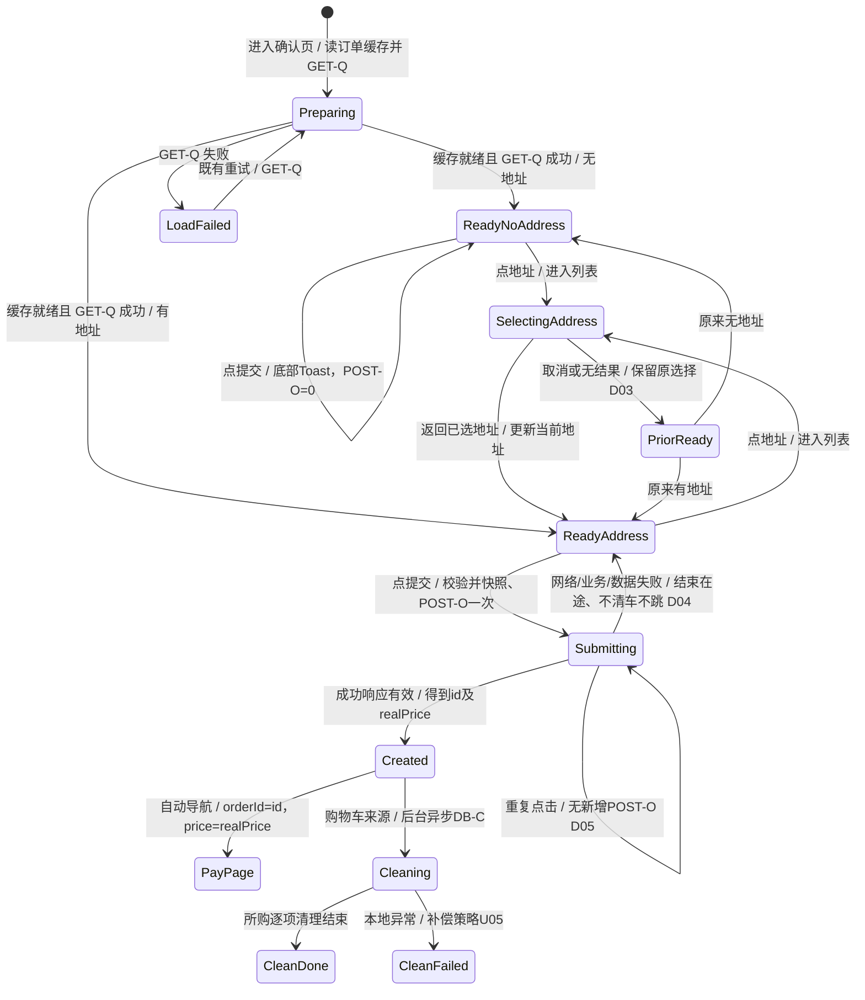

# cml-spec17 验收矩阵（0-analyze）

本次分析阶段已完成：将 Spec 拆为31条明文要求、11条合理推导，覆盖15步、28项边界，另列10项未确认策略。原工程的844个受版本控制文件未修改；按用户追加授权，另增隔离测试入口、模拟响应和只读诊断，必要的O01–O08现状调查已完成。源码事实、原始普通包实测与本地测试构建观察分开记录。基线构建、安装和既有入口调查见 `spec/baseline-notes.md`，本矩阵不代表功能已通过。需求修订v02已合入三项复审纠错，原始记录保留；输入补测结论见第13节。

## 1. 输入与证据约定

- Spec：`spec/requirement.md`，实算 SHA256 为 `81d6d215138d27533848c7eb94f0d6a451241bd431f76297720755d340d8cc9a`，与批准值一致。
- 元数据：`spec/metadata.json:2` 的 `base_commit`，及本次 `git rev-parse HEAD` 均为 `d6a6ba7480fbd0a30075462e46bb4344a430ba61`。未查阅相关历史提交。
- 范围：3 个场景，共 15 个步骤。覆盖索引见第 3 节；需求数量不代表官方 F-point 数量或分值。
- `SPEC_EXPLICIT`：原文直接规定的行为。`REASONABLE_DERIVATION`：从原文目标、因果关系和本题代码得到的必要推导。`UNCONFIRMED_ASSUMPTION`：原文和本题代码不足以确定的具体策略。代码现状单列为 `CODE_FACT`，不是新增 Spec 要求。
- 下表来源 `S1.3/L13` 表示场景一第 3 步、`spec/requirement.md:13`。逐字摘录保留原文字面；省略号未用于替代必须检查的文案。
- 每条 E/D 需求的原子定义表与八维表按编号连接，合起来构成完整验收项。八维为入口、前置数据、用户动作、UI 结果、数据结果、网络结果、返回结果、边界条件。`无新 UI（数据项）` 等明确注明不适用理由。
- `Q/R/M/C/A/P` 等选择器是待设计采纳的测试接口建议，基线缺少 `.id()`，不是既有 id，也不是 Spec 指定命名。详细映射见第 5 节。

## 2. 静态基线事实与缺口

| 编号 | CODE_FACT 与原文位置 | 对需求/验证的影响 |
| --- | --- | --- |
| F01 | `feature/order/src/main/ets/viewmodel/OrderConfirmViewModel.ets:270-272` 的 `onSubmitOrderClick()` 只有 TODO。`feature/order/src/main/ets/view/OrderConfirmPage.ets:305-312` 的按钮调用该方法。 | 提交、缺地址校验、创建请求、成功跳转当前均无该入口的实现；本地设备观察为点击后创建数0、无跳转，详见第12节，不能宣称已通过。 |
| F02 | `OrderConfirmViewModel.ets:257-263` 调用 `UserNavigator.toAddressList(true)`，收到地址只打印。确认页 `OrderConfirmPage.ets:78-82` 始终绑定 `vm.data?.defaultAddress`。 | 地址列表有入口，但选中地址未在该回调写回；E21/E22、D02 是独立缺口。 |
| F03 | `feature/user/src/main/ets/viewmodel/AddressListViewModel.ets:62-66` 选择模式返回 `{ address }`；`:75-80` 新增完成收到 refresh 后刷新列表。`AddressDetailViewModel.ets:401-402` 返回 `{ refresh: true }`。 | 已有“新增→列表刷新→选中→确认页”的合法链路；不必假设新增页直接返回完整地址。 |
| F04 | `OrderConfirmViewModel.ets:93-111` 读 `cachedCarts` 和 `selectedGoodsList`，展示优先用购物车缓存，随后清缓存。`:172-174` 用缓存是否非空识别购物车来源。 | 缓存读完前提交、无数据重进是风险；不能只看页面价格就认定请求商品完整。 |
| F05 | `feature/main/src/main/ets/viewmodel/CartViewModel.ets:250-275` 结算校验选择、保存两种缓存后导航；`:281-305` 只收集选中规格；`:313-344` 转为 `SelectedGoods` 并保留规格与数量。 | 正常结算缓存限本次已选规格；C 场景应沿此入口，不能用整车替代本次订单。 |
| F06 | `OrderConfirmViewModel.ets:278-307` 已有异步 `deleteCartItems()`，未在空提交方法调用；`:296` 仅比较两套规格 ID 集合的大小。 | 可复用清理基础；数量相同不能证明规格全部相同。静态风险是“同数异集合误删整商品”，需 D09 边界验证。 |
| F07 | `core/data/src/main/ets/repository/CartRepository.ets:56-67,99-100` 提供整商品删除、单规格删除、按商品查询。`core/database/src/main/ets/datasource/cart/CartLocalDataSourceImpl.ets:92-113` 对本地 ORM 执行删除/存储，删除最后规格会删除整行。 | 清理是本地数据库操作，不是向服务器逐项删除购物车；验收要包含仓库重读。 |
| F08 | `core/model/src/main/ets/request/CreateOrderRequest.ets:11,28-44` 为 `{ data: { remark?, addressId, goodsList, couponId?, title? } }`；`SelectedGoods.ets:14-26` 有 goodsId/spec/count。`core/network/src/main/ets/datasource/order/OrderNetworkDataSourceImpl.ets:71-74` POST `order/info/create`；`core/data/src/main/ets/repository/OrderRepository.ets:74-75` 已封装。 | 请求形状、路径可依据本题代码确定；`title` 可选且非本题明文，不能因“等参数”任意增加必填项。 |
| F09 | `core/model/src/main/ets/entity/Order.ets:13` 为 id；`:39-49` 分别为 price、discountPrice、realPrice，其中 realPrice 注释为“实际支付金额”。`core/navigation/src/main/ets/order/OrderNavigator.ets:50-57` 传 `{ orderId, price, from? }`。 | E13/E14 应用响应 `id` 与 `realPrice`，导航参数名虽为 price，但不可换成响应 price 或本地 totalPrice。字段对应关系可消歧，无需用户决定。 |
| F10 | `core/navigation/src/main/ets/order/OrderRoutes.ts:13,21` 为 `order/confirm`、`order/pay`；`feature/order/src/main/ets/navigation/OrderGraph.ets:21,23` 已注册。`OrderPayPage.ets:20-35` 仅标题“订单支付”与占位内容；`OrderPayViewModel.ets:8-9` 为空。 | 本题终点是跳转现有支付页并正确带参；Spec 没要求完成支付交易、支付渠道、倒计时。UI 单看标题不足以证明参数正确。 |
| F11 | `OrderConfirmPage.ets:245-254` 备注字段绑定 remark，maxLength 为 200；`:152-161` 优惠券点击仅切 `couponModalVisible`；该页无绑定该状态的优惠券弹层；VM `:214-217` 有选券方法。 | 备注上限是既有行为，非本题明文。已选优惠券 ID 必须传递；完整选券交互是否纳入本题见 U02。 |
| F12 | `feature/order/src/main/resources/base/element/string.json:272-273` 为“提交订单”；`:444-445` 的 select_address 为“请选择收货地址”。`core/ui/src/main/resources/base/element/string.json:196-201` 空地址展示“您还没有选择收货地址”“点击添加收货地址”。 | 可复用精确缺地址提示资源。Spec 的“区域为空”不等于必须渲染完全空白像素；既有引导文本可作为空地址 UI。 |
| F13 | `core/util/src/main/ets/toast/ToastUtils.ets:34-38` 的 showError 未显式指定位置；`:106-111` 的 showBottom 明确 bottom。 | E18“页面底部”是独立明文断言；不能仅调用 showError 就声称位置符合。依赖组件默认位置尚未实测。 |
| F14 | `core/base/src/main/ets/viewmodel/BaseNetWorkViewModel.ets:39-79` 负责页面 GET 状态；`OrderConfirmViewModel.ets:74-86` 请求页面数据。`core/network/src/main/ets/datasource/page/PageNetworkDataSourceImpl.ets:36-39` GET `page/confirmOrder`。 | 页面初始化 GET 与用户提交 POST 应分开计数；缺地址只禁止创建订单 POST，不是禁止所有网络。 |
| F15 | `core/result/src/main/ets/RequestHelper.ets:103-130` 可绑定 loading、解业务结果、处理异常并 finally 隐藏；`:111-117` 成功 code 可返回 null data。`NetworkResponse.ets:33-35` 成功码为 1000。 | 业务失败、网络拒绝、空 success data 要分开验证；助手不是返回有效订单的充分保证。只使用 loading API 不等于具备单次提交锁。 |
| F16 | 本次对确认页、支付页、购物车页、购物车底栏、地址列表、AddressCard、OrderGoodsCard、OrderGoodsItem 搜索 `.id(`，无匹配。 | 所有关键控件缺稳定 id；重复“合计”和重复商品名使纯文本定位不可靠。推荐选择器见第 5 节。 |
| F17 | `core/navigation/src/main/ets/RouteInterceptor.ts:19-26` 把地址列表/详情、确认订单/支付列为受保护路由；`core/network/src/main/ets/interceptors/AppInterceptors.ets:21-26` 读取 token 加 Authorization。`NetworkClient.ets:16,21` 配置远程基础地址、10 秒超时。 | 验证前需要有效登录/测试数据或受控服务；真实服务是否可达、账号/地址/商品是否可用均未实测。无需访问该远程项目或上游。 |

以上表中不带完整前缀的 `OrderConfirmViewModel.ets`、`OrderConfirmPage.ets`、`OrderPayPage.ets`、`OrderPayViewModel.ets` 均在 `feature/order/src/main/ets/{viewmodel,view}/`；AddressDetailViewModel 在 `feature/user/src/main/ets/viewmodel/`。模型缩写在 `core/model/src/main/ets/{entity,network}/`，没有引用其他题工程。

## 3. 明文原子验收项

本节 E01–E31 证据等级均为 `SPEC_EXPLICIT`。请求字段名和路由字段名来自 F08/F09，仅是本题接口落点，不将实现命名误标成 Spec 原文。

| 编号 | 来源 | 逐字原文 | 原子行为与可观察断言 | 选择器 |
| --- | --- | --- | --- | --- |
| E01 | S1.1/L11 | “完成商品浏览” | 确认页可浏览本次商品信息；UI 中商品/规格/数量与所选数据相符。 | Q,G |
| E02 | S1.1/L11 | “备注填写” | 用户可填写备注，确认页输入值可观察；提交参数的逐值一致由 E08 验证。 | R |
| E03 | S1.1/L11 | “确认收货地址、商品信息均正确” | 确认页展示当前收货地址，供用户确认；与当前有效选择一致。 | A,G |
| E04 | S1.2/L12 | “用户点击底部"提交订单"按钮” | 页面底部提供可点击、文案逐字为“提交订单”的按钮。 | C |
| E05 | S1.2/L12 | “系统检测到收货地址已填写，开始提交订单请求。” | 有地址时点击提交后发生创建订单请求；校验与请求有因果关系。 | C,N |
| E06 | S1.3/L13 | “商品列表” | 创建请求 data.goodsList 包含本次订单商品列表。 | G,N |
| E07 | S1.3/L13 | “收货地址ID” | 创建请求 data.addressId 等于当前收货地址 ID。 | A,N |
| E08 | S1.3/L13 | “订单备注” | 创建请求 data.remark 对应用户本次输入；非空有意义备注不得丢失或替换。 | R,N |
| E09 | S1.3/L13 | “所选优惠券ID” | 有所选优惠券时，请求 data.couponId 等于其 ID。 | K,N |
| E10 | S1.4/L14 | “返回订单信息（含订单ID和实付金额）。” | 成功响应中订单 ID 可被后续流程消费；通过受控响应区分真实返回 ID 与本地伪造 ID。 | N,P |
| E11 | S1.4/L14 | “返回订单信息（含订单ID和实付金额）。” | 成功响应中实付金额可被后续流程消费；使用响应 realPrice，含与本地显示总价不同的样本。 | N,P |
| E12 | S1.5/L15 | “自动跳转到支付页面。” | 创建成功后无需第二次用户动作即进入现有支付页。 | P |
| E13 | S1.5/L15 | “根据返回的订单ID和实付金额” | 支付路由参数 orderId 与成功响应 id 相同。 | P,N |
| E14 | S1.5/L15 | “根据返回的订单ID和实付金额” | 支付路由参数 price 与成功响应 realPrice 相同，不从本地金额重算。 | P,N |
| E15 | S2.1/L25 | “页面上方的收货地址区域为空（未设置默认地址）。” | 没有默认地址时，确认页上部无已选地址实体；允许保留既有空态提示。 | Q,A |
| E16 | S2.2/L26 | “系统检测到收货地址缺失。” | 在缺地址的确认页点击提交会进入缺地址分支。 | C,A |
| E17 | S2.3/L27 | “请选择收货地址” | 提示为 Toast，文字逐字为“请选择收货地址”，不能用近义句、弹窗替代。 | T |
| E18 | S2.3/L27 | “页面底部弹出Toast错误提示” | 同一次缺地址提示出现在页面底部。 | T |
| E19 | S2.3/L27 | “订单提交操作被中止。” | 缺地址点击不发创建订单 POST、不导航支付、不清购物车。 | C,N,P,V |
| E20 | S2.4/L28 | “用户点击地址区域跳转到地址列表页” | 点击空地址区域能进入现有地址列表的选择流程。 | A,L |
| E21 | S2.4/L28 | “选择或新增一个收货地址后返回确认订单页。” | 选择已有地址后返回同一次订单确认流程；地址结果已返回。 | L,A,Q |
| E22 | S2.4/L28 | “选择或新增一个收货地址后返回确认订单页。” | 原先无可用地址时，可新增地址并选择它返回确认页。 | L,J,A,Q |
| E23 | S2.5/L29 | “用户再次点击"提交订单"，系统正常创建订单” | 补选地址后重新点击能够创建订单；上一轮校验失败不能使页面永久不可提交。 | A,C,N |
| E24 | S2.5/L29 | “并跳转到支付页面。” | 补地址重试成功后自动进入支付页，且 E13/E14 同样成立。 | P |
| E25 | S3.1/L39 | “用户从购物车页面选择商品并点击结算，进入确认订单页面。” | 购物车选择商品→结算→确认页的既有入口成立，能保留本次选择。 | V,X,H,Q,G |
| E26 | S3.2/L40 | “服务器成功创建订单并返回订单ID。” | 购物车来源提交也须真实完成创建并收到订单 ID。 | C,N |
| E27 | S3.3/L41 | “系统在后台异步执行清理操作” | 订单成功后自动启动异步购物车清理，无需用户再次点击删除。 | V,N,P |
| E28 | S3.3/L41 | “逐一移除本次订单中已购买的购物车商品。” | 多个已购买商品均被处理，不能只清第一件；只清本次订单购买范围。 | V,X,N |
| E29 | S3.4/L42 | “若某商品在购物车中的所有规格均已购买，则直接删除该商品整条购物车记录。” | 某商品所有购物车规格均购时，仓库查询不存在该商品整行。 | V,X |
| E30 | S3.5/L43 | “若只有部分规格被购买，则仅删除对应规格” | 部分规格购买时仅删除订单所购规格，商品记录仍包含未购规格。 | V,X |
| E31 | S3.5/L43 | “其余规格仍保留在购物车中。” | 未购规格保留，不能全商品误删；重读仓库和重开购物车均可看到剩余规格。 | V,X |

### 3.1 八个维度：每条 E 需求对应一行

网络记号：`GET-Q` 为确认页初始化 GET；`POST-O` 为创建订单 POST；`POST-A` 为地址列表/新增请求（非创建订单）；`DB-C` 是本地购物车读写，不是网络。`返回` 指页面导航/返回及异步响应。

| 编号 | 入口 | 前置数据 | 用户动作 | UI 结果 | 数据结果 | 网络结果 | 返回结果 | 边界条件 |
| --- | --- | --- | --- | --- | --- | --- | --- | --- |
| E01 | 确认页 Q | 非空所选商品集 | 浏览/滚动 | 所选商品可见 | 展示数据与所选相符 | 无额外 POST-O；GET-Q 是既有入口请求 | 留在 Q | 单/多商品，多规格，不连续 ID |
| E02 | Q | 本次订单已加载 | 输入普通备注 | 输入值保持可见 | remark 更新 | 输入本身不提交 POST-O | 留在 Q | 空/纯空格策略见 U01；长输入见 B02 |
| E03 | Q | 有默认或已选地址 | 查看地址 | 显示当前地址 | 所用实体与选择一致 | 查看本身不提交 POST-O | 留在 Q | 无地址→E15；选非默认→D02 |
| E04 | Q 底部 | 页面数据加载完成 | 点击“提交订单” | 按钮可定位、底部可见 | 动作被接收 | 是否 POST-O 取决地址 | 分支由 E05/E16 判定 | 小屏/滚动后底部仍可操作；连点见 D05 |
| E05 | C | 有地址、商品 | 点击提交 | 请求中 UI 不可先显示支付成功 | 提交本次订单快照 | 发生 POST-O | 等服务器结果 | 页面 GET 与创建 POST 分开计数 |
| E06 | C | 已选商品集 | 提交 | 无独立新 UI（请求字段） | goodsList 等于本次订单 | POST-O 携带商品 | 等响应 | 多商品、多规格、数量>1；D01 |
| E07 | C | 地址 ID=A | 提交 | 无独立新 UI（请求字段） | addressId=A | POST-O 携带地址 ID | 等响应 | 默认与后选地址不同；ID 不连续 |
| E08 | R,C | 备注“请放驿站 17号” | 输入后提交 | 备注显示与输入一致 | data.remark 不丢失 | POST-O 携带备注 | 等响应 | 空白归一化未规定，不强制 trim |
| E09 | K,C | 有效选择优惠券 K1 | 提交 | 无独立新 UI（请求字段） | couponId=K1.id | POST-O 携带优惠券 ID | 等响应 | 无券为 U02；不得错用金额/标题作 ID |
| E10 | POST-O 响应 | code=1000，id=701 | 不再点击 | 成功后可导航 | 取得返回 ID | 成功响应被消费 | id 进入后续流程 | 缺 data/id 是失败边界 D04/U08 |
| E11 | POST-O 响应 | realPrice 与本地价不同 | 不再点击 | 不要求新增金额展示（Spec 未规定支付内容） | 取得返回实付额 | 响应 realPrice 被消费 | 实付额进入后续流程 | realPrice=0 不可当作缺失；单位见 U07 |
| E12 | POST-O 成功后 | 合法订单响应 | 无追加动作 | 支付页出现 | 当前订单保持正确 | 不要求调用支付接口（本题未要求支付） | 自动到 order/pay | 延迟响应前不得先跳；失败不跳 D04 |
| E13 | 自动跳转 | 响应 id=701 | 无 | P 存在 | route.orderId=701 | 无新增 POST-O（导航动作） | 参数进入 P | 响应与本地 ID 冲突时以响应为准 |
| E14 | 自动跳转 | 响应 realPrice=9300 | 无 | P 存在 | route.price=9300 | 无新增 POST-O（导航动作） | 金额参数进入 P | 不能取 order.price/totalPrice；零额 |
| E15 | Q | defaultAddress=null/undefined | 进入页面 | 顶部为空地址态 | 无已选地址 | 可有 GET-Q；无 POST-O | 留在 Q | 没默认但地址列表有数据也不等于已选 |
| E16 | Q,C | 无已选地址 | 点击提交 | 触发错误提示分支 | 地址状态仍空 | 不开始 POST-O | 留在 Q | 重复/快速点击均不可漏过校验 |
| E17 | Q,C | 无地址 | 点击提交 | Toast 文本精确匹配 | 无订单产生 | 无 POST-O | 留在 Q | 重复提示次数/持续时间未规定 |
| E18 | Q,C | 无地址 | 点击提交 | Toast 位于页面底部 | 无持久数据（UI 提示） | 无 POST-O | 留在 Q | 默认 Toast 位置不能代替设备证据 |
| E19 | Q,C | 无地址、购物车有数据 | 点击提交 | 不出现 P | 订单/购物车均不改变 | POST-O=0；GET-Q 不在禁止范围 | 留在 Q，可补地址 | 不能先显示 loading 再把请求延后补发 |
| E20 | Q,A | 空地址态 | 点击地址区域 | 地址列表页出现 | 开始选择流程 | 可有 POST-A，POST-O=0 | 进入地址选择列表 | 无数据可新增 E22；最后一页 B11 |
| E21 | 地址列表 L | 已有地址 A2 | 点选地址 | 回到 Q | 返回选中地址；消费见 D02 | 点选本身无需 POST-O | 同一订单确认页 | 取消见 D03；不能丢商品/备注 |
| E22 | L,J | 原先无可选地址 | 新增保存，再选择新地址 | 能返回 Q | 新地址可用，结果返回 | 新增/刷新可 POST-A；无 POST-O | 同一订单确认页 | 新增失败/取消见 B04/B12/B14 |
| E23 | 返回后的 Q | 新地址已选、商品仍在 | 再次点击提交 | 可进入请求中状态 | 请求用新地址、原商品/备注 | 正常 POST-O | 等成功响应 | 前次缺地址错误已可恢复 |
| E24 | 补地址后的响应 | 创建成功 | 无追加动作 | 出现 P | route 参数来自本次响应 | 不重复创建 | 自动到 P | 新地址与原默认不同；金额不同 |
| E25 | 购物车 V | 多商品/规格，存在选择 | 选择后点结算 | Q 展示本次选择 | 缓存/确认数据只含已选项 | 结算本身无 POST-O，可 GET-Q | V→Q | 只选一个规格、混合全购/部分购 |
| E26 | 购物车来源 Q | 地址有效、本次购买项 | 点击提交 | 请求成功后可继续 | 获得订单 ID | 真正 POST-O 成功 | 返回订单信息 | 清理不得早于成功 |
| E27 | POST-O 成功后 | cachedCarts 代表本次购买 | 无追加动作 | 无需手动删除 UI | 异步清理被启动 | DB-C；不要求购物车远端请求 | 与支付导航关系见 D06 | 成功只触发一次；失败不触发 |
| E28 | 异步清理 | 购买多个商品 | 无 | 购物车重开反映变化 | 每个购买商品逐一处理 | DB-C；无额外 POST-O | 清理 Promise 可结束 | 多商品中全购、部分购并存 |
| E29 | 异步清理 | 商品 A 的现存规格全部已购 | 无 | V 中 A 整条消失 | getCartByGoodsId(A) 不存在 | DB-C 删除整行 | 重读不存在 | 单规格、多个不连续规格；不能仅比集合大小 |
| E30 | 异步清理 | A 规格{11,37,91}，购{37} | 无 | A 仍显示 11/91 | 37 消失，其他保留 | DB-C 按规格删 | 重读剩余规格 | 购买范围不能扩成整车/整商品 |
| E31 | 清理后 V | 未购规格及未购商品 | 重新浏览购物车 | 未购项仍可见 | 明文：未购规格仍保留；数量/详情保持为推导 D08/B20 | DB-C 重读；无需 POST-O | 返回购物车可继续用 | 重启后重读 D08；同数异集合 D09 |

### 3.2 全部 15 步覆盖索引

| Spec 步骤与位置 | 验收项 |
| --- | --- |
| 场景一第 1 步 L11 | E01、E02、E03 |
| 场景一第 2 步 L12 | E04、E05 |
| 场景一第 3 步 L13 | E06、E07、E08、E09 |
| 场景一第 4 步 L14 | E10、E11 |
| 场景一第 5 步 L15 | E12、E13、E14 |
| 场景二第 1 步 L25 | E15 |
| 场景二第 2 步 L26 | E16 |
| 场景二第 3 步 L27 | E17、E18、E19 |
| 场景二第 4 步 L28 | E20、E21、E22 |
| 场景二第 5 步 L29 | E23、E24 |
| 场景三第 1 步 L39 | E25 |
| 场景三第 2 步 L40 | E26 |
| 场景三第 3 步 L41 | E27、E28 |
| 场景三第 4 步 L42 | E29 |
| 场景三第 5 步 L43 | E30、E31 |

## 4. 合理推导验收项

本节 D01–D11 均为 `REASONABLE_DERIVATION`，不冒充明文。原文片段为其推导依据，具体工程落点见第 2 节。

| 编号 | 来源与逐字依据 | 原子行为、可观察断言、推导理由 | 选择器 |
| --- | --- | --- | --- |
| D01 | S1.3/L13“商品列表”；S3.1/L39“选择商品并点击结算” | 请求商品集准确到 goodsId/spec.id/count，含多商品多规格，不含未选项；否则不能称为“本次订单”。F05/F08 给出已有数据表达。 | G,X,N |
| D02 | S2.4/L28“选择或新增一个收货地址后返回确认订单页。”；S2.5/L29“正常创建订单” | 结果需回写当前有效选择并反映 UI/请求。新选非默认地址必须优先于原默认地址；返回前后商品、备注不丢。否则 E23 不可成立。 | A,L,R,N |
| D03 | S2.4/L28“选择或新增一个收货地址”；S1.1/L11“确认收货地址” | 取消选择/无返回结果不凭空新增或清空有效选择；原来无地址仍无地址，原来有地址仍保留。原文未规定取消，但无动作不应产生新选择。 | A,L,Q |
| D04 | S1.4-5/L14-15“创建订单成功”“自动跳转”；S3 概述/L35“成功创建订单后” | 网络失败、业务失败、响应无有效订单时不导航支付、不清购物车，并允许结束请求后重试。具体错误文字未规定，恢复可用性是合理推导。 | C,N,P,V |
| D05 | S1.2/L12“开始提交订单请求”；S3.3/L41“本次订单” | 同一笔提交在途时重复/快速点击不产生重复创建、重复导航和并发清理。建议按在途锁限定；后端跨重启幂等不由此推导。 | C,N,P |
| D06 | S1.5/L15“自动跳转”；S3.3/L41“后台异步执行清理操作” | 创建成功后清理与跳转不应串成“等用户手动清完才去支付”。建议延迟本地清理验证支付可先进入；本地失败不把服务器已成功订单当作未创建。清理失败恢复策略见 U05。 | P,V,N |
| D07 | S3 概述/L35“用户从购物车下单”；F04/F05 | 非购物车入口下单不应误删购物车中的同商品。购物车清理仅作用于本次有购物车来源证据的购买项。 | V,G,N |
| D08 | S3 概述/L35“保持购物车数据的准确性”；S3.5/L43“仍保留在购物车中” | 清理结束后仓库重读、返回购物车、重启重开购物车均保持删除/保留结果；只改内存列表不能满足购物车数据准确性。未购数量/详情也不应被修改。 | V,X |
| D09 | S3.4-5/L42-43“所有规格均已购买”“仅删除对应规格” | 判断全购须按实际 ID 包含关系。现存{11,37}、订单{11,91}虽同为 2 个，也不得删除未购37。现存 ID 与订单的交集才是可删范围；不存在的行/规格跳过而不误删别项。 | V,X |
| D10 | S1.2/L12“开始提交订单请求”；S1.4/L14“返回订单信息” | 如采用 loading/禁用，必须与真实创建请求在途期绑定，所有终态释放；缺地址不能留锁、挂 loading。Spec 未明文要求某种 loading 外观，具体外观见 U03。 | C,O,N |
| D11 | S1.3/L13“商品列表”；S2.4/L28“返回确认订单页” | 缓存/页面数据尚未准备好时不可发送不完整订单；返回选择地址不可重新消费已清空缓存而丢掉商品。异步初始化需按 readiness 判断，不靠固定等待。 | Q,G,C,N |

### 4.1 D 项八个维度

| 编号 | 入口 | 前置数据 | 用户动作 | UI 结果 | 数据结果 | 网络结果 | 返回结果 | 边界条件 |
| --- | --- | --- | --- | --- | --- | --- | --- | --- |
| D01 | V→Q 或商品直购→Q | 精确已选三元组集 | 结算后提交 | G 与选择相符 | 请求集与选择集相同 | POST-O 参数可断言 | 等响应 | 数量>1、不连续 ID、相同规格名 |
| D02 | L→Q | 原默认A1，选择A2 | 点选A2返回后提交 | 显示A2，商品备注仍在 | addressId=A2.id | POST-O 用A2 | 回到原Q，非新空订单 | 已有默认替换；新增后选中 |
| D03 | Q→L→Q | 有/无原地址各一组 | 系统返回/取消新增 | 原地址态保持 | 无新选择，无订单 | 无 POST-O；地址列表请求可发生（实际POST-A） | 仍可再选/提交 | undefined/null结果，不重置已选A2 |
| D04 | Q,C | 商品/地址有效，故障响应 | 提交，等待结束，再重试 | 停留Q，恢复可操作 | 购物车不变 | 首次失败，不自动重复 POST-O | 无P；重试可成功 | 离线、超时、业务失败、null数据 |
| D05 | Q,C | 慢 POST-O | 连点2次/快速多次 | 在途防重，支付只入一次 | 一份订单快照 | 在途 POST-O=1 | 一次成功导航 | 失败后允许下一笔请求；非永久封锁 |
| D06 | 成功回调 | DB-C 故意延迟/失败 | 不追加动作 | P 可出现 | 订单成功状态不回滚 | 已成功POST-O不可因清理失败再发 | 支付与清理各自完成 | 异步失败不可未处理异常；补偿见U05 |
| D07 | 商品直购Q | 购物车含同商品、无本次购物车缓存 | 提交成功 | P出现 | DB-C不删除任何购物车项 | 正常POST-O，无额外购物车网络 | 可返回V查看 | 不用goodsId相同推定来自购物车 |
| D08 | 清理结束后V | 混合全购/部分购/未购项 | 重开V，再重启应用重开V | 删除结果与剩余项一致 | 仓库持久数据准确 | 读取本地，不再次POST-O | 仍可继续购物车操作 | 仅清理完成后的重启；中途被杀见U06 |
| D09 | 清理函数 | 同数异集合/不存在行 | 成功后清理 | 未购规格仍显示 | 只删购买交集 | DB-C精确操作 | 正常结束，不误删下一项 | ID非连续、同规格ID属于不同goodsId |
| D10 | Q,C | 各请求终态、缺地址分支 | 提交/重试 | 在途状态释放，Q可用 | 锁在成功/失败均释放 | loading仅绑定实际POST-O | 失败留Q/成功P | GET-Q不可替代POST-O锁；缺地址不挂锁 |
| D11 | Q初始化/地址返回 | 延迟缓存或GET-Q | 过早提交/地址返回 | 不出现不完整支付流程 | 商品不丢、不伪造 | 准备完前不发不完整POST-O | 可在就绪后提交 | 缓存已清空、页面被临时覆盖 |

## 5. 稳定选择器与观测约束

全部为 `REASONABLE_DERIVATION` 的验证可观测性建议，需在实现时补 `.id()`，并由设计角色评估可复用组件对 id 的实际暴露。不要把 id 命名计作业务要求。

| 代号 | 建议 id | 控件及基线位置 | 覆盖 |
| --- | --- | --- | --- |
| Q | `order_confirm_page` | 确认页根/目的地，OrderConfirmPage.ets:40-50 | 入口、回流、失败留页 |
| A | `order_confirm_address`；子节点 `order_confirm_address_empty`、`order_confirm_address_text` | 地址可点击区及展示，OrderConfirmPage.ets:78-82，AddressCard.ets:55-58,90-98,171-191 | 地址有/无/回写与点击 |
| G | `order_confirm_goods_<goodsId>`、`order_confirm_spec_<goodsId>_<specId>`，可配数量子节点 | OrderConfirmPage.ets:87-96，OrderGoodsCard/Item | 多商品、相同名称消歧 |
| R | `order_confirm_remark_input` | IBestField，OrderConfirmPage.ets:245-254 | 输入/回流保持/请求一致 |
| C | `order_confirm_submit` | IBestButton，OrderConfirmPage.ets:305-312 | 精确按钮、禁用/在途、连点 |
| M | `order_confirm_total` | 底部金额，OrderConfirmPage.ets:296-301 | 区分页面价格与返回实付额；避免多个“合计”文本 |
| K | `order_confirm_coupon`、若需要则 `order_coupon_item_<couponId>` | 选券单元格，OrderConfirmPage.ets:152-161 | 所选ID；弹层交互 U02 |
| O | `order_confirm_submitting` 或 submit 的可读 loading/disabled | 基线无创建请求状态控件 | 真实在途期的 UI 可观察性 |
| L | `address_list_page`、`address_select_<addressId>` | AddressListPage.ets:41-55,112-117 | 选择模式、相同地址文本消歧 |
| J | `address_add_new`、`address_save` | AddressListPage.ets:59-62；新增详情既有保存入口 | 新增后回流 |
| V | `cart_page`、`cart_goods_<goodsId>` | CartPage.ets:46-68,106-122 | 清理后返回与重读 |
| X | `cart_select_<goodsId>_<specId>`、`cart_spec_<goodsId>_<specId>` | CartPage.ets:144-151 与商品规格行 | 部分选中/剩余项 |
| H | `cart_settle` | CartBottomBar.ets:123-133 | 从既有结算入口进入 |
| P | `order_pay_page` | OrderPayPage.ets:20-35 | 自动跳转终点 |
| T | 若组件可配则 `order_address_error_toast`，否则精确文本+UI树/截图位置 | ToastUtils.ets:34-38,106-111 | 类型、文案、底部位置；不可把普通常驻文本当Toast |
| N | 无 UI id；受控仓库/HTTP 观测的请求计数、请求体、响应/路由参数 | create 接口、导航封装 | 真请求及参数不宜仅由UI推断 |

Hypium 可断言页面、文字、点击、输入、控件存在/禁用等；请求体、调用次数、路由参数、持久仓库结果需要本题测试接缝或可审计请求记录与仓库重读。若这些接缝不可用，应记录“未验证”，不能用点击无崩溃代替参数断言。支付页原有占位 UI 无法证明 orderId/price 正确，测试应读取路由参数或设计提供与业务一致的可观察性；Spec 未要求展示订单 ID。

## 6. 网络与清理状态机

实线说明业务因果；`D` 标记合理推导的异常/防重约束。loading 外观为 U03，任何采用的在途 UI 必须遵守 D10。

`PayPage` 与 `Cleaning` 是由同一 `Created` 派生的并行效果，不是二选一。非购物车来源直接没有 Cleaning 分支；本图的创建成功判断不包含“支付完成”。页面离开/应用被杀的在途处理见 U04/U06，不由该示意图暗定。

| 动作/事件 | GET-Q | 地址请求 | POST-O | DB-C | loading / 请求结束恢复 |
| --- | --- | --- | --- | --- | --- |
| 初次进入确认页 | 既有一次；失败重试另计 | 不要求额外请求 | 0 | 只读订单缓存；不删购物车 | 既有页面loading按GET-Q结束；提交ready还须缓存就绪 |
| 浏览商品/填备注 | 0新增 | 0 | 0 | 不清理 | 不应启动创建loading |
| 缺地址提交 | 0新增 | 0 | 0 | 0删除 | 错误Toast；不得遗留loading/提交锁 |
| 打开地址列表 | 0新增为推荐；生命周期重载需保留草稿 | 既有分页列表请求 | 0 | 0删除 | 地址列表自身状态，不属于订单提交loading |
| 地址点选/取消 | 无创建所需新增请求 | 点选本身可本地返回 | 0 | 0删除 | 回到原ready；取消保留原选择 |
| 新增保存 | 无创建所需新增请求 | 既有新增POST及列表刷新 | 0 | 0删除 | 新增失败仍可恢复，不能误判已选地址 |
| 有效提交 | 不用GET-Q代替 | 0新增 | 1 | 成功前0删除 | 开始真实在途；锁/选定快照在请求前生效 |
| 在途重复点击 | 0新增 | 0 | 0新增 D05 | 0新增 | 保持已有在途，无并发新loading |
| 业务失败/网络异常/超时 | 0新增 | 0 | 原请求终止，不自动追加 | 0删除 | finally释放在途，保留商品/备注/选择，可明确重试 |
| 成功但数据缺失 | 0新增 | 0 | 已有响应，不能伪造成功订单 | 0删除 | 退出在途、留页；精确错误策略U08 |
| 成功且合法 | 0新增 | 0 | 1成功，不因清理再发 | 购物车来源逐项异步清理 | 创建loading结束、一次导航P；清理状态另算 |
| 返回/重启后只查看购物车 | 0 | 0 | 0 | 重读数据 | 不自动再次创建/清理旧订单 |

请求边界证据：POST-O 路径 F08；GET-Q 路径 F14；地址分页/新增分别为 `core/network/src/main/ets/datasource/address/AddressNetworkDataSourceImpl.ets:27-30,59-62`；本地清理 F07。以上服务能力均为本题静态代码事实，未调用线上接口验证。

## 7. 边界穷举与验收强度

覆盖 `0-analyze.md` 要求的全部边界词，并补充本题关键数据组合。`明确` 指对应 E 项；`推导` 指对应 D 项；`假设` 只建议覆盖，不预先固定未规定产品策略。

| 编号 | 边界及前置/操作 | 可观察结果与等级 | 关联 |
| --- | --- | --- | --- |
| B01 | 空输入：无地址；商品/备注其他有效，点提交 | 明确：底部Toast“请选择收货地址”，POST-O=0，无支付、无清理。 | E15–E19 |
| B02 | 备注为空、纯空格、前后有空格、中文/换行、200/201字符 | 非空有意义内容随请求为明确；空备注可选为本题代码事实；trim、空串省略、超限策略是假设。不能发明“备注必填”错误。200上限来自基线，非Spec新阈值。 | E02/E08、U01 |
| B03 | 取消：有/无原地址时进入列表后系统返回，无结果 | 推导：保持原选择；无地址仍能看到空态，再点提交仍拦截。 | D03 |
| B04 | 关闭：关闭优惠券层或返回确认页；取消新增地址 | 选券层具体行为是假设；取消新增不应自动选中新地址或提交订单为推导。现有删除地址对话框是旁支，不增加本题删除需求。 | U02、D03 |
| B05 | 重复点击：缺地址连续点击 | 每次动作不可绕过校验，始终POST-O=0；Toast合并/次数未规定。 | E16–E19 |
| B06 | 快速连点：有地址、请求延迟，多次点提交 | 推导：同一在途创建1次、成功导航1次、清理1次；失败解除后再点允许新尝试。 | D05/D10 |
| B07 | 无数据：无购物车、无已选商品、清空/缺失缓存、初始化未就绪 | Spec成功场景有商品前提；空商品的错误文字/返回策略是假设。推导：不可用空请求伪装正常创建，也不可清别的购物车；加载完成后能正常操作。 | D11、U09 |
| B08 | 无默认地址但地址列表已有数据 | 明确：未选择前仍拦截；选已有地址后可成功；不可静默使用列表第一项。 | E15/E19/E21/E23 |
| B09 | 地址列表无数据 | 明确：能新增后选择返回并正常下单；新增完成先回列表再选符合现有流程。 | E22–E24 |
| B10 | 最后一页：确认页商品/购物车列表 | 本题下单与清理不包含分页，故“订单创建最后一页”不适用；多商品需滚动看到末项，不能漏提交/漏清理末项。 | E01/E06/E28 |
| B11 | 最后一页：地址列表已有分页，目标地址位于最后一页 | 本题要求能选地址，合理回归既有列表末页可选、返回正确ID；不增加新的分页算法要求。 | E20/E21、D02 |
| B12 | 部分操作：备注已填/券已选，但地址缺失；或新增地址未保存便返回 | 明确：无有效地址仍拦截；推导：已填备注/商品保持，不因失败部分提交或提前清车。 | E19、D02/D03 |
| B13 | 请求失败：POST-O离线、异常、10秒超时、code!=1000 | 推导：不跳支付、不清车、结束loading/锁，可再点成功。具体错误文案无明文。仅HTTP 200不是业务成功。 | D04/D10，F15/F17 |
| B14 | 请求失败：GET-Q失败/地址列表失败/新增失败 | 不得误把页面加载成功或新增点击当成订单成功；保持既有重试入口。下单相关可用性须分别补证，非本题新增全套网络页样式。 | D11、E22、U09 |
| B15 | success但data=null/缺ID/缺实付额/非法金额 | 推导：不伪造跳转、不清车；对零金额应与缺失区分；具体校验/错误文字是假设。 | D04、E11/E14、U08 |
| B16 | 返回后重进：选址往返、商品详情往返、支付后返回确认页 | 选址往返保持草稿为推导；支付成功后返回旧确认页能否重新下单、路由栈替换方式是假设，不可把在途防重锁无限延长。 | D02/D11、U04 |
| B17 | 返回后重进：清理完成后返回购物车，切其他tab再回来 | 推导：UI最终与仓库删除结果一致；需要区分清理延迟与“永久不刷新”，不能用单次截屏误判。 | E29–E31、D08 |
| B18 | 重启应用后重进：清理已结束后重开购物车 | 推导：持久删除/保留准确，不复活已购规格；不自动再提交订单。草稿能否重启恢复未规定。 | D08、U06 |
| B19 | 应用关闭/返回时订单请求仍在途或清理仅完成一部分 | 操作属于崩溃/终止时恢复的真实歧义；无明文要求跨进程续跑、原子事务或后台服务，勿把此策略当硬性F点。须记录已有结果和风险。 | U04/U05/U06 |
| B20 | 多商品混合：A全部规格购，B只购部分，C完全未购 | 明确：A整行删，B仅所购规格删，C不动；多个商品逐一处理而非return首项。未购数量/详情不变为推导。 | E28–E31、D08 |
| B21 | ID不连续、规格名相同、跨商品规格ID相同 | 明确目标按对应商品/规格准确；推导使用goodsId+specId组合，不按数组下标或显示名删除/提交。 | D01/D09 |
| B22 | 同数异集合：现存{11,37}、购买快照{11,91} | 推导：37未购须保留，只可删11；数量相等不能进入全删分支。该样本模拟结算后数据变化/过期缓存，不声称正常结算会自然产生。 | D09，F05/F06 |
| B23 | 清理时购物车行/所购规格已不存在；重复清理 | 推导：跳过缺失项，不影响其他购买商品/未购项；重做删除不增加或误删数据。是否自动重试见U05。 | D09 |
| B24 | 同规格count>1，购物车结算后数量变更 | count>1需正确请求为推导；Spec按“规格”删除，没定义结算后新加同规格数量保留/扣减策略，见U10，不自行发明数量扣减。 | D01、E30、U10 |
| B25 | 没有优惠券、取消优惠券、选券ID不连续 | 有选券时传正确ID是明确；无券应可正常下单是基线可选字段的合理推导；null或省略、弹层关闭行为是假设。 | E09、U02 |
| B26 | 服务器实付额与前端总额/原价不同，含realPrice=0 | 明确用响应实付额导航；Order字段映射可由F09确定；分/元换算未写明，不自行乘除100。 | E11/E14、U07 |
| B27 | 非购物车直购，但购物车恰有同商品/规格 | 推导：不清购物车；只凭goodsId不能证明本次来源。 | D07 |
| B28 | 清理单项数据库失败，其后还有购买商品 | Spec要求逐项清除，成功路径必须全覆盖；异常后的继续/重试/补偿属于真实歧义，支付不应因此重复创建为推导。 | E28、D06、U05 |

## 8. 未确认假设单独汇总

以下均为 `UNCONFIRMED_ASSUMPTION`。不能将推荐直接升级为 `SPEC_EXPLICIT`；由主 Agent 决定采用方案、向用户提问或保留风险。可由本题代码消除的字段映射、来源范围、现有新增回流路线已在第 2 节消歧，不再列为需问用户的问题。

| 编号 | 未能确定的具体策略 | 原文位置/不足 | 推荐与理由 | 受影响需求/方案/测试 |
| --- | --- | --- | --- | --- |
| U01 | 空/纯空格备注是否trim、发空串还是省略；超200字符行为 | L11/L13只说填写/发送备注；CreateOrderRequest.ets:28为可选，基线上限200，没规定trim | 默认保留用户输入，不新增必填规则；沿用200上限作为既有行为。空串/省略遵循现有模型允许即可，避免测试把trim写死。 | E02/E08、B02；请求序列化与备注测试 |
| U02 | 无优惠券用null还是省略；是否必须补完整优惠券弹层、排序/可用条件/关闭方式 | L13要求“所选优惠券ID”；字段可选、VM有选择方法，但页面弹层缺失，Spec未描述选券交互步骤 | 无券不得编造ID；有券必须传真实ID。先确保已选状态可通过既有交互或验证接缝复现；若要求可从UI选择，设计最小补齐方案，别发明大套券规则。 | E09、K、B04/B25；设计需说明范围 |
| U03 | 提交loading外观、禁用文案、提示持续时间/重复合并 | L12只说开始请求，L27只指定缺地址底部Toast | 复用loading与在途锁，结束必释放；不把某种spinner/新文案列硬性验收。底部缺地址Toast仍是明文。 | D05/D10；视觉测试不要限定未规定外观 |
| U04 | 在途返回/关闭页面后是否继续导航；成功后返回旧确认页能否再下单；push还是replace/from值 | L15仅自动跳转支付，没指定路由栈/来源字符串 | 沿用现有导航并避免离开页面后重复导航；成功回到旧页不得自动再POST。若设计限制再次提交需明示，不把永久锁当在途防重。 | E12/D05，B16/B19；导航生命周期测试 |
| U05 | 清理失败是否逐项继续、重试、事务回滚、持久补偿、错误提示 | L41要求后台异步逐一清理，但只写成功路径 | 创建已成功的订单不重发；清理错误捕获并可记录。优先继续处理不相关项，是否补偿由方案确认，不宣称有跨重启保障。 | E27/E28、D06、B28；故障测试需标策略 |
| U06 | 未提交草稿重启恢复、在途/清理中被杀后的恢复 | L41的“后台异步”未规定应用终止语义；L11未规定草稿持久化 | 清理完成后的持久数据必须保留(D08)；不要扩展成后台服务或跨进程工作队列要求。终止中恢复列风险。 | D08、B18/B19；重启时机必须写清 |
| U07 | 金额单位及支付页显示/换算细节 | L14-L15仅“实付金额”；基线VM注释元、Page方法注释分，彼此不一致 | 响应realPrice原值传入现有toPay的price，不自行乘除100；用不同金额验证来源。支付页面完整金额UI不属明文。 | E11/E14；方案与金额测试 |
| U08 | success响应缺字段/负数/无穷值等精确合法性阈值及错误提示 | Spec只描述含ID和实付额的成功响应，模型可缺省0 | 最低不因null/缺失字段伪造订单；0实付额可成立，不用truthy误判。对ID/金额校验的具体规则由设计明示。 | D04、B15；响应异常测试 |
| U09 | 空商品/无缓存/GET页面失败时错误文案、退出页面还是禁用提交 | 成功场景以商品已确认为前提，Spec未写无商品路径 | 不发不完整订单；沿用现有加载/重试并提供可恢复状态，避免为假设编写新文案硬断言。 | D11、B07/B14；readiness方案 |
| U10 | 结算后并发新增同规格/改变数量/改变规格集合时按快照删除还是数量扣减 | L42-L43以“规格”描述，没定义跨时间并发库存/购物车合并语义 | 正常链路按本次选中规格清理；绝不误删未购规格(D09)。同规格后来增加的数量策略暂不硬定，不能因数量变动扩大删除到别规格。 | E29–E31、B22/B24；并发数据方案 |

真实歧义中优先影响范围的是 U02（选券交互是否补齐）、U04（页面离开后的请求/导航策略）、U05（清理失败恢复）。它们不妨碍先完成明确成功/缺地址/按规格清理的验收设计；此角色不向用户发问或替主 Agent 决策。

## 9. 建议的下一步与复审规则

1. 主 Agent 将 E01–E31 作为明文覆盖基线、D01–D11 作为标注过证据等级的防漏项交方案角色，要求说明每个项的代码落点和验证方式。不能把“提交方法补上”概括为所有参数、回流和清理均已满足。
2. 方案应先解决提交状态机、响应id/realPrice传参、地址选择结果回写，以及清理成功门槛和购买范围；同数异集合须修正判断依据。优惠券 UI 范围、清理异常/页面离开策略单独标注选择，不能隐藏在实现里。
3. 验证角色先补未修改基线的构建/安装/实际入口证据、已有告警与依赖前置情况。本角色所有UI现状均静态，不能作为设备通过证据。若账号/服务/数据受阻，保留阻塞事实，不把本地伪造结果写成线上创建成功。
4. 建议优先用受控仓库/网络返回检查：缺地址创建数0；非空商品、地址、备注、券ID准确；code!=1000、拒绝、null data均不跳不清；慢请求连点创建数1；响应id/realPrice与本地值不同；全购/部分购/未购混合、多ID组合；非购物车直购不清车。设备沿既有入口补地址→重试→支付、重开购物车、底部Toast位置。
5. 若后续测试要求使用order.price或本地totalPrice作为实付额、缺地址仍请求、创建失败清车、整商品删除未购规格、或把建议文案/trim/支付交易当明文，应以L13–15、L27、L35、L41–43复审并更新/作废对应方案与测试，不降低原文要求。
6. 若后续补充正式Spec或本题代码证据解决U项，更新本文件的证据等级、相关E/D、边界与选择器映射，并显式通知方案/实现/验证哪些断言失效；不要默默把旧假设当既定需求。

需求原始分析：`workflow/requirements/analysis-01.md`；修订需求：`workflow/requirements/analysis-02.md`；架构复审：`workflow/design/analysis-review-01.md`；编码角色只读审计：`workflow/implementation/analysis-audit-01.md`。这些为分析记录，不是功能实施或官方评测证据。

## 10. 复审轮 02 修订说明与批准输入

本版本沿用初稿的需求编号、31 条明文要求、11 条合理推导、15 步覆盖、28 项边界、10 项未确认假设和相应证据等级。本轮仅修正下列三个精度问题，未增加功能需求或声明基线功能已通过。

批准输入：原始 Spec `spec/requirement.md`（SHA256 `81d6d215138d27533848c7eb94f0d6a451241bd431f76297720755d340d8cc9a`）、`spec/metadata.json`、基线 HEAD `d6a6ba7480fbd0a30075462e46bb4344a430ba61`，以及本轮主 Agent 派工允许的原始 `workflow/requirements/analysis-01.md` 和 `workflow/design/analysis-review-01.md` v1.0。没有读取上游修复历史、其他题工程或会话原始记录。

| 修订 | 原位置 | 修正与原文/源码证据 | 下游影响 |
| --- | --- | --- | --- |
| R1 | 第 4.1 节 D03 网络维度 | 将“地址GET可发生”改为“地址列表请求可发生（实际POST-A）”。`core/network/src/main/ets/datasource/address/AddressNetworkDataSourceImpl.ets:27-29` 使用 POST `user/address/page`。 | 接口观察、请求计数与取消选址测试须按实际 POST-A 分类；仅“创建订单 POST-O=0”是此处的下单请求限制，不能把地址列表请求误计为创建订单。 |
| R2 | 第 3.1 节 E22 边界维度 | 将错误引用 B06/B12 改为 B04/B12/B14。B06 是快速连点；B04、B12、B14 才对应取消新增、未保存与地址请求失败。 | 新增地址回流测试应引用修正后的边界编号；B06 的快速连点验收内容本身保持不变。 |
| R3 | 第 3.1 节 E31 数据维度 | 明文仅“未购规格仍保留”；数量/详情保持明确注明为推导 D08/B20。`spec/requirement.md:43` 只明说“其余规格仍保留在购物车中”。 | 合成验收矩阵及测试报告不得把数量/详情不变误标为 SPEC_EXPLICIT；该推导仍保留在 D08/B20，不因分级修正而删除边界覆盖。 |

原始版本保全：`workflow/requirements/analysis-01.md` 的本轮前后 SHA256 一致。供主 Agent 刷新 `spec/acceptance.md` 时以本版本为需求来源，原始版本保留审计；本角色没有编辑最终 Spec、其他角色文件、生产代码、测试或 workflow/state.json。

本轮输入快照：analysis-01.md SHA256 `fee464af1fc0592dffc922d09a15d9a9c7059fd5119d50c7fdb35655f349dfc7`；analysis-review-01.md SHA256 `e08202f0923c44cac86e43e603c8a1240887bb32d2ba9b2236bc6e046ba8c267`. 

## 11. 原始未修改包的验证状态

- 未修改基线的全量构建、安装和启动已完成，原始命令及日志见 `spec/baseline-notes.md`。
- 商品详情立即购买和购物车选中结算两条既有入口已在设备操作，均在 `order/confirm` 登录拦截后进入登录页。缺少合法测试账号，未绕过登录。
- 本矩阵 E/D 项为目标和检查方式；确认订单、创建请求、地址 Toast、支付跳转、购物车清理未执行验收，不记为通过。当前运行限制记 `blocked`，源码 TODO/缺口记 `CODE_FACT`。
- 已确认的来源字段映射不属歧义；第 8 节 U01–U10 的具体策略仍待判断。推荐方案不等于用户批准，也不等于新增必需要求。

## 12. 无账号本地测试构建补充调查

用户追加授权允许增加本地测试入口，以完成本阶段基线现状调查。本节为 `LOCAL_FIXTURE_OBSERVATION`：复用既有页面和 VM，依赖为合成固定数据及测试运行期路由例外。它不替代第 11 节原始包的登录阻断证据，不代表真实服务器创建订单或支付通过。

测试说明：`workflow/local-entry/README.md`；方案/范围：`workflow/design/local-entry-plan-01.md`、`workflow/requirements/local-entry-scope-01.md`；独立结果：`workflow/verification/local-entry-results-01.md`、`local-entry-results-02.md`。下表主要记录01轮，输入项由02轮补齐；原 `onSubmitOrderClick`、地址返回回调、购物车VM/清理helper均未改动。

| 关联目标 | 本地实际观察 | 资格与限制 | 证据（相对 traces/local-entry-01/verification） |
| --- | --- | --- | --- |
| E01/E03/E04 | 有地址场景进入原确认页，显示默认地址701、甲37×1和乙205×3/407×2、合计5600、底部提交按钮 | 固定数据下渲染及直购形状缓存装载可观察；不是原商品详情完整链路或真实账号接口通过 | 01-with-ready.png；02-with-probe-reassembled.json |
| E15 | 无默认地址场景显示既有空态“您还没有选择收货地址” | 本地空态可观察；不需要伪造用户token | 03-noaddress-ready.png；04-noaddress-probe-reassembled.json |
| E17/E18/E19 | 点击原提交按钮后3.156秒采样未发现精确Toast“请选择收货地址”；createCount=0、路由仍order/confirm、购物车不变 | 错误提示目标在本地未满足。零请求来自原TODO无动作，不能单独认定缺地址校验已实现 | 05-noaddress-submit-toast-watch.json；06-noaddress-postsubmit-reassembled.json |
| E20/E21/D02/D03 | 原地址列表可打开；选907返回后实际确认数据仍701；取消选择也保持701 | 列表/返回路径可观察；选中结果未回写已复现；取消分支保持原状态 | 25-address-list.png；27-select-907.png；28-after-select-907-reassembled.json；31-after-address-cancel-reassembled.json |
| E09/U02 | 点击原优惠券单元格后couponModalVisible=true，selectedCoupon=null，未出现选择弹层 | 复现券入口缺口；不得把直接改selectedCoupon作为用户选券通过 | 33-coupon-click.png；34-coupon-probe-reassembled.json |
| E25/D01 | 从原主Tab购物车实际勾甲37和乙205/407并结算；原确认VM isFromCart=true且仅带所选规格 | 本地种子下原选择/结算链路可观察；未选甲11/91和丙4193仍在真实本地仓库 | 43-cart-tab.png至50-cart-confirm-probe-reassembled.json |
| E05/E10–E14/E26–E31 | 有地址及购物车来源点击提交均createCount=0，不跳支付、不清购物车 | 原提交TODO无动作已复现；成功响应、按返回金额跳转、成功后清理未执行，不能写pass | 36-withaddr-postsubmit-reassembled.json；52-cart-postsubmit-reassembled.json |
| D08 | 返回购物车/切Tab重进，当前仓库和截图仍保留原数据 | 本轮没有清理；不能据此声称成功清理后的持久性通过。离开确认页后Probe保留旧getter，不作为当前购物车VM证据 | 53-cart-return.png；55-cart-reenter-tab.png；56-cart-reenter-probe-reassembled.json的仓库/路由字段 |
| L06：普通启动保护 | 测试包force-stop后无测试Want冷启动，购物车结算仍被原guard送到登录页 | 测试路由例外仅在明确测试启动生效；原包与普通认证逻辑保留 | 60-normal-checkout.png；61-normal-login-settled.png与hilog |
| E02/E08、E22/E23：输入观察 | 01轮多种输入路径触发小艺首次隐私协议，未接受；02轮在用户明确授权后选择基本模式，已完成真实输入和新增选择返回 | 01轮blocked作为历史保留；当前输入环境阻断已解除。E02本地回写有证据，E08入创建请求仍未执行；新增地址返回未被确认页消费，详见第13节 | 01轮08/20/23/40历史证据；02轮证据另列于第13节 |

测试包标识 `com.hcup.cmlspec17.localanalysis`；原包为 `com.joker.coolmall`。测试源码为本题HEAD副本，另加10项明确差异，847项源码和8项模板/工具已冻结；原工程844项指纹保持不变。测试包移除INTERNET；同一NetworkClient的adapter只响应本地确认/地址依赖，未知和创建订单请求均拒绝，不写token、不向真实后端回落。完整差异及指纹见 `workflow/local-entry/generated/freeze.json`、`sandbox.patch`、`protected-handlers.json`。

诊断只读当前确认页持有的真实VM及真实仓库；分块重组校验无缺块。在路由离开确认页后，order快照可能来自保留的旧getter，此时只以当前路由、截图和仓库重读作结论。V10/V11为可选隔离helper/延迟加载增强，本轮未运行，不计通过。

## 13. 输入补测02与分析阶段结论

用户明确允许“仅在本题测试模拟器中同意”。独立验证仅在本题 `127.0.0.1:11243` 选择小艺“同意基本模式”，随后选择26键布局；没有选择全量模式或授予无关权限。原01轮协议阻断证据保留，02轮未重建、未改冻结源码。授权操作和完整采证见[输入补测报告](/D:/HCUP/cml-spec17/workflow/verification/local-entry-results-02.md)。

| 目标与动作 | LOCAL_FIXTURE_OBSERVATION | 资格与证据 |
| --- | --- | --- |
| E02：原备注组件实际输入 | 中文“请轻放，周末送达”、空串、三个空格，UI与当前order/confirm的VM.remark分别逐字一致 | 本地输入回写pass，已有 `!!` 绑定有效。空格原样保留是当前行为，U01未升级为强制trim规则；[中文读数](/D:/HCUP/cml-spec17/traces/local-entry-02/10-remark-chinese-probe-reassembled.json)、[空串读数](/D:/HCUP/cml-spec17/traces/local-entry-02/13-remark-empty-probe-reassembled.json)、[空格读数](/D:/HCUP/cml-spec17/traces/local-entry-02/16-remark-spaces-probe-reassembled.json) |
| D02备注/商品保持、D03取消样本 | 重填中文后选907返回，再进入列表Back取消，中文及所选商品均保持；选907后地址仍701 | 备注/商品保持及有地址取消样本pass；D02整体因地址未消费仍fail。无地址取消等其余变体未运行；[选择返回](/D:/HCUP/cml-spec17/traces/local-entry-02/23-after-select-remark-reassembled.json)、[取消返回](/D:/HCUP/cml-spec17/traces/local-entry-02/26-after-cancel-remark-reassembled.json) |
| O05、E22本地新增返回样本 | 空列表→原新增表单，填写“本地新增丙”、13800000003、北京市/北京市/东城区、“本地测试丙路1201号”→保存→原列表刷新→选新增1201→返回 | 本地add计数1、page计数2，原新增/刷新/选择/返回路径已观察。地址服务为合成fixture，无Authorization；[完整表单](/D:/HCUP/cml-spec17/traces/local-entry-02/43-complete-address-form.png)、[刷新列表](/D:/HCUP/cml-spec17/traces/local-entry-02/45-refreshed-address-list.png) |
| D02地址结果消费、E23/E24后续 | 原回调日志确实返回1201，路由回到order/confirm，但当前data.defaultAddress仍null，UI仍为空地址态；createCount=0 | 地址消费fail，归因为原回调只打印未赋值；新增成功不等于补地址后下单成功。[当前确认VM及请求](/D:/HCUP/cml-spec17/traces/local-entry-02/48-added-return-confirm-reassembled.json)、[返回后确认页](/D:/HCUP/cml-spec17/traces/local-entry-02/48-added-return-confirm.png)。E23/E24创建/支付后继链not_run |
| E08与成功后继链 | 原提交仍为TODO，未产生创建订单请求或成功订单 | 备注入请求、返回id/realPrice、支付跳转、成功后清理及其持久性not_run；不从UI回写推断请求正确，也不注入成功回调补证 |

原844项、测试847项、冻结工具/模板8项及测试HAP均与冻结值一致；[完整性结果](/D:/HCUP/cml-spec17/traces/local-entry-02/integrity-final.json)。01轮19项、02轮17项证据一致性检查均无不一致，它们不是Spec业务通过数；[02轮断言](/D:/HCUP/cml-spec17/traces/local-entry-02/assertions-02.json)。失败截图 `27-roundtrip-remark-visible.png` 为0字节，已保留并排除有效证据，往返结论采用23/26当前路由与实际VM读数。

当前0-analyze及授权补充调查已完成，O01–O08均有现状结论；O09/O10可选增强未运行。输入协议不再是待决阻断；普通包无账号的登录限制、真实认证后端未验证和原业务缺口继续明确记录。U01–U10为后续方案策略，未擅自决定。本阶段不实施提交、地址回写、券弹层或清理修复，不标记整题 `local_validation_complete`。
