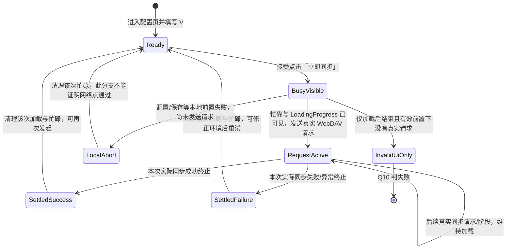

# vg-spec14 验收矩阵

> 1-do 实施更新（2026-10-16）：下文保留0-analyze历史分析。U01–U07的实施选择见[需求复审](../workflow/requirements/do-review-v1.md)；当前实现与11个唯一方法分批通过的证据见[交付索引](../workflow/do-delivery.md)、[逐项验收结果](../workflow/verification/do-results-v1.json)。29项适用条目通过，E03/E13不适用；可选>120秒压力未测。未改写Spec原文或推断官方分值。

日期：2026-10-16。范围：`0-analyze`；需求角色起草、主 Agent 汇合基线实测后复审。编号仅用于本地验收引用。

## 1. 范围、输入与证据规则

本文件为正式分析交付物，依据 `spec/requirement.md` 拆解验收条件，未修改业务代码。基线已独立构建、安装、启动并沿既有界面操作；实测结论、原始日志及未测项集中在 `spec/baseline-notes.md`，不能用本矩阵的静态源码引用代替运行证据。需求初稿保留在 `workflow/requirements/analysis-v1.md`。

已批准输入标识（主 Agent 提供）：

| 输入 | 标识 |
| --- | --- |
| 基线 HEAD / metadata 的 base_commit | `88db8789e28333c7b7dcc8db078f394a262b73c3` |
| `spec/requirement.md` SHA256 | `22ca2ecd1c5749dd8abc972854eee167a3aa3fa0e3cf17ab2a16f424643ae3d4` |
| `spec/metadata.json` SHA256 | `6ace3344962c66300a23b017d435e18bc9d340d8b77eaec478a3f6a96006f920` |

实际只读资料：本题 `spec/requirement.md`、`spec/metadata.json`、`spec-harness/0-analyze.md` 及本题相关基线源码。没有读取题包、其他赛题、上游修复历史或初始化总览会话。首次搜索中匹配到本题 `workflow/setup-code-fingerprint.json` 的文件名和散列行；这些不是需求或功能开发证据，本文件结论不以该记录为依据。

- `SPEC_EXPLICIT`：Spec 原文直接要求，必须实现并验证。
- `REASONABLE_DERIVATION`：由原文的时序、绑定、一致性或前置条件推导；独立编号，不冒充原文。
- `UNCONFIRMED_ASSUMPTION`：Spec 未规定且存在多种合理选择；仅形成决策候选，未确认前不升级为硬性通过条件。
- `CODE_FACT`：本题基线源码可证明的事实。它用于确定现状、选择器与测试入口，不能扩大或降低 Spec 要求。
- `RUNTIME_UNVERIFIED`：对应结论尚无设备执行证据。代码存在某调用，不等于运行时已进入页面、已发送请求或满足可见时序；已完成的基线实测以 `spec/baseline-notes.md` 为准。

官方 F-point 数、权重和隐藏输入未知。本矩阵编号不是官方评分点，也不据场景数推算分值。

## 2. Spec 原文逐字索引

后文引用 Q 编号时，引用的是下表原句；所有引号、中文、`LoadingProgress` 名称与标点均保留原文。Spec 唯一明确的按钮文案是「立即同步」。Spec 没有指定加载中的文字、成功文字、失败文字、Toast、请求方法、具体路径或载荷。

| 引用 | 原文位置 | 原文 |
| --- | --- | --- |
| Q00 | `spec/requirement.md:1` | `# WebDAV 同步进度提示与实际操作保持一致` |
| Q01 | 场景一概述，`spec/requirement.md:7` | 用户点击「立即同步」后，WebDAV 配置页必须在同步运行期间渲染 ArkUI `LoadingProgress` 加载指示器。 |
| Q02 | 场景一步骤1，`spec/requirement.md:11` | 1. 用户进入 WebDAV 配置页，并填写可访问的 WebDAV 配置。 |
| Q03 | 场景一步骤2，`spec/requirement.md:12` | 2. 用户点击「立即同步」按钮。 |
| Q04 | 场景一步骤3，`spec/requirement.md:13` | 3. 页面进入同步忙碌状态。 |
| Q05 | 场景一步骤4，`spec/requirement.md:14` | 4. 页面显示 ArkUI `LoadingProgress` 加载指示器。 |
| Q06 | 场景二概述，`spec/requirement.md:20` | 加载指示器必须和真实的 WebDAV 操作绑定。同步流程必须在忙碌状态可见时向配置的端点发送请求。 |
| Q07 | 场景二步骤1，`spec/requirement.md:24` | 1. 用户点击「立即同步」。 |
| Q08 | 场景二步骤2，`spec/requirement.md:25` | 2. 页面显示同步加载指示器。 |
| Q09 | 场景二步骤3，`spec/requirement.md:26` | 3. 应用向配置的 WebDAV 服务端发送请求。 |
| Q10 | 场景二步骤4，`spec/requirement.md:27` | 4. 如果只有加载状态而没有后端请求，则该功能点不满足要求。 |

## 3. 验收约定与测试证据

1. `V` 表示可访问的受控 WebDAV 配置：设备能访问的端点、可用凭据、该端点要求的可读写目录，以及基线同步所需的同步密码。具体字段由基线得知，不能将基线的字段名、默认目录、密码长度当作 Spec 新增明文要求。基线字段位置见 C03、C06。
2. `N(op)` 表示由本次用户手动同步触发、属于真实 WebDAV 同步流程的请求集合。它不包含测试连接产生的旧请求、自动同步、服务端健康检查或其他线程的请求。请求证据应包含服务端收到时间、端点/路径、方法与响应结果，并能通过隔离端点或清空后的服务端日志归属到本次操作。不得记录明文密码等敏感值。
3. `L(op)` 表示本次操作在 WebDAV 配置页渲染、实际可见的 ArkUI `LoadingProgress`。仅修改布尔变量、只显示文字、放置未显示/零尺寸组件、展示其他组件的转圈效果，均不能证明 Q01/Q05。
4. 强制关系：有效前置下，接受「立即同步」后有 `L(op)`，且 `N(op)` 非空；至少一次真实请求发送时忙碌状态和对应加载指示器已可见。同步仍运行且配置页可见时，加载指示器应持续可见。Spec 没有规定固定最短展示时长、首帧的毫秒预算或超时时长。
5. Hypium 的 UI 断言应检查组件类型、可见性、所在页面、按钮状态和选定端点的配置值。Hypium 的 UI 树本身不能证明服务端收到请求，须与受控服务端日志/抓包等独立网络证据配对。客户端日志可作辅助，但不能单独替代服务器请求证据。
6. 用可控延迟或服务端屏障延长真实请求，稳定采到请求未结束时的 UI。服务端延迟是测试条件，不是要求产品人为延迟，也不能用固定等待后截一张图推断整个时段都可见。快速响应路径也应采集 UI 时序，不能把“太快看不到”当成自动通过。
7. 固定选定端点，隔离或关闭自动同步后清空日志；不要预先点击「测试连接」并把该请求记作手动同步请求。现有自动同步风险见 C10。
8. 本题没有要求验证具体单词/事件冲突合并、全量备份、云端恢复或自动同步功能的全部语义；可用少量数据使手动同步实际运行，但不把这些功能的独立结果扩写成明文验收点。

## 4. 基线代码事实与稳定选择器盘点

以下为 `CODE_FACT` 的静态盘点。入口、忙碌按钮、真实请求及缺少 LoadingProgress 已由基线运行补证，详见 `spec/baseline-notes.md`；未列入运行证据的持久化、失败、离页及超时分支仍为 `RUNTIME_UNVERIFIED`。

| 编号 | 结论 | 本题证据 |
| --- | --- | --- |
| C01 | 首页设置入口调用路由 `pages/SettingsPage`；该路由已登记。 | `entry/src/main/ets/pages/Index.ets:325`；`entry/src/main/resources/base/profile/main_pages.json:7` |
| C02 | 设置总览的「WebDAV 配置」项使用内部 section id `sync`；点击设置 `activeSectionId`；该值为 `sync` 时渲染 `SettingsSyncSection`，并非单独配置页路由。 | `entry/src/main/ets/pages/SettingsPage.ets:41`、`:447`、`:448`、`:527`、`:528` |
| C03 | 目标组件有地址、账号、密码、同步密码、远端目录 5 个输入；通用 Builder 创建 TextInput。 | `entry/src/main/ets/pages/settings/SettingsSyncSection.ets:348`、`:356`、`:370`、`:379`、`:439`、`:440`、`:441`、`:442`、`:443` |
| C04 | 手动同步按钮绑定 `webdavSyncNow()`；忙碌时变成「处理中...」、禁用；其他保存/测试/备份/恢复按钮也使用相同忙碌文案。 | `entry/src/main/ets/pages/settings/SettingsSyncSection.ets:543`、`:553`、`:578`、`:585`、`:586`、`:594`、`:604` |
| C05 | 手动路径先检查 `webdavBusy`，再置 true，写入「正在同步数据...」，等待 100ms，保存当前字段，再等待 50ms，然后调用 `syncIncremental()`；返回或异常后 finally 置 false。 | `entry/src/main/ets/pages/settings/SettingsSyncSection.ets:289`、`:290`、`:291`、`:292`、`:295`、`:298`、`:306`、`:308`、`:315`、`:316` |
| C06 | 保存地址/账号时 trim，空远端目录回退 `/weiyu_sync`；当前字段交给 manager。manager 在开始前检查地址、账号/密码、同步密码，并从 settings 创建 WebDavClient。 | `entry/src/main/ets/pages/settings/SettingsSyncSection.ets:100`、`:102`、`:103`、`:106`、`:109`；`entry/src/main/ets/sync/WebDavSyncManager.ets:164`、`:177`、`:178` |
| C07 | `syncIncremental()` 现有路径先校验、拒绝 manager 正在同步状态、设置 SYNCING、执行远端预检，再执行下载/上传；正常流程 finally 重置 manager IDLE。 | `entry/src/main/ets/sync/WebDavSyncManager.ets:672`、`:676`、`:683`、`:688`、`:692`、`:693`、`:719`、`:775`、`:901`、`:903` |
| C08 | WebDavClient 从配置构建 URL、Basic Auth，并使用 `@ohos.net.http` 的真实 `request.request(url, options)`；客户端设置连接 15000ms、读取 20000ms 超时。这些是基线事实，不是 Spec 规定的方法或时限。 | `entry/src/main/ets/sync/webdav/WebDavClient.ets:6`、`:27`、`:28`、`:30`、`:88`、`:95`、`:128`、`:140`、`:143`、`:144`、`:149` |
| C09 | 本地状态由 `webdav_state_store` Preferences 保存，settings 有主键/备份键；设置页面初始化加载 manager 中的配置。 | `entry/src/main/ets/utils/WebDavStateStore.ets:63`、`:66`、`:67`、`:146`、`:150`；`entry/src/main/ets/sync/WebDavSyncManager.ets:124`、`:142`；`entry/src/main/ets/pages/SettingsPage.ets:163`、`:165`、`:167`、`:190` |
| C10 | 前台事件会尝试自动同步；若不隔离，请求可能被错误归因到手动点击。 | `entry/src/main/ets/entryability/EntryAbility.ets:49`、`:53`、`:54` |
| C11 | 目标 `SettingsSyncSection.ets` 从 `:1` 至 `:693` 没有 `LoadingProgress` 调用，也没有 `.id()`；build 只构建基础配置、自动同步、手动操作卡。故静态代码存在显式组件缺口，但不据此假装已有运行失败截图。 | `entry/src/main/ets/pages/settings/SettingsSyncSection.ets:684`、`:686`、`:687`、`:688`；整文件检索 `LoadingProgress` / `\.id\(` 均无匹配 |
| C12 | 设置页仅根节点使用 `.id('settings_' + this.themeRefreshToken)`，值受主题刷新 token 影响；不是专用同步定位 id。 | `entry/src/main/ets/pages/SettingsPage.ets:565` |
| C13 | 设置页头部返回先从当前 section 回到设置总览，再从总览 router.back；目标子组件 busy 是其局部 `@State`，可能在 section 销毁/重建时丢失。正在同步时返回再进入的运行表现未验证。 | `entry/src/main/ets/pages/SettingsPage.ets:172`、`:173`、`:174`、`:177`、`:178`、`:487`；`entry/src/main/ets/pages/settings/SettingsSyncSection.ets:43` |
| C14 | 页面 timeout 由 `Promise.race` 实现；超时 promise 未看到取消 operation 的代码，UI finally 会清 busy。不能把 race 超时认定为真实同步已经结束；该风险须实测。 | `entry/src/main/ets/pages/settings/SettingsSyncSection.ets:114`、`:116`、`:117`、`:118`、`:120`、`:308`、`:315`、`:316` |
| C15 | 代码已有成功/失败结果和 toast；Spec 不规定这些文字，不能按基线文案扩充硬性文本断言。 | `entry/src/main/ets/pages/settings/SettingsSyncSection.ets:309`、`:310`、`:313`、`:314`；`entry/src/main/ets/sync/WebDavSyncManager.ets:892` |
| C16 | 网络权限已声明；设备是否能访问目标服务、证书是否可用仍需运行验证。 | `entry/src/main/module.json5:15` |

### 4.1 定位符字典

下列 id 都是建议的测试契约名称，**基线中均没有这些固定 `.id()`，需在后续经授权的实现阶段补 `.id()`**；本阶段不补代码，也不把拼写当作 Spec 文案。每条矩阵引用的 S 编号均指本表，不能误认为基线已有 id。若后续方案采用其他固定名字，须同步更新字典与测试。

| S 编号 | 建议固定 id | 对象与基线定位 | 现状与风险 |
| --- | --- | --- | --- |
| S01 | `home_settings_entry` | 首页设置入口；`entry/src/main/ets/pages/index/components/TopNavigation.ets:69`、`:70`、`:79` | 缺失；仅「⚙」文本。 |
| S02 | `settings_webdav_entry` | 设置总览 `sync` 项；`entry/src/main/ets/pages/SettingsPage.ets:41`、`:511`、`:527` | 缺失；ForEach 数据字段 `id: 'sync'` 及 keyGenerator 不等于组件 `.id()`。 |
| S03 | `webdav_config_page` | 配置区根容器；`entry/src/main/ets/pages/settings/SettingsSyncSection.ets:684`、`:685` | 缺失；根 `settings_<token>` 只可辅助定位，不能确认当前 section。 |
| S04 | `webdav_endpoint_input` | 地址 TextInput；同文件 `:356`、`:439` | 缺失；需给具体输入实例稳定 id，不依赖 Builder 的通用类型/相对序号。 |
| S05 | `webdav_username_input` | 账号 TextInput；同文件 `:356`、`:440` | 缺失；不能仅按 TextInput 类型查找。 |
| S06 | `webdav_password_input` | 密码 TextInput；同文件 `:379`、`:441` | 缺失；密码文字通常不可直接作为文本选择器。 |
| S07 | `webdav_sync_password_input` | 同步密码 TextInput；同文件 `:379`、`:442` | 缺失；与普通密码均可能为 Password 类型。 |
| S08 | `webdav_remote_root_input` | 远端目录 TextInput；同文件 `:356`、`:443` | 缺失；默认值不能作为永久 id。 |
| S09 | `webdav_sync_now_button` | 手动同步 Button；同文件 `:578`、`:586` | 缺失；闲时「立即同步」可辅助，忙时「处理中...」有 5 个同名按钮。 |
| S10 | `webdav_sync_loading` | 对应手动同步的 ArkUI LoadingProgress | 组件和 id 均缺失，需在实现时补组件及 `.id()`；还须断言组件类型及可见性，id 自身不证明类型。 |
| S11 | `webdav_action_result` | 同步结果 Text；同文件 `:567`、`:568` | 缺失；动态文本变化，且非 Spec 固定文案。 |
| S12 | `settings_back_button` | 设置页头部返回；`entry/src/main/ets/pages/SettingsPage.ets:484`、`:487` | 缺失；仅「←」，其他页面可能同名。 |
| S13 | `webdav_test_button` | 测试连接 Button；`entry/src/main/ets/pages/settings/SettingsSyncSection.ets:553` | 缺失；忙时同名「处理中...」。 |
| S14 | `webdav_auto_sync_toggle` | 自动同步 Toggle；同文件 `:419`、`:466` | 缺失；有多个 Toggle，建议稳定定位以隔离自动请求。 |
| S15 | `webdav_save_button` | 保存设置 Button；同文件 `:543` | 缺失；忙时同名「处理中...」。 |

基线可用于探索的文本不是稳定 id。网络请求的归属标识由测试环境关联记录提供，不建议为了测试向产品协议强加 Spec 没有要求的请求头。

## 5. 按场景、步骤拆分的原子验收项

以下每项完整列出八维。遇到“不适用”均说明原因；“数据结果不适用”仅指 Spec 没有新增业务数据语义，不代表允许用假请求替换真实同步。

### A01 进入 WebDAV 配置区域

- 来源：场景一步骤1，Q02，`spec/requirement.md:11`。
- 证据等级：`SPEC_EXPLICIT`。
- 原子行为：用户能够进入 WebDAV 配置页。
- 可观察结果：沿当前应用流程进入后，配置区及其输入、手动同步入口可定位，当前标题/区域为「WebDAV 配置」（该标题文字来自 C02，不是 Spec 新增精确标题要求）。
- 稳定选择器：S01、S02、S03、S09，均基线缺失，需在实现时补 `.id()`。

| 维度 | 内容 |
| --- | --- |
| 入口 | 首页设置入口 → `pages/SettingsPage` → `sync` 区；C01/C02 的既有入口已由本轮基线运行验证，见 `spec/baseline-notes.md`。 |
| 前置数据 | 已安装并可启动的应用；不要求先有学习记录。 |
| 用户动作 | 打开设置，点击「WebDAV 配置」。 |
| UI 结果 | 配置区实际可见，可继续填写与触发同步。 |
| 数据结果 | 不适用：进入步骤未规定修改或持久化业务数据。 |
| 网络结果 | 不适用：Spec 未要求单纯进入即手动同步；环境需隔离 C10 自动同步。 |
| 返回结果 | 不适用：本步尚未返回；返回再进入另见 E11/E12。 |
| 边界条件 | 首次安装无配置/无学习数据仍可进入；不能要求先完成其他同步作为入口前置。 |

### A02 填写可访问的 WebDAV 配置

- 来源：场景一步骤1，Q02，`spec/requirement.md:11`。
- 证据等级：`SPEC_EXPLICIT`。
- 原子行为：用户可以填写本次手动同步要使用的可访问 WebDAV 配置。
- 可观察结果：输入操作生效；下一步同步能使用该端点。密码等可用后续请求认证成功间接验证，不要求明文显示。
- 稳定选择器：S03～S08，基线缺失，需在实现时补 `.id()`。

| 维度 | 内容 |
| --- | --- |
| 入口 | A01 的 WebDAV 配置区。 |
| 前置数据 | 受控服务器提供 V；设备可访问且有相应权限。 |
| 用户动作 | 填写地址、凭据及现有同步所需配置；基线 5 字段见 C03。 |
| UI 结果 | 输入框接受用户输入并可发起下一步。 |
| 数据结果 | 当前操作配置更新；Spec 未要求独立点击「保存设置」或规定持久化格式。 |
| 网络结果 | 填写本身不要求请求；后续请求须指向所填写的配置，见 B04。 |
| 返回结果 | 不适用：未返回；离开/重启后的保存语义见 U06。 |
| 边界条件 | 覆盖首次填写及覆盖已有端点；空/纯空格导致端点或凭据不可用时不满足“可访问”前置，见 E01/E02。远端目录空白会按 C06 回退默认目录，仍可能形成有效配置，不能一概判无效。 |

### A03 点击「立即同步」发起手动流程

- 来源：场景一步骤2，Q03，`spec/requirement.md:12`。
- 证据等级：`SPEC_EXPLICIT`。
- 原子行为：用户点击「立即同步」启动对应手动同步流程。
- 可观察结果：通过该按钮点击后进入 A04/A05，而不是要求改从测试连接或其他后台入口触发。
- 稳定选择器：S09、S10，基线缺失；S10 组件也缺失，需在实现时补 `.id()`。

| 维度 | 内容 |
| --- | --- |
| 入口 | A02 完成的配置区手动同步按钮。 |
| 前置数据 | V；没有其他正在运行的同步，避免并发歧义干扰基本路径。 |
| 用户动作 | 单击「立即同步」。 |
| UI 结果 | 页面进入忙碌、渲染加载指示器；不能只响应点击后维持闲置。 |
| 数据结果 | 启动本次 op；不单独要求产生某条学习数据。 |
| 网络结果 | 本次流程必须产生 B03 的真实请求；点击本身不是请求已发送证据。 |
| 返回结果 | 不适用：本步没有返回动作。 |
| 边界条件 | 重复/快速点击见 E05/E06；Spec 没有规定每个被忙碌屏蔽的物理点击都另建操作。 |

### A04 页面进入同步忙碌状态

- 来源：场景一步骤3，Q04，`spec/requirement.md:13`；结合 Q01。
- 证据等级：`SPEC_EXPLICIT`。
- 原子行为：接受手动同步后，页面显示与正在执行的同步关联的忙碌状态。
- 可观察结果：忙碌状态实际在 UI 上可见，并与 A05 的加载指示器属于同次同步；私有 `webdavBusy=true` 的日志不能单独证明。
- 稳定选择器：S03、S09、S10；均缺失，需在实现时补 `.id()`。

| 维度 | 内容 |
| --- | --- |
| 入口 | A03 的按钮动作。 |
| 前置数据 | V；受控服务端令操作保持未结束。 |
| 用户动作 | 点击后观察请求期间页面。 |
| UI 结果 | 同步忙碌状态可见；不强制某种忙碌文字，按钮禁用是 C04 现状并非 Spec 明文。 |
| 数据结果 | UI 状态与当前运行 op 对应，不能由无关状态替代。 |
| 网络结果 | 忙碌可见时要有属于 op 的请求；详见 B05。 |
| 返回结果 | 不适用：留在当前页；恢复见 D01/D02。 |
| 边界条件 | 连通慢响应不能只开始时闪过忙碌就提前结束；不规定固定展示时长。 |

### A05 渲染 ArkUI LoadingProgress

- 来源：场景一步骤4，Q05，`spec/requirement.md:14`。
- 证据等级：`SPEC_EXPLICIT`。
- 原子行为：同步运行时显示 ArkUI `LoadingProgress` 组件。
- 可观察结果：目标配置区 UI 树可定位到可见的 `LoadingProgress`；同时保留类型与可见性证据。仅 S10 id 或“正在同步数据...”文字不能通过本项。
- 稳定选择器：S03、S10；LoadingProgress 及 id 均缺失，需在实现时补 `.id()`。

| 维度 | 内容 |
| --- | --- |
| 入口 | A03 后的 WebDAV 配置区。 |
| 前置数据 | V；op 尚未结束，页面在前台可见。 |
| 用户动作 | 发起后采样 UI 树/屏幕。 |
| UI 结果 | 实际显示 ArkUI `LoadingProgress`；文字、自绘替代或其他页的同类组件均不足。 |
| 数据结果 | 不适用：本项检验组件渲染，不规定同步数据格式。 |
| 网络结果 | 本项不独立证明请求，必须和 B03 联合验收。 |
| 返回结果 | 不适用：未离页。 |
| 边界条件 | 零尺寸、隐藏、被遮挡、屏幕外的组件不算“显示”；应在当前配置区的可见同步状态中呈现。 |

### A06 同步运行期间持续显示

- 来源：场景一概述 Q01，`spec/requirement.md:7`。
- 证据等级：`SPEC_EXPLICIT`。
- 原子行为：同步仍在运行且该页可见期间，加载指示器持续反映运行状态。
- 可观察结果：服务端屏障保持请求未结束时多次观察仍可见；多阶段同步在操作尚未终止时不出现假的“已空闲”区间。
- 稳定选择器：S03、S10，基线缺失，需在实现时补 `.id()`。

| 维度 | 内容 |
| --- | --- |
| 入口 | A05 可见的运行中页面。 |
| 前置数据 | V；服务端控制 op 中一项或多项请求延迟，UI 保持前台。 |
| 用户动作 | 保持页面并在请求前、请求等待中及后续阶段观察。 |
| UI 结果 | 同步运行期间 `LoadingProgress` 持续可见；不以固定 timer 到点清除。 |
| 数据结果 | 忙碌生命周期覆盖本次实际操作，不由临时文字更新决定。 |
| 网络结果 | 请求前配置准备、请求等待、后续阶段均须属于真实 op；本项不要求所有时间点都有在途 TCP 包。 |
| 返回结果 | 实际结束后恢复另见 D01/D02；离开页面后的策略见 U05。 |
| 边界条件 | 慢请求、多个顺序请求、部分阶段失败、超时但底层仍运行见 E08/E09/E10。 |

### B01 场景二也由「立即同步」触发

- 来源：场景二步骤1，Q07，`spec/requirement.md:24`。
- 证据等级：`SPEC_EXPLICIT`。
- 原子行为：场景二网络验证从点击同一个「立即同步」入口开始。
- 可观察结果：服务端记录的增量请求能够归属到本次按钮动作；不能换成「测试连接」或自动同步。
- 稳定选择器：S09、S13、S14；均缺失，需在实现时补 `.id()`。

| 维度 | 内容 |
| --- | --- |
| 入口 | WebDAV 配置区的「立即同步」。 |
| 前置数据 | V；已清空服务端日志并隔离自动同步和测试连接请求。 |
| 用户动作 | 单击「立即同步」。 |
| UI 结果 | 本次触发对应 B02 的加载指示器。 |
| 数据结果 | 为本次观察创建测试侧动作关联记录，不要求产品新增数据字段。 |
| 网络结果 | 仅统计动作后归属于 op 的真实同步请求。 |
| 返回结果 | 不适用：本步无返回。 |
| 边界条件 | 动作前已有历史请求、自动同步在前台触发的请求不能冒充该次成功证据。 |

### B02 请求流程显示同步加载指示器

- 来源：场景二步骤2，Q08，`spec/requirement.md:25`；组件类型由 Q01/Q05 共同约束。
- 证据等级：`SPEC_EXPLICIT`。
- 原子行为：本次真实同步请求流程在配置页显示同步加载指示器。
- 可观察结果：与 B01 同次动作对应的 S10 类型为 ArkUI `LoadingProgress` 且可见。
- 稳定选择器：S03、S10；均缺失，需在实现时补 `.id()`。

| 维度 | 内容 |
| --- | --- |
| 入口 | B01 的手动动作后。 |
| 前置数据 | V；可控延迟服务器，用于观察绑定时序。 |
| 用户动作 | 点击后等待进入可见忙碌并观察。 |
| UI 结果 | 配置区出现本次同步的加载指示器。 |
| 数据结果 | 不适用：本项不单独规定业务数据变更。 |
| 网络结果 | 加载期间必须同时执行 B03/B05，不能停留在只显示 UI。 |
| 返回结果 | 不适用：没有离页动作。 |
| 边界条件 | 别的操作产生的 spinner 或仅挂载不可见组件均不能充当本次指示器。 |

### B03 发送真实 WebDAV 请求

- 来源：场景二步骤3，Q09，`spec/requirement.md:26`；结合 Q06。
- 证据等级：`SPEC_EXPLICIT`。
- 原子行为：应用执行真实 WebDAV 操作并向服务端发送请求。
- 可观察结果：受控服务端观测到 `N(op)` 非空；仅进入 manager、打印日志、更新 UI、调用本地 mock 均不能替代。
- 稳定选择器：UI 关联用 S09、S10，基线缺失；网络侧使用测试服务端记录，不是 UI `.id()`。

| 维度 | 内容 |
| --- | --- |
| 入口 | B01 的「立即同步」动作。 |
| 前置数据 | V；服务器已监听且设备可达。 |
| 用户动作 | 点击并保持操作进行，服务端记录收到的请求。 |
| UI 结果 | B02/A06 的指示器在实际同步运行时可见。 |
| 数据结果 | 真实同步工作被执行；Spec 未指定本项必须改动某个对象或必须上传特定字节。 |
| 网络结果 | 服务端实际收到属于 op 的 WebDAV 请求；不冻结 HEAD/GET/PUT 等方法、次数、具体路径或载荷。 |
| 返回结果 | 成功/失败终止后的恢复见 D01/D02；响应不必保证成功才能证明曾发送请求。 |
| 边界条件 | 空数据也不能无条件以本地空操作替代网络，见 D03；失败场景须区分“已发送但失败”和“未发出”。 |

### B04 请求发送到当前配置的端点

- 来源：场景二概述 Q06、步骤3 Q09，`spec/requirement.md:20`、`:26`。
- 证据等级：`SPEC_EXPLICIT`。
- 原子行为：请求目的地与用户配置的 WebDAV 服务端对应。
- 可观察结果：用不同受控端点 A/B，选定 B 后 B 日志收到本次请求，不能以硬编码 A 的请求充数；允许基线合法相对路径拼接，不要求 URL 与输入字符串逐字完全相等。
- 稳定选择器：S04～S09，均缺失，需在实现时补 `.id()`；配对服务端端点标识。

| 维度 | 内容 |
| --- | --- |
| 入口 | A02 配置后的手动同步。 |
| 前置数据 | 两个可区分且可达的受控端点；填写本次选定的 V。 |
| 用户动作 | 填写/更换端点后点击「立即同步」。 |
| UI 结果 | 选定端点配置可确认，随后显示对应加载状态。 |
| 数据结果 | 本次使用当前配置，不偷偷沿用旧端点或固定服务。 |
| 网络结果 | `N(op)` 的目标归属到配置端点；合法路径和重定向语义未规定，见 U01。 |
| 返回结果 | 不适用：本项不规定离页保存；重进语义见 U06。 |
| 边界条件 | 首次填写、覆盖旧配置、末尾斜杠等测试见 E14；具体规范化策略不凭 Spec 编造。 |

### B05 可见忙碌与真实请求有正确时序绑定

- 来源：场景二概述 Q06，`spec/requirement.md:20`；步骤2/3 Q08/Q09。
- 证据等级：`SPEC_EXPLICIT`。
- 原子行为：真实同步请求发生时，忙碌和加载状态已经在配置页可见。
- 可观察结果：保留 UI 时间序列与服务端请求时间序列，证明至少一次本次请求发送处于可见忙碌时段；不能请求完成后才补放 spinner。
- 稳定选择器：S03、S09、S10，均缺失，需在实现时补 `.id()`；独立网络事件时间。

| 维度 | 内容 |
| --- | --- |
| 入口 | B01 之后的同次同步。 |
| 前置数据 | V；受控服务端延迟或屏障，统一/可关联的时间记录。 |
| 用户动作 | 单击后观察第一次真实请求和后续运行。 |
| UI 结果 | 真实请求发生时已可见忙碌及 `LoadingProgress`，并按 A06 保持到实际运行结束。 |
| 数据结果 | UI 与请求属于同一 op；不能分别取自两次操作凑证据。 |
| 网络结果 | 存在真实 `N(op)`，其时序与可见忙碌重叠。 |
| 返回结果 | 不适用：请求时序阶段未返回；结束恢复见 D01/D02。 |
| 边界条件 | 极快响应也不能用事后 spinner 满足；采样不足应标“未验证”，不能把截图缺失当作通过。 |

### B06 只有加载而没有请求判为不满足

- 来源：场景二步骤4，Q10，`spec/requirement.md:27`。
- 证据等级：`SPEC_EXPLICIT`。
- 原子行为：拒绝用纯 UI 加载效果代替后端操作的结果。
- 可观察结果：有效可达前置下，观察到加载但整个 op 没有对应服务端请求，场景二必须失败；不能仅因 spinner 测试通过就判整题通过。
- 稳定选择器：S09、S10，均缺失，需在实现时补 `.id()`；服务端空日志的完整观测窗口。

| 维度 | 内容 |
| --- | --- |
| 入口 | B01 的有效手动同步流程。 |
| 前置数据 | V；先确认网络环境可达、隔离自动请求、记录动作前日志基线。 |
| 用户动作 | 点击并观察直到该 op 实际结束或明确异常终止。 |
| UI 结果 | 即使出现加载 UI，也不能抵消无真实请求的失败。 |
| 数据结果 | 本地改变状态/构造成功结果不作为后端请求证据。 |
| 网络结果 | 若 `N(op)` 为空则不通过；须先排除监听错误/错误端点，避免测量假阴性。 |
| 返回结果 | 不适用：该项是验收判据；状态恢复依然由 D01/D02 单独验证。 |
| 边界条件 | 缺失配置不是 V，不能用无效配置场景替代此反例；有效配置保存失败须单独记录环境/产品失败，不能当作网络点通过。 |

### D01 实际同步成功结束后恢复非忙碌

- 来源：Q00/Q01/Q06，`spec/requirement.md:1`、`:7`、`:20`。
- 证据等级：`REASONABLE_DERIVATION`；Spec 要求与运行保持一致，但没有逐字规定成功清理、按钮文字或内部枚举。
- 原子行为：本次实际同步结束后，页面不再保持该次运行的加载/忙碌。
- 可观察结果：成功终止后 S10 隐藏或卸载，页面可再次接受有效手动同步；不强制某个成功 Toast 或“同步完成”文本。
- 稳定选择器：S09、S10、辅助 S11，均缺失，需在实现时补 `.id()`。

| 维度 | 内容 |
| --- | --- |
| 入口 | A/B 各项正在运行的流程。 |
| 前置数据 | V；服务器完成请求，实际同步流程已经成功返回。 |
| 用户动作 | 等待真实完成后观察，再点一次手动同步验证可用性。 |
| UI 结果 | 该次加载消失，忙碌结束，可发起新一轮；不要求特定清理实现。 |
| 数据结果 | 仅要求操作状态复原，不规定 manifest 数值或同步数据内容。 |
| 网络结果 | 原 op 不再运行；再次接受的 op 再有自身请求。 |
| 返回结果 | 成功回到可操作配置区；没有要求跳转到其他页面。 |
| 边界条件 | 第一次点击后已无变更，第二次仍应按 D03 做真实同步；多请求未全结束不提前按成功清理。 |

### D02 实际同步失败/异常终止后恢复非忙碌

- 来源：Q00/Q01/Q06，`spec/requirement.md:1`、`:7`、`:20`。
- 证据等级：`REASONABLE_DERIVATION`；失败文案、失败码与取消协议均非明文。
- 原子行为：实际同步已经失败终止后解除该次忙碌，保留重试能力。
- 可观察结果：受控 HTTP 失败或异常路径终止后，加载不永久旋转；将服务器恢复后能再触发真实同步。
- 稳定选择器：S09、S10、辅助 S11，均缺失，需在实现时补 `.id()`。

| 维度 | 内容 |
| --- | --- |
| 入口 | 已接受的手动同步。 |
| 前置数据 | V 的地址/凭据格式完整；服务器在接到请求后受控失败。 |
| 用户动作 | 点击；待失败实际终止；恢复服务器后重试。 |
| UI 结果 | 终止后加载消失、恢复可操作；反馈文字不作 Spec 精确文本断言。 |
| 数据结果 | 状态清理；不强制事务回滚、冲突处理或部分数据变更语义。 |
| 网络结果 | 保留失败请求证据；重试属于新 op 且有真实请求，不能只重放失败 UI。 |
| 返回结果 | 留在可恢复配置流程；不指定错误后强制导航。 |
| 边界条件 | 401/403/500、断连、异常等为测试样本；超时仅在底层真实终止/已取消后才按终止处理，见 U07。 |

### D03 无本地变更仍执行真实同步

- 来源：Q02/Q06/Q09/Q10，`spec/requirement.md:11`、`:20`、`:26`、`:27`。
- 证据等级：`REASONABLE_DERIVATION`；Spec 只限定可访问配置，没有要求先有数据/变更。
- 原子行为：可访问配置下，即使没有本地学习数据或新增变更，手动同步仍实际访问端点。
- 可观察结果：空数据或连续第二次同步时都有属于该次 op 的真实请求，并在运行时显示加载；不强制无变更时上传空文件。
- 稳定选择器：S09、S10，均缺失，需在实现时补 `.id()`；服务端请求记录。

| 维度 | 内容 |
| --- | --- |
| 入口 | 配置区「立即同步」。 |
| 前置数据 | V；本地空数据或前次同步后没有新增变更；远端可为空但目录可访问。 |
| 用户动作 | 单击或前次结束后再次单击。 |
| UI 结果 | 真实运行时加载可见，实际结束后恢复。 |
| 数据结果 | 可以没有业务数据变化；不能为触发请求而伪造用户数据。 |
| 网络结果 | `N(op)` 仍非空；预检/读取等真实同步请求可被记录，具体方法和完整算法不冻结。 |
| 返回结果 | 正常终止后可继续操作。 |
| 边界条件 | 本地空、远端空、本地和远端均空、无新增变更分别覆盖；远端目录不可访问转失败用例。 |

### D04 仅填写或进入不作为本次手动同步请求证据

- 来源：Q02/Q03/Q07/Q06，`spec/requirement.md:11`、`:12`、`:24`、`:20`。
- 证据等级：`REASONABLE_DERIVATION`；是动作归因约束，不禁止 Spec 之外已有的自动同步。
- 原子行为：区分点击前其他动作的网络与当前手动同步请求。
- 可观察结果：记录点击前后两段日志；加载及请求证据只能来自已接受的该次同步，不能复用点击前的网络记录。
- 稳定选择器：S02、S04～S09、S13、S14，均缺失，需在实现时补 `.id()`。

| 维度 | 内容 |
| --- | --- |
| 入口 | 进入配置区或编辑配置阶段。 |
| 前置数据 | 受控端点日志可分段；已标记自动同步/测试连接活动。 |
| 用户动作 | 只进入、只编辑、或单独测试连接；随后明确记录手动按钮动作。 |
| UI 结果 | 不将其他操作的指示器作为 A/B 通过证据。 |
| 数据结果 | 当前输入可以改变，但这不证明手动同步已执行。 |
| 网络结果 | 点击前记录不计入 `N(op)`；不强制产品绝不执行其他合法请求。 |
| 返回结果 | 不适用：本项仅校验归因。 |
| 边界条件 | 自动同步恰好在同一秒发起时，应通过独立端点/隔离重测解决，不能直接通过。 |

## 6. 网络与可见状态机

状态机使用需求语义，**不强制生产代码采用这些枚举/类名**。实线为基本同步契约，成功/失败恢复属于 D01/D02；离页、取消、超时如何真正终止见 U05/U07。

| 动作/事件 | 是否触发本题要求的真实请求 | LoadingProgress 与状态约束 | 请求结束/恢复 |
| --- | --- | --- | --- |
| 进入 WebDAV 配置区 | Spec 未要求；基线自动请求须隔离。 | 本身不是手动加载证据。 | 无 op，无需套用本次结束清理。 |
| 填写/改字段 | Spec 未要求立即请求。 | 输入过程不代替手动同步运行。 | 不把编辑结果当作同步完成。 |
| 「保存设置」 | 不是 Spec 的手动同步触发动作；C05 手动流程会自行保存。 | 不用保存的忙碌作为该次同步证据。 | 保存失败若阻止网络，记为前置失败，不判网络点通过。 |
| 「测试连接」 | 可能真实请求，但不计入本次 `N(op)`。 | 不能用测试连接转圈替代本题「立即同步」指示器。 | 测试完成后清空日志再测手动。 |
| 闲置且 V，点击「立即同步」 | 必须触发本次真实 WebDAV 同步请求。 | 先进入可见忙碌，渲染 ArkUI LoadingProgress；真实请求时可见。 | 后续按真实终止清理。 |
| 同步真实请求等待中 | 可以还没有响应；不得以等待等同已结束。 | 页面可见时保持加载，不能固定时间到点隐藏。 | 请求失败/成功后的整次同步终止才清理该次状态。 |
| 第一个请求已完成，后续阶段未完成 | 可能还会有后续请求；不强制请求数。 | 整次同步仍运行，继续显示。 | 不以第一条响应取代整次结束。 |
| 成功终止 | 该 op 不再产生工作；新点击为新 op。 | D01：清加载/忙碌。 | 可再次操作；成功文案未指定。 |
| HTTP 失败/网络异常且实际终止 | 已发送的失败请求仍应保留证据。 | D02：终止后恢复；不得永久转圈。 | 可以修正环境后重试；失败文案未指定。 |
| 空/纯空格配置下点击 | 未满足 V；Spec 未指定该分支是否请求，不能当作 B03 通过样本。 | 若曾进入忙碌，实际拒绝终止后应恢复（推导）。 | 具体校验与文案见 U02/U03。 |
| 忙碌期间重复点击/快速连点 | Spec 未指定忽略、禁用、排队或并发。 | 现存真实 op 仍运行时不能错误清掉加载；每个被接受的 op 都受绑定约束。 | 选定并发策略见 U04；不能擅自断言恰好一次请求。 |
| 返回/切区/关闭页面 | Spec 未指定取消还是继续。 | 留页期间适用强制约束；不要求不存在的页面渲染。重进时须识别是否仍有真实操作（推导，策略待确认）。 | 见 U05；不要把页面销毁当成已取消网络的证据。 |
| UI timeout/race 胜出 | 不自动等于底层请求被取消。 | 若实际操作仍运行且页可见，不能声称已完成；基线 C14 待实测。 | 超时值、取消/继续策略见 U07；不凭 timer 自动宣告契约满足。 |

禁止通过形态：只把 `webdavBusy` 设 true → 等待固定时间 → 设 false；或先发完请求 → 之后显示指示器。两者分别违背 Q10 或 Q06。

## 7. 边界穷举与证据等级

这些是本题适用边界清单，不把与本题无关的通用边界生造成功能。每条列全八维；对 Spec 未规定的分支明确保留假设等级。

### E01 空输入

- 来源：Q02（`spec/requirement.md:11`）的可访问前置；基线 C06。证据等级：`UNCONFIRMED_ASSUMPTION`，关联 U02/U03。
- 原子行为/可观察：分别清空地址、账号、密码、同步密码后点击，观察是否本地拒绝、是否有请求、结束后是否恢复；具体拒绝规则和文案不能作 Spec 硬断言。选择器：S04～S10/S11，均需补 `.id()`。
- 八维：入口＝配置区；前置数据＝一个必需字段为空，其余为 V；用户动作＝点击「立即同步」；UI 结果＝记录校验/加载与恢复，不冻结文案；数据结果＝不将空值构造的假成功当同步；网络结果＝未满足 V，不能拿无请求判 B03 基本路径失败或通过；返回结果＝本地拒绝终止后应可修正再试（推导）；边界条件＝逐字段空值及全部为空，不测试时混淆为可访问配置。

### E02 纯空格输入

- 来源：Q02（`:11`）；C06。证据等级：`UNCONFIRMED_ASSUMPTION`，关联 U02。
- 原子行为/可观察：分别给地址/账号/密码/同步密码/远端目录填纯空格，记录处理及真实请求；Spec 未指定 trim 或默认目录。选择器：S04～S10，均需补 `.id()`。
- 八维：入口＝配置区；前置数据＝指定字段仅空格，其余 V；用户动作＝输入并点击；UI 结果＝记录是否拒绝、是否忙碌及何时恢复；数据结果＝记录规范化，不强制密码 trim；网络结果＝凭据不可用/地址空时不满足 V，结果与基本路径分离；返回结果＝可修正后重新测有效路径；边界条件＝空白与空串分开，远端目录回退是 C06 事实而非明文要求。

### E03 取消

- 来源：Spec Q03/Q07（`:12`、`:24`）仅有「立即同步」。证据等级：`UNCONFIRMED_ASSUMPTION`，关联 U05。
- 原子行为/可观察：**显式取消同步按钮不适用**：Spec 未要求，基线手动同步路径 C05 无确认弹窗/取消入口；不新增取消功能作为验收门槛。选择器：如未来有取消入口需另行登记，目前无该 id。
- 八维：入口＝不适用，当前没有同步取消入口；前置数据＝不适用，不能构造不存在的确认对话框；用户动作＝不适用，Spec 无取消操作；UI 结果＝不要求新增取消 UI；数据结果＝不适用，无取消语义；网络结果＝不规定取消请求；返回结果＝返回/离页另见 E04/E11；边界条件＝不要误把「从云端恢复」的取消对话框纳入本题手动同步取消。

### E04 关闭/离开页面

- 来源：Q01/Q06（`:7`、`:20`）运行绑定；基线 C13。证据等级：`UNCONFIRMED_ASSUMPTION`，关联 U05。
- 原子行为/可观察：请求等待时切离配置区、返回首页或把应用放后台，记录真实操作继续/取消及恢复前台状态；Spec 未指定离页策略。选择器：S03/S09/S10/S12，均需补 `.id()`。
- 八维：入口＝运行中的配置区；前置数据＝V，服务器保持请求未完成；用户动作＝返回/切区/后台再前台；UI 结果＝离开后不要求该页渲染，重进需记录是否有仍运行的 op；数据结果＝不擅定取消/回滚/恢复策略；网络结果＝记录请求实际终止或继续，不能由组件消失推断已取消；返回结果＝同一会话重进时验证契约，见 E11；边界条件＝系统返回、页头返回、切 section、后台应区分记录，进程强杀见 E12。

### E05 重复点击（忙碌中再次点击）

- 来源：Q01/Q06（`:7`、`:20`）；基线 C04/C05/C07。证据等级：`UNCONFIRMED_ASSUMPTION`，并发策略见 U04；持续显示约束仍为 A06 明文。
- 原子行为/可观察：第二次点击不得导致尚在执行的真实同步错误结束加载；是否接受第二次操作按待选策略记录。选择器：S09/S10，均需补 `.id()`，不得用同名「处理中...」定位。
- 八维：入口＝运行中的手动同步；前置数据＝V，第一 op 未结束；用户动作＝间隔再点击按钮；UI 结果＝若第一 op 仍运行则加载持续；数据结果＝记录接受的 op 数，不强制 1 或 2；网络结果＝每个被接受 op 均须真实绑定，不用物理点击数断言请求数；返回结果＝所有实际运行操作结束后恢复（推导）；边界条件＝禁用、忽略、排队、并发均未被 Spec 指定，C04/C05 的防重复现状优先保留但非明文。

### E06 快速连点

- 来源：Q01/Q06（`:7`、`:20`）；C04/C05。证据等级：`UNCONFIRMED_ASSUMPTION`，关联 U04。
- 原子行为/可观察：对按钮连续快速点击，检查状态和请求是否始终对应被接受的操作。选择器：S09/S10，均需补 `.id()`。
- 八维：入口＝闲置配置区；前置数据＝V，服务端慢响应；用户动作＝连续快速点击；UI 结果＝已接受的同步运行时保持真实可见加载，不被后一次快速返回清除；数据结果＝记录实际接收操作，避免凭猜测要求去重/队列；网络结果＝记录同一观测窗口所有请求并归因，不冻结次数；返回结果＝实际终止后恢复；边界条件＝首个 UI 帧出现前的双击、已 busy 后多次点击分别观察，具体节流间隔未规定。

### E07 无数据/无变更

- 来源：D03，Q02/Q06/Q09/Q10（`:11`、`:20`、`:26`、`:27`）。证据等级：`REASONABLE_DERIVATION`。
- 原子行为/可观察：本地空/远端空或前次完成后没有新增变更，也有真实请求与可见加载。选择器：S09/S10，均需补 `.id()`。
- 八维：入口＝已配置的手动同步；前置数据＝V，分别空本地、空远端、双方空、无变更；用户动作＝点击；UI 结果＝真实运行期间显示 LoadingProgress；数据结果＝允许数据无变化，不凭空造记录；网络结果＝本次 `N(op)` 非空；返回结果＝终止后恢复；边界条件＝空数据与不可访问/不存在目录分开，后者是失败配置/服务条件。

### E08 请求失败

- 来源：A06/B03/B05/D02，Q01/Q06/Q09（`:7`、`:20`、`:26`）。证据等级：`REASONABLE_DERIVATION`，失败精确反馈另见 U03。
- 原子行为/可观察：服务器收到请求后返回 401/403/500 或受控断连，检查真实等待期 loading 以及失败终止清理。选择器：S09/S10/S11，均需补 `.id()`。
- 八维：入口＝手动同步；前置数据＝配置完整，服务器可达并设定受控失败；用户动作＝点击、等待实际失败终止；UI 结果＝未终止时加载、终止后恢复，不限定错误文字；数据结果＝不强制失败回滚全部历史操作；网络结果＝保留实际请求与失败响应，区分连接前失败；返回结果＝修正服务后可重试；边界条件＝HTTP 失败、网络断连、客户端异常分别记录，完全不可达时用客户端网络错误辅助说明，不能伪造服务端已收到。

### E09 部分操作完成

- 来源：Q01/Q06（`:7`、`:20`）；C07 的多阶段路径。证据等级：`REASONABLE_DERIVATION`（运行期间持续显示本身为 A06 明文）。
- 原子行为/可观察：第一请求/阶段完成但后续仍运行时，加载继续；后续失败终止时才恢复。选择器：S09/S10，均需补 `.id()`。
- 八维：入口＝真实运行的手动同步；前置数据＝V；服务器允许前一阶段完成并延迟/失败后一阶段；用户动作＝点击并等待跨阶段；UI 结果＝中间阶段未完成整个 op 时不清加载；数据结果＝记录可能有部分变更，不强制事务回滚或全量备份；网络结果＝顺序记录各实际请求，次数和算法阶段名非 Spec 契约；返回结果＝整次 op 实际终止后恢复；边界条件＝第一条响应成功不等于同步完成，导入/导出计算阶段也属于仍运行时段。

### E10 慢响应、极快响应、超时

- 来源：Q01/Q06（`:7`、`:20`）；C14。证据等级：`REASONABLE_DERIVATION`（持续绑定）；具体超时/取消为 `UNCONFIRMED_ASSUMPTION` U07。
- 原子行为/可观察：慢响应期间持续加载；极快响应保留时序证据；UI timeout 不得冒充底层实际结束。选择器：S09/S10/S11，均需补 `.id()`。
- 八维：入口＝手动同步；前置数据＝V，服务端提供立即响应、延迟响应、在途未结束样本；用户动作＝点击并捕获时间线；UI 结果＝请求发送时 loading 可见，实际仍运行时不假闲置；数据结果＝记录 op 生命周期，不能只看 race promise；网络结果＝关联服务端实际结束/断连时间，timeout 阈值未指定；返回结果＝实际终止后恢复，取消/继续方案待确认；边界条件＝不强加 100/50ms 延迟、120s 超时或最短展示毫秒数，采不到极短状态标未验证并改善采样。

### E11 返回后重进

- 来源：Q01/Q06（`:7`、`:20`）；C13。证据等级：`REASONABLE_DERIVATION`（重进后仍执行同一有效手动动作应满足原契约）；运行中离页行为为 U05。
- 原子行为/可观察：先在已完成/已失败终止后返回重进，再有效点击，仍有 LoadingProgress 和真实请求；运行中返回重进另记录生命周期歧义。选择器：S02/S03/S09/S10/S12，均需补 `.id()`。
- 八维：入口＝设置 section/设置总览/首页之间既有返回路径；前置数据＝分别已成功、已失败、仍运行的 op；用户动作＝返回再进入并在实际闲置时发起；UI 结果＝新 op 的加载正常；若旧 op 仍运行则记录是否丢失状态；数据结果＝仅要求有效配置仍可重新提供，不擅定未保存字段保持；网络结果＝新 op 必须有自己的请求，旧 op 与新 op 区分；返回结果＝可沿原入口回到配置区；边界条件＝页头返回到总览与 router 返回区分，不能认为组件重建就证明网络取消。

### E12 重启应用后重进

- 来源：Q02/Q03/Q06（`:11`、`:12`、`:20`）；C09。证据等级：`REASONABLE_DERIVATION`（重启后重新满足 V 则原契约适用）；配置持久化及中断恢复为 U06。
- 原子行为/可观察：重启后进入配置区，读取或重新填写 V，再手动同步，仍满足基本契约；不要求跨进程恢复旧网络任务。选择器：S01～S10，均需补 `.id()`。
- 八维：入口＝重启应用后沿原路进入；前置数据＝分别前次完成与进程在运行中终止，重进后保证重新满足 V；用户动作＝重启、进入、必要时填写，再点击；UI 结果＝新的有效手动同步显示加载，不能遗留永久忙碌；数据结果＝记录基线保存是否存在但不凭 Spec 强制定持久化格式/恢复策略；网络结果＝新点击产生新的真实请求；返回结果＝进入配置区可继续操作；边界条件＝普通重启、进程强制结束区分，旧任务续传和凭据持久化不是明确要求。

### E13 最后一页

- 来源：Spec 全文 `spec/requirement.md:1` 至 `:27`，C03/C07。证据等级：`REASONABLE_DERIVATION` 的不适用判断。
- 原子行为/可观察：**分页最后一页不适用**：本题没有列表分页、页码或加载下一页操作，不能扩写分页数据断言。选择器：不适用，没有分页组件；配置区仍使用 S03/S09/S10。
- 八维：入口＝不适用，无分页入口；前置数据＝不适用，无分页前置数据；用户动作＝不适用，无下一页动作；UI 结果＝不要求分页 UI；数据结果＝不要求分页合并/去重；网络结果＝不要求页码参数或末页请求；返回结果＝不适用，无分页返回；边界条件＝“同步最后一个请求”适用 E09，“配置区底部滚动可见性”属于 A05 可见性，不是分页最后一页。

### E14 更换端点、目录和格式边界

- 来源：B04，Q02/Q06/Q09（`:11`、`:20`、`:26`）；C06/C08。证据等级：`REASONABLE_DERIVATION`；具体规范化/重定向见 U01/U02。
- 原子行为/可观察：旧端点 A 改为有效 B 后，点击立即同步会访问 B；验证输入末尾斜杠、已存在目录等合法配置样本。选择器：S04～S10，均需补 `.id()`。
- 八维：入口＝配置区；前置数据＝受控 A/B 均可达，B 的凭据/目录可用；用户动作＝改字段后直接点击；UI 结果＝对应本次加载可见；数据结果＝使用当前配置，不强制独立保存按钮前置；网络结果＝B 收到本次真实请求；返回结果＝完成后可再次调整；边界条件＝支持的合法格式依实际协议验证，非法地址/证书不可信/目录无权限作为失败样本而非“可访问”样本，允许的重定向未由 Spec 指定。

### E15 只有 UI、错误归因及组件假满足

- 来源：Q01/Q05/Q06/Q10（`:7`、`:14`、`:20`、`:27`）。证据等级：`SPEC_EXPLICIT`。
- 原子行为/可观察：拒绝只有文字、只有 LoadingProgress、只有旧请求、其他页指示器、仅本地 mock 的“完成”。选择器：S03/S09/S10，均需补 `.id()`；独立服务端日志。
- 八维：入口＝有效手动同步；前置数据＝V，清空并隔离日志；用户动作＝单击并观察完整 op；UI 结果＝必须是当前配置区可见的 ArkUI LoadingProgress；数据结果＝本地变量变化不能证明真实后端；网络结果＝必须存在本次真实 WebDAV 请求；返回结果＝伪加载即使恢复也不能通过网络点；边界条件＝重复 id、同名忙碌文案、隐藏节点、其他页面 LoadingProgress、自动同步旧日志均应排除。

## 8. 待确认假设汇总与推荐处理

本表为决策队列，**不是已经批准的附加验收要求**。这些问题无法仅凭当前 Spec 消除，但可保留既有行为、约束测试来继续 0-analyze；是否需要向用户提问由主 Agent 决定，不因存在未指定细节阻塞基本矩阵。若主 Agent 选定候选，后续需求/方案/测试须明确标注决策来源，不改写成 Spec 原文。

| U 编号 / 证据等级 | 真正未规定内容与候选 | 推荐处理、依据 | 影响项/后续变更 |
| --- | --- | --- | --- |
| U01 `UNCONFIRMED_ASSUMPTION` | 请求具体方法、次数、路径、数据、重定向是否必须跟随；预检请求与整个同步流程完成的评分范围。候选：冻结一种方法/要求整套算法特定结果；或验证存在归属于真实同步流程的请求且沿基线同步继续执行。 | 推荐沿 C05/C07/C08 的真实同步路径，测试记录实际方法而不冻结；拒绝无业务意义的统计/心跳或仅为过测试新建假请求。Q06/Q09 要求真实 WebDAV 操作，但没有定义特定方法与载荷，更没有要求在此次变更中重写算法。 | B03/B04/B05、D03、E07/E14；方案不可只加无意义请求，测试不可仅接受固定 PUT 或固定次数。 |
| U02 `UNCONFIRMED_ASSUMPTION` | 无效/空白配置的校验规则、密码 trim、默认目录、先保存与否。候选：新增校验规范；或保留基线并仅对 V 做本题硬验收。 | 推荐保留 C06 的既有字段语义；正向测试填完整可访问配置。Q02 要求“可访问”，没有规定空值消息或具体字段长度；C05 证明手动流程已保存当前配置，不应无据增加“先点保存/测试连接”。 | A02、E01/E02/E14；无效用例只记录与验证恢复推导，不以自创文案决定本题通过。 |
| U03 `UNCONFIRMED_ASSUMPTION` | 成功、失败、校验、加载中的精确文案与 Toast。候选：规定新文案；或保留基线反馈。 | 推荐保留 C15 等既有反馈，精确文本仅按 Spec 的「立即同步」约束；忙时文字可变化，但需要稳定 id。Q01/Q05 固定组件类型而非文字。 | A03/A04、D01/D02、E01/E08；文本断言除「立即同步」外须标为基线兼容性或选定方案，不冒充 Spec。 |
| U04 `UNCONFIRMED_ASSUMPTION` | 忙碌时重复/连点采用禁用、忽略、排队或并发，以及与自动同步竞争策略。 | 推荐优先保留 C04/C05/C07 的禁用/拒绝现状；主测试隔离自动同步。无论选择何种策略，被接受的真实 op 都要满足加载/网络绑定，不能因为一个拒绝分支清掉另一个未结束 op 的指示器。Spec 没规定去重时窗和请求数量。 | E05/E06、状态机；不得写“每次点击恰好一次 HTTP 请求”“必须排队”或额外并发 API 的硬性断言。 |
| U05 `UNCONFIRMED_ASSUMPTION` | 显式取消、运行中返回/切区/后台时，是继续、取消还是禁止离开；重进时恢复旧 op 的 UI 策略。 | 推荐不新增 Spec 未要求的取消 UI；基本验收留在配置页。保留原入口/返回流程，运行中离页做风险实测：若真实同步仍继续，重进后的可见状态应与真实运行一致（Q00/Q01/Q06 的推导），但具体恢复/取消机制由方案选择。C13 只证明局部状态生命周期，不能证明发生了错误。 | E03/E04/E11；若选择运行中继续，应复审状态归属与页面重建；若选择取消，需真实取消证据，不仅是隐藏 UI。 |
| U06 `UNCONFIRMED_ASSUMPTION` | 未保存输入、已保存配置、同步中断的持久化/重启恢复、自动续传。 | 推荐保留 C09 现有配置加载保存；重启测试重新保证 V，再验新手动操作。不要凭本题新增自动续传、密码存储方式或跨进程恢复要求。 | A02、E11/E12；记录基线保存结果但不把自创持久化规则计为本题 Spec F-point。 |
| U07 `UNCONFIRMED_ASSUMPTION` | 超时时限、超时后底层操作真正取消还是继续，以及快速响应最短 loading 时间。 | 推荐不新增任意固定毫秒契约；设计应确保可见 loading 对应真实生命周期。C14 的 Promise.race 不自动取消底层，先实测并报告。真正超时取消后恢复或继续运行期间保持状态皆须有实际依据，不能用 UI timer 假造结束。 | A06/B05、D02、E10；任何阈值/取消方案变更都需同步需求假设、设计与长请求测试，不能按 C14 的 120000ms 写成明文。 |

## 9. 后续路由与复审要求

1. 本矩阵包含 A01～A06、B01～B06 明文项、D01～D04 推导项及 E01～E15 边界，覆盖场景一步骤1～4、场景二步骤1～4及两段概述。
2. 独立自测已完成未修改基线构建、安装、启动及真实入口操作；命令、告警、UI 和请求时间证据见 `spec/baseline-notes.md`，本文件 C01～C16 不能代替实测。
3. 优先实测：目标页当前是否可操作、目标 UI 树有无 `LoadingProgress`、点击后选定端点是否收到真实请求、慢请求期间 UI 状态、请求失败后的恢复、自动同步是否干扰。缺少可用服务器/凭据/设备网络时明确列为环境缺口，不编造成功。
4. 方案只在主 Agent 获得后续实现授权后制定/落地；当前 0-analyze 不补 `.id()`、不补组件、不改请求、不修复基线风险。稳定 id 字典用于提出实现可观测性需求。
5. 若实现仅加文字、仅加 spinner 或仅加一个与同步无关的请求，方案和对应 UI-only 测试应判失效，回到 Q01/Q06/Q10 复审。
6. 若方案调整并发、timeout、页面生命周期、配置保存或重启语义，须更新对应 U 决策、D/E 边界及状态机；不可仅更新代码、保留过时测试。
7. 若更改按钮/输入的固定 id 名字，更新 S 字典和所有引用测试；不可把 `.id()` 已存在或缺失的基线事实悄悄改写。
8. 若后续运行证据与静态推断冲突，保留证据来源与原文，先修订现状结论/测量方法；不降低 Spec 的 `LoadingProgress` 类型、真实请求、可见时序和运行期间一致性要求。

当前阶段结论：基线已实测可进入配置区、接受手动同步并向本轮受控端点发出真实请求，忙碌期间 UI 树未出现 `LoadingProgress`，因此基线不满足加载指示器要求；目标组件也缺少固定定位 id。完整证据与未验证边界见 `spec/baseline-notes.md`。本阶段完成需求分析，不代表功能已实现或整体验收通过。
