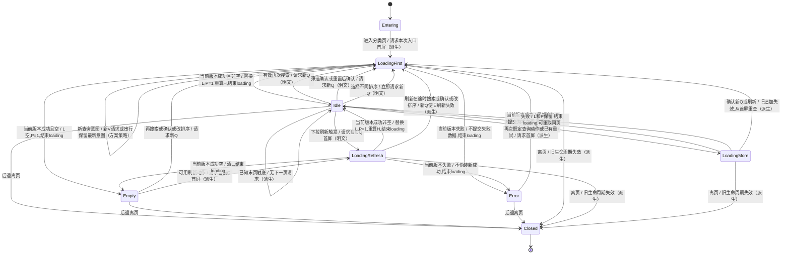

# cml-spec24 验收矩阵 v1（分析阶段）

> 产物所有者：harmony_requirements。仅分析；未修改业务代码、测试、Spec 或全局状态。本矩阵不作构建、设备或功能通过结论；本轮构建、安装与实际页面证据见 `spec/baseline-notes.md`。
>
> 发布目标由主 Agent 决定：本文件可发布为 `spec/acceptance.md`；本 Agent 仅写 `workflow/requirements/*`。

## 1. 输入、证据及读法

- 根目录：`D:/HCUP/cml-spec24`。派工：`workflow/dispatch/requirements-01.md`。
- Spec：`spec/requirement.md`，SHA256 `db94fb5440c450010739e4b8e01754bb7f54e04d7da2c719a288c1f8ead42939`，本次读取并核对一致。
- 基线：`spec/metadata.json:2` 指定 `ab3dc7cd5d05a9a3fd7d4e9ddd0a49e1a05085d8`；`workflow/analysis-start-code-fingerprint.json` 的 head 一致，scope 为 `analysis_only`，differences_from_setup 为空。
- 分析格式依据：`spec-harness/0-analyze.md:34-53`。仅以本题 Spec 与本题基线源码取证，未访问其他题、上游修复历史或初始化总览会话。
- `SPEC_EXPLICIT`：Spec 明文，可直接列为必需验收；`REASONABLE_DERIVATION`：使明文行为成立所需的连贯性约束，需设计/测试复审；`UNCONFIRMED_ASSUMPTION`：业务语义或外部协议未确定，不能直接作为 Spec 必过断言。
- 矩阵每行均包含入口、前置数据、用户动作、UI 结果、数据结果、网络结果、返回结果、边界条件八维。边界配置 G1–G7 的完整十二项适用/不适用理由见第 4 节，每行明确引用配置；局部补充写在该行。
- “返回结果”包含动作结束后的页面/弹层归宿；后退、重入及重启的保存策略另见 A75，不能将现有框架行为认定为 Spec 要求。
- 网络断言使用可控商品/分类服务或验证 Agent 安排的请求记录能力；目前未证实工程已有可直接使用的网络捕获夹具。不能只断言按钮标题更新就判定查询成功。
- `gc.*` 是建议的测试契约名称，均不是声称现存 id，也不是 Spec 指定命名。所有标为“需在实现时补 `.id()`”的 id 由设计 Agent 统一后再冻结。仅用文本定位会遇到菜单选项与按钮同名、重复商品名等歧义。
- 数字价格/销量必须基于已知夹具校验，不能用显示文本字典序；订单并列值不要求稳定次序，Spec 未定义第二排序键。

### 1.1 精确原文索引

以下文字逐字摘录，Q 编号供每个原子项回溯。行号均指 `spec/requirement.md`。

| Q | 原文位置 | 原文 |
| --- | --- | --- |
| Q01 | 场景一概述 L7 | 用户进入商品分类页面浏览商品，页面顶部嵌入搜索框，下方筛选排序栏提供"筛选"下拉菜单和"排序"下拉菜单，商品列表支持网格与列表两种布局模式切换，并支持下拉刷新和上拉加载更多。 |
| Q02 | 场景一第1步 L11 | 用户通过点击分类或搜索结果进入商品分类页，页面标题区域显示可输入的搜索框，用户可直接修改搜索词再次搜索。 |
| Q03 | 场景一第2步 L12 | 搜索框下方展示筛选排序栏，左侧为"筛选"下拉按钮，中间为"排序"下拉按钮，右侧为布局切换图标。 |
| Q04 | 场景一第3步 L13 | 商品列表默认以两列网格形式展示，每个商品格显示主图、名称和价格。 |
| Q05 | 场景一第4步 L14 | 用户点击右侧布局切换图标，商品列表切换为单列列表布局，再次点击切换回网格布局。 |
| Q06 | 场景一第5步 L15 | 用户向下滚动到列表底部，系统自动加载下一页商品数据并追加到列表末尾。 |
| Q07 | 场景二概述 L21 | 用户通过筛选功能对商品进行多维度过滤，包括按分类标签筛选和设置价格区间。用户可先在筛选面板中调整条件，再统一确认应用，也可一键重置为默认条件。 |
| Q08 | 场景二第1步 L25 | 用户点击筛选排序栏中的"筛选"按钮，页面弹出下拉筛选面板，面板内展示价格区间输入和多个分类标签组。 |
| Q09 | 场景二第2步 L26 | 用户在价格区间中输入最低价和最高价（如50~200），两者之间有横线分隔。 |
| Q10 | 场景二第3步 L27 | 用户点击某个分类标签（如"运动户外"），该标签高亮显示（边框变色），可多选。 |
| Q11 | 场景二第4步 L28 | 筛选面板底部显示"重置"和"确认"两个按钮，用户点击"确认"，面板关闭，商品列表按筛选条件重新加载。 |
| Q12 | 场景二第5步 L29 | 用户再次打开筛选面板，点击"重置"按钮，所有筛选条件清空，再点击"确认"，商品列表恢复全量展示。 |
| Q13 | 场景三概述 L35 | 用户通过排序下拉菜单对商品列表进行排序，支持综合排序、价格升降序和销量升降序，选择不同排序方式后列表立即重新加载。 |
| Q14 | 场景三第1步 L39 | 用户点击筛选排序栏中的"排序"下拉按钮，展开排序选项列表，包含：综合排序、价格由低到高、价格由高到低、销量由低到高、销量由高到低。 |
| Q15 | 场景三第2步 L40 | 用户选择"价格由低到高"，下拉菜单关闭，排序按钮标题更新为当前选中的排序方式名称。 |
| Q16 | 场景三第3步 L41 | 商品列表刷新，商品按价格从低到高重新排列展示。 |
| Q17 | 场景三第4步 L42 | 用户再次打开排序菜单，切换为"销量由高到低"，商品列表再次刷新并按销量降序排列。 |
| Q18 | 场景三第5步 L43 | 用户选择"综合排序"，商品列表恢复服务端默认排序。 |

“如50~200”“如\"运动户外\"”是例子，不能据此要求生产服务必须返回固定商品或固定标签；验收夹具应主动提供这些值以覆盖明文示例。Spec 没有指定搜索占位文案、横线的具体字符、空/错/末页提示文案、图标资源、选中边框色值。

### 1.2 本题代码实证（不替代 Spec）

| E | 文件与位置 | 仅由源码可确认的事实 / 限制 |
| --- | --- | --- |
| E01 | `feature/goods/src/main/ets/view/GoodsCategoryPage.ets:20-36`；`feature/goods/src/main/ets/viewmodel/GoodsCategoryViewModel.ets:8-9` | 目标页 AppNavDestination 标题“商品分类”，内容仅“商品分类页面内容视图”；VM 为空子类，目标功能尚无实现。运行时未验证。 |
| E02 | `feature/goods/src/main/ets/navigation/GoodsCategoryNav.ets:9-10`；`core/navigation/src/main/ets/goods/GoodsRoutes.ts:17`；`core/navigation/src/main/ets/goods/GoodsNavigator.ets:44-49` | 路由名 `goods/category` 及 toCategory(params?) 已存在，导航 Builder 构造 GoodsCategoryPage。 |
| E03 | `core/navigation/src/main/ets/goods/GoodsParam.ets:9-29` | 导航参数有 typeId?: string、keyword、featured、recommend、minPrice；并没有完整筛选/排序状态协议。 |
| E04 | `feature/goods/src/main/ets/viewmodel/GoodsSearchViewModel.ets:76-90`；`feature/goods/src/main/ets/view/GoodsSearchPage.ets:40-47` | 既有搜索页会 trim，拒绝空词；先 await 历史写/读（L82–83）再携带 keyword 调用 toCategory（L90）。仅静态链路，数据库运行未验证；不是商品分类页的空词规范。 |
| E05 | `feature/main/src/main/ets/view/CategoryPage.ets:170-192` | 当前分类项构建为图片和名称；本段没有点击导航回调。此为静态缺口证据，不声称实际操作过入口。 |
| E06 | `core/ui/src/main/ets/component/appbar/SearchTopAppBar.ets:99-117,136-149` | 可复用搜索栏支持 readOnly 参数、输入回调、清空回调、onSearch 及搜索按钮；上述构建内没有 .id()。 |
| E07 | `core/ui/src/main/ets/component/goods/GoodsGridItem.ets:39-76`；`GoodsListItem.ets:36-74`（同目录） | 既有商品卡使用 goods.mainPic、title、price（另有 sold）；两类卡上述构建无 .id()。存在组件不代表目标页已经接入。 |
| E08 | `core/model/src/main/ets/request/GoodsSearchRequest.ets:9-37` | 请求模型 page 默认1、size 默认20；typeId 为 number[]，minPrice/maxPrice/keyWord/order/sort 均可选。order/sort 的字面值未在该模型定义。 |
| E09 | `core/data/src/main/ets/repository/GoodsRepository.ets:38-39,64-65`；`core/network/src/main/ets/datasource/goods/GoodsNetworkDataSourceImpl.ets:27-30,59-62` | 可用服务方法对应 POST goods/type/list 与 POST goods/info/page。这是基线接入证据；真实服务是否在线、契约字面值、返回数据均未实测。 |
| E10 | `core/base/src/main/ets/viewmodel/BaseNetWorkListViewModel.ets:74-82,90-106,114-124,140-159,181-187` | 通用分页基类首屏替换、后续页追加，refresh/loadMore 有 isLoading 门禁，finally 清 loading；hasMore 由 pagination.size*page<total 决定；追加失败回退 currentPage。没有因此证明新页已满足竞态或所有重载语义。 |
| E11 | `core/ui/src/main/ets/component/refresh/RefreshLayout.ets:41-52`；`core/ui/src/main/ets/component/network/BaseNetWorkListView.ets:77-117` | 刷新组件由 loading 控制并分 pull/slideUp 回调；网络容器有 loading/error/empty/content 可见性。上述源码未设 .id()；使用 opacity 时测试要判断可见性，不能仅判断节点存在。 |
| E12 | `core/model/src/main/ets/entity/Goods.ets:11-39`；`Category.ets:9-33`；`CategoryTree.ets:11-43`（同 entity 目录） | 商品有 id、typeId、title、mainPic、price、sold；分类有 id/name/parentId/children。树形数据支持分组，但不能据此确定哪些层级可多选。 |
| E13 | `core/model/src/main/ets/network/NetworkPageData.ets:11-23`；`NetworkPageMeta.ets:9-26`（同目录） | list/pagination 及 total/size/page 可为空；缺失元数据时如何探测末页不是 Spec 明文。 |
| E14 | 稳定 id 检索范围：GoodsCategoryPage、SearchTopAppBar、GoodsGridItem、GoodsListItem、BaseNetWorkListView、RefreshLayout、CategoryPage、GoodsSearchPage | 对上述本题文件执行 `rg -n '\.id\('`，无匹配。仅说明这些文件未显式设置 id，未查第三方依赖内部节点，不能将内部临时 id 当作稳定契约。 |

## 2. 测试数据和稳定选择器约定

夹具建议（测试前置，非新增业务要求）：

- T1：可点击分类 c11、c12（同组）和 c21（另一组），有名称“运动户外”，至少两个组；有对应商品和组外商品。
- T2：商品唯一 id，至少覆盖 price=49/50/100/200/201，sold 值与价格顺序相反；服务端默认顺序刻意不同于价格和销量四种排序。
- T3：多页数据 P1/P2/P3，各页 id 不相交；末页非满页、刚好满页末页、首屏空数组各一组。
- T4：可延迟/乱序返回查询 X/Y、首屏失败、追加失败、分类加载失败；验证记录请求参数、请求序号、成功/失败和结束时间。
- T5：价格/销量并列、多选命中单一类别及多个类别、无命中、仅最低/最高价、非法价格输入。未决语义按第 6 节处理。
- 每项写“请求”时，Hypium 需用 UI 动作驱动，再结合夹具记录或服务日志断言；单纯读取 VM 内存不能替代屏幕可观察结果。
- 商品列表需可取得有序商品 id 和价格/销量。建议卡片根 id 为 `gc.goods.<goodsId>`，子节点为 `gc.image.<goodsId>`、`gc.name.<goodsId>`、`gc.price.<goodsId>`、`gc.sold.<goodsId>`。Spec 未要求显式销量文字，若不展示销量，按夹具 id 到 sold 映射断言排序即可。
- 选中边框颜色不是 Hypium 常规文字断言；需稳定 id 搭配组件属性检查（若工具支持）或截图比对，至少断言选中语义与实际颜色变化两项。只断言选中 id 存在不足以证明“边框变色”。

## 3. 原子验收矩阵

### 3.1 Spec 明文（A01–A52）

以下每行证据等级均为 `SPEC_EXPLICIT`，不将其中的建议选择器、夹具或未规定的请求字面值提升为明文。

| 编号 | 来源（场景/步骤/行/Q） | 证据等级 | 原子行为 | Hypium 可观察结果 | 八维（每项均显式列出） | 稳定选择器 |
| --- | --- | --- | --- | --- | --- | --- |
| A01 | 场景一/第1步/L11/Q02 | SPEC_EXPLICIT | 点击分类进入商品分类页 | 点击已知分类后可见目标页搜索区域；路由为 goods/category（E02） | 入口：主界面分类入口 前置数据：T1 分类存在且入口可操作 用户动作：点击某分类 UI结果：目标页出现 数据结果：入口选中分类与所展示商品对应（参数保持详见A54） 网络结果：入口商品加载；接口路径仅参考E09 返回结果：由原页面进入商品分类页；后退保存未规定，见A75 边界条件：G1；分类无数据时不能伪造可点击项 | 分类入口 category.<id>、gc.page；需在实现时补 `.id()` |
| A02 | 场景一/第1步/L11/Q02 | SPEC_EXPLICIT | 由搜索结果流程进入商品分类页 | 用非空词驱动既有搜索流程后目标页出现 | 入口：既有商品搜索页/搜索结果流程 前置数据：T2 有关键词命中结果；E04 已有 toCategory 调用 用户动作：在既有搜索页提交非空关键词（E04直接toCategory，不增加中间结果页点击） UI结果：目标页出现 数据结果：使用该关键词的商品结果；不得丢词 网络结果：搜索商品请求使用入口关键词；协议详见A76 返回结果：由搜索流程进入商品分类页 边界条件：G1+G2；入口空词行为不由此项决定 | 搜索入口、搜索提交、gc.page；需在实现时补 `.id()` |
| A03 | 场景一/第1步/L11/Q02 | SPEC_EXPLICIT | 标题区域显示可输入搜索框 | 搜索框位于标题区域，可聚焦并接受键盘输入 | 入口：已由分类或搜索流程进入商品分类页 前置数据：T2 首屏成功 用户动作：点击搜索框并输入字符 UI结果：标题内可见输入框，字符显示 数据结果：编辑输入值改变；是否请求见A05/A67 网络结果：不适用：只检查可编辑性，不在本项规定提交时机 返回结果：动作结束后停留商品分类页 边界条件：G2；清空/纯空格不妨碍输入能力，提交语义见A67 | gc.search.input、gc.header；需在实现时补 `.id()` |
| A04 | 场景一/第1步/L11/Q02 | SPEC_EXPLICIT | 可直接修改搜索词 | 在分类页将原词X编辑为Y，输入框显示Y，仍在当前页 | 入口：已由分类或搜索流程进入商品分类页 前置数据：已有搜索词X且T2 有Y结果 用户动作：在本页替换输入为Y UI结果：无需先离开商品分类页即可编辑 数据结果：输入值为Y 网络结果：不适用：编辑与提交分开，提交请求由A05验证 返回结果：动作结束后停留商品分类页 边界条件：G2；部分编辑不等于完成搜索 | gc.search.input；需在实现时补 `.id()` |
| A05 | 场景一/第1步/L11/Q02 | SPEC_EXPLICIT | 修改搜索词后再次搜索 | 提交Y后列表呈现Y夹具商品，X独有商品不作为Y结果；请求记录Y | 入口：已由分类或搜索流程进入商品分类页 前置数据：已成功展示X；T2 可区分X/Y 用户动作：改为非空Y并触发搜索提交 UI结果：Y结果可见 数据结果：列表按Y重新查询；替换页码语义见A53 网络结果：本次商品查询使用Y；loading见A57 返回结果：动作结束后停留商品分类页 边界条件：G2+G7；空词/空格见A67，失败A63，竞态A59 | gc.search.input、gc.search.submit、gc.goods.<id>；需在实现时补 `.id()` |
| A06 | 场景一/第2步/L12/Q03 | SPEC_EXPLICIT | 筛选排序栏在搜索框下方 | 用节点边界断言筛选排序栏在搜索框下方 | 入口：已由分类或搜索流程进入商品分类页 前置数据：首屏或空结果均可 用户动作：观察页面 UI结果：纵向顺序为搜索框、筛选排序栏 数据结果：不适用：本项为结构显示检查，不改变数据 网络结果：不适用：本项无独立请求动作，先等待入口加载结束 返回结果：动作结束后停留商品分类页 边界条件：G1；无商品也不删除控制栏 | gc.search.input、gc.controls；需在实现时补 `.id()` |
| A07 | 场景一/第2步/L12/Q03 | SPEC_EXPLICIT | 左侧展示“筛选”下拉按钮 | 可见且可点击文字“筛选”，位于排序按钮左方 | 入口：已由分类或搜索流程进入商品分类页 前置数据：初次页面状态 用户动作：观察筛选排序栏 UI结果：左侧文字逐字为“筛选”，有下拉入口 数据结果：不适用：本项为结构显示检查，不改变数据 网络结果：不适用：本项无独立请求动作，先等待入口加载结束 返回结果：动作结束后停留商品分类页 边界条件：G1；无数据仍可查找；菜单操作见A19 | gc.filter.trigger；需在实现时补 `.id()` |
| A08 | 场景一/第2步/L12/Q03 | SPEC_EXPLICIT | 中间展示“排序”下拉按钮 | 初始可见“排序”按钮，横向位于筛选和布局图标之间 | 入口：已由分类或搜索流程进入商品分类页 前置数据：尚未选择新排序 用户动作：观察筛选排序栏 UI结果：初始文字“排序”，位于中间；选择后的标题另验A45/A66 数据结果：不适用：本项为结构显示检查，不改变数据 网络结果：不适用：本项无独立请求动作，先等待入口加载结束 返回结果：动作结束后停留商品分类页 边界条件：G1；初始“排序”不推导order/sort协议或服务默认算法；初始“综合排序”不是已确认必过要求 | gc.sort.trigger、gc.sort.title；需在实现时补 `.id()` |
| A09 | 场景一/第2步/L12/Q03 | SPEC_EXPLICIT | 右侧展示布局切换图标 | 图标可见可点击，横向位于排序按钮右侧 | 入口：已由分类或搜索流程进入商品分类页 前置数据：任意成功结果 用户动作：观察筛选排序栏 UI结果：右侧有布局切换图标；具体资源未规定 数据结果：不适用：本项为结构显示检查，不改变数据 网络结果：不适用：本项无独立请求动作，先等待入口加载结束 返回结果：动作结束后停留商品分类页 边界条件：G1；无数据图标仍为结构项，切换状态见A14/A15 | gc.layout.toggle；需在实现时补 `.id()` |
| A10 | 场景一/第3步/L13/Q04 | SPEC_EXPLICIT | 商品列表默认两列网格 | 新页面至少3件商品，首行前两卡 y 对齐且 x 不同，第三卡在下一行 | 入口：已由分类或搜索流程进入商品分类页 前置数据：T2 至少3件商品；本次新建页面实例 用户动作：等待初始成功结果 UI结果：两列网格；不能因已有响应式卡片而改为三列 数据结果：商品列表与首屏响应一致 网络结果：不适用：本项无独立请求动作，先等待入口加载结束 返回结果：动作结束后停留商品分类页 边界条件：G3；少于2件不能证明两列，需夹具；持久化A75未决 | gc.goods.grid、gc.goods.<id>；需在实现时补 `.id()` |
| A11 | 场景一/第3步/L13/Q04 | SPEC_EXPLICIT | 每个商品格显示主图 | 每个夹具商品根节点内有可见主图组件；已知图请求/截图与夹具相符 | 入口：已由分类或搜索流程进入商品分类页 前置数据：T2 主图有效 用户动作：观察网格商品 UI结果：每格主图可见且非零尺寸 数据结果：绑定该商品mainPic（E07/E12），不串卡 网络结果：本项不要求额外商品接口；图片加载请求可作佐证 返回结果：动作结束后停留商品分类页 边界条件：G3；空结果无商品格故本项不适用；图失败提示未规定 | gc.image.<id>；需在实现时补 `.id()` |
| A12 | 场景一/第3步/L13/Q04 | SPEC_EXPLICIT | 每个商品格显示名称 | 每个商品根内存在夹具名称文字（允许既有省略展示，但绑定正确） | 入口：已由分类或搜索流程进入商品分类页 前置数据：T2 名称彼此可区分 用户动作：观察网格商品 UI结果：各卡名称可见 数据结果：名称对应本商品title（E07/E12） 网络结果：不适用：本项无独立请求动作，先等待入口加载结束 返回结果：动作结束后停留商品分类页 边界条件：G3；无商品时无卡片可断言，按A60验空态 | gc.name.<id>；需在实现时补 `.id()` |
| A13 | 场景一/第3步/L13/Q04 | SPEC_EXPLICIT | 每个商品格显示价格 | 每卡价格文字与夹具金额数值对应；不强制未规定币种/小数格式 | 入口：已由分类或搜索流程进入商品分类页 前置数据：T2 价格含50/100/200 用户动作：观察网格商品 UI结果：价格可见 数据结果：绑定对应price，金额不串卡 网络结果：不适用：本项无独立请求动作，先等待入口加载结束 返回结果：动作结束后停留商品分类页 边界条件：G3；无商品时不适用；排序按数字另验A47/A48 | gc.price.<id>；需在实现时补 `.id()` |
| A14 | 场景一/第4步/L14/Q05 | SPEC_EXPLICIT | 第一次点击布局图标切为单列列表 | 点击后可见单列列表；至少3卡 x 对齐、y递增 | 入口：已由分类或搜索流程进入商品分类页 前置数据：当前两列网格且T2至少3件 用户动作：点击一次布局图标 UI结果：商品以单列列表排列 数据结果：数据不变另验A55 网络结果：不触发请求属于派生A56；本项只要求布局变化 返回结果：动作结束后停留商品分类页 边界条件：G3；连点奇偶性由逐次切换推出，数据保持A55 | gc.layout.toggle、gc.goods.list、gc.goods.<id>；需在实现时补 `.id()` |
| A15 | 场景一/第4步/L14/Q05 | SPEC_EXPLICIT | 再次点击切回网格 | 从A14状态再点一次，恢复两列网格 | 入口：已由分类或搜索流程进入商品分类页 前置数据：当前由网格切到单列列表 用户动作：再次点击布局图标 UI结果：恢复两列网格 数据结果：数据不变另验A55 网络结果：请求约束另验A56 返回结果：动作结束后停留商品分类页 边界条件：G3；重复往返可验证；重启后初始策略见A75 | gc.layout.toggle、gc.goods.grid、gc.goods.<id>；需在实现时补 `.id()` |
| A16 | 场景一/第5步/L15/Q06 | SPEC_EXPLICIT | 滚动到底部自动加载下一页 | 只滚动触底即可记录下一页加载；无需点击额外按钮 | 入口：已由分类或搜索流程进入商品分类页 前置数据：T3首屏已成功且确有P2 用户动作：向下滚动至列表底部 UI结果：下一页商品随后可见；加载状态另验A57 数据结果：请求下一页，不能重新取首屏冒充追加 网络结果：商品分页请求下一页且保持当前查询，见A54 返回结果：动作结束后停留商品分类页 边界条件：G6+G7；网格与列表均验；无数据/末页不触发见A60/A61 | gc.goods.grid、gc.goods.list、gc.loadmore；需在实现时补 `.id()` |
| A17 | 场景一/第5步/L15/Q06 | SPEC_EXPLICIT | 下一页数据追加到列表末尾 | 成功后有序id=P1后接P2，P1仍在，P2不插在头部 | 入口：已由分类或搜索流程进入商品分类页 前置数据：T3 P1/P2 id不相交 用户动作：触底并等待P2成功 UI结果：向后可浏览P2，已有P1未消失 数据结果：列表尾部追加；页边界商品不遗漏 网络结果：与A16同一次请求成功结果，不能为布局切换另查 返回结果：动作结束后停留商品分类页 边界条件：G6+G7；重复触底去重A58、失败不追加A62 | gc.goods.<id>、gc.goods.grid、gc.goods.list；需在实现时补 `.id()` |
| A18 | 场景一/概述/L7/Q01 | SPEC_EXPLICIT | 支持下拉刷新 | 刷新前后夹具首屏内容不同；下拉后呈现新的当前查询首屏 | 入口：已由分类或搜索流程进入商品分类页 前置数据：T3 已有商品；服务可返回更新后的P1 用户动作：在列表顶部下拉达到刷新触发阈值 UI结果：刷新结束后显示新数据 数据结果：重新加载当前查询，替换与页码重置见A53 网络结果：实际发起刷新请求，不能只有刷新动画 返回结果：动作结束后停留商品分类页 边界条件：G6+G7；两种布局均验；取消未达阈值不视为触发，失败A63 | gc.refresh、gc.goods.grid、gc.goods.list；需在实现时补 `.id()` |
| A19 | 场景二/第1步/L25/Q08 | SPEC_EXPLICIT | 点击“筛选”弹出下拉筛选面板 | 点击唯一“筛选”触发节点后筛选面板可见 | 入口：已由分类或搜索流程进入商品分类页 前置数据：面板关闭 用户动作：点击“筛选” UI结果：下拉筛选面板展开 数据结果：已应用商品数据不因打开动作改变 网络结果：打开不得将未确认草稿作为已应用查询；严格零商品请求是建议P02，分类元数据请求时机未规定 返回结果：仍在商品分类页，叠加筛选面板 边界条件：G4；重复点击开关/关闭语义见A73 | gc.filter.trigger、gc.filter.panel；需在实现时补 `.id()` |
| A20 | 场景二/第1步/L25/Q08 | SPEC_EXPLICIT | 面板展示价格区间输入 | 面板内最低/最高价两个可编辑节点均可见 | 入口：商品分类页筛选面板 前置数据：已打开筛选面板 用户动作：观察面板 UI结果：价格区间输入区域可见 数据结果：不适用：此项仅检查输入结构 网络结果：不适用：观察不提交请求 返回结果：筛选面板保持可见 边界条件：G4；空值是合法初始显示，提交语义另验A68/A69 | gc.filter.min、gc.filter.max；需在实现时补 `.id()` |
| A21 | 场景二/第1步/L25/Q08 | SPEC_EXPLICIT | 面板展示多个分类标签组 | T1返回多个组时面板内至少两个可区分组及其标签 | 入口：商品分类页筛选面板 前置数据：T1 分类元数据成功且至少2组 用户动作：观察面板 UI结果：多个分类标签组可见；组名/层级策略见A71 数据结果：标签绑定真实分类id/name（E12） 网络结果：分类获取可复用E09；Spec不规定每次打开必请求 返回结果：筛选面板保持可见 边界条件：G4；分类空/失败不能编造数据，A71/A63；示例非固定服务要求 | gc.filter.group.<id>、gc.filter.tag.<id>；需在实现时补 `.id()` |
| A22 | 场景二/第2步/L26/Q09 | SPEC_EXPLICIT | 可输入最低价 | 最低价节点输入50后显示50 | 入口：商品分类页筛选面板 前置数据：价格区间输入已显示 用户动作：在最低价输入50 UI结果：最低价显示50 数据结果：仅草稿最低价被编辑 网络结果：未确认草稿不得被提交应用（A30）；零请求优化仅为第5节P02建议 返回结果：筛选面板保持可见 边界条件：G4；空/空格/部分输入见A68/A69 | gc.filter.min；需在实现时补 `.id()` |
| A23 | 场景二/第2步/L26/Q09 | SPEC_EXPLICIT | 可输入最高价 | 最高价节点输入200后显示200 | 入口：商品分类页筛选面板 前置数据：价格区间输入已显示 用户动作：在最高价输入200 UI结果：最高价显示200 数据结果：仅草稿最高价被编辑 网络结果：未确认草稿不得被提交应用（A30）；零请求优化仅为第5节P02建议 返回结果：筛选面板保持可见 边界条件：G4；非法或最小大于最大见A69 | gc.filter.max；需在实现时补 `.id()` |
| A24 | 场景二/第2步/L26/Q09 | SPEC_EXPLICIT | 最低最高价之间有横线 | 输入框位置之间可见横线；用节点边界或截图比对，不强制“-”字符 | 入口：商品分类页筛选面板 前置数据：两个输入显示 用户动作：观察区间区域 UI结果：横线在两框之间 数据结果：不适用：装饰结构不改数据 网络结果：不适用：观察装饰不触发请求 返回结果：筛选面板保持可见 边界条件：G4；输入为空仍应显示横线，其他输入语义不影响该结构 | gc.filter.range.separator、gc.filter.min、gc.filter.max；需在实现时补 `.id()` |
| A25 | 场景二/第3步/L27/Q10 | SPEC_EXPLICIT | 点击分类标签后高亮 | 点击未选标签后选中语义为真且视觉高亮 | 入口：商品分类页筛选面板 前置数据：T1 有未选标签“运动户外” 用户动作：点击该标签 UI结果：该标签高亮 数据结果：草稿选择包含该分类id 网络结果：未确认草稿不得被提交应用（A30）；零请求优化仅为第5节P02建议 返回结果：筛选面板保持可见 边界条件：G4；再次点击取消规则见A71，关闭见A73 | gc.filter.tag.<id>；需在实现时补 `.id()` |
| A26 | 场景二/第3步/L27/Q10 | SPEC_EXPLICIT | 选中标签边框变色 | 点击前后截图或属性显示标签边框颜色改变；不能只以文字/背景替代 | 入口：商品分类页筛选面板 前置数据：T1 标签未选且可取得前态 用户动作：点击该标签 UI结果：选中边框与未选边框颜色不同；具体色值未规定 数据结果：不适用：本项只检查选择的视觉反馈 网络结果：不适用：边框变色不要求请求 返回结果：筛选面板保持可见 边界条件：G4；无分类时无标签可测，按分类空数据处理 | gc.filter.tag.<id>；需在实现时补 `.id()` |
| A27 | 场景二/第3步/L27/Q10 | SPEC_EXPLICIT | 支持分类标签多选 | 选择两个不同标签后两者同时高亮，第二次选择不无故清除第一项 | 入口：商品分类页筛选面板 前置数据：T1 至少两个可选标签 用户动作：依次点击两个不同标签 UI结果：两个标签均选中 数据结果：草稿选中集包含两个id；组内/跨组组合语义见A71 网络结果：未确认草稿不得被提交应用（A30）；零请求优化仅为第5节P02建议 返回结果：筛选面板保持可见 边界条件：G4；连点同一标签不等价选择两类，去选规则见A71 | gc.filter.tag.<id1>、gc.filter.tag.<id2>；需在实现时补 `.id()` |
| A28 | 场景二/第4步/L28/Q11 | SPEC_EXPLICIT | 面板底部显示“重置”按钮 | 面板内底部操作区域可见“重置” | 入口：商品分类页筛选面板 前置数据：面板打开 用户动作：观察底部操作区 UI结果：逐字“重置”按钮，位于面板底部 数据结果：不适用：结构项 网络结果：不适用：观察按钮不触发请求 返回结果：筛选面板保持可见 边界条件：G4；长标签列表下底部可到达，不限定固定像素 | gc.filter.reset、gc.filter.actions；需在实现时补 `.id()` |
| A29 | 场景二/第4步/L28/Q11 | SPEC_EXPLICIT | 面板底部显示“确认”按钮 | 面板内底部操作区域可见“确认” | 入口：商品分类页筛选面板 前置数据：面板打开 用户动作：观察底部操作区 UI结果：逐字“确认”按钮，位于面板底部 数据结果：不适用：结构项 网络结果：不适用：观察按钮不触发请求 返回结果：筛选面板保持可见 边界条件：G4；与重置分开定位，避免同名弹窗按钮 | gc.filter.confirm、gc.filter.actions；需在实现时补 `.id()` |
| A30 | 场景二/概述/L21/Q07 | SPEC_EXPLICIT | 面板中先调整，统一确认后应用 | 无在途请求前置下，仅改价格/选多个标签时，已应用查询及商品结果不因草稿编辑改变 | 入口：商品分类页筛选面板 前置数据：已有已应用查询Q0及成功商品列表；无在途商品请求 用户动作：编辑价格并选择标签，但不点“确认” UI结果：草稿反馈可见，原商品列表未按草稿提前刷新 数据结果：草稿与已应用条件分离 网络结果：不得将未确认条件当作已应用查询；不禁止无关的已应用查询刷新，严格零请求仅建议P02 返回结果：筛选面板保持可见 边界条件：G4+G7；部分操作/重置后未确认不应用；关闭草稿去向见A73 | gc.filter.min、gc.filter.max、gc.filter.tag.<id>、gc.filter.confirm；需在实现时补 `.id()` |
| A31 | 场景二/第4步/L28/Q11 | SPEC_EXPLICIT | 点击“确认”关闭面板 | 合法草稿下点击“确认”后面板不可见 | 入口：商品分类页筛选面板 前置数据：50~200+分类草稿合法 用户动作：点击“确认” UI结果：筛选面板关闭 数据结果：条件提交与结果见A32 网络结果：此动作须连接真实商品重载A32 返回结果：回到商品分类页列表视图 边界条件：G4+G7；失败后不要求面板自动重开；非法输入见A69 | gc.filter.confirm、gc.filter.panel；需在实现时补 `.id()` |
| A32 | 场景二/第4步/L28/Q11 | SPEC_EXPLICIT | 确认后按筛选条件重新加载 | 记录包含min=50,max=200及所选分类的查询；列表仅显示夹具匹配商品 | 入口：商品分类页筛选面板 前置数据：T1/T2 含匹配与不匹配商品；合法草稿 用户动作：点击“确认”并等待成功 UI结果：显示筛选结果 数据结果：应用全部草稿条件；区间端点和分类OR/AND见A70/A71 网络结果：发出按已确认条件商品重载；参数名称参考E08，页码见A53 返回结果：面板已关闭，停留分类页 边界条件：G4+G7；无命中A60，失败A63，乱序A59 | gc.filter.confirm、gc.goods.<id>；需在实现时补 `.id()` |
| A33 | 场景二/第5步/L29/Q12 | SPEC_EXPLICIT | 可以再次打开筛选面板 | 完成一次筛选后再次点击“筛选”，面板可见 | 入口：已由分类或搜索流程进入商品分类页 前置数据：筛选确认完成且面板关闭 用户动作：再次点击“筛选” UI结果：面板再次展开 数据结果：是否回显已应用条件见A74 网络结果：重开不应用未确认草稿；是否同条件刷新并无明文次数约束，见P02 返回结果：停留分类页，筛选面板可见 边界条件：G4；不能只实现一次可用；重复开关草稿策略见A73/A74 | gc.filter.trigger、gc.filter.panel；需在实现时补 `.id()` |
| A34 | 场景二/第5步/L29/Q12 | SPEC_EXPLICIT | “重置”清空最低价 | 最低价已有50时点“重置”后输入值为空 | 入口：再次打开的筛选面板 前置数据：最低价草稿非空 用户动作：点击“重置” UI结果：最低价输入清空 数据结果：草稿最低价为空 网络结果：未确认草稿不得被提交应用（A30）；零请求优化仅为第5节P02建议 返回结果：筛选面板保持打开以供再次确认 边界条件：G4；重复重置保持空；路由默认条件范围见A72 | gc.filter.reset、gc.filter.min；需在实现时补 `.id()` |
| A35 | 场景二/第5步/L29/Q12 | SPEC_EXPLICIT | “重置”清空最高价 | 最高价已有200时点“重置”后输入值为空 | 入口：再次打开的筛选面板 前置数据：最高价草稿非空 用户动作：点击“重置” UI结果：最高价输入清空 数据结果：草稿最高价为空 网络结果：未确认草稿不得被提交应用（A30）；零请求优化仅为第5节P02建议 返回结果：筛选面板保持打开以供再次确认 边界条件：G4；只填最高价也可清空；重复重置保持空 | gc.filter.reset、gc.filter.max；需在实现时补 `.id()` |
| A36 | 场景二/第5步/L29/Q12 | SPEC_EXPLICIT | “重置”清空所有分类选择 | 多组多标签选中后重置，所有可选标签均恢复未选，草稿选择集为空 | 入口：再次打开的筛选面板 前置数据：已有至少两个选中分类 用户动作：点击“重置” UI结果：所有选中高亮/变色边框恢复未选态 数据结果：草稿分类选择清空 网络结果：未确认草稿不得被提交应用（A30）；零请求优化仅为第5节P02建议 返回结果：筛选面板保持打开以供再次确认 边界条件：G4；不允许只清当前可视组；路由初始分类范围见A72 | gc.filter.reset、gc.filter.tag.<id>；需在实现时补 `.id()` |
| A37 | 场景二/第5步/L29/Q12 | SPEC_EXPLICIT | 重置后确认恢复全量展示 | 从受价格/标签限制结果重置再确认，商品请求移除这些限制并出现原先被过滤商品 | 入口：商品分类页筛选面板 前置数据：T1/T2 有因面板条件被过滤的商品 用户动作：点击“重置”再点“确认” UI结果：面板关闭，出现全量结果 数据结果：面板筛选限制清除；“全量”是否跨入口关键词/路由范围须A72确认 网络结果：真实重新加载全量查询，不可只清面板显示 返回结果：回到商品分类页列表 边界条件：G4+G7；无初始路由约束夹具下可直接验；含入口约束用A72分支 | gc.filter.reset、gc.filter.confirm、gc.goods.<id>；需在实现时补 `.id()` |
| A38 | 场景三/第1步/L39/Q14 | SPEC_EXPLICIT | 点击“排序”展开选项列表 | 点击排序触发节点后排序选项容器可见 | 入口：商品分类页 前置数据：初始排序菜单关闭 用户动作：点击“排序” UI结果：下拉选项列表展开 数据结果：不适用：展开菜单尚未选择排序 网络结果：打开未选菜单不改变已应用排序；建议不发商品请求为P02，改选请求见A46 返回结果：仍在商品分类页，排序菜单可见 边界条件：G5；关闭未选择见A73；与筛选面板互斥方式未规定 | gc.sort.trigger、gc.sort.menu；需在实现时补 `.id()` |
| A39 | 场景三/第1步/L39/Q14 | SPEC_EXPLICIT | 菜单包含“综合排序” | 菜单内存在逐字“综合排序”且可选 | 入口：商品分类页排序下拉菜单 前置数据：排序菜单展开 用户动作：观察该选项 UI结果：选项文字“综合排序”可见 数据结果：不适用：本项检查可用选项 网络结果：不适用：观察选项不触发查询 返回结果：排序菜单保持可见 边界条件：G5；商品无数据也能选择；重复文字按菜单id限定 | gc.sort.option.default；需在实现时补 `.id()` |
| A40 | 场景三/第1步/L39/Q14 | SPEC_EXPLICIT | 菜单包含“价格由低到高” | 菜单内存在逐字“价格由低到高”且可选 | 入口：商品分类页排序下拉菜单 前置数据：排序菜单展开 用户动作：观察该选项 UI结果：选项文字“价格由低到高”可见 数据结果：不适用：本项检查可用选项 网络结果：不适用：观察选项不触发查询 返回结果：排序菜单保持可见 边界条件：G5；商品无数据也能选择；重复文字按菜单id限定 | gc.sort.option.priceAsc；需在实现时补 `.id()` |
| A41 | 场景三/第1步/L39/Q14 | SPEC_EXPLICIT | 菜单包含“价格由高到低” | 菜单内存在逐字“价格由高到低”且可选 | 入口：商品分类页排序下拉菜单 前置数据：排序菜单展开 用户动作：观察该选项 UI结果：选项文字“价格由高到低”可见 数据结果：不适用：本项检查可用选项 网络结果：不适用：观察选项不触发查询 返回结果：排序菜单保持可见 边界条件：G5；商品无数据也能选择；重复文字按菜单id限定 | gc.sort.option.priceDesc；需在实现时补 `.id()` |
| A42 | 场景三/第1步/L39/Q14 | SPEC_EXPLICIT | 菜单包含“销量由低到高” | 菜单内存在逐字“销量由低到高”且可选 | 入口：商品分类页排序下拉菜单 前置数据：排序菜单展开 用户动作：观察该选项 UI结果：选项文字“销量由低到高”可见 数据结果：不适用：本项检查可用选项 网络结果：不适用：观察选项不触发查询 返回结果：排序菜单保持可见 边界条件：G5；商品无数据也能选择；重复文字按菜单id限定 | gc.sort.option.soldAsc；需在实现时补 `.id()` |
| A43 | 场景三/第1步/L39/Q14 | SPEC_EXPLICIT | 菜单包含“销量由高到低” | 菜单内存在逐字“销量由高到低”且可选 | 入口：商品分类页排序下拉菜单 前置数据：排序菜单展开 用户动作：观察该选项 UI结果：选项文字“销量由高到低”可见 数据结果：不适用：本项检查可用选项 网络结果：不适用：观察选项不触发查询 返回结果：排序菜单保持可见 边界条件：G5；商品无数据也能选择；重复文字按菜单id限定 | gc.sort.option.soldDesc；需在实现时补 `.id()` |
| A44 | 场景三/第2步/L40/Q15 | SPEC_EXPLICIT | 选择“价格由低到高”关闭菜单 | 点击该选项后排序菜单不可见 | 入口：商品分类页排序下拉菜单 前置数据：当前不是价格升序 用户动作：点击“价格由低到高” UI结果：排序下拉菜单关闭 数据结果：排序提交和结果分别见A46/A47 网络结果：与A46同一次查询，不能只关闭菜单而不加载 返回结果：回到商品分类页列表 边界条件：G5+G7；失败也不要求菜单自动重开 | gc.sort.option.priceAsc、gc.sort.menu；需在实现时补 `.id()` |
| A45 | 场景三/第2步/L40/Q15 | SPEC_EXPLICIT | 排序按钮标题更新为“价格由低到高” | 菜单关闭后触发按钮内文字逐字为“价格由低到高” | 入口：商品分类页排序下拉菜单 前置数据：当前排序标题不是价格升序 用户动作：选择“价格由低到高” UI结果：触发按钮显示当前选中名称“价格由低到高” 数据结果：选中状态为价格升序 网络结果：必须连到A46查询；仅改标题不算实现排序 返回结果：商品分类页列表可见 边界条件：G5；其余选项标题一致性为派生A66 | gc.sort.title、gc.sort.option.priceAsc；需在实现时补 `.id()` |
| A46 | 场景三/概述/L35/Q13 | SPEC_EXPLICIT | 选择不同排序方式立即重新加载 | 每次改为不同方式后无需额外确认/刷新即开始商品查询；请求在该动作处理流程启动 | 入口：商品分类页排序下拉菜单 前置数据：T2 五种结果可区分；菜单已展开 用户动作：依次改选不同排序方式 UI结果：查询启动，随后显示该方式结果 数据结果：当前查询排序方式更新 网络结果：每次不同选择触发商品重载；不得仅本地排已有一页；参数字面值A76 返回结果：回到商品分类页；一般关闭行为见A65 边界条件：G5+G7；“立即”不设未规定毫秒阈值；同项重复频率见第5节策略 | gc.sort.option.<mode>、gc.loading；需在实现时补 `.id()` |
| A47 | 场景三/第3步/L41/Q16 | SPEC_EXPLICIT | 价格升序展示 | 夹具显示id序列映射的price为数值非递减（49,50,100,200,201等） | 入口：商品分类页 前置数据：T2 原默认顺序不按价格 用户动作：选“价格由低到高”并等成功 UI结果：商品按价格从低到高排列 数据结果：正确性覆盖当前已加载数据；跨页见A54 网络结果：按价格升序重载；真实服务映射见A76 返回结果：停留商品分类页 边界条件：G5+G6；并列不规定二级排序；无数据A60，非字符串字典序 | gc.goods.<id>、gc.price.<id>；需在实现时补 `.id()` |
| A48 | 场景三/概述/L35/Q13 | SPEC_EXPLICIT | 价格降序展示 | 商品id序列映射price为数值非递增 | 入口：商品分类页 前置数据：T2 至少3个不同价格 用户动作：选“价格由高到低”并等成功 UI结果：价格由高到低排列 数据结果：当前结果数值降序 网络结果：按价格降序重载，不能仅改名称 返回结果：停留商品分类页 边界条件：G5+G6；虽非步骤单独示例，概述明文支持价格升降序 | gc.sort.option.priceDesc、gc.goods.<id>、gc.price.<id>；需在实现时补 `.id()` |
| A49 | 场景三/概述/L35/Q13 | SPEC_EXPLICIT | 销量升序展示 | 商品id序列映射sold为数值非递减；销量不展示时从夹具id映射断言 | 入口：商品分类页 前置数据：T2 价格与销量顺序不同 用户动作：选“销量由低到高”并等成功 UI结果：销量由低到高排列 数据结果：按sold升序，不能误按价格/库存 网络结果：按销量升序重载 返回结果：停留商品分类页 边界条件：G5+G6；Spec未强制在卡上显示销量文字，不增设该硬要求 | gc.sort.option.soldAsc、gc.goods.<id>；需在实现时补 `.id()` |
| A50 | 场景三/第4步/L42/Q17 | SPEC_EXPLICIT | 切换销量降序后按销量降序展示 | 从价格升序切换后，商品id映射sold为数值非递增 | 入口：商品分类页 前置数据：已通过A47的价格升序结果；T2销量顺序与其不同 用户动作：再次打开菜单，选“销量由高到低”并等待 UI结果：商品按销量降序展示 数据结果：结果sold非递增，非延用价格顺序 网络结果：必须有该次新排序商品查询（A52） 返回结果：停留商品分类页 边界条件：G5+G6+G7；并列无额外次序要求 | gc.sort.option.soldDesc、gc.goods.<id>；需在实现时补 `.id()` |
| A51 | 场景三/第5步/L43/Q18 | SPEC_EXPLICIT | 选“综合排序”恢复服务端默认排序 | 使用与四类显式排序都不同的默认夹具顺序，显示id顺序逐一等于服务返回顺序 | 入口：商品分类页排序下拉菜单 前置数据：已采用价格或销量排序；T2默认顺序独特 用户动作：选择“综合排序”并等待 UI结果：显示服务端默认次序 数据结果：去除显式排序作用，不能以商品id/价格人为模拟默认 网络结果：以服务端默认排序契约查询，具体空值/省略见A76 返回结果：停留商品分类页 边界条件：G5+G6；多页按服务端每页次序拼接；无数据A60 | gc.sort.option.default、gc.goods.<id>；需在实现时补 `.id()` |
| A52 | 场景三/第4步/L42/Q17 | SPEC_EXPLICIT | 已排价格后再次切销量会再次刷新 | 清空请求日志后由价格升序改销量降序，记录一次新的销量降序查询并返回新结果 | 入口：商品分类页 前置数据：已有成功价格升序结果，非首次加载 用户动作：再次打开排序菜单并切“销量由高到低” UI结果：列表再次刷新，不需退出页面 数据结果：新列表来自此次销量查询 网络结果：观察第二次排序重载，防止仅首选有效 返回结果：停留商品分类页 边界条件：G5+G7；重复生命周期可操作；快速切换见A59 | gc.sort.trigger、gc.sort.option.soldDesc、gc.goods.<id>；需在实现时补 `.id()` |

### 3.2 合理推导（A53–A66）

这些条目用于确认明文场景连续执行时仍成立，不能宣传为 Spec 逐字规定的竞态、loading 样式或失败交互。

| 编号 | 来源（场景/步骤/行/Q） | 证据等级 | 原子行为 | Hypium 可观察结果 | 八维（每项均显式列出） | 稳定选择器 |
| --- | --- | --- | --- | --- | --- | --- |
| A53 | 场景一/第1步与概述/L7,L11；场景二/第4-5步/L28-29；场景三/概述/L35；Q01,Q02,Q11,Q12,Q13 | REASONABLE_DERIVATION | 重新查询与刷新从首屏替换，不把新条件结果追加到旧列表 | 已加载P1+P2后搜索/确认筛选/重置确认/换排序/下拉刷新，查询page=1，成功id序列只属于新首屏 | 入口：商品分类页 前置数据：T3 已加载至少2页，可区分新旧查询 用户动作：分别执行五种重新加载动作 UI结果：显示新查询首屏 数据结果：旧查询后续页失效；新分页基点为已成功首屏 网络结果：请求首屏；具体size沿既有协议但Spec未定固定值 返回结果：仍在分类页，筛选/排序菜单按相应动作关闭 边界条件：G6+G7；推导依据为“重新加载/刷新”；失败是否保留旧列表样式见第5节 | gc.goods.<id>、gc.refresh、相关提交控件；需在实现时补 `.id()` |
| A54 | 场景一/第1,5步/L11,L15；场景二/概述及第4步/L21,L28；场景三/概述/L35；Q02,Q06,Q07,Q11,Q13 | REASONABLE_DERIVATION | 分页和刷新沿用当前已应用查询身份 | 应用关键词+价格+多分类+排序后触底或刷新，请求快照保留这些条件；跨页排序/筛选成立 | 入口：商品分类页 前置数据：T1–T3 已成功应用组合查询Q 用户动作：触底取下一页或下拉刷新 UI结果：显示Q的对应页商品 数据结果：页面结果属于Q，分页序列保持全局排序；布局不属于查询条件 网络结果：后续页/刷新仅按动作改变page，不意外丢keyword/typeId/min/max/order/sort 返回结果：停留分类页 边界条件：G6+G7；新的搜索是否同时清其他条件未明文，至少不能在纯翻页/刷新时丢失 | gc.goods.<id>、gc.refresh、gc.loadmore；需在实现时补 `.id()` |
| A55 | 场景一/第3-5步/L13-15/Q04-Q06 | REASONABLE_DERIVATION | 布局切换保留已加载商品及其顺序 | 记下有序商品id和查询，再切列表/网格，id/金额/顺序一致 | 入口：商品分类页 前置数据：T3已加载两页，或已筛选/排序 用户动作：切换布局并切回 UI结果：同一组商品换排列方式 数据结果：已加载列表及已应用筛选/排序不改变 网络结果：商品请求数另验A56 返回结果：停留分类页 边界条件：G3；保留精确滚动像素未规定，不作为断言 | gc.layout.toggle、gc.goods.<id>；需在实现时补 `.id()` |
| A56 | 场景一/第4步/L14/Q05 | REASONABLE_DERIVATION | 单纯布局切换不发商品重载请求 | 清空请求记录后切换两次，新增goods/info/page请求为0 | 入口：商品分类页 前置数据：全部现有请求结束 用户动作：只点击布局切换 UI结果：布局按A14/A15改变 数据结果：不因展示样式切换清空数据 网络结果：0次新增商品分页请求；图片缓存/图片加载不计入 返回结果：停留分类页 边界条件：G3；此为展现切换的合理推导，Spec未明文网络次数 | gc.layout.toggle；需在实现时补 `.id()` |
| A57 | 场景一/概述及第5步/L7,L15；场景二/第4步/L28；场景三/概述/L35；Q01,Q06,Q11,Q13 | REASONABLE_DERIVATION | loading 状态与真实未结束的当前请求绑定 | 延迟首屏/重载/刷新/追加：请求开始时可观察等待态，当前请求成功或失败后等待态结束；请求未结束不提前完成 | 入口：商品分类页 前置数据：T4可延迟成功/失败请求 用户动作：分别发起入口加载、重载、刷新、追加 UI结果：当前动作有明确等待态；完成后恢复可操作 数据结果：loading不代表伪造商品或已成功页码 网络结果：loading起止绑定实际请求生命周期；过期请求的finally不能结束新请求等待态 返回结果：当前页面不被永久loading遮蔽 边界条件：G7；Spec未指定动画样式/文字，此为防止虚假加载的测试契约 | gc.loading、gc.refresh、gc.loadmore、gc.error、gc.empty；需在实现时补 `.id()` |
| A58 | 场景一/第5步/L15/Q06 | REASONABLE_DERIVATION | 同一下一页未结束时重复触底不重复追加 | 延迟P2，连续触底多次，只有一个有效P2加载；成功后P1+P2各id仅一次 | 入口：商品分类页 前置数据：T3首屏，T4 P2未完成 用户动作：多次/快速触底 UI结果：一次P2完成后可继续操作 数据结果：不跳页、不重复追加 网络结果：建议单请求门禁；允许等效合并但不得重复有效页请求 返回结果：停留分类页 边界条件：G6+G7；为“下一页追加”的一致性推导，非Spec指定防抖毫秒数 | gc.loadmore、gc.goods.<id>；需在实现时补 `.id()` |
| A59 | 场景一/第1步/L11；场景二/第4步/L28；场景三/概述与第4步/L35,L42；Q02,Q11,Q13,Q17 | REASONABLE_DERIVATION | 快速换条件时旧响应不能覆盖当前条件结果 | X慢、Y快：先提交X再提交Y，Y成功后再回X；最终标题/条件/列表仍全部为Y，旧失败/finally不污染Y状态 | 入口：商品分类页 前置数据：T4支持不同查询乱序成功/失败 用户动作：快速搜索/筛选确认/排序切换，含旧追加跨新首屏 UI结果：最终展示最后一次已提交条件对应结果 数据结果：旧查询成功数据不追加/覆盖新查询；旧错误不覆盖新状态 网络结果：可取消、串行到最新意图、或忽略过期结果；具体机制交设计决定 返回结果：停留当前分类页 边界条件：G7；这是最新条件正确性的推导，Spec未规定并发实现，不能从基类就认定已满足 | gc.search.input、gc.sort.title、gc.goods.<id>、gc.loading；需在实现时补 `.id()` |
| A60 | 场景一/第3,5步/L13,L15；场景二/第4-5步/L28-29；场景三/概述/L35；Q04,Q06,Q11,Q12,Q13 | REASONABLE_DERIVATION | 成功空结果正确结束并无残留旧商品 | 空首屏响应后可见无商品结果、loading结束，不把先前查询商品当当前结果；控件仍可操作 | 入口：商品分类页 前置数据：T3 当前查询首屏成功list=[] 用户动作：搜索/筛选/排序至无命中或刷新空结果 UI结果：空结果可识别；无强制空文案 数据结果：当前商品数组空；空不等于网络失败 网络结果：不循环请求下一页；是否额外探页见第5节协议策略 返回结果：仍可编辑搜索、筛选和排序 边界条件：G6+G7；无商品时A11–A13卡片检查不适用，不能伪造示例商品 | gc.empty、gc.loading、gc.goods.<id>、gc.controls；需在实现时补 `.id()` |
| A61 | 场景一/第5步/L15/Q06 | REASONABLE_DERIVATION | 已知最后一页后停止继续加载 | T3元数据表明末页，反复触底不再请求不存在页，列表不丢失且loading结束 | 入口：商品分类页 前置数据：末页非满或刚好满且元数据无下一页；E13 用户动作：滚动到底并反复触底 UI结果：无永久加载；末页文字未规定 数据结果：保留全部已成功商品，不无故清空 网络结果：已知hasMore=false后0次新页请求；未知元数据策略见第5节 返回结果：停留分类页 边界条件：G6+G7；新查询/刷新后末页结论须重新计算，不能沿用旧查询false | gc.loadmore、gc.goods.<id>；需在实现时补 `.id()` |
| A62 | 场景一/第5步/L15/Q06 | REASONABLE_DERIVATION | 追加失败不提交失败页或破坏已有列表 | P2失败后P1原样保留；再触发允许请求同一个P2并正确追加，不能跳P3 | 入口：商品分类页 前置数据：T3 P1成功，T4 P2先失败再成功 用户动作：触底，等待失败，再触底 UI结果：追加等待态结束，旧商品仍可浏览 数据结果：已成功页基点不前移，未提交失败数据 网络结果：失败结束后可重取失败页；重试入口采用既有触底动作即可，不强制新增按钮 返回结果：停留分类页，未被错误页永久覆盖 边界条件：G6+G7；请求失败语义为派生；错误文案/Toast/重试按钮未规定 | gc.loadmore、gc.goods.<id>；需在实现时补 `.id()` |
| A63 | 场景一/第1步与概述/L7,L11；场景二/第1,4步/L25,L28；场景三/概述/L35；Q01,Q02,Q08,Q11,Q13 | REASONABLE_DERIVATION | 首屏或重载失败后可结束等待并恢复既定操作 | 模拟商品/分类请求失败，loading结束且不把失败当空成功；随后通过搜索/刷新/重新打开等既定动作能再次请求 | 入口：商品分类页 前置数据：T4首屏、替换查询或分类元数据失败 用户动作：发起相应动作并等失败，再重做可用动作 UI结果：有可辨识的失败反馈，页面仍可操作；具体文案未规定 数据结果：不提交失败结果；保留旧列表与否见第5节，必须避免旧数据被误标新成功 网络结果：每个失败请求结束；下一次请求可独立完成 返回结果：仍在当前页；不强制自动导航/自动重开面板 边界条件：G7；复用E10/E11可参考，未实测；空与错不能混同 | gc.loading、gc.error、gc.refresh、gc.search.submit、gc.filter.panel；需在实现时补 `.id()` |
| A64 | 场景一/第1步/L11；场景二/第4步/L28；场景三/概述/L35；Q02,Q11,Q13 | REASONABLE_DERIVATION | 离页后旧请求不污染下一次进入 | 延迟请求时后退再入另一分类/关键词，旧请求回来不改变新页标题、条件、商品或loading | 入口：商品分类页及其返回入口 前置数据：T4旧请求尚未结束；另一入口查询可区分 用户动作：请求中后退，再以另一入口重进 UI结果：重进页仅显示本次入口结果 数据结果：上一页面生命周期结果不能写入新页数据 网络结果：允许取消或失效旧请求；不规定是否后台传输实际中止 返回结果：后退回调用方；再次进入有效新页 边界条件：G7；后退保存同条件/布局策略仍属A75，不能用本项强制持久化 | gc.back、gc.page、gc.goods.<id>、gc.loading；需在实现时补 `.id()` |
| A65 | 场景三/第1-2步/L39-40/Q14-Q15（对其余选项一致性推导） | REASONABLE_DERIVATION | 其余排序选项选择后也关闭菜单 | 分别选择价格降序/销量升序/销量降序/综合排序，菜单均不可见 | 入口：商品分类页排序菜单 前置数据：每次选择与当前不同 用户动作：选择除价格升序外的各选项 UI结果：菜单关闭 数据结果：所选方式被提交 网络结果：与A46同次重载 返回结果：回到列表 边界条件：G5；只有价格升序关闭是L40明文，其余为控件一致性派生 | gc.sort.option.<mode>、gc.sort.menu；需在实现时补 `.id()` |
| A66 | 场景三/第2步/L40/Q15（对其他名称的一致性推导） | REASONABLE_DERIVATION | 其余排序方式标题与已选方式一致 | 依次选择后触发按钮文字逐字为“价格由高到低”“销量由低到高”“销量由高到低”“综合排序” | 入口：商品分类页排序菜单 前置数据：选项文字已按A39–A43提供 用户动作：依次选择不同方式 UI结果：按钮名称反映当前选择 数据结果：标题与实际已应用排序保持一致 网络结果：必须对应A46查询，不能仅改标题 返回结果：回到列表 边界条件：G5+G7；失败时标题/旧列表应可辨识，不能声称新排序成功 | gc.sort.title、gc.sort.option.<mode>；需在实现时补 `.id()` |

### 3.3 未确认假设（A67–A76）

以下各行的分支是待复审方案，不是已经授权的验收结论。建议与取舍汇总见第 6 节。

| 编号 | 来源（场景/步骤/行/Q） | 证据等级 | 原子行为 | Hypium 可观察结果 | 八维（每项均显式列出） | 稳定选择器 |
| --- | --- | --- | --- | --- | --- | --- |
| A67 | 场景一/第1步/L11/Q02；仅能参考E04既有搜索页 | UNCONFIRMED_ASSUMPTION | 空词及纯空格的再次搜索策略待定 | 分支H1：trim后空值不请求、保留已应用结果；H2：空词请求全量；选定后才能冻结断言 | 入口：商品分类页搜索框 前置数据：已成功展示非空关键词结果 用户动作：清空输入或只输入空格，再提交 UI结果：H1停留原结果；H2显示全量查询结果；不强制未定提示文案 数据结果：输入草稿与应用词必须可区分，不能把空词误当旧词成功 网络结果：H1为0次新商品请求；H2为省略关键词的首屏请求 返回结果：都停留商品分类页 边界条件：G2+G7；推荐H1沿既有搜索页trim/空词拒绝，非Spec明文 | gc.search.input、gc.search.submit；需在实现时补 `.id()` |
| A68 | 场景二/第2,5步/L26,L29/Q09,Q12；E08可选价格字段 | UNCONFIRMED_ASSUMPTION | 仅一端价格及空格价格的语义待定 | H1：空/trim后空字段无界，仅有最低或最高仍可确认；H2：要求两端齐填；须确认后断言 | 入口：商品分类页筛选面板 前置数据：分别构造仅最低、仅最高、双空、空格字段 用户动作：输入后点击“确认” UI结果：H1关闭并显示单边/不限结果；H2保留面板并反馈 数据结果：不得静默将空价格转换为0造成无意过滤 网络结果：H1省略空字段；H2不提交非法条件 返回结果：依已选规则回列表或留面板 边界条件：G4；推荐H1，E08字段可选且重置须支持不限价；具体取舍仍列明 | gc.filter.min、gc.filter.max、gc.filter.confirm；需在实现时补 `.id()` |
| A69 | 场景二/第2,4步/L26,L28/Q09,Q11 | UNCONFIRMED_ASSUMPTION | 非法价格和逆序区间处理待定 | 对非数字、负数、50~20分别执行，记录阻止/校正/服务端拒绝分支；未规定小数精度、长度上限 | 入口：商品分类页筛选面板 前置数据：非法字符、负数、min>max等独立夹具 用户动作：输入一种非法价格并确认 UI结果：推荐保留面板并显示可辨识错误；具体文案未定 数据结果：推荐不覆盖已应用合法条件；不得静默应用不同条件 网络结果：推荐本地阻止非法商品请求；自动交换/裁剪是另一假设 返回结果：推荐留面板供纠正 边界条件：G4+G7；接受合法小数/金额单位需由A76契约核对，不能凭模型字符串判定 | gc.filter.min、gc.filter.max、gc.filter.confirm、gc.filter.validation；需在实现时补 `.id()` |
| A70 | 场景二/第2,4步/L26,L28/Q09,Q11 | UNCONFIRMED_ASSUMPTION | 价格区间是否包含端点待定 | T2设49/50/200/201，以50~200确认；H1命中50与200，H2排除一个或两个端点 | 入口：商品分类页筛选面板 前置数据：T2边界金额商品存在 用户动作：输入50与200并确认 UI结果：按已确认端点策略展示 数据结果：推荐闭区间[50,200]，但Spec只说区间，不定义包含关系 网络结果：参数保持50与200；实际比较语义需A76服务证据 返回结果：回到分类页列表 边界条件：G4；min=max是否允许单价查询亦需与端点策略一致 | gc.filter.min、gc.filter.max、gc.goods.<id>；需在实现时补 `.id()` |
| A71 | 场景二/第1,3步/L25,L27/Q08,Q10；E12分类树 | UNCONFIRMED_ASSUMPTION | 分类组/可选标签层级待定 | T1含根与子分类时，核实哪些为组标题、哪些为可选标签；选父类是否扩展子孙不得凭空确定 | 入口：商品分类页筛选面板 前置数据：T1有多组、根/子/孙层级、空子组 用户动作：展开筛选并选择不同层级 UI结果：推荐根类做组标题，实际子类作为标签；服务层级不足时方案需说明 数据结果：已选多个单值typeId应按集合并集理解，价格与分类交集为合理推导；父类含子孙语义未决 网络结果：推荐用真实分类id数组，不用文本匹配或虚构“运动户外”；父子展开须契约证据 返回结果：筛选面板可见，确认后回列表 边界条件：G4；同标签再次点击推荐取消，属交互选择非L27明文；分类空/失败不能硬编码兜底 | gc.filter.group.<id>、gc.filter.tag.<id>；需在实现时补 `.id()` |
| A72 | 场景二/概述与第5步/L21,L29/Q07,Q12；E03路由初始条件 | UNCONFIRMED_ASSUMPTION | “重置全部/全量”覆盖入口条件的范围待定 | 在带keyword/typeId/minPrice/featured/recommend入口分别重置确认，按H1/H2/H3记录哪个字段保留，不能只在无约束入口验证 | 入口：带入口约束的商品分类页 前置数据：当前路由条件与面板附加条件同时存在 用户动作：重置再确认 UI结果：A34–A36清空是确定要求；搜索框是否也清空未定 数据结果：H1清面板全部含预置分类/价，保留关键词等外部范围；H2清全部查询；H3恢复入口默认 网络结果：对应字段从请求移除或保留必须有明确决议；H3与“所有筛选条件清空”张力最大 返回结果：回列表；全量范围随决议 边界条件：G4+G2；推荐H1并明确范围，不直接把H1当已获批准 | gc.filter.reset、gc.filter.confirm、gc.search.input、gc.goods.<id>；需在实现时补 `.id()` |
| A73 | 场景二/概述与第4步/L21,L28/Q07,Q11；场景三/第1-2步/L39-40/Q14-Q15 | UNCONFIRMED_ASSUMPTION | 未确认取消/关闭和菜单外点击策略待定 | 筛选编辑后点遮罩/后退/再点触发器：不得提前应用；H1丢草稿，H2保留草稿；排序未选关闭不改变排序 | 入口：筛选面板或排序菜单 前置数据：已有应用条件Q0，筛选草稿Q1尚未确认 用户动作：分别尝试遮罩、后退、触发器关闭；无独立取消按钮时不强行要求新增 UI结果：推荐可关闭；筛选H1下次回显Q0，H2回显Q1；排序保持原选项 数据结果：确定部分为未确认不应用（A30）；草稿去向/开关互斥未规定 网络结果：不提交未确认草稿；关闭本身零商品请求是P02建议，中止在途请求另见A64 返回结果：关闭回列表；后退优先关弹层还是直接退页需设计选择 边界条件：G4+G5；推荐H1丢弃草稿；Spec未要求“取消”按钮或关闭文案 | gc.filter.panel、gc.filter.dismiss、gc.sort.menu、gc.sort.dismiss；需在实现时补 `.id()` |
| A74 | 场景二/第5步/L29/Q12 | UNCONFIRMED_ASSUMPTION | 重开筛选时已确认条件是否回显待定 | 应用50~200+多选后重开：H1回显已应用值；H2每次空草稿；Spec只要求能重开并重置 | 入口：商品分类页列表 前置数据：已经确认过非空筛选条件 用户动作：再次打开面板 UI结果：推荐回显已确认值并保持选择视觉 数据结果：推荐草稿从已应用条件拷贝，不共享可变引用 网络结果：重开不得应用新草稿；零商品请求是P02建议 返回结果：筛选面板可见 边界条件：G4；推荐H1以保证可见条件与商品一致；未确认草稿按A73 | gc.filter.trigger、gc.filter.min、gc.filter.max、gc.filter.tag.<id>；需在实现时补 `.id()` |
| A75 | 场景一/第1,3-4步/L11,L13-14/Q02,Q04,Q05；Spec未描述持久化 | UNCONFIRMED_ASSUMPTION | 返回重进、重启后条件/布局恢复策略待定 | 分别返回后以同/异入口重进、杀进程重启再入；H1新实例按本次入口默认两列，H2恢复上次条件/布局 | 入口：商品分类页及主入口 前置数据：改过词、筛选、排序、布局，已加载多页 用户动作：后退重进；另行关闭应用并重启重进 UI结果：推荐新实例两列网格、面板关闭，采用本次入口参数；返回仍存活实例可保持其状态 数据结果：Spec无持久化键/保存时长/跨入口规则，不增加跨重启保存硬要求 网络结果：每次进入是否缓存或重新查未规定；数据最终必须属于当前入口 返回结果：后退回调用页；重进分类页 边界条件：G1–G7均关联；A64仅要求旧请求不污染，不预设保存策略 | gc.back、gc.page、gc.layout.toggle、gc.search.input、gc.sort.title；需在实现时补 `.id()` |
| A76 | 场景一/第1,5步/L11,L15；场景二/第4步/L28；场景三/第3-5步/L41-43；E03,E08,E09,E13 | UNCONFIRMED_ASSUMPTION | 服务请求契约的未证实字面值待核对 | 可控或真实服务记录：keyword路由→keyWord请求；order/sort价格/销量/默认字面值、金额单位、分类id层级、布尔false过滤语义及分页缺元数据行为 | 入口：所有商品查询动作 前置数据：当前源码仅给字段和接口路径，未给服务端字面值协议 用户动作：由已授权设计/验证阶段核对允许的本题服务/文档；本分析不访问上游实现 UI结果：最终UI须满足A05/A32/A47–A51，不以某套猜测字段冒充已验证 数据结果：推荐复用GoodsSearchRequest和GoodsRepository；综合排序不额外本地重排 网络结果：order=price/sold、sort=asc/desc等仅候选，尚无本题证据；false不等于未筛选尚未证实 返回结果：仍在商品分类页；契约失败按A63 边界条件：G2+G4+G5+G6+G7；这是外部契约未知，不要求用户决定技术字段拼写 | gc.goods.<id>、gc.loading、gc.sort.title；需在实现时补 `.id()` |

## 4. 十二类边界的适用性穷举

G 配置均为本表一整列。任何行引用 G 时，该列的十二种边界都包含在该行复审范围内；“不适用”说明该边界不改变该原子项，并非整页无需处理。不得把推荐策略当作已确认规范。

- G1：入口和静态框架（A01–A02、A06–A09）。
- G2：搜索编辑/再次搜索（A03–A05、A67）。
- G3：商品卡与布局（A10–A15、A55–A56）。
- G4：筛选（A19–A37、A68–A74）。
- G5：排序（A38–A52、A65–A66）。
- G6：刷新/分页（A16–A18、A53–A54、A58、A60–A62）。
- G7：所有相关异步操作（A53、A57–A64、A76）。

| 边界 | G1 入口/静态 | G2 搜索 | G3 商品卡/布局 | G4 筛选 | G5 排序 | G6 刷新/分页 | G7 异步 |
| --- | --- | --- | --- | --- | --- | --- | --- |
| B01 空输入 | 结构项不适用：无文本提交；入口空词不由本项定义 | A67：空词拒绝或不限词分支待定；不误用旧词 | 不适用：按钮/卡片无文本输入 | A68：双空/单端空；A34–A36清空；空不擅自变0 | 不适用：固定选项，无自由输入 | 不适用输入；空响应另见B07 | 无独立文本输入；由A67–A69确定是否应发请求 |
| B02 纯空格 | 不适用：静态框架不解析文本 | A67：trim后空分支；既有搜索页E04仅作参考 | 不适用：无文本输入 | A68/A69：价格空格是否trim；标签无空格输入 | 不适用：固定枚举 | 不适用：手势不产生文本 | 不适用独立输入；不能以失败掩盖未校验的空白 |
| B03 取消 | 不要求新增取消按钮；未完成入口点击不算已进入 | 取消键盘/未提交不等于已搜索；是否即输即搜未明文，采用既有提交建议 | 不适用独立取消：切换是即时动作 | A73：未确认取消不得应用；草稿丢弃/保留待定；无取消按钮不判缺失 | A73：未选项取消，已应用排序不变；关闭手段待定 | 未达阈值的取消手势不算触发；确已触发则按请求结束处理 | 请求取消/忽略过期属A59/A64实现策略；不可伪装成功 |
| B04 关闭 | 页关闭/后退后旧请求A64；静态文本不另有关闭动作 | 离页A64；是否保存词A75 | 无独立布局关闭；页面离开A64/A75 | A73：遮罩/后退/触发器关面板的手段和草稿策略待定 | A73：未选择关闭与选后关闭A44/A65分别验 | 请求中离页A64，不要求继续在已退页展示动画 | A64：旧生命周期失效；物理取消不是明文要求 |
| B05 重复点击 | 重复导航是否堆栈去重未规定；不能据静态结构强制单实例 | 同词多次提交频率未规定；结果不得混入旧条件；建议P03合并 | A14/A15：逐次切换可反复往返；n次有效点击按奇偶布局；卡片展示本身无点击要求 | 重置重复后仍全空；确认后已关闭不可造成第二次误应用；同标签去选见A71 | 不同选项A46每次有效；同项是否重查未规定，建议P03不重查 | A58：P2未结束时重复触底不重复有效加载/追加 | A58/A59：不能重复提交同一页数据；具体防抖时长不规定 |
| B06 快速连点 | 入口重复堆栈策略未规定；本题必须仍可到目标页 | A59：X/Y快切最后条件正确，含旧请求慢返回 | A14/A15/A55：连续切换无丢商品；未规定动画必须逐帧完成 | A30：连选只改草稿；多次确认/重置不应用半份条件；A59新旧响应隔离 | A59：快切各方式，最终标题与结果一致；不能只改标题 | A58：多次触底不跳P2；刷新/新查询打断追加见A53/A59 | A57/A59：旧finally不得清当前loading，旧错不覆盖新成功 |
| B07 无数据 | 搜索框/控制栏仍可见；入口没有分类时不能编造入口 | A60：有效词无命中，空成功不同于失败 | 无商品时A11–A13不适用：没有商品格；布局空态仍可操作，不能用坐标证明列数 | 商品无命中A60；分类元数据为空A71：没有标签可选，组数量前置不满足，不编造组；价格/按钮仍可验 | 菜单五项仍存在；排序空数组允许；不能凭空构造商品 | A60：空首屏结束，不循环追加；新有效查询可恢复 | 成功空、失败、loading三种状态分开；无强制空态文案 |
| B08 最后一页 | 不适用：入口/静态框架不判断页码 | 新搜索使旧末页状态失效A53；词输入本身无末页 | 单纯切换不重置分页A55；显示卡片无页终点逻辑 | 确认/重置确认后重查首屏A53；面板本身不分页 | 换排序重查首屏A53；菜单本身不分页 | A61：非满末页与刚好满末页均验；有可信元数据不再请求；缺元数据策略P05 | 旧查询hasMore=false不得封死新查询；追加成功才提交页码 |
| B09 部分操作 | 未完成入口动作不构成到页；静态观察无部分提交 | A04：编辑部分字符不等于成功搜索；提交时机建议复用E06 | 切换即时生效，无“确认一半”状态；精确滚动位置保持未规定 | A30：只填一端、只选标签、重置但未确认均不应用草稿；单端确认A68 | 只打开不选不改变排序；选中即重载，不增加确认步骤 | 下拉未达阈值不算刷新；加载部分网络字节不应提交半页数据 | 响应成功才原子替换/追加；传输分块展示不是Spec要求 |
| B10 请求失败 | 入口商品加载失败A63；静态栏结构本身无独立请求可失败 | A63：重搜失败结束等待，可重做；不误标旧列表为新成功 | 单纯切换无商品请求A56；主图失败具体占位未规定，不扩张为商品查询失败 | 商品确认失败A63；分类加载失败A71/A63；非法价格不等于网络失败A69 | A63：排序重载失败不显示伪成功；错误文案未规定 | 首屏/刷新失败A63；追加失败A62，不跳页 | A57/A59/A62/A63：finally恢复，错误不污染别的请求；可用既定动作再试 |
| B11 返回后重进 | A75：新/存活实例策略待定；A64旧请求不污染 | A75：词是否保存待定；异入口必须对应本次入口 | A75：布局是否恢复待定；新实例默认两列有Q04支持 | A74/A75：同实例面板回显与跨实例保存分开 | A75：排序恢复待定，不擅自要求持久化 | A75：页码/列表缓存策略未规定；不复用错查询页 | A64/A75：生命周期隔离可验；缓存策略是方案选择 |
| B12 重启应用后重进 | A75：Spec没有跨进程保存要求 | A75：不把搜索页历史机制等同本页条件持久化 | A75：推荐新实例两列；是否持久化未定 | A75：筛选重启保存未定；不要求新增存储键 | A75：排序重启保存未定 | A75：重启缓存/重新首屏加载未定；正确页面仍须能使用 | 进程重启旧内存请求不可成为当前页结果；跨进程恢复协议不在Spec |

补充组合边界：两种布局都执行下拉刷新和触底（Q01“商品列表”并未限某种布局）；加载到后续页后再筛选/重置/排序/搜索；末页后换条件；筛选无结果后重置；排序成功后筛选再翻页；筛选/排序请求未结束时换词；分类元数据失败但商品查询成功。这些组合只用于验证上表已有原子项，不新造持久化或复杂手势要求。

## 5. 网络动作、状态机和请求结束约束

### 5.1 状态定义与证据等级

- Q：已提交的完整查询快照，含关键词、有效分类集合、有效价格、排序及本次入口范围。D：筛选面板草稿。V：当前生命周期/查询版本。P：最后成功提交页码。L：已经成功提交的有序商品列表。H：当前查询是否还有下一页（可为未知）。
- Q 与 D 分开源于 Q07 明文“先…调整…再统一确认应用”；分页首屏替换、提交成功页码、版本隔离、失败恢复与loading绑定是 A53–A64 的合理推导。
- 示意图用“请求”表示实际服务查询，不能只改UI。箭头中的“明文”仅修饰动作/结果语义；page=1、loading视图、版本号、错误视图等细节仍按派生级处理。
- 本图描述一种可测的一致性模型，不指定必须使用类名、布尔变量名、取消令牌或具体状态管理库。工程已有 E08–E11 可复用，但未证明目标页已接入。

空态是否支持下拉刷新、错误态有没有独立重试按钮未被 Spec 规定，图中只要求仍可使用已经提供的搜索/筛选/排序等恢复动作。Error 是逻辑失败状态，可以是独立空错视图，也可以是带旧数据的失败反馈；不能把图画法误解为必须清屏。

### 5.2 动作—请求—loading—结束表

| 动作 | 查询/请求语义 | loading 绑定及结束 | 证据等级与相关项 |
| --- | --- | --- | --- |
| 分类/搜索入口进入 | 根据本次入口取商品；路由 keyword 与请求 keyWord 大小写不同，按E03/E08映射，不能直接散拷贝 | 当前请求完成后展示成功、空或失败；入口数据不得来自其他入口旧请求 | 商品显示为明文；请求生命周期/入口参数连续性派生A01–A05/A54/A57 |
| 编辑搜索框但未提交 | Spec要求可编辑、可再次搜索，没有规定按键即查还是提交查。推荐复用E06提交事件；不以打字次数构造硬请求数量 | 若方案采用提交查，输入编辑不进入商品loading | A03–A05；提交方式为方案选择，空词A67未决 |
| 开/关筛选或排序菜单 | 打开不得应用未确认筛选/不同排序。P02建议0次商品查询；Spec不禁止同一已应用条件刷新或元数据预取 | 菜单展示状态与商品loading分离；不能因关面板把在途商品请求标完成 | A19/A30/A33/A38明文的未应用语义；零请求为P02建议 |
| 价格编辑、标签选择、重置但未确认 | 只调整D；不能将D应用到商品Q。P02建议不预取商品；分类元数据请求是独立通道 | 无草稿应用等待态；元数据loading不能假冒商品已刷新 | Q07、A30明文；请求次数优化为设计建议 |
| 筛选确认（含重置后确认） | D一次提交为新Q，实际重载；从首屏替换，不沿用旧末页结论 | 首屏/重载loading跟随本次请求；成功替换，空清数据，失败结束且不提交失败结果 | A31/A32/A37明文；A53/A57/A60/A63派生 |
| 不同排序方式选择 | 立即改Q并重载；不能只排序当前页已有数组；综合排序以服务端返回为准 | 本次请求loading；成功次序与标题一致；失败需可辨识 | A46–A52明文；A57/A63派生；字段字面值A76未决 |
| 重复相同排序/相同有效搜索 | Spec未固定请求次数。P03建议相同在途意图合并，已完成同值选择不重查；允许可解释的重新查询但结果不得重复 | 不制造无请求的永久loading；合并后不得提交两遍数据 | 方案策略P03；一致性A58/A59 |
| 布局切换 | 不改Q、不改P/L；建议不发商品请求 | 不因布局切换重置已有请求loading；图片重取不计商品重载 | A14/A15明文布局；A55/A56派生 |
| 下拉刷新 | 当前Q从首屏实际重取；新结果替换L；清除旧分页终态并根据新返回重算 | 本次刷新真实在途；成功/失败后结束刷新指示，允许再操作 | Q01明文刷新；A18/A53/A54/A57派生细节 |
| 触底/上拉加载更多 | 当前Q下一页；同页在途/空首屏/已知末页时阻止无意义重复；只成功才提交P | 追加loading跟本次请求；失败不前移成功页、不清旧L，可再取同页 | A16/A17明文；A58/A60–A62派生 |
| 新查询与旧请求重叠 | 新查询取得独立V。可取消旧请求或忽略过期结果；若串行，最终必须执行最新已提交意图，不得永久丢弃 | 旧success/error/finally均不得写当前V数据/loading；取消也有终止恢复 | A59派生；具体串行/取消/并行机制为方案策略 |
| 后退/关闭页面 | 旧生命周期结果失效；是否真的中止网络传输不强制 | 离页不再向新页写旧loading；新页绑定自身请求 | A64派生；保存/重入默认A75未决 |
| 当前请求失败后的再试 | 可以重做现有搜索/筛选/排序/刷新/触底；不要求发明独立重试按钮；若复用E11已有重试则应有效 | 每次请求各自进入并结束等待态；旧错误不能锁死后续操作 | A62/A63派生；错误/空/末页精确文案未规定 |

### 5.3 分页、竞态和失败的决策边界

1. **分页提交点**：下一页请求捕获Q/V/目标页；成功且仍属于当前Q/V才追加并提交P。先递增再失败回退是E10已有实现方式，可复用也可换实现；测试只看“不跳页、不重复、不串查询”。初始/刷新/排序/搜索/筛选成功均以首屏替换，H重新计算，不能沿用旧查询的末页false。
2. **相同条件与最新条件**：P03是减少重复请求的建议，Spec没有毫秒级防抖阈值。最新查询正确性A59可通过取消、版本过滤或串行保证。单纯“isLoading就return”若把已明确的新排序/筛选意图永久丢掉，会破坏明文结果；允许在途时暂缓，但最终须执行最新意图。
3. **loading和旧finally**：A57要求当前请求状态真实结束；选择并发时不可让旧finally将新请求loading清false。具体可用计数/版本/单任务等，由设计决定，不新增技术栈要求。
4. **失败旧数据**：P04建议刷新/重载失败保留最后成功L，同时显示失败且明确它不是新Q的成功结果；清旧L改为错误态也可。Spec没有强制哪一种视觉方案，不将保留旧列表当首屏重载失败必过项。追加失败保留L和成功P是A62的连贯性要求。
5. **末页契约**：P05优先用可信pagination（E13）判断H。有metadata且末页刚好满页，不得仍无限探页。没有metadata时“返回数<size算末页”、额外探一次空页或停用上拉属于契约策略，不能仅凭list非空就宣称有下一页。由A76在允许的服务/文档证据中核对，若仍未知必须在设计注明。
6. **分类元数据**：单独的 states=unrequested/loading/data/empty/error。若用E09的goods/type/list，分类加载失败不得硬编码全部分类伪装成功。可重开面板/已有重试恢复；是否首屏预取、缓存、是否阻塞商品首屏由设计决定，不是Spec明文。商品loading与分类loading结束应各自绑定实际请求，防止其中一条失败锁死另一条。
7. **P02零请求建议**：无提交意图的开关菜单、编辑草稿、未确认重置，建议不发商品查询。验收明文只断言草稿没有被应用；若实现确有相同已应用Q的刷新/预取，不能仅因请求计数非0判Spec失败，必须核实是否违反已应用条件/数据语义。矩阵A30前置无在途请求，避免把旧请求正常完成误判为草稿提前应用。

## 6. 真实未决语义及建议（不静默采纳）

| 条目 | 不能由允许证据消除的歧义 | 备选假设 | 推荐处理与理由 | 对方案/测试的影响 |
| --- | --- | --- | --- | --- |
| A67 | 空词、纯空格是否表示全量查询 | H1 trim后空值不提交，保留原已应用结果；H2空词提交去关键词 | 推荐H1，沿E04既有搜索入口一致行为；Spec只讲“修改搜索词再次搜索”，无空词语义。主Agent确认前两分支保留 | 影响输入校验、Q提交和请求数；正常非空搜索A05不受阻 |
| A68 | 单边价格是否可用；空格是否空；双空是否不限价 | H1空/trim空为无界，单边可提交；H2必须双填 | 推荐H1：E08字段可选，Q12清空后恢复全量，均支持省略空字段；不用空字符串转0 | 影响合法性、请求省略字段及单端夹具；A34–A37确定清空行为保持 |
| A69 | 非数字、负数、逆序、精度/长度如何处理 | 阻止并反馈；自动交换/裁剪；交服务端拒绝 | 推荐本地校验非负合法金额和min<=max，错误不覆盖已应用条件；不得擅定最大金额/两位小数等服务限制 | 影响验证反馈和面板是否关闭；具体金额单位/精度依A76证据 |
| A70 | 50~200是否包含50和200；min=max | 闭区间；一个/两个开端点；相等是否单价 | 推荐闭区间和允许相等，以常见区间表达和用户可预期性为据，仍非Spec明文；先用端点夹具记录 | 影响价格比较和服务契约；普通内部金额100不受歧义影响 |
| A71 | 哪一层分类是组/标签；选父类是否包含全部子类；空组显示 | 根做标题子做标签；根也可选；父类映射子孙或仅自身 | 推荐按实际服务分类树：真实根组与子标签；使用id，不把示例写死。Goods.typeId单值与请求typeId数组支持多个已选id并集，跨价格维度取交集；没有证据要求多标签AND | 影响标签构建、父子id转化和数据夹具。多选明文A27不能因层级未知降为单选 |
| A72 | 重置“所有筛选条件”“全量”是否清入口keyword/typeId/flags/minPrice | H1清面板全部（含预置可编辑分类/价格），保留外部keyword/flags范围；H2清全部查询变站内全量；H3恢复入口默认条件 | 推荐H1，搜索与筛选是独立入口，且“所有”至少应清掉全部可编辑面板条件；H3若仍有分类/价格残留与Q12张力最大。必须由主Agent作范围决议，不能默选 | 影响route→draft→Q映射、搜索框显示、重置请求。需在带路由约束入口测，不只用空入口 |
| A73 | 未确认关闭方式与草稿是否保留；后退先关弹层还是离页 | H1关时丢D，下次从Q复制；H2关时保存未应用D；关闭方式可为遮罩/触发器/后退组合 | 推荐H1，避免未应用草稿与结果混淆；无需新增Spec未要求的“取消”按钮。确定要求仍是A30未确认不应用 | 影响弹层状态机、部分操作与关闭回归；不把遮罩点击或返回键优先级当明文 |
| A74 | 再开面板是否必须回显已确认条件 | H1回显Q；H2每次空D | 推荐H1，可解释当前列表过滤范围且便于继续编辑；Q12只要求再次打开并重置，未逐字规定回显 | 影响draft拷贝、标签高亮和reopen测试；与A73未提交草稿独立 |
| A75 | 返回/重启是否保存词、筛选、排序、布局、页码/列表 | 新实例从本次入口开始；存活实例保留；跨实例/跨进程持久化恢复 | 推荐新实例采用本次入口+默认两列（Q04），存活实例允许保留，暂不新增跨重启存储要求。没有保存期限、键或恢复规则，不能要求持久化 | 影响生命周期/导航/缓存测试。A64的旧请求不污染仍可独立验证；若后续确认恢复策略，更新A10前置和B11/B12 |
| A76 | order/sort的真实服务字面值、默认省略/空值、金额单位、分类父子、flags=false、缺metadata末页策略 | 例如order=price/sold及sort=asc/desc只是候选；也可能不同枚举；false可能不筛选或筛非推荐/非精选 | 优先复用已存在GoodsSearchRequest/GoodsRepository，并由后续获授权服务验证核对契约；route keyword→request keyWord是本题代码已有字段证据，不需用户猜拼写。未获证据不可把候选写成已验证事实 | 技术契约由设计/验证取证而非向用户索要字段知识；阻塞真实接口排序/筛选结论，不阻塞本次分析交付 |

不属于真实业务歧义、无需问用户的事项：稳定id命名、复用既有路由/仓库、实现类/状态变量名、错误提示具体文案、加载动画样式、防抖实现、图片缓存、是否添加额外重试按钮、精确滚动像素恢复。由设计按工程习惯决定，且不能扩张为Spec硬要求。Spec示例值并非生产常量、初始“排序”标题不等于请求协议默认值，这两点已有文字证据可裁决。

## 7. 覆盖、复审影响及交接

### 7.1 场景覆盖核对

| Spec来源 | 明文原子项 | 覆盖说明 |
| --- | --- | --- |
| 场景一第1步 L11 | A01–A05 | 分类入口、搜索流程入口、标题可输入、原地编辑、再次搜索分别断言 |
| 场景一第2步 L12 | A06–A09 | 控制栏上下关系、三个横向位置/文案与图标 |
| 场景一第3步 L13 | A10–A13 | 默认两列、每卡主图/名称/价格拆分 |
| 场景一第4步 L14 | A14–A15 | 单列与再次网格拆分 |
| 场景一第5步 L15 | A16–A17 | 自动下一页与追加尾部拆分 |
| 场景一概述 L7 | A18，及A14–A17 | 独立补出下拉刷新，不能只覆盖步骤触底 |
| 场景二第1步 L25 | A19–A21 | 面板、价格区域、多分类组拆分 |
| 场景二第2步 L26 | A22–A24 | 最低、最高可编辑、横线拆分 |
| 场景二第3步 L27 | A25–A27 | 高亮、边框变色、多选拆分 |
| 场景二第4步 L28 | A28–A29、A31–A32 | 两按钮、关闭、按条件真实重载拆分 |
| 场景二第5步 L29 | A33–A37 | 再开、清最低、清最高、清选择、重置确认全量拆分 |
| 场景二概述 L21 | A30 | 草稿调整与统一应用独立验，不强加严格零商品请求 |
| 场景三第1步 L39 | A38–A43 | 展开与五项逐字名称分别覆盖 |
| 场景三第2步 L40 | A44–A45 | 选价格升序后关闭和当前名称分开 |
| 场景三第3步 L41 | A47 | 数值价格升序 |
| 场景三第4步 L42 | A50、A52 | 从价格排序再选销量降序，重载与数据降序分开 |
| 场景三第5步 L43 | A51 | 恢复真实服务默认顺序，不能本地假定 |
| 场景三概述 L35 | A46、A48–A49（及A47/A50/A51） | 每次不同排序立即请求；补价格降序与销量升序，不漏只在概述支持的能力 |

统计：3场景、15个编号步骤及3条场景概述全部映射；共76项，其中52项 `SPEC_EXPLICIT`、14项 `REASONABLE_DERIVATION`、10项 `UNCONFIRMED_ASSUMPTION`。所有76项均有来源、原子行为、具体可观察结果、八维字段和选择器需求。数字仅为本地拆解覆盖统计，不推断官方F-point数或分值。

### 7.2 对下一阶段方案/测试的约束

- 设计Agent应逐项承接A01–A52；A53–A66按“派生”复审可观察语义，不要求特定技术实现。A67–A76必须保留未决分支或记录主Agent决议后再冻结对应测试。
- 入口验证沿本题既有 `goods/category`，搜索提交基线直接导航，无需发明一个必须点击的中间结果页。分类项静态缺点击证据需要基线/实现角色进一步处理；本文件不作运行时到达成功结论。
- 首批Hypium计划至少含：正常分类与搜索入口、两种布局往返、两种布局刷新/触底、多页追加、价格+多分类草稿确认、重置后确认、五种排序及重复切换。数据断言须使用可区分的夹具，不以控件文字存在代替功能结果。
- 请求/边界回归映射A53–A64：第二页后换条件、末页后换条件、成功空、首屏/追加失败、乱序响应、离页重进。没有设备/服务证据时标未验证，不写“已覆盖通过”。
- 初始标题、选择后标题、菜单选项必须用不同稳定id限定；商品按id定位，不能仅按重复名称；选中边框需属性/截图证据；opacity隐藏容器需检查可见性。
- 若后续修改“重置范围”，A37/A54/A72、请求状态机和带入口约束测试需一起修订；若修改空词/价格规则，更新A05/A32/A67–A70及B01/B02/B09/B10；若确认分类层级/服务枚举，更新A21/A27/A32/A47–A51/A71/A76及服务夹具。
- 若主Agent确认取消/回显/持久化策略，更新A10前置、A33/A64/A73–A75、B03/B04/B11/B12及导航/弹层测试；未确认前声称某一种跨重启恢复策略失败的测试应失效或移为条件测试。
- 若实现允许同Q后台刷新/预取，不能使用“开面板/编辑草稿严格0次商品请求”作为Spec明文失败判据；应改验未确认条件没有应用（A30）。设计若采纳P02，可另设实现契约测试，但保持证据等级。
- 构建/安装/设备与服务可用性由验证Agent提供。收到的独立角色消息提示本地官方模拟器与新HAP存在ABI安装不匹配；在主Agent核对其报告前，本文件仍仅宣称静态分析，不把到页/UI/数据交互计为通过。

### 7.3 本次完成状态

已完成需求拆解与可观测性规划；未修改生产代码、测试、输入、Spec、基线标记或workflow/state.json。下一步建议主Agent组织设计及实施角色只读复审，记录上述真实未决语义的取舍，并将本稿与基线验证报告共同发布；若当前仅授权分析阶段，不开始功能实现。

