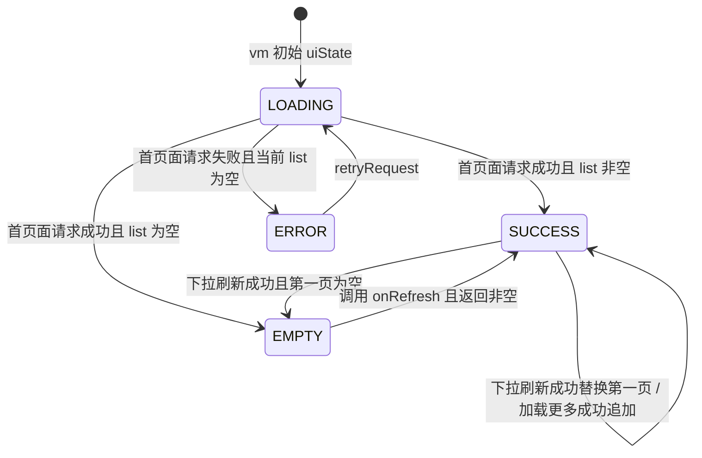

# cml-spec28 基线说明

版本：BASELINE-NOTES-1.0。日期：2026-10-18（Asia/Shanghai）。工程根：`D:/HCUP/cml-spec28`；下列代码、日志与截图路径均相对本工程根，`路径:行号` 可定位原始证据。

本文件完成 `spec-harness/0-analyze.md` 的分析交付。**业务代码未修改；未修改基线已重新干净构建、安装、启动并实际操作。** 实测“我的 → 收货地址”进入登录页；购物车显示占位内容。地址列表内部、新增/编辑/删除和订单选择流程均没有取得运行通过证据，22 个 Spec 原步骤保留 `blocked`，派生功能边界保留 `not_run`。

本次实际 HEAD 为 `b75aa21fdb29af1d3d00aa313360da85c6e05e4f`，不是 metadata 的原始 base；两者关系是既有依赖准备提交，准备来源见 `workflow/baseline-provenance.json:4`、`:28` 起及 `workflow/setup-result.json:8` 起。本轮未采用任何功能实现或上游修复。记录 HEAD 满足快照标识要求，没有新增 tag 或提交。

证据等级严格区分：**Spec 明文**只由 `spec/requirement.md` 支持；**代码事实/代码检索结果**只证明当前源码状态；**条件推断**是明确前提下的风险；**运行实证**有本次命令、UI dump 或截图；没有进入或触发的内容均为**未验证**。静态发现详情页和确认订单页占位，不等于本轮已在设备进入并复现这些页面。

两份正式分析产物为本文件和 `spec/acceptance.md`。`workflow/` 与 `traces/` 是按 AGENTS/调度技能必须保留的角色交接、状态和原始证据，不是新增功能产物。未请求登录、注册、写入地址数据、发布、提交或赛事打包。

基线能力概览：地址列表已有分页、卡片字段及新增/编辑导航；删除和整行选择处理为空；详情页和订单确认页为占位。直接证据：`feature/user/src/main/ets/viewmodel/AddressListViewModel.ets:21`、`:33`、`:41`、`:50`，`feature/user/src/main/ets/view/AddressDetailPage.ets:35`，`feature/order/src/main/ets/view/OrderConfirmPage.ets:35`。运行终点证据：`traces/analysis/baseline-runtime/address-entry.json:1` 与同名 PNG。所有功能缺口只记录，不在本阶段修复。

## 1. 基线快照与记录边界

| 项 | 核对结果 | 证据 |
| --- | --- | --- |
| HEAD | `b75aa21fdb29af1d3d00aa313360da85c6e05e4f` | `traces/analysis/baseline-runtime/fingerprint-before-build.json:3` |
| 官方 base | `9a1d608dc89acfc301657c33ce5dd6089cbf9572` | `spec/metadata.json:2`；`workflow/baseline-provenance.json:4` |
| Spec SHA256 | `9edc8d69229b60db29a8fe1c6ab8939ac4c03a128aaef5cba528ee5c5454f3d3`，匹配派工批准值 | `traces/analysis/baseline-runtime/fingerprint-after-runtime.json:6` |
| metadata SHA256 | `d48cbaae60b67d13fca9c1276ebeb2b96d33cf6a43513e7abf1556e6a56c3f7d`，匹配派工批准值 | 同文件 `:7` |
| 受控文件 | 构建前、构建后、运行后共 821 个文件逐个 SHA256，三次均与准备指纹一致 | `fingerprint-before-build.json:4`、`fingerprint-after-build.json:4`、`fingerprint-after-runtime.json:4`（均位于本证据目录）；`:5` 的变化列表为空 |
| 生产变更 | 无；`git diff --name-only HEAD` 为空 | 上述三份完整哈希清单和各自 `tracked_diff` |

`workflow/setup-result.json` 和 `workflow/baseline-provenance.json` 仅用于准备来源核对。未读取初始化总览会话，未把准备构建/官方示例作为本题功能证据。未修改生产源码、配置、Spec、依赖或鉴权数据。

## 2. 构建、工具、独立设备与告警

每次 PowerShell 工具进程首先执行 `. D:/HCUP/.hcup-local/Enter-HarmonyEnv.ps1`。工具命令、UTC 开始/结束时间、工作目录、原生退出码及原始日志路径在 `traces/analysis/baseline-runtime/commands.jsonl:1` 起逐条记录。日志执行辅助为 `workflow/verification/Invoke-Trace.ps1`。

实际工具：hvigor 6.23.7、hdc 3.2.0c、Node v18.20.1、JBR/OpenJDK 21.0.8、Python 3.12.3、Hypium 6.1.0.210。Python 实际来自只读公共环境 `D:\HCUP\common\.venv\Scripts\python.exe`。各工具原始版本输出为本证据目录 `tool-*-version.log:1`。

最初只读检查发现 `127.0.0.1:11237` 有其他应用前台任务（`device-preflight-abilities.log:3`，`device-preflight-windows.log:16`）。进程归属检查表明它是另一题专用隔离实例。因此未对其安装、启动、停止、卸载或注入 UI 操作。经主 Agent 同意，在本题目录创建独立实例：

| 项 | 实际值 | 证据 |
| --- | --- | --- |
| 实例 | `CmlSpec28Baseline`，本题专用；启动进程 PID 47892 | `emulator-start.json:1` |
| 序列号 | `127.0.0.1:11239` | `device-targets-own.log:3` |
| 系统 | emulator `6.1.0.115(SP11DEVC00E115R4P11)`，API 23 | `own-device-env.log:2`、`own-api.log:1` |
| 屏幕 | 1308 × 2880，560 dpi | `own-device-env.log:3`；实例 `config.ini:19`、`:23`、`:24` |
| 类型 | Phone、自定义屏幕、`PHEMU-FD00`，x86_64，4 GiB RAM | 实例 `config.ini:2`、`:3`、`:4`、`:17`、`:26` |
| 镜像 | 只读公共镜像 `D:/HarmonyDev/emulator/images` | `emulator-start.json:11` |
| 实例目录 | `traces/analysis/baseline-runtime/emulator-instances/CmlSpec28Baseline` | `emulator-start.json:9`；本节 `config.ini` 均指该目录下文件 |

本地 harness 环境检查输出“环境与官方评测规格一致”（`own-device-env.log:5`），该检查实际只比较镜像版本及分辨率。DPI 由实例配置单独核对；本轮没有将自定义 Phone 认定为真实 Pura 90 Pro Max 硬件。

### 本次干净构建和安装

在工程根运行：

```powershell
. D:/HCUP/.hcup-local/Enter-HarmonyEnv.ps1
hvigorw clean assembleHap --mode module -p product=default -p buildMode=debug --no-daemon
```

结果：**pass**，原生退出码 0，`BUILD SUCCESSFUL in 16 s 266 ms`（`baseline-clean-build.log:1609`；命令记录 `commands.jsonl:5`）。实际重新执行 CompileArkTS（`:1600`）。

产物：`entry/build/default/outputs/default/entry-default-unsigned.hap`，7,894,295 字节；SHA256：`4a8fbbcc1333fe4d21f635801e876628fb10be6db2a870c672c813b46955b963`。构建后与运行后哈希一致（`hap-hash.txt:3`、`hap-hash-after-runtime.txt:3`）。此前准备记录的 HAP 哈希不同，不能用此前产物代替本次安装对象。

| 操作 | 原生退出码 | 实际语义结果及证据 |
| --- | --- | --- |
| 首次 `hdc ... install -r D:/HCUP/...hap` | 0 | **fail（命令路径）**。Windows hdc 把正斜杠绝对路径拼到 cwd，报 `[Fail]Error opening file`（`baseline-install.log:1`），未安装 |
| 随后首次 `aa start` | 0 | **fail（未安装）**。`10104001` / `Ability is not installed`（`baseline-start.log:1`） |
| 改用 `hdc -t 127.0.0.1:11239 install -r entry\build\default\outputs\default\entry-default-unsigned.hap` | 0 | **pass**，`install bundle successfully`（`baseline-install-retry.log:1`；`commands.jsonl:19`） |
| `hdc -t 127.0.0.1:11239 shell aa start -a EntryAbility -b com.joker.coolmall` | 0 | **pass**，`start ability successfully`（`baseline-start-retry.log:1`；`commands.jsonl:20`） |

首次失败日志未覆盖。此工具的原生 0 退出码不代表安装/启动语义成功，结论同时检查原始输出。

### 已有告警清单

完整每项位置、原文和原始构建日志行号在 `warnings.json:1` 起；提取脚本为 `workflow/verification/summarize_build.py`，执行退出码 0（`warning-summary.log:1`，`commands.jsonl:10`）。

| 类别 | 本次数量 |
| --- | ---: |
| ArkTS `arkts-strict-typing-required` | 147 |
| ArkTS `arkts-no-typing-with-this` | 1 |
| ArkTS `arkts-no-implicit-return-types` | 10 |
| ArkTS `arkts-no-type-query` | 2 |
| 函数可能抛异常，需特殊处理 | 34 |
| `@BuilderParam content` 初始化方式 | 40 |
| **带文件位置 ArkTS 诊断合计** | **234** |
| 资源名冲突提示 | 175 |
| `sourceMapsPath` 缺失 | 1 |
| `No signingConfig found for product default` | 1 |

原始资源冲突从 `baseline-clean-build.log:151` 开始；`sourceMapsPath` 在 `:1598`，未签名警告在 `:1605`。另有 ArkTS FAQ 提示行，不单计诊断。没有删除/屏蔽告警，没有改 SDK 声明或依赖来消除告警。

## 3. 入口的实际操作与静态调用点

原始 UI dump 未重写，均为单行 JSON，引用 `*.json:1`。屏幕截图与 dump 分开采集，有短时间差；只用两者一致的稳定状态作结论。可见业务节点摘要为 `ui-visible-summary.jsonl`，保留快照名、文字、hint、类型、id、边界和可见性。

| 本地基线诊断 | 结果 | 事实与证据 |
| --- | --- | --- |
| 首页启动、切到“我的” | pass | 显示“未登录”“点击登录账号”“收货地址”（`personal-center.png`、`personal-center.json:1`；摘要 `:7`、`:21`） |
| 点击“收货地址” | pass（仅诊断操作） | **实际进入登录主页**，显示“验证码登录”“账号密码登录”；没有到达地址列表（`address-entry.png`、`address-entry.json:1`；摘要 `:35`、`:36`） |
| 打开“账号密码登录” | pass（仅诊断操作） | 手机号和密码输入均为空，显示占位“请输入手机号”“请输入密码”；未输入或提交凭据（`password-login.png`、`password-login.json:1`；摘要 `:44`、`:45`） |
| 两次 Back | pass（仅返回诊断） | 密码页→登录主页→个人中心（`login-back.png/json:1`、`personal-back.png/json:1`；`commands.jsonl:44`、`:49`） |
| 切到“购物车” | pass（仅诊断操作） | 显示“购物车页面内容视图”，没有可操作的结算内容（`cart-entry.png`、`cart-entry.json:1`；摘要 `:88`） |
| force-stop 后重启，再进“我的”→“收货地址” | pass（仅诊断操作） | 仍显示未登录、再次进入登录主页（`restart-personal.png/json:1`、`restart-address.png/json:1`；摘要 `:124`、`:152`、`:153`；`commands.jsonl:60` 起） |

这里的 pass 只表示对应基线状态被实际观测，并不表示地址需求通过。`workflow/verification/check_baseline_snapshots.py` 对 8 个已采集状态的可见文字断言均通过，退出码 0（`snapshot-checks.log:1`，`snapshot-checks.json:1`）；它不是官方测试或本题完整验收套件，未启动任何隐藏测试。

**静态路由与实测终点分开：** 代码映射指出菜单预期调用地址路由，但受保护路由包含 AddressList、AddressDetail、OrderConfirm（`core/navigation/src/main/ets/RouteInterceptor.ts:16`），`core/navigation/src/main/ets/NavigationService.ets:51` 在未登录时换成登录路由，`core/state/src/main/ets/UserState.ets:146` 根据 token 判登录。详见 `workflow/design/baseline-map.md:31`。这解释当前登录拦截，不构成已运行到地址页的证据。

**网络事实：** 已采集 app PID 3588 的非阻塞 hilog（`own-app-hilog.log:1` 起）。其中商品分类请求有 HTTP 200（`:1552` 请求，`:1558` 状态）。因此不能把阻断泛称为完全断网；本轮没有验证登录请求、地址接口鉴权或地址服务可用性。首页初始 loading 也不能据此判定网络故障。

### 静态入口链（以下不代表已在设备走通）

### 根入口及个人中心到列表

1. **代码事实**：Ability 加载 `view/EntryPage`（`entry/src/main/ets/entryability/EntryAbility.ets:50-54`），EntryPage 挂载 NavigationHost（`entry/src/main/ets/view/EntryPage.ets:39-42`）。NavigationHost 创建并注册全局 NavPathStack，根内容是 MainPage，目标页按 RouteBuild 查询（`entry/src/main/ets/navigation/NavigationHost.ets:13-18,26-29,37-42`）。
2. **代码事实**：MainPage 第 4 个 Tab 是 MePage，索引 3；Tab 标签来自 MainViewModel 的 `app.string.me`，文字为“我的”（`feature/main/src/main/ets/view/MainPage.ets:71-73,114`；`feature/main/src/main/ets/viewmodel/MainViewModel.ets:21-25`；`feature/main/src/main/resources/base/element/string.json:16-17`）。
3. **代码事实**：MePage 在 ListItem 中渲染菜单分组（`feature/main/src/main/ets/view/MePage.ets:111-113,447-453`），每个 IBestCell 的点击调用 `item.onClick()`（同文件 `469-478`）。primaryMenus 中“收货地址”调用 `UserNavigator.toAddressList()`（`feature/main/src/main/ets/viewmodel/MeViewModel.ets:50-55`；文字资源 `feature/main/src/main/resources/base/element/string.json:148-149`）。这里的“个人中心”需求入口实际静态挂在“我的”Tab 菜单；另有 `user/profile` 路由，不应把它当成已证实的地址入口（`core/navigation/src/main/ets/user/UserNavigator.ets:14-15`）。
4. **代码事实**：`toAddressList()` 导向 `user/address-list`；有参数时仅传 `{ isSelectMode }`（`core/navigation/src/main/ets/user/UserNavigator.ets:23-29`；`core/navigation/src/main/ets/user/UserRoutes.ts:13`）。UserGraph 注册 AddressListNav，Nav 构造 AddressListPage（`feature/user/src/main/ets/navigation/UserGraph.ets:18`；`feature/user/src/main/ets/navigation/AddressListNav.ets:9-10`）。Ability 启动时注册 UserGraph 和 OrderGraph（`entry/src/main/ets/entryability/EntryAbility.ets:100-109`）。
5. **代码事实**：地址列表、地址详情、确认订单都是受保护路由（`core/navigation/src/main/ets/RouteInterceptor.ts:16-25`）。`navigateTo` 检查 `getUserState().isLoggedIn()`，未登录时改跳登录路由，再入栈（`core/navigation/src/main/ets/NavigationService.ets:51-74`）。`isLoggedIn` 仅依据 token 非空（`core/state/src/main/ets/UserState.ets:146-147`），不等于服务端 token 一定有效。

**运行实证与剩余未验证项**：本轮已实际点击“我的 → 收货地址”并到达登录页，菜单位置和点击过程见 `traces/analysis/baseline-runtime/commands.jsonl:25`、`:30` 及 `personal-center.png`、`address-entry.png`（同目录）。登录后的地址列表可达性、登录/地址服务响应和列表内部行为仍未验证；上面的源码调用链不能代替这些运行证据。

### 列表到新增/编辑

| 触发 | 精确调用链与参数 | 静态目标现状 |
| --- | --- | --- |
| 底部“新增地址” | `feature/user/src/main/ets/view/AddressListPage.ets:58-61` → `UserNavigator.toAddressDetail()`（`core/navigation/src/main/ets/user/UserNavigator.ets:38-44`） | 无参数入 `user/address-detail`（`core/navigation/src/main/ets/user/UserRoutes.ts:17`） |
| 某行右侧编辑图标 | `feature/user/src/main/ets/view/AddressListPage.ets:115-118` → `AddressListViewModel.onEditAddress(item.id)` → `toAddressDetail(true,addressId)`（`feature/user/src/main/ets/viewmodel/AddressListViewModel.ets:41-42`） | 传出 `{ isEditMode:true,addressId }`，详情页没有接收/应用逻辑 |
| 详情路由构造 | `feature/user/src/main/ets/navigation/UserGraph.ets:19` → `AddressDetailNav`（`feature/user/src/main/ets/navigation/AddressDetailNav.ets:9-10`） | `AddressDetailPage.ets:22` 固定标题“地址详情”；`:35` 固定占位文字 |

**代码事实**：`UserAddressDetailParam` 定义了可选 `isEditMode`、`addressId`（`core/navigation/src/main/ets/user/UserParam.ets:19-27`）。目标 AddressDetailViewModel 仅继承空基类，没有 `getRouteParams`、地址状态或仓库字段（`feature/user/src/main/ets/viewmodel/AddressDetailViewModel.ets:1-9`）；不能依据参数声明认定新增/编辑分流已实现。

### 确认订单到选择列表

- **代码事实**：订单路由 `order/confirm` 存在（`core/navigation/src/main/ets/order/OrderRoutes.ts:13`），OrderGraph 注册该路由，Nav 构造 OrderConfirmPage（`feature/order/src/main/ets/navigation/OrderGraph.ets:21`；`feature/order/src/main/ets/navigation/OrderConfirmNav.ets:9-10`）。`OrderNavigator.toConfirm()` 也存在（`core/navigation/src/main/ets/order/OrderNavigator.ets:29-30`）。
- **代码事实**：OrderConfirmPage 固定标题为“订单确认”，只渲染占位文字；VM 为空，无地址卡片、地址点击、默认地址获取或返回接收（`feature/order/src/main/ets/view/OrderConfirmPage.ets:22,34-35`；`feature/order/src/main/ets/viewmodel/OrderConfirmViewModel.ets:8-9`）。资源中另有“确认订单”，不能当成当前页面标题（`feature/order/src/main/resources/base/element/string.json:12-13`）。
- **代码检索结果**：在 `entry/src/main/ets`、`core`、`feature` 生产 `.ets/.ts`（排除依赖、build、test、ohosTest）检索 `toConfirm`，仅命中上述函数定义；检索 `toAddressList`，仅命中封装及 MeViewModel 调用，没有 `toAddressList(true)` 调用。购物车与商品详情页也都是占位内容（`feature/main/src/main/ets/view/CartPage.ets:34-35`；`feature/main/src/main/ets/viewmodel/CartViewModel.ets:8-9`；`feature/goods/src/main/ets/view/GoodsDetailPage.ets:34-35`；`feature/goods/src/main/ets/viewmodel/GoodsDetailViewModel.ets:8-9`）。
- **条件推断**：当前生产源码缺少从常规购买流程进入确认订单的已接线调用点；不能仅因路由已注册就声明场景三可实际进入。没有对设备上的 UI、深链或其他外部入口作断言。

## 4. 页面、状态、数据、网络和本地存储现状

### 页面组件与字段展示

| 组件/状态 | 基线写法和证据 |
| --- | --- |
| 页面 VM | `@Local AddressListViewModel`（`feature/user/src/main/ets/view/AddressListPage.ets:25-26`）；VM 是 `@ObservedV2`，继承 `BaseNetWorkListViewModel<Address>`（`feature/user/src/main/ets/viewmodel/AddressListViewModel.ets:10-11`） |
| 网络壳 | BaseNetWorkListView 接受 vm.uiState、重试回调，内容为地址 List（`feature/user/src/main/ets/view/AddressListPage.ets:52-56`）；其默认 loading/error/empty 组件是 PageLoading/EmptyNetwork/EmptyData（`core/ui/src/main/ets/component/network/BaseNetWorkListView.ets:49-70`） |
| 列表及刷新 | RefreshLayout 接 vm.isLoading/isEnableSlideUp/scroller，方向回调交 VM；List 使用 `ForEach(vm.listData)`，key 为地址 id 字符串（`feature/user/src/main/ets/view/AddressListPage.ets:74-89`）；RefreshLayout 转交 IBestPullRefresh（`core/ui/src/main/ets/component/refresh/RefreshLayout.ets:41-52`） |
| 地址行 | AddressCard 接 item、整行回调和 actionSlot（`feature/user/src/main/ets/view/AddressListPage.ets:99-104`）；省市区直接无空格拼接（`core/ui/src/main/ets/component/address/AddressCard.ets:216-217`），详细地址为 `address.address`（同文件 `98-102`），联系人为 `address.contact`、手机号为 `address.phone`（同文件 `135-147`） |
| 默认标签 | `if(address.isDefault)` 显示 IBestTag；文字资源是“默认”（`core/ui/src/main/ets/component/address/AddressCard.ets:150-156`；`core/ui/src/main/resources/base/element/string.json:184-185`）。代码没有要求默认地址排到第一行；Spec 也允许标签在旁边（`spec/requirement.md:12`） |
| 编辑/删除 | 两个 AddressActionButton 使用编辑/删除图标和对应 item.id（`feature/user/src/main/ets/view/AddressListPage.ets:114-123`）。AddressActionButton 是带 CommonIcon 的圆形 Row，只挂 onClick（`core/ui/src/main/ets/component/address/AddressActionButton.ets:47-60`） |
| 新增按钮 | 仅 `uiState` 不是 LOADING、ERROR 时显示（`feature/user/src/main/ets/viewmodel/AddressListViewModel.ets:57-59`）。因此 EMPTY 时会显示，初次 loading/error 时不会显示；这只是代码条件，不是实测屏幕结论 |

### 当前列表网络状态机（静态）



**代码事实**：首次 `aboutToAppear → initLoad → loadListData` 发起请求（`core/base/src/main/ets/viewmodel/BaseNetWorkListViewModel.ets:58-82`）。请求是新建 PageRequest，把 `currentPage` 与 `pageSize` 赋入，再调 `getAddressPage`（`feature/user/src/main/ets/viewmodel/AddressListViewModel.ets:21-25`）。初始 page=1、size=10（基类 `:38-42`），PageRequest.sort 默认 desc（`core/model/src/main/ets/request/PageRequest.ets:9-17`）。首屏显示的是分页结果；不能把单次请求描述成“已经一次取回全部地址”。

**代码事实**：第一页成功替换 listData，并转 SUCCESS/EMPTY；后续页追加；`hasMore` 根据 pagination 的 `size * page < total` 计算（`core/base/src/main/ets/viewmodel/BaseNetWorkListViewModel.ets:90-107,181-187`）。第一页请求失败且已有数据时保留现有 uiState；空数据时转 ERROR；后续页失败回退 currentPage（同文件 `114-124`）。所有 `loadListData` 的 finally 将 isLoading 恢复 false（同文件 `80-82`）。图中的 EMPTY→SUCCESS 仅表示方法级状态转移；EMPTY 默认 UI 未提供刷新入口，不能据图认定用户实际可触发。

| 用户/生命周期动作 | 当前发出的业务请求与 loading/去重 | 精确证据 |
| --- | --- | --- |
| 列表组件首次出现 | 地址分页请求；初始 uiState=LOADING，但 isLoading 初值 false，initLoad/loadListData 不置 true | `core/base/src/main/ets/viewmodel/BaseNetWorkListViewModel.ets:19,29,58-82` |
| 下拉刷新 | 若 isLoading 已为 true 则直接返回；否则置 true、page=1 后请求 | 同文件 `140-147` |
| 上滑更多 | isLoading=true、无下一页或 list 为空时不请求；否则置 true、page+1 后请求 | 同文件 `153-159` |
| 错误页重试 | 设 LOADING、page=1 后请求；该方法没有自身的 isLoading 去重检查/置 true | 同文件 `130-134` |
| 点击编辑 | 只调用详情导航，没有 getAddressInfo/update 请求 | `feature/user/src/main/ets/viewmodel/AddressListViewModel.ets:41-42`；详情 VM `AddressDetailViewModel.ets:8-9` |
| 点击新增 | 只调用详情导航，没有 add 请求 | `feature/user/src/main/ets/view/AddressListPage.ets:59-61`；详情 VM `AddressDetailViewModel.ets:8-9` |
| 点击整行/删除 | 空方法，没有请求、确认对话框、移除或返回 | `feature/user/src/main/ets/viewmodel/AddressListViewModel.ets:33-34,50-51` |
| 保存地址 | 当前目标页没有保存按钮或处理函数，因此无保存请求/loading 状态可观察 | `feature/user/src/main/ets/view/AddressDetailPage.ets:34-35`；详情 VM `AddressDetailViewModel.ets:8-9` |

**条件推断**：初次加载/重试与 onRefresh/onLoadMore 共用一个 isLoading，但前两者不置 true，且 loadListData/retryRequest 没有请求标识或互斥保护，不能声称整个列表已覆盖并发/快速重试去重。是否能通过设备 UI 制造重叠请求尚未验证（上述同文件 `74-82,130-159`）。

### 返回与刷新

- **代码事实**：AppNavDestination 在 aboutToAppear 和 onShown 分别转发 VM 生命周期（`core/ui/src/main/ets/component/navdestination/AppNavDestination.ets:73-75,131-133`）。BaseNetWorkListViewModel 只在 aboutToAppear 初次加载；AddressListViewModel 没有 onShown 覆盖或详情返回回调（`core/base/src/main/ets/viewmodel/BaseNetWorkListViewModel.ets:58-60`；`feature/user/src/main/ets/viewmodel/AddressListViewModel.ets:11-61`），BaseViewModel.onShown 本身为空（`core/base/src/main/ets/viewmodel/BaseViewModel.ets:55-56`）。
- **代码事实**：详情没有保存、navigateBack 或结果返回代码，列表也没有新增/更新/删除完成事件处理。因此“成功保存后自动返回并刷新”当前没有实现链条（`feature/user/src/main/ets/viewmodel/AddressDetailViewModel.ets:8-9`；`feature/user/src/main/ets/viewmodel/AddressListViewModel.ets:11-61`）。
- **条件推断**：如果页面在栈上保留，仅弹回不保证再次调用 aboutToAppear；因此不能凭现有初始化加载认定返回就会刷新。实际生命周期次数由独立验证角色测定。

### 地址数据模型与回填

| 业务字段 | Address 的实际字段/默认值 | 构造复制位置 | 详情页当前回填状态 |
| --- | --- | --- | --- |
| 地址标识 | `id:number=0`（`core/model/src/main/ets/entity/Address.ets:9`） | 同文件 `55` | 未读取 addressId；未加载真实记录 |
| 用户标识 | `userId:number=0`（同文件 `13`） | 同文件 `56` | 无表单/请求组装 |
| 联系人 | `contact:string=""`（同文件 `17`） | 同文件 `57` | 无输入组件或状态 |
| 手机号 | `phone:string=""`（同文件 `21`） | 同文件 `58` | 无输入组件或状态 |
| 省/市/区 | `province/city/district:string=""`（同文件 `25,29,33`） | 同文件 `59-61` | 无地区文本/选择值/级联状态 |
| 详细地址 | `address:string=""`（同文件 `37`） | 同文件 `62` | 无输入组件或状态 |
| 是否默认 | `isDefault:boolean=false`（同文件 `41`） | 同文件 `63` | 无开关或状态 |
| 时间字段 | `createTime?/updateTime?:string|null=null`（同文件 `45,49`） | 同文件 `64-65` | 无保存快照 |

整张表“无回填”的共同直接证据是 `feature/user/src/main/ets/view/AddressDetailPage.ets:34-35` 和 `feature/user/src/main/ets/viewmodel/AddressDetailViewModel.ets:8-9`。

**代码事实**：手机号在当前模型、构造复制和地址卡片中一致使用 `phone`（`core/model/src/main/ets/entity/Address.ets:21,58`；`core/ui/src/main/ets/component/address/AddressCard.ets:143`）。生产源码 `.ets/.ts` 的 `mobile` 检索无命中；尚无回填代码，因此没有证据把 phone/mobile 命名不一致描述为“现存 bug”。真实接口是否使用 phone、电话号码是否完整、默认字段真实类型/值均未验证。

**代码事实**：分页网络实现直接返回 `resp.data`，未逐条 `new Address(...)` 或转换字段（`core/network/src/main/ets/datasource/address/AddressNetworkDataSourceImpl.ets:27-30`）；NetworkPageData 构造也只是保留 payload.list（`core/model/src/main/ets/network/NetworkPageData.ets:21-23`）。类型声明本身不能作为服务端真实数据字段已确认的证据。

**代码事实**：`ConfirmOrder` 中已有 `defaultAddress?:Address|null`，构造时可以复制为 Address（`core/model/src/main/ets/entity/OrderConfirm.ets:8-23`），并由 model 导出（`core/model/Index.ets:74`）；但确认订单 VM 没有使用它（`feature/order/src/main/ets/viewmodel/OrderConfirmViewModel.ets:1-9`）。创建订单请求模型存在 `addressId:number`（`core/model/src/main/ets/request/CreateOrderRequest.ets:24-36`），这不证明地址选择回传已接线。

### 网络与本地存储

### 已有地址接口

地址 Repository 可注入 AddressNetworkDataSource，默认创建真实网络实现（`core/data/src/main/ets/repository/AddressRepository.ets:12,18-19`）。它没有地址本地缓存字段，仅转交网络方法（同文件 `27-80`）。

| 接口 | Repository 位置 | 网络方法、路径、参数 | 当前页面调用情况 |
| --- | --- | --- | --- |
| 分页 | `core/data/src/main/ets/repository/AddressRepository.ets:36-37` | POST `user/address/page`，PageRequest；`core/network/src/main/ets/datasource/address/AddressNetworkDataSourceImpl.ets:27-30` | AddressListViewModel `:21-25` 已调用 |
| 全列表 | Repository `:44-45` | POST `user/address/list`，无显式 body；网络实现 `:37-40` | 生产 feature/entry 未找到调用 |
| 详情 | Repository `:71-72` | GET `user/address/info`，query `{id}`；网络实现 `:70-73` | 详情 VM 未调用 |
| 新增 | Repository `:62-63` | POST `user/address/add`，Address；返回 NetworkResponse&lt;Id&gt;；网络实现 `:59-62` | 未接表单、未调用 |
| 更新 | Repository `:27-28` | POST `user/address/update`，Address；返回 NetworkResponse&lt;void&gt;；网络实现 `:16-19` | 未接表单、未调用 |
| 删除 | Repository `:53-54` | POST `user/address/delete`，Ids；返回 NetworkResponse&lt;void&gt;；网络实现 `:48-51` | 列表回调为空，未调用 |
| 默认地址 | Repository `:79-80` | GET `user/address/default`；返回 Address 或 null；网络实现 `:80-83` | 订单确认 VM 未调用 |

表内缩写“Repository”均指 `core/data/src/main/ets/repository/AddressRepository.ets`，“网络实现”均指 `core/network/src/main/ets/datasource/address/AddressNetworkDataSourceImpl.ets`。删除参数类 Ids 具有 `ids:number[]`（`core/model/src/main/ets/common/Ids.ets:5-12`）。以上是已声明协议，不是已观察到的服务端交互。

### 响应处理与条件风险

- **代码事实**：NetworkClient 的 baseURL 为 `https://mall.dusksnow.top/app/`，Axios timeout 为 10000 ms，JSON 请求头（`core/network/src/main/ets/NetworkClient.ets:16-24`）。全局拦截器从 TokenStore 取 token 并写 Authorization（`core/network/src/main/ets/interceptors/AppInterceptors.ets:19-28`）。静态映射角色没有访问该地址，也不据此断言服务可用。
- **代码事实**：NetworkResponse.code===1000 代表 isSucceeded；缺省 data 会变 null（`core/model/src/main/ets/network/NetworkResponse.ets:23-26,33-35`）。RequestHelper 无论 response() 还是 execute()，最终都经 `runInternal`，仅在 `resp.isSucceeded && resp.data !== null` 条件下返回成功（`core/result/src/main/ets/RequestHelper.ets:59-60,87-88,111-125`）。
- **条件推断**：若地址更新/删除真实成功响应是 data:null 或缺省 data，当前 RequestHelper 会判失败；NetworkResponse&lt;void&gt; 类型仅提示应关注此边界，不能证明真实服务一定返回 null。真实 update/delete 响应、错误文案和是否发生该失败均未验证，不能写成已经复现的错误。
- **代码事实**：RequestHelper.loading(true) 会 showLoading，并在 finally hide；但它不提供用户点击互斥（`core/result/src/main/ets/RequestHelper.ets:68-70,107-109,126-129`）。调用方传入的是已经创建的 Promise（同文件 `14,32-42`）。当前详情页既未使用该 helper，也没有保存 loading 状态（`feature/user/src/main/ets/viewmodel/AddressDetailViewModel.ets:8-9`）。

### 存储与环境依赖

- **代码事实**：地址 Repository 仅有 networkDataSource（`core/data/src/main/ets/repository/AddressRepository.ets:8-19`）。在 `core/database/src/main/ets`、`core/datastore/src/main/ets`、`core/state/src/main/ets` 和 util/storage 检索 Address/address 没有地址实体或缓存实现；模块导出分别只有购物车/足迹/搜索历史、账号/token、用户/断点/安全区（`core/database/Index.ets:8-25`；`core/datastore/Index.ets:6-12`；`core/state/Index.ets:6-31`）。因此未发现可替代真实地址服务的本地地址持久化链条。
- **代码事实**：token 使用 Preferences 文件 `token_store` 和键 `token`，有保存/读取/清除方法（`core/datastore/src/main/ets/datasource/token/TokenStoreDataSourceImpl.ets:18-22,38-56`）。用户状态通过 PersistenceV2 持久化，更新登录状态会保存 token（`core/state/src/main/ets/UserState.ets:43-47,170-171,181-187`）；这些是登录存储，不是地址缓存。
- **未验证**：需有效账号和服务端已保存地址，才能对列表、真实字段、编辑图标后详情一致性作完整运行核查；当前本地是否具备账号、服务可用性、地址数量、跨应用重启持久化和网络实际请求次数，由独立验证记录。本源码未出现地址 WebDAV 依赖（依据上述 Repository/存储链条及 AddressNetworkDataSourceImpl 的现有调用）；不得据此扩展出需要 WebDAV 的前置条件。

## 5. 可复用的既有实现

| 既有能力 | 位置 | 已具备/未具备的边界 |
| --- | --- | --- |
| 地址模型与 API 分层 | `core/model/src/main/ets/entity/Address.ets:5-66`；`core/data/src/main/ets/repository/AddressRepository.ets:18-80` | 完整地址字段、可注入网络源及增删改查封装已存在；无表单状态或真实响应验证 |
| 列表/刷新/网络空错态 | `core/base/src/main/ets/viewmodel/BaseNetWorkListViewModel.ets:19-42,58-187`；`core/ui/src/main/ets/component/network/BaseNetWorkListView.ets:49-118`；`core/ui/src/main/ets/component/refresh/RefreshLayout.ets:41-52` | 分页、下拉、加载更多、空错态已有；不覆盖地址变更后自动刷新或完整请求去重 |
| 地址卡片 | `core/ui/src/main/ets/component/address/AddressCard.ets:24-45,51-60,84-157,165-217` | 支持空地址提示、整卡点击、自定义操作插槽和 addressSelected 箭头；确认订单尚未使用 |
| 导航参数和带结果返回 | `core/navigation/src/main/ets/NavigationService.ets:84-112,139-183,192-201` | 已有 navigateBackWithResult、navigateToWithResult、navigateToForResult、getRouteParams；地址导航封装当前只用 navigateTo，无返回监听（`core/navigation/src/main/ets/user/UserNavigator.ets:23-44`） |
| 底部按钮 loading | `core/ui/src/main/ets/component/bottombar/AppBottomButton.ets:25-26,49-58` | loading 同时控制 IBestButton.loading 和 disabled；地址详情没有实例化保存按钮 |
| 手机输入风格与校验 | `feature/auth/src/main/ets/component/PhoneInputField.ets:39-63`；`core/util/src/main/ets/validation/ValidationUtil.ets:9,21-22` | 有 IBestField 受控 value/onChange 写法，手机号正则 `/^1[3-9]\d{9}$/`；地址详情没有使用，不代表编辑不变字段已经通过校验 |
| 既有文字资源 | `feature/user/src/main/resources/base/element/string.json:28-105` | 已有“编辑地址”“确认删除该地址吗？”“保存”“新增地址”“联系人”等资源；资源存在不能证明 UI/行为存在；“设置默认地址”“手机号码”“省市区”与 Spec 逐字文字也有差异 |

### 级联选择器及第三方地址表单

**代码事实**：本题的 ibestui 模块原样导出 `@ibestservices/ibest-ui-v2`，固定依赖 1.1.3（`core/ibestui/Index.ets:6`；`core/ibestui/oh-package.json5:9`）。已安装依赖根记为：

`IBEST = oh_modules/.ohpm/@ibestservices+ibest-ui-v2@1.1.3/oh_modules/@ibestservices/ibest-ui-v2`

以下 `IBEST/...` 是该完整本地路径的缩写，属于本题安装的通用组件声明，非来源项目功能实现。

- **代码事实**：`IBEST/Index.d.ets:29-30` 导出 IBestCascader、IBestCascaderContent、IBestCascaderOption；`:39-40,57,62,120-121` 还导出 Field、Switch、Dialog、ContactAddressForm/Controller。当前生产 `core/feature/entry`（排除 oh_modules、build）未找到 IBestCascader、IBestContactAddressForm、IBestSwitch、IBestDialog 的实例使用，地址详情自身为占位（`feature/user/src/main/ets/view/AddressDetailPage.ets:34-35`）。
- **代码事实**：CascaderOption 包含 text/value/children（`IBEST/src/main/ets/s/e1/r.d.ets:7-17`）。Cascader 接收 visible、value、options、lazyLoad、onChange、onConfirm（`IBEST/src/main/ets/s/e1/e.d.ets:98-116,143-163`）。声明说明 selectAnyLevel=false 时选择最后一级触发 onConfirm，true 时点击按钮触发（同文件 `133-138,155-159`）；所以“库有 onConfirm”不能直接认定符合 Spec 的选完三级再点击确认行为，需将来实测库实际交互。
- **代码事实**：通用 IBestContactAddressForm 要求外部 regionData，提供 getFormValues/setFormValues，内部名称为 name/phone/provinceCityDistrict/detail（`IBEST/src/main/ets/s/r3/e.d.ets:15-20,77-90,107-108`）。它没有在本题集成，name/detail 与业务 Address.contact/address 不同仅是声明差异，不是已存在的保存映射 bug。
- **代码检索结果**：在本题业务 `core/network/src/main/ets`、`core/data/src/main/ets`、`feature/user/src/main/ets`、`entry/src/main/ets` 检索 province/district/region/cascad 未发现行政区加载链条；`feature/user/src/main/resources`、`entry/src/main/resources`、`core/ui/src/main/resources` 文件名检索 area/region/province/city/district/cascad 未发现地区数据文件。**未验证**：地区完整数据来源、行政区覆盖范围、选择器回填/取消/部分选择语义尚无业务证据，不能因为组件依赖存在就认定三级联动已具备。

## 6. 缺失能力与条件风险

以下缺口的“未实现”均为静态事实；在设备上是否可到达占位页、会显示什么错误，仍须独立验证。

| 缺口/风险 | 需求来源 | 直接源码证据或条件边界 |
| --- | --- | --- |
| 删除确认、取消分支、确认后请求与列表移除/刷新 | `spec/requirement.md:14-15` | `feature/user/src/main/ets/viewmodel/AddressListViewModel.ets:50-51` 空方法；文案仅资源 `feature/user/src/main/resources/base/element/string.json:48-49` |
| 新增标题、四必填、默认开关、保存按钮及空/纯空格/格式校验 | `spec/requirement.md:26-30` | `feature/user/src/main/ets/view/AddressDetailPage.ets:22,34-35`；`AddressDetailViewModel.ets:8-9` 占位，无表单 |
| 行政区数据、三级联动、确认后填文案、取消/关闭/部分选择状态 | `spec/requirement.md:27-28` | 详情占位；组件声明有 options 接口，但未集成，见本文件“级联选择器及第三方地址表单”小节 |
| 新增请求、保存成功返回、列表出现新数据、失败恢复 | `spec/requirement.md:30-31` | 底层 add 已有但详情 VM `:8-9` 空；列表 VM 无返回监听（`feature/user/src/main/ets/viewmodel/AddressListViewModel.ets:11-61`） |
| 编辑标题、真实回填并保持其余字段/默认状态 | `spec/requirement.md:55-56` | 只传 id/模式（列表 VM `:41-42`），详情未接收；固定“地址详情”与占位文字（详情 Page `:22,35`） |
| 按编辑模式更新、不能新增、保存快速连点去重和 loading 绑定 | `spec/requirement.md:57` | 详情 VM `:8-9` 空，未调用任何地址 API；不应宣称存在“更新错调新增”的现存实现 |
| 编辑成功后返回正常列表、修改姓名可见、再次编辑/应用重启持久化 | `spec/requirement.md:58-59`；重启为分析阶段边界推导 | 没有保存/返回/刷新链条；地址只在网络仓库，没有本地地址缓存（本文件“返回与刷新”和“网络与本地存储”小节）；真实服务持久化未验证 |
| 选择模式入口、点击行立即回传并更新订单卡片 | `spec/requirement.md:41-44` | 订单 Page/VM 占位；`isSelectMode` 只有声明和传出、未消费（`core/navigation/src/main/ets/user/UserParam.ets:9-13`；`feature/user/src/main/ets/viewmodel/AddressListViewModel.ets:11-61`）；onAddressClick `:33-34` 为空 |
| 编辑/删除图标点击与整卡点击隔离 | `spec/requirement.md:43,54` | Card 父容器 onClick（`core/ui/src/main/ets/component/card/Card.ets:62`）与图标 Row onClick（`core/ui/src/main/ets/component/address/AddressActionButton.ets:60`）均存在，未显式 stopPropagation；是否实际同时触发是条件风险，未验证，当前整行本就空 |
| 列表错误时新增入口不可见 | 分析阶段请求失败边界 | `feature/user/src/main/ets/viewmodel/AddressListViewModel.ets:57-59` 排除 ERROR；当真实网络失败造成 ERROR 时会影响新增入口，是否出现取决于运行环境 |
| “所有已保存”与分页末页/重复请求 | `spec/requirement.md:11,42` | pageSize=10、loadMore/hasMore 已有（基类 `:42,153-159,181-187`）；真实 pagination 是否正确、是否可连续看到所有条目未验证 |
| 成功空响应被 RequestHelper 判失败 | update/delete 后成功返回边界 | 本文件“响应处理与条件风险”小节是条件推断，必须先验证真实响应，不能作为已复现 bug |

## 7. 前置环境、逐步骤验证状态和最小复现

编号直接对应批准 Spec 的场景/步骤，不代替主 Agent 的原子验收矩阵。`AUTH`：自然地址入口进入登录页，缺少合法已登录账号；`ORDER`：未获得可操作确认订单前置，购物车只有占位内容；`DATA`：没有账号下真实保存地址数据。各阻断均不计通过。

| Spec 项 | 来源行 | 本轮状态 | 未验证内容及阻断 |
| --- | ---: | --- | --- |
| S1.1 | 11 | blocked | 个人中心入口已点击；加载用户全部地址未验证，AUTH；确认订单入口另有 ORDER |
| S1.2 | 12 | blocked | 姓名、手机号、省市区、详细地址、默认标签，AUTH + DATA |
| S1.3 | 13 | blocked | 右侧编辑与已有信息回填，AUTH + DATA |
| S1.4 | 14 | blocked | 删除图标及“确认删除该地址吗？”对话框，AUTH + DATA |
| S1.5 | 15 | blocked | 确认删除、剩余地址及刷新，AUTH + DATA |
| S1.6 | 16 | blocked | 地址页“新增地址”入口，AUTH |
| S2.1 | 26 | blocked | “新增地址”标题、四必填和默认开关，AUTH |
| S2.2 | 27 | blocked | 省/市/区级联及确认，AUTH |
| S2.3 | 28 | blocked | 所在地区文字填入，AUTH |
| S2.4 | 29 | blocked | 填字段和默认切换，AUTH |
| S2.5 | 30 | blocked | 手机格式校验、“手机号格式不正确”、新增请求，AUTH |
| S2.6 | 31 | blocked | 保存返回和新增列表数据，AUTH |
| S3.1 | 41 | blocked | 确认订单地址区域→选择模式，ORDER + AUTH |
| S3.2 | 42 | blocked | 浏览真实已保存地址，ORDER + AUTH + DATA |
| S3.3 | 43 | blocked | 点击地址行立即携数据返回，ORDER + AUTH + DATA |
| S3.4 | 44 | blocked | 订单地址卡更新，ORDER + AUTH + DATA |
| S4.1 | 54 | blocked | 点击已有地址编辑图标，AUTH + DATA |
| S4.2 | 55 | blocked | “编辑地址”标题、四字段真实回填、默认状态，AUTH + DATA |
| S4.3 | 56 | blocked | 只改联系人、保持其余字段，AUTH + DATA |
| S4.4 | 57 | blocked | 更新而非新增请求、去重点击、无误报校验，AUTH + DATA |
| S4.5 | 58 | blocked | 保存返回且列表正常展示，AUTH + DATA |
| S4.6 | 59 | blocked | 列表姓名、再次编辑回填、其余字段不变，AUTH + DATA |

以下派生边界均 **not_run**：地址输入为空/纯空格、地区取消/关闭、默认切换、编辑或保存取消、重复/快速点击、无地址/最后一页、部分操作、请求失败与 loading 恢复、地址页返回重进及地址数据跨应用重启保持。原因是尚未通过 AUTH/ORDER/DATA 前置进入相关功能；已做的“应用重启后入口”诊断不证明地址数据持久化。

### 阻断、归因与已解决工具问题

### B-AUTH：真实账号前置缺失（blocked，强运行证据）

1. 在 11239 安装本次 HAP，`aa start -a EntryAbility -b com.joker.coolmall`。
2. 点“我的”（当前屏幕坐标 1144,2732），确认“未登录”。
3. 点“收货地址”（425,1390）。

期望（进入 Spec 场景的前置）：以合法用户身份进入地址管理，具备其真实地址数据。实际：到达登录主页。原始操作见 `commands.jsonl:25`、`:30`；界面证据见本文件第 3 节，重启后同样复现。没有可用已登录账号，未尝试默认凭据、注册、伪造 token、注入地址数据或绕过鉴权。本题 README 检索未发现测试凭据；代码映射复核结果一致。**归因假设：符合基线鉴权拦截，阻断来自可用测试账号前置缺失；不是已证明的登录 bug。** 建议主 Agent 安排合法账号/登录会话及其地址数据后重测。

### B-ORDER：购物车占位，确认订单前置未取得（blocked，局部强运行证据）

从个人中心返回主 Tab，点击“购物车”（817,2732）。实际只显示“购物车页面内容视图”，未找到结算入口。证据 `commands.jsonl:54`、`cart-entry.json:1`、`cart-entry.png`。这仅证明当前购物车界面现状，不能推断所有订单路径都不可达。静态映射另指出确认订单和地址详情均有占位缺口（`workflow/design/baseline-map.md:14`、`:48`）；**这些页面本轮没有实际进入，属于代码证据，不宣称实机复现失败。** 建议主 Agent 在方案/编码阶段处理已确认缺口，并明确如何形成合法订单选择前置。

### B-PATH：hdc Windows 路径语义（已解决，强命令证据）

最小复现、期望/实际、原始错误及成功重试已列本文件第 2 节。归因：hdc 对 `D:/...` 的路径解析；改用本题 Windows 相对路径即安装成功，不涉及生产代码修复。

## 8. 选择器、同名文本与运行证据风险

**代码检索结果**：`rg -n '\.id\s*\(' entry/src/main/ets core feature -g '*.ets' -g '*.ts'`（排除依赖、build、test、ohosTest）未找到生产 `.id()`。下面相关业务节点也均未设置 id；`ForEach` 的 key 是渲染标识，不是 Hypium 可直接使用的组件 id（`feature/user/src/main/ets/view/AddressListPage.ets:81-85`）。后续验收所需 id 清单由需求矩阵定义，本轮不添加。

| 观察目标 | 基线选择器风险 | 源码位置 |
| --- | --- | --- |
| “我的”“收货地址”入口 | 无稳定 id；“收货地址”同时用作菜单文字与列表标题，按文本找对象需先确认当前页面 | `feature/main/src/main/ets/view/MainPage.ets:114`；`feature/main/src/main/ets/view/MePage.ets:469-479`；`feature/user/src/main/ets/view/AddressListPage.ets:42-43`；两文字资源分别 `feature/main/src/main/resources/base/element/string.json:148-149`、`feature/user/src/main/resources/base/element/string.json:12-13` |
| 指定地址行、联系人、手机号、地区、详细地址、默认标签 | 无按 address.id 绑定的 UI id；不同地址可能有同名联系人/相同电话/相同地区；默认文本可能有多个资源或节点，不能仅文本定位到目标记录 | `feature/user/src/main/ets/view/AddressListPage.ets:81-85,99-104`；`core/ui/src/main/ets/component/address/AddressCard.ets:90-102,135-156` |
| 编辑/删除图标 | 每条地址都有同样图标，组件没有文本标签、id 或显式 accessibilityText；搜“编辑”/“删除”文字不能证明点击到图标；已有文字资源未在此按钮使用 | `feature/user/src/main/ets/view/AddressListPage.ets:114-123`；`core/ui/src/main/ets/component/address/AddressActionButton.ets:47-60`；`core/ui/src/main/resources/base/element/string.json:188-193` |
| 新增按钮 | 文本“新增地址”可见时可能在将来与页标题同名；无稳定 id；当前 LOADING/ERROR 条件隐藏 | `feature/user/src/main/ets/view/AddressListPage.ets:58-62`；`core/ui/src/main/ets/component/bottombar/AppBottomButton.ets:49-59` |
| 删除对话框/确认/取消 | 业务对话框缺失；资源中 ok 和 confirm 都是“确认”，不能从资源个数推断设备节点 | `feature/user/src/main/ets/viewmodel/AddressListViewModel.ets:50-51`；`feature/user/src/main/resources/base/element/string.json:36-49` |
| 编辑/新增标题、四输入、开关、地区弹层、保存/loading | 目标组件全部未实现，无可用于回填、保持值、模式、去重或关闭断言的稳定节点 | `feature/user/src/main/ets/view/AddressDetailPage.ets:20-35`；`feature/user/src/main/ets/viewmodel/AddressDetailViewModel.ets:8-9` |
| 确认订单地址区域/选中后卡片 | 业务节点缺失，无法从同名联系人反推订单卡片已更新 | `feature/order/src/main/ets/view/OrderConfirmPage.ets:34-35`；`feature/order/src/main/ets/viewmodel/OrderConfirmViewModel.ets:8-9` |
| 网络 loading/error/empty/content | BaseNetWorkListView 同时构建四个 Column，通过 opacity 切换；是否在自动化树中保留不可见节点、是否可命中隐藏按钮需实测，不能只断言文本存在 | `core/ui/src/main/ets/component/network/BaseNetWorkListView.ets:77-118` |

### 实测选择器与生成文件记录

“收货地址”和登录主页按钮的业务节点 id 为空（摘要 `ui-visible-summary.jsonl:21`、`:35`、`:36`）。账号输入 id 为 `ibest_field_input_2315`、`ibest_field_input_2322`，包含运行生成编号，未证明跨启动稳定。当前诊断点击采用已观察屏幕坐标，受分辨率与布局约束；正式验收需要主 Agent 方案中的稳定业务选择器。

本轮写入范围：`workflow/verification/` 下辅助脚本及本报告、`traces/analysis/baseline-runtime/` 下原始日志/UI dump/截图/摘要/哈希/独立模拟器。构建工具重新生成各模块 build 输出、工程 `.hvigor` 缓存及本次 HAP；均与业务源码变更区分登记。独立模拟器生成 qcow2 等大体积运行磁盘文件，它们不是源代码或验收结论，文件大小清单在 `emulator-generated-files.json:1`。最终 821 个受控文件 SHA256 无变化（`fingerprint-final.json:4`）。证据文件哈希见 `evidence-manifest.json:1`；仍被模拟器占用的两个启动日志保留原件、不强行哈希，清单明确排除，模拟器运行磁盘也不在此静态证据哈希范围内。

设备按主 Agent 授权保留运行，停留在登录主页，没有账户或地址写操作。可在后续本题阶段复用 `127.0.0.1:11239`。重连已验证命令：

```powershell
. D:/HCUP/.hcup-local/Enter-HarmonyEnv.ps1
hdc tconn 127.0.0.1:11239
```

关闭建议（**本轮 not_run**，由主 Agent 协调后执行；仅指定本题实例）：

```powershell
. D:/HCUP/.hcup-local/Enter-HarmonyEnv.ps1
& D:/HarmonyDev/DevEcoStudio-6.1.0/tools/emulator/Emulator.exe -stop CmlSpec28Baseline -instancePath D:/HCUP/cml-spec28/traces/analysis/baseline-runtime/emulator-instances
```

恢复启动的已执行参数记录于 `emulator-start.json:1`；使用标准 Emulator.exe、本题 instancePath、只读公共 imageRoot、`-hdcPort 11239 -bootmode coldboot`，后台启动带 `-WindowStyle Hidden`。不得重用其他题专用实例。

## 9. 证据索引与下一阶段边界

- 四角色交叉复审：`workflow/implementation/analysis-audit.md`；102 项验收字段与证据等级已复核，发现的合并措辞和旧章节引用问题已修正，无剩余实质文档阻断。文档完整性检查见 `workflow/analysis-document-check.json:1`。这不构成功能运行通过。
- 静态映射原始角色交接：`workflow/design/baseline-map.md:1`；独立构建实测交接：`workflow/verification/baseline-runtime.md:1`。
- 本次完整命令与退出码：`traces/analysis/baseline-runtime/commands.jsonl:1`；文件级告警原文和位置：`traces/analysis/baseline-runtime/warnings.json:1`；静态证据哈希：`traces/analysis/baseline-runtime/evidence-manifest.json:1`。
- 运行前后指纹：`traces/analysis/baseline-runtime/fingerprint-before-build.json:1`、`fingerprint-after-build.json:1`、`fingerprint-final.json:1`（同目录）；主调度开始快照：`workflow/analysis-initial-fingerprint.json:1`。
- 验收矩阵及文案/手机号规则/默认地址策略/订单入口等待确认项见 `spec/acceptance.md`。这些假设不是已经批准的功能需求。
- 后续开发应从本题既有流程和分层接口接续；是否以及如何补足最小订单前置，应在用户进入开发阶段后明确范围。本轮不接线、不改鉴权、不增加测试专用入口、不扩展购物流程。
- 本地诊断通过不代表地址功能通过，更不代表官方隐藏测试通过；不根据场景数或本地矩阵条数推断 F-point 数量或分值。
